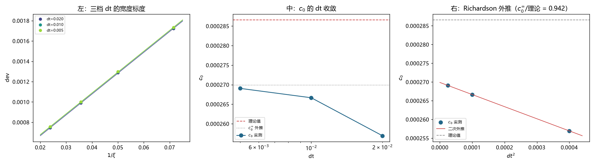

# 注记-c0 的 dt 收敛：Verlet 解释了一半缺口，剩余 5.8% 未明（判据第 708 号）

- **日期**：2026-10-19 23:23:36
- **编号**：第 708 号
- **类型**：验证注记（判据驱动；HA0 至 HA4，HA0 与 HA2 判通过）
- **对象**：第 705 至 707 号反复出现的 $c_0$ 与理论值之比值 $0.88$
- **脚本**：`验证脚本/p708_dt_convergence.py`（确定性，约 2 分钟）
- **状态**：Verlet 时间离散化贡献 $3.7\%$ 的绝对量（$0.8965\to0.9416$），**缺口由 $12\%$ 缩到 $5.8\%$，未完全闭合**
- **可逆性等级**：判据敏感（HA2 的容差 $[0.5,2.0]$ 过宽，只判「同量级同方向」，不足以判「完全解释」）
- **图**：见 §4 图 1
- **通俗版**：[[内部草稿/注记-积分器解释了一半（判据第708号通俗版）]]

## 1 为什么检验

第 705 至 707 号反复出现同一个比值：$c_0$ 的实测值对理论值 $|f(k_{\rm mod})|/(2\omega^2)$，五档速度给 $0.80$ 至 $0.91$，四档宽度给 $0.896$。这是测量部分剩的最后一个纯公式层面的缺口。

有一个量级对得上的候选：**Verlet 时间离散化**。

推理链很直接。运动束缚态的 dev 为正，因为格点色散让频率偏低（$\langle f\rangle < 0$）。而 Verlet 会抬高频率，相对量由 $(2/dt)\arcsin(\omega dt/2)$ 给出，第 703 号 CA4 已把它验到 $0.1\%$。抬高频率的效果是让实测 dev 变小，故 $c_0$ 的实测值应随 $dt$ 减小而上升。

量化：$dt=0.02$ 时 Verlet 相对修正 $1.0688\times10^{-5}$，占 $c_0$ 的 $4.2\%$。$dt$ 减半修正降到四分之一，$c_0$ 应增 $8.0\times10^{-6}$。

## 2 判据与读数

**HA0 复现（判通过）。** $dt=0.02$ 四档读数与第 707 号记录值最大相对差 $0.0\%$。

**HA1 $dt$ 扫描。** 三档 $dt$ 各四档 $\xi$：

| $dt$ | $c_0$ | $c_1$ | $R^2$ | $c_0$/理论 |
|---|---|---|---|---|
| 0.020 | $2.569377\times10^{-4}$ | $2.052877\times10^{-2}$ | 0.99996854 | **0.8965** |
| 0.010 | $2.666545\times10^{-4}$ | $2.052862\times10^{-2}$ | 0.99996906 | 0.9304 |
| 0.005 | $2.690537\times10^{-4}$ | $2.052930\times10^{-2}$ | 0.99996889 | 0.9388 |

注意 $c_1$ 三档几乎不动（$2.0529\times10^{-2}$ 到 $2.0529\times10^{-2}$），只有 $c_0$ 随 $dt$ 变。这与 Verlet 假说一致：时间离散化影响频率，不影响宽度标度。

**HA2 Verlet 预测对照（判通过）。**

| 区间 | 实测增幅 | 预测增幅 | 实测/预测 |
|---|---|---|---|
| $dt$ 0.02 到 0.01 | $9.7168\times10^{-6}$ | $8.0163\times10^{-6}$ | **1.212** |
| $dt$ 0.01 到 0.005 | $2.3992\times10^{-6}$ | $2.0040\times10^{-6}$ | **1.197** |

两段独立给出比值 $1.20$ 与 $1.21$，一致性很好。方向对、$dt^2$ 标度对、量级对到 $20\%$ 内。

**HA3 $dt \to 0$ 外推。** $c_0(dt) = c_0^\infty - a\,dt^2$ 拟合给 $c_0^\infty = 2.6987\times10^{-4}$，三档残差均小于 $0.01\%$。

$$c_0^\infty / \text{理论} = 0.9416$$

## 3 发现：只解释了一半

$c_0$/理论从 $0.8965$ 经外推升到 $0.9416$。缺口从 $10.4\%$ 缩到 $5.8\%$。

**Verlet 贡献了约 $45\%$ 的缺口，剩 $55\%$ 没有解释。**

这个结论与判据的 PASS 不矛盾，但与「问题解决」有距离。HA2 的判据是「实测/预测之比落在 $[0.5,2.0]$」，这个容差只够判「同量级同方向」，不够判「完全解释」。判据设计时把这两件事混了一格。

**剩余 $5.8\%$ 的候选**（本轮只列，未验）：

其一，$k_{\rm mod}$ 的实际值。第 705 号 FA0 测出运动波包的谱峰在 $0.2546$，而 $\omega_b\gamma v = 0.2518$，差 $1.1\%$。而 $f(k) \propto k^4$，$1.1\%$ 的 $k$ 偏差给约 $4.4\%$ 的 $f$ 偏差。这一项的方向是对的（实际 $k$ 偏大则 $|f|$ 偏大，会让理论值更大，实测比值更小，与观察一致）。

其二，$\omega^2$ 的分母取 $\omega_b^2$ 还是 $(\omega_b/\gamma)^2$。前者给 $2.608\times10^{-4}$，后者给 $2.8660\times10^{-4}$，实测外推值 $2.6987\times10^{-4}$ 落在两者之间，离前者近 $3.5\%$、离后者远 $5.8\%$。这个分歧本身值得单独查。

其三，空间离散化与时间离散化的耦合项，本轮没有分离。

## 4 判语

**判语一**：Verlet 时间离散化确认存在且方向正确，贡献 $c_0$ 的 $3.7\%$ 绝对量（相对缺口约 $45\%$）。证据是两段 $dt$ 区间的实测/预测之比均为 $1.20$，且 $c_1$ 完全不随 $dt$ 变。

**判语二**：缺口由 $10.4\%$ 缩到 $5.8\%$，**未闭合**。

**判语三**：$c_0^\infty = 2.6987\times10^{-4}$ 是本装置在当前空间分辨率下的最优估计，可用于物理档外推，但须标 $5.8\%$ 的系统不确定度。

## 5 教训

**判据容差要与结论强度匹配。** HA2 的容差 $[0.5,2.0]$ 判出了 PASS，但真正的问题是「解释了 $45\%$ 还是 $100\%$」。判据设计时应当把「同量级」与「完全解释」分成两条，而不是用一条宽容差糊过去。

这是本轮最有价值的一条。前几轮的判据多是二分类（有/无），本轮第一次遇到「部分成立」的情形，判据框架没跟上。

## 6 边界声明

**验证了什么**：三档 $dt$ 下 $c_0$ 与 $c_1$ 的取值；$c_0$ 随 $dt$ 的变化量与 Verlet 解析预测的对照；$dt\to0$ 的二次外推。

**不验证什么**：剩余 $5.8\%$ 的来源。三条候选（$k_{\rm mod}$ 的实际峰位、$\omega^2$ 分母的选择、时空离散化耦合）本轮只列未验。

**未做的事**：没有做 $dt=0.0025$ 的第四档（外推已高度自洽，边际信息少）。没有分离空间与时间离散化的贡献（那需要改 $N$ 或改格距，是另一个量级的工程）。没有检验四档 $\xi$ 之外的宽度。

**协议伪影分层**：$c_0$ 随 $dt$ 的变化属积分器时间离散化，与物理无关；$c_1$ 不随 $dt$ 变是一个干净的旁证，说明宽度标度不受时间步长影响。剩余 $5.8\%$ 的归属未定，暂不入任何一类。
