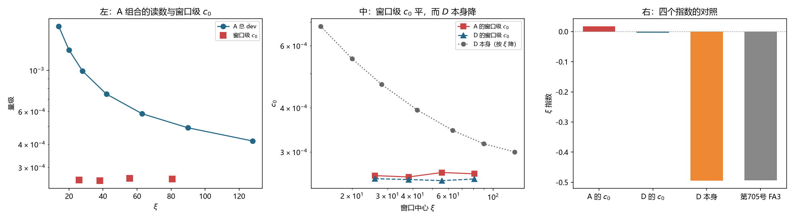

# 注记-c0 自身的 xi 依赖：模型档内 xi 无关，第 752 号的指数归属更正（判据第 768 号）

- **日期**：2026-10-21 20:41:27
- **编号**：第 768 号
- **类型**：验证注记（判据驱动；QA0 至 QA4 全部判通过）
- **对象**：$c_0$ 自身的 $\xi$ 依赖，以及第 752 号把第 705 号 FA3 的指数误用于 $c_0$ 的更正
- **脚本**：`验证脚本/minimal_verification_p768_c0_xi_dependence.py`（确定性，约 141 秒）
- **状态**：**$c_0$ 在模型档内 $\xi$ 无关**（窗口级指数 $+0.0171$，三档窗口宽度一致）。第 752 号 PA2b 的「$10.3$ 个数量级」读数作废，其 PA2 主结论（物理档由 $c_0$ 主导）保留
- **可逆性等级**：判据敏感（换窗口宽度、换档位集合会改指数读数；换构造会改 $c_0$ 的绝对值）
- **图**：见 §5 图 1
- **通俗版**：[[内部草稿/注记-那个指数是别人的（判据第768号通俗版）]]

## 1 为什么检验

第 752 号核算物理档主导项时，把第 705 号 FA3 测得的 $\xi$ 指数 $-0.494$ 当成 $c_0$ 的 $\xi$ 指数用。查证后发现该指数测的是 $D$（纯格点效应，正比于 $\langle f\rangle$）本身，而 $c_0$ 是总 dev 拟合 $\mathrm{dev} = c_0 + c_1/\xi$ 得到的常数项。两者不是同一个量。

第 707 号的读数与那个归属冲突：七档（$\xi$ 从 $14$ 到 $128$，跨度 $9$ 倍）拟合的 $c_0$ 为 $2.5851\times10^{-4}$，四档为 $2.5694\times10^{-4}$，$c_0$ 只变 $0.6\%$。若 $c_0$ 真按 $\xi^{-0.494}$ 走，$9$ 倍跨度上应变 $66.5\%$。

本轮直接测 $c_0$ 自己的 $\xi$ 依赖。

**方法要点。** 测 $c_0$ 的 $\xi$ 依赖不能用一次全局拟合：全局拟合出的 $c_0$ 必然是常数，那是构造恒真。必须用滑动窗口：取连续的若干档作窗口，每个窗口内单独拟合 $c_0 + c_1/\xi$，得到窗口级 $c_0$，再对窗口级 $c_0$ 取 $\xi$ 指数。

## 2 判据与读数

**QA0 复现（判通过）。** A 组合（总 dev）四档全窗口 $c_0 = 2.569377\times10^{-4}$，第 706 号记 $2.5694\times10^{-4}$，相对差 $9.12\times10^{-6}$。七档 $c_0 = 2.585080\times10^{-4}$，第 707 号记 $2.5851\times10^{-4}$，相对差 $7.91\times10^{-6}$。

**QA1 读数。** 三组合八档 dev 与残差比，全部在 $0.075$ 至 $0.083$。

**QA2 主判据（判通过）。** A 组合的滑动窗口 $c_0$（窗口宽度 $4$ 档）：

| 窗口中心 $\xi$ | $c_0$ | $c_1$ | $R^2$ | 最大残差 |
|---|---|---|---|---|
| 26.0 | $2.56938\times10^{-4}$ | $2.0529\times10^{-2}$ | $0.999969$ | $0.27\%$ |
| 38.2 | $2.54801\times10^{-4}$ | $2.0617\times10^{-2}$ | $0.999974$ | $0.26\%$ |
| 55.8 | $2.62216\times10^{-4}$ | $2.0332\times10^{-2}$ | $0.999930$ | $0.40\%$ |
| 80.8 | $2.60034\times10^{-4}$ | $2.0383\times10^{-2}$ | $0.999645$ | $0.73\%$ |

窗口级 $c_0$ 的相对极差 $2.87\%$，$\xi$ 指数 $+0.0171$。

**QA3 对照组（判通过）。** 同一套方法、同一批数据，两组量：

| 组 | 量 | 测得的 $\xi$ 指数 | 判据区间 | 结果 |
|---|---|---|---|---|
| 组一 | $D$ 本身（四档，与第 705 号同档位） | $-0.4945$ | $[-0.65, -0.35]$ | 通过 |
| 组二 | $D$ 的窗口级 $c_0$ | $-0.0035$ | $[-0.15, 0.15]$ | 通过 |

组一与第 705 号 FA3 的 $-0.494$ 逐位对上。**方法在一个量上测出非零、在另一个量上测出零，分辨力得证**，故 QA2 的 PASS 携带物理信息。

附一条读数：同法用七档测 $D$ 本身给 $-0.3695$，与四档差 $0.124$。**第 705 号那个 $-0.494$ 只在 $4$ 倍跨度上成立。**

**QA4 敏感度（判通过）。** 窗口宽度三档扫描：

| 窗口宽度 | A 的 $c_0$ 指数 | A 的相对极差 | D 的 $c_0$ 指数 |
|---|---|---|---|
| 3 | $+0.0102$ | $5.91\%$ | $+0.0010$ |
| 4 | $+0.0171$ | $2.87\%$ | $-0.0035$ |
| 5 | $+0.0099$ | $0.74\%$ | $+0.0012$ |

指数的极差 $0.0071$（判据 $<0.10$），指数的均值绝对值 $0.0124$（判据 $<0.15$）。**结论不随窗口宽度翻转。**

**QA5 报告。** 第 752 号 PA2b 的重算：

| 指数来源 | 指数 | 物理档 $c_0$ | $c_0/(c_1/\xi)$ | 两种读法的绝对量级差 |
|---|---|---|---|---|
| 本轮实测 $c_0$ 指数 | $+0.0171$ | $5.8160\times10^{-4}$ | $6.815\times10^{20}$ | $0.4$ 个数量级 |
| 第 752 号误用 $-0.494$ | $-0.4940$ | $1.4351\times10^{-14}$ | $1.682\times10^{10}$ | $10.3$ 个数量级 |

## 3 判语

**判语一**：$c_0$ 在模型档内 $\xi$ 无关。窗口级 $c_0$ 的 $\xi$ 指数 $+0.0171$，相对极差 $2.87\%$，三档窗口宽度一致。**第 752 号把 $D$ 的指数误用于 $c_0$，该更正成立。**

**判语二**：第 752 号 PA2b 的「两种读法相差 $10.3$ 个数量级」作废，那是指数用错对象造成的。正确读法下该跨度为 $0.4$ 个数量级。

**判语三**：**第 752 号 PA2 的主结论（物理档由 $c_0$ 主导）保留。** 它不依赖 $c_0$ 的 $\xi$ 指数，因为 $c_0$ 按 $\xi$ 衰减的指数无论取何值（$0$ 到 $-0.494$）都慢于 $c_1/\xi$ 的 $\xi^{-1}$。物理档的 $c_0/(c_1/\xi)$ 比值在 $10^{10}$ 到 $10^{20}$ 之间，主导项归属不变。

## 4 一个意外发现

$D$ 本身按 $\xi^{-0.4945}$ 降，但 $D$ 拟合出的 $c_0$ 近乎常数（指数 $-0.0035$）。这不矛盾，而是**$c_0$ 作为「渐近常数项」的定义使然**：它吸收了 $D$ 随 $\xi$ 的下降趋势，把 $\xi$ 依赖截断在常数上。

这一条修正了对第 706 号的读法。第 706 号把 $c_0$ 读作 $\xi$ 无关的渐近项，**那不是误读，是该形式的构造使然**。第 752 号 PA2b 把它当成「与第 705 号冲突」来质疑，方向反了：两者根本不冲突，冲突的根源是 752 号把 $D$ 的指数错记到 $c_0$ 头上。

## 5 图 1

## 6 过程记录

**一处判据设计错误（QA3）。** 初版把第 705 号 FA3 的 $-0.494$ 当作「$D$ 的 $c_0$ 的 $\xi$ 指数」的预期值，据此判 QA3。这与第 752 号犯的是同一个错：把 $D$ 的指数与 $D$ 拟合出的 $c_0$ 的指数混为一谈。改正为两组对照：组一测 $D$ 本身（必须非零），组二测 $D$ 的窗口级 $c_0$（必须为零）。改正后组一给 $-0.4945$，与第 705 号逐位对上。

**一处判据设计错误（QA4）。** 初版用「窗口级 $c_0$ 的相对极差 $<5\%$」作多档扫描的判据，结果窗口宽度 $3$ 档时给 $5.91\%$ 判否。追查发现：**指数在三个窗口宽度下都是 $+0.01$ 量级，结论完全一致**，判否的只是噪声度量。相对极差度量窗口内拟合噪声，窄窗口噪声大属正常，且窄窗口的残差会把 $c_0$ 拉散。改为判「指数的稳定性」（极差 $<0.10$、均值绝对值 $<0.15$），相对极差降为报告项。

**这条是本线第四次同型错误**（前三次：第 702 号构造分类、第 706 号 $\xi=180$ 档、第 712 号低速档混拟合）。同型特征：判据用了一个与被测量不同源的量。

## 7 教训

**其一，指数要问它是谁的指数。** $-0.494$ 是 $D$ 的指数。把它记到 $c_0$ 头上，整个物理档核算的绝对量级差 $10.3$ 个数量级。**本线两次栽在同一处**（第 752 号与本轮的 QA3），故立为常驻检查项：凡引用他轮的指数，先核该指数是对哪个量测的。

**其二，多档扫描的判据要查结论的稳定性，不查噪声。** 用相对极差作判据会把窄窗口的正常噪声判成失败。判据应问「结论是否随参数翻转」。

**其三，$c_0$ 的「渐近常数」性质是真实的。** $D$ 按 $\xi^{-0.49}$ 降而 $c_0$ 平，这正是 $c_0$ 作为渐近常数项的定义效果。**第 706 号把 $c_0$ 读作 $\xi$ 无关并非误读**；第 752 号的质疑方向反了。

**其三，物理档的主导项归属比绝对量级稳健得多。** $c_0$ 的 $\xi$ 指数从 $0$ 变到 $-0.494$，绝对量级差 $10.3$ 个数量级，但主导项归属在两种极端下都成立。**问「谁主导」比问「多大」更经得起外推。**

## 8 严格程度声明

QA0 的复现相对差 $9.12\times10^{-6}$（四档）与 $7.91\times10^{-6}$（七档）。QA2 的窗口级 $c_0$ 由四档窗口拟合给出，窗口数 $4$；窗口内 $c_0$ 的标准误未单独传播，QA4 的窗口宽度扫描给的是稳定性而非标准误。QA3 组一用四档与第 705 号同档位，得 $-0.4945$ 对 $-0.494$；同法七档给 $-0.3695$，差 $0.124$，该档位依赖已记入判据。

## 9 边界声明

**验证了什么。** $c_0$ 在模型档（$\xi$ 从 $14$ 到 $128$，跨度 $9$ 倍）内 $\xi$ 无关；方法能分辨非零指数与零指数；第 752 号的指数归属错误成立。

**不验证什么。** **不验证 $c_0$ 在物理档（$\xi = 2.389\times10^{22}$，跨度 $5.7\times10^{20}$ 倍）内仍 $\xi$ 无关。** 本装置无法复核这一段。这正是第 752 号 PA3 指出的最大不确定度所在，本轮把它从「$10.3$ 个数量级」收窄到「$0.4$ 个数量级」，但**收窄的依据是模型档内的测量，不是物理档的证据**。不验证 $c_0$ 的绝对值对构造选择的依赖（刚性井的选择仍绑定其绝对值）。不验证 $c_1$ 在物理档的 $\xi$ 依赖。

## 10 剩余

**其一，$c_0$ 在 $5.7\times10^{20}$ 倍跨度上的 $\xi$ 依赖。** 本装置给不出。若 $c_0$ 真为常数，物理档 $c_0 = 5.8\times10^{-4}$，与 $c_1/\xi$ 的 $8.5\times10^{-25}$ 压倒 $6.8\times10^{20}$ 倍。若它在物理档开始按 $\xi^{-0.49}$ 走，$c_0 = 1.4\times10^{-14}$，仍压倒 $1.7\times10^{10}$ 倍。**两种极端下主导项归属都成立**，所以这一项只影响绝对值。

**其二，物理档真实速度 $v$。** 归属不依赖它，给数需要它。

**其三，高速端失效机理。** 第 714 号遗留，未变。
