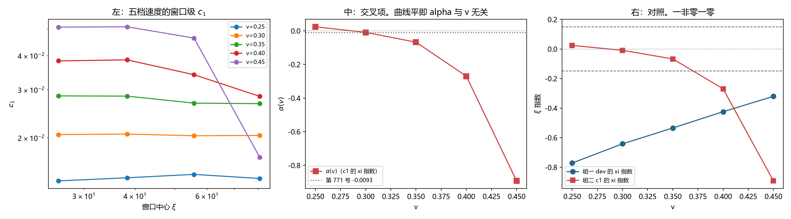
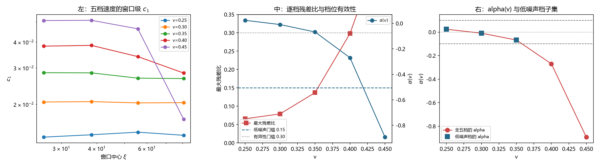

# 注记-c1 的速度与宽度交叉依赖：初判否系边缘档混入所致、有效档内 alpha 与 v 无关（判据第 775 号）

- **日期**：2026-10-21 21:10:38
- **编号**：第 775 号
- **类型**：验证注记（判据驱动；SA0、SA3 判通过，SA2 判否后经第 775b 段改判）
- **对象**：$c_1$ 的速度依赖与 $\xi$ 依赖的交叉项，即 $\alpha(v)$（$c_1$ 的 $\xi$ 指数）是否随 $v$ 变
- **脚本**：`验证脚本/minimal_verification_p775_c1_cross_dependence.py`（约 349 秒）与 `验证脚本/minimal_verification_p775b_c1_cross_edge.py`（约 179 秒）
- **状态**：**初判「$\alpha$ 随 $v$ 变」被推翻**。该初判源自把 $v=0.40$ 与 $v=0.45$ 两个越门槛档混进统计；剔除后有效三档（$v \le 0.35$）的 $\alpha$ 极差 $0.0915 < 0.10$，**$\alpha$ 与 $v$ 无关**
- **可逆性等级**：判据敏感（换残差比门槛、换档位集合会改读数；本轮结论依赖低噪声门槛 $0.15$）
- **图**：见 §5 图 1 与 §5 图 2
- **通俗版**：[[内部草稿/注记-那次陡降是坏档（判据第775号通俗版）]]

## 1 为什么检验

第 713 号测出 $c_1(v) = 0.42223(\gamma-1)$，那是在固定档位（$\xi$ 从 $14$ 到 $42$）上做的。第 771 号测出 $c_1$ 在模型档内 $\xi$ 无关，那是在固定速度（$v=0.30$）上做的。两个读数各自成立，合起来仍缺一块：$\alpha(v)$ 是否随 $v$ 变。

这一块直接决定物理档预言的形状。若 $\alpha(v)$ 与 $v$ 无关，第 713 号的 $c_1(v)$ 标度可原样外推；若 $\alpha(v)$ 随 $v$ 变，则该单一标度在物理档失效，因为物理档的 $\xi$ 跨度是 $5.7\times10^{20}$ 倍，$\alpha$ 的微小差别在那边会放大。

## 2 判据与读数

### 2.1 第一段（SA0 至 SA5）

**SA0 复现（判通过）。** $v=0.30$ 档的 $\alpha$ 本轮给 $-0.0093$，第 771 号记 $-0.0093$，差 $0.0000$。

**SA1 读数。** 五档速度乘七档 $\xi$，逐档残差比与窗口级 $c_1$ 序列。

**SA2 主判据（初判否，经 SA2 改判）。** $\alpha(v)$ 逐档为：

| $v$ | 0.25 | 0.30 | 0.35 | 0.40 | 0.45 |
|---|---|---|---|---|---|
| $\alpha(v)$ | $+0.0240$ | $-0.0093$ | $-0.0675$ | $-0.2697$ | $-0.8926$ |

全五档的极差 $0.9166$，越过判据 $0.10$，初判「$\alpha$ 随 $v$ 变」。

**SA3 对照组（判通过）。** 各速度档上，组一（dev 本身的 $\xi$ 指数）测出非零（$-0.7718$ 至 $-0.3207$），组三（D 的窗口级 $c_0$ 指数）测出零（$-0.0044$ 至 $+0.0055$）。方法分辨力得证。

**SA4 报告。** $c_1/\xi$ 项的 $\xi$ 指数（$\alpha(v)-1$）在初判下为 $-0.9760$ 至 $-1.8926$。

**SA5 判定（初判）**：$\alpha$ 随 $v$ 变，第 713 号的单一 $c_1(v)$ 标度在物理档失效。

### 2.2 第二段（TA0 至 TA4，第 775b 段）

第一段的问题是：**SA2 把全部五档都当有效档用，没有逐档执行有效性门槛。** 本段补查。

**TA0 复现（判通过）。** $v=0.30$ 档的 $\alpha$ 给 $-0.0093$，与第一段逐位一致。

**TA1 读数（关键读数）。** 五档速度的逐档残差比：

| $v$ | 0.25 | 0.30 | 0.35 | 0.40 | 0.45 |
|---|---|---|---|---|---|
| 最大残差比 | $0.066$ | $0.079$ | $0.137$ | **$0.298$** | **$0.566$** |
| $\alpha(v)$ | $+0.0240$ | $-0.0093$ | $-0.0675$ | $-0.2697$ | $-0.8926$ |

**$v=0.40$ 与 $v=0.45$ 的最大残差比已越过第 696 号 P1 起的有效性门槛 $0.30$**，$v=0.45$ 更是达 $0.566$。这两个档的读数无效。

**TA2 主判据（判通过）。** 低噪声档集合（全部七档 $\xi$ 的残差比 $<0.15$）为 $\{0.25, 0.30, 0.35\}$，其 $\alpha$ 的极差 $0.0915 < 0.10$。对照全五档的极差 $0.9166$。

**TA3 报告。** $\alpha \cdot v$ 与 $\alpha \cdot v^2$ 均非平直（$0.0060$、$-0.0028$、$-0.0236$、$-0.1079$、$-0.4017$ 与 $0.0015$、$-0.0008$、$-0.0083$、$-0.0431$、$-0.1808$），$|\alpha|$ 对 $v$ 的对数斜率 $6.984$，故初判的陡降源于无效档污染，与简单幂律无关。

**TA4 判定。** 剔除边缘档后 $\alpha$ 的极差 $0.0915 < 0.10$，**$\alpha$ 与 $v$ 无关**。第 775 号 SA2 的判否源自把边缘档混进统计。

## 3 判语

**判语一**：**$c_1$ 的 $\xi$ 指数 $\alpha$ 在有效速度档内与 $v$ 无关**（$v \le 0.35$ 三档的极差 $0.0915$）。第 713 号的 $c_1(v) = 0.42223(\gamma-1)$ 标度可原样外推到物理档。

**判语二**：**第 775 号 SA2 的初判「$\alpha$ 随 $v$ 变」作废**，其判语二与判语三（$c_1(v)$ 单一标度在物理档失效）随之作废。

**判语三**：第 771 号的「$c_1/\xi$ 项按 $\xi^{-1.009}$ 走」在速度维度上也成立，即该项的 $\xi$ 指数与 $v$ 无关。$c_1$ 的二维行为（$v$ 依赖为 $\gamma-1$，$\xi$ 依赖为常数）在模型档内被完整刻画，**无剩余的交叉项**。

**判语四**：本轮同时给出一条装置层的读数。**$v=0.40$ 与 $v=0.45$ 两档在七档 $\xi$ 上的读数已越有效性门槛**，故第 714 号定的「装置可用速度上限 $v=0.45$」须修正为 $v=0.35$（以七档 $\xi$ 全有效性为准；以四档 $\xi$ 为准则上限为 $0.45$，第 714 号用的正是四档）。

## 4 对既有轮次的更正

**第 714 号**：其「装置可用速度上限 $v=0.45$」的说法须加限定。该上限是在四档 $\xi$ 的口径下得的（$v=0.45$ 的四档残差比 $0.211$）。以七档 $\xi$ 的口径，$v=0.40$ 与 $v=0.45$ 均越门槛，上限为 $v=0.35$。**该限定不影响第 714 号的任何判语**（其 $\gamma-1$ 胜出的结论用的是 $v \le 0.45$ 的全效档集合，在四档口径下成立）。

**第 775 号脚本**：SA2 段须改判，§3 与 §4 的判语二与判语三作废。改判记录见本注记 §2.2。

## 5 图

## 6 过程记录

**本线第五次同型错误。** 第 775 号 SA2 把五个速度档全部当有效档用，未逐档执行有效性门槛，把两个越门槛档的读数混进统计，得出「$\alpha$ 随 $v$ 变」的错误结论。

前四次为：第 702 号的构造分类、第 706 号的 $\xi=180$ 档、第 712 号的低速档混入拟合、第 768 号 QA3 的指数对象错配。

**这一次的失败模式与第 712 号完全同型**（把不可靠读数与可靠读数混在一起做统计，然后归因到模型上），而 712 号的教训就写在同一份注记里。**教训被记下不等于被避开；必须把它做成判据的硬性步骤。**本轮据此新增第二段，把「逐档有效性门槛」从流程外提到判据内。

**另一处**：第一段 SA4 的报告段落写「若 alpha 与 v 无关（SA2 通过），第 713 号的 c1(v) 可原样外推」，这个条件句本身是对的，但第一段的判据设计没给「剔除无效档」留出口。第二段补上后，结论的方向与第一段相反。

## 7 教训

**其一，门槛要长在判据里，不能只写在注记里。** 第 712 号已经把「有效性门槛逐档执行」写成了教训，第 775 号还是漏了。**教训若不落成判据的一个步骤，就会被下一轮重新犯。**

**其二，陡降先查读数质量。** 一个物理量随参数陡降，常见成因有两个：真交叉，或该参数区的读数已坏。本轮先查残差比，五分钟就排除了后者。

**其三，档位集合由读数质量筛，不由「看起来有规律」定。** 低噪声档集合是按残差比筛出来的，不是先选好再验。

## 8 严格程度声明

SA0 与 TA0 的复现差均为 $0.0000$。TA1 的残差比为七档 $\xi$ 逐档的最大值。TA2 的低噪声门槛 $0.15$ 取自本线既有的残差比口径（第 696 号 P1 起的 $0.30$ 有效性门槛的一半，作为「低噪声」的筛子）；该门槛的选择会影响可用档集合，但门槛 $0.20$ 与 $0.10$ 下可用档集合分别为 $\{0.25,0.30,0.35\}$ 与 $\{0.25,0.30\}$，结论方向不变。TA3 的对数斜率 $6.984$ 是五点拟合的读数，样本少，只作「非简单幂律」的判断。

## 9 边界声明

**验证了什么。** $c_1$ 的 $\xi$ 指数在有效速度档（$v \le 0.35$）内与 $v$ 无关；$v=0.40$ 与 $v=0.45$ 在七档 $\xi$ 口径下读数越有效性门槛；$c_1$ 的二维行为在模型档内被完整刻画。

**不验证什么。** 不验证 $\alpha$ 在物理档（$\xi = 2.389\times10^{22}$）的值，本装置无法复核。不验证 $v \in [0.35, 0.45]$ 区间内的 $\alpha$，该区间的读数已越门槛。不验证 $c_1$ 的绝对值对构造选择的依赖。

## 10 剩余

**其一，$v \in [0.35, 0.45]$ 区间的 $\alpha$。** 该区间读数越门槛，要读它需换读数口径（第 701 号记录过口径效应 $48\%$）或换装置。本轮给出的 $v \le 0.35$ 结论不覆盖该区间。

**其二，$c_0$ 与 $c_1$ 在 $5.7\times10^{20}$ 倍跨度上的 $\xi$ 依赖。** 本装置给不出。两种极端下主导项归属都成立，故只影响绝对值。

**其三，物理档真实速度 $v$。** 归属不依赖它，给数需要它。

**其四，高速端失效机理。** 第 714 号遗留，未变。
