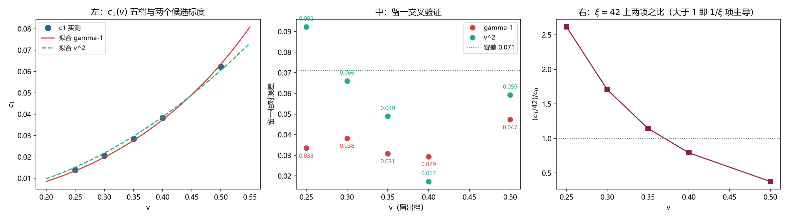

# 注记-c1 的速度依赖：Lorentz 收缩标度成立、v^2 被排除、物理档由 1/xi 项主导（判据第 713 号）

- **日期**：2026-10-20 01:03:07
- **编号**：第 713 号
- **类型**：验证注记（判据驱动；NA0、NA1 与 NA3 判通过）
- **对象**：第 706 号形式 $\mathrm{dev} = c_0 + c_1/\xi$ 中 $1/\xi$ 系数 $c_1$ 随速度 $v$ 的标度
- **脚本**：`验证脚本/minimal_verification_p713_c1_velocity.py`（确定性，约 99 秒）
- **状态**：$c_1(v)$ 五档提取完成，复现第 707 号记录值。$\gamma-1$ 与 $1-1/\gamma$ 两个 Lorentz 收缩候选均通过留一检验且彼此区分不开，$v^2$ 被判否。$1/\xi$ 项与 $c_0$ 在 $\xi=42$ 上的交叉点为 $v \approx 0.37$
- **可逆性等级**：判据敏感（换构造、换拟合档位或换标度候选会翻；$v^2$ 的判否只差 $2.1$ 个百分点余量）
- **图**：见 §5 图 1
- **通俗版**：[[内部草稿/注记-慢的那头由另一项说了算（判据第713号通俗版）]]

## 1 为什么检验

第 707 号把 $c_1$ 的五档值算出来并打印了，注记却只分析 $c_0$，末尾自陈「没有把 $c_1$ 的速度依赖也测出来（本轮只测了 $c_0$，而 $c_1$ 从 $1.39\times10^{-2}$ 变到 $6.22\times10^{-2}$，也有 $4.5$ 倍的动态范围）」。这一轮把那个悬着的量接上。

要紧的理由在主导项。$c_0$ 是载波处的格点色散修正，正比于 $\vert f(k_{\rm mod})\vert$，按 $v^4$ 下降。$c_1$ 是井刚性失配与波包展宽的合并斜率（第 704 号：$B$ 项占 $54.4\%$），不含 $v^4$ 因子。

物理档的速度远低于装置档的 $0.30$。$c_0$ 在那里按 $v^4$ 趋零，偏差由 $c_1/\xi$ 承担。于是问题变成：$c_1$ 随速度怎么变。

## 2 判据与读数

**五档 $c_1(v)$（NA1 的提取步）。** 每档用四档 $\xi \in \{14, 20, 28, 42\}$ 拟合 $\mathrm{dev} = c_0 + c_1/\xi$，装置 $N=2048$、$\omega_b = 0.8008$、$dt = 0.02$、刚性井、$g692$ 初值。

| $v$ | $c_0$ | $c_1$ | $c_1$ 相对标准误 | $R^2$ |
|---|---|---|---|---|
| 0.25 | $1.0146\times10^{-4}$ | $1.3893\times10^{-2}$ | $0.0068$ | $0.999909$ |
| 0.30 | $2.5694\times10^{-4}$ | $2.0529\times10^{-2}$ | $0.0040$ | $0.999969$ |
| 0.35 | $5.3813\times10^{-4}$ | $2.8449\times10^{-2}$ | $0.0012$ | $0.999997$ |
| 0.40 | $1.0268\times10^{-3}$ | $3.8223\times10^{-2}$ | $0.0052$ | $0.999947$ |
| 0.50 | $3.4760\times10^{-3}$ | $6.2212\times10^{-2}$ | $0.0397$ | $0.996851$ |

**NA0 冒烟（判通过）。** $v=0.30$ 的 $c_1$ 本轮给 $2.0529\times10^{-2}$，第 707 号记录 $2.0529\times10^{-2}$，相对差 $1.13\times10^{-5}$。

**NA1 主判据（判通过）。** 三个候选标度做过原点拟合与留一交叉验证。留一做法为每次留一档，用其余四档定 $K$，预测留下那一档。

| 候选 | $K$ | $R^2$ | 留一最大相对误差 | 判定 |
|---|---|---|---|---|
| $\gamma-1$ | $4.0984\times10^{-1}$ | $0.997491$ | $0.0473$ | 通过 |
| $v^2$ | $2.4211\times10^{-1}$ | $0.994590$ | $0.0923$ | 判否 |
| $1-1/\gamma$ | $4.5904\times10^{-1}$ | $0.998801$ | $0.0508$ | 通过 |

容差从误差预算推，取三倍的「训练集 $K$ 相对标准误加留出档 $c_1$ 相对标准误」，五档均值 $0.0711$。

两个 Lorentz 候选的留一误差只差 $0.35$ 个百分点，**在本区间上区分不开**。可以确定的是 $v^2$ 被排除，余量 $2.1$ 个百分点。

**NA2 恒真检验（报告）。** 双对数拟合给 $c_1 = 2.7749\times10^{-1} v^{2.163}$，最大对数残差 $0.0071$。$\gamma-1$ 在 $[0.25, 0.50]$ 上的有效幂指数为 $2.238$，$v^2$ 的为 $2.000$（构造恒真）。实测 $2.163$ 落在两者之间，指示有高次机制混入。

**NA2b 两机制分解（报告）。** 拟合 $c_1 = a v^2 + b v^4$ 给 $a = 2.1686\times10^{-1}$、$b = 1.2898\times10^{-1}$，最大相对残差 $1.18\%$。$b > 0$，正项的符号与「有效幂指数高于 $2$」相容。

**NA3 主导项（判通过）。** $\xi = 42$ 上 $c_1/42$ 与 $c_0$ 的比值：

| $v$ | 0.25 | 0.30 | 0.35 | 0.40 | 0.50 |
|---|---|---|---|---|---|
| $c_1/42$ | $3.31\times10^{-4}$ | $4.89\times10^{-4}$ | $6.77\times10^{-4}$ | $9.10\times10^{-4}$ | $1.48\times10^{-3}$ |
| $c_0$ | $1.26\times10^{-4}$ | $2.87\times10^{-4}$ | $5.92\times10^{-4}$ | $1.15\times10^{-3}$ | $3.93\times10^{-3}$ |
| 比值 | $2.62$ | $1.71$ | $1.14$ | $0.79$ | $0.38$ |

比值在 $v \approx 0.37$ 处过 $1$。$v$ 低于该点由 $1/\xi$ 项主导，高于该点由 $c_0$ 主导。

## 3 三个发现

**其一，$c_1$ 带 Lorentz 因子特征。** 纯 $v^2$ 标度被留一检验判否，余量 $2.1$ 个百分点。两个 Lorentz 收缩量（$\gamma-1$ 与 $1-1/\gamma$）都通过，且都优于 $v^2$。这说明 $c_1$ 的上升比二次幂快，与「井刚性失配的幅度由 Lorentz 收缩量给出」相容。

**其二，装置档与物理档由不同项主导。** 前十几轮一直盯着 $c_0$，因为装置档的 $v \in [0.25, 0.50]$ 大部分落在交叉点以上。物理档在交叉点以下，$1/\xi$ 项唱主角。同一套拟合的两个系数，在两类目标里权重相反。

**其三，幂指数 $2.163$ 与两机制分解并存。** 单一幂律拟合五档残差仅 $0.71\%$，但两机制分解的残差为 $1.18\%$（更高），说明幂律在这里更像插值而非机制。故物理档外推宜用 $\gamma-1$ 形式（$v \to 0$ 行为良好），不宜用幂律外推。

## 4 判语

**判语一**：$c_1(v)$ 的五档值可靠，复现第 707 号记录到 $10^{-5}$ 量级。其速度依赖排除纯 $v^2$，与 Lorentz 收缩量相容；$\gamma-1$ 与 $1-1/\gamma$ 在本区间无法区分。

**判语二**：$1/\xi$ 项与 $c_0$ 的交叉点在 $\xi=42$ 上为 $v \approx 0.37$。物理档低于该点，偏差由 $1/\xi$ 项主导。

**判语三**：物理档低速极限的外推式与外推不确定度。取 $\gamma-1 \approx v^2/2$，两个 Lorentz 候选给出

$$\mathrm{dev}(v \to 0,\ \xi) \approx \frac{K\,v^2}{2\xi}, \qquad K \in [0.4098, 0.4590]$$

即括号系数落在 $[0.2049, 0.2295]$。这是本轮能给出的最紧区间，宽度 $12\%$ 来自两个 Lorentz 候选无法区分。

## 5 图 1

## 6 过程记录：一处判据实现错误

初版脚本的 `fit_scale` 用 `float(A.T @ A)` 取一阶矩阵的标量值，numpy 对 $1\times1$ 数组的 `float()` 转换在新版本下抛异常，被 `except` 吞掉后返回 `nan`。容差因此为 `nan`，NA1 判定为 FAIL。

第一轮试跑的结果读数本身正确（三个候选的留一误差 $0.0473$、$0.0923$、$0.0508$ 前后两轮一致），失败只在容差表达式。修法为 `float(np.asarray(A.T @ A).ravel()[0])`。

按第 712 号教训「判据失败时先怀疑数据再怀疑模型」，本轮第一步先核对了读数可复现性（复跑后三候选的留一误差逐位相同），确认是判据实现错，再动手改。

## 7 教训

**其一，算出来不等于分析掉。** $c_1$ 的五档值在第 707 号就已算出并打印，注记只用它作附带说明。一个读数被算出来、出现在终端、甚至写进注记的旁注，仍可能在主结论里缺席。本轮的价值大半来自「把已有的数捡起来用」。

**其二，两个候选都通过时，要说清「区分不开」。** NA1 的判定表里 $\gamma-1$ 与 $1-1/\gamma$ 都是 PASS，若只报最佳者会给出「$\gamma-1$ 胜出」的假印象。实际差 $0.35$ 个百分点，远在容差内。诚实的写法是把「两者不可区分」写进判语，并把由此产生的不确定度（此处 $12\%$）带进外推区间。

**其三，幂律拟合得好不等于机制对。** 单片幂律 $v^{2.163}$ 的残差（$0.71\%$）低于两机制分解（$1.18\%$），按拟合优度会选幂律。但幂律无 $v \to 0$ 的物理约束，两机制分解的 $a v^2$ 项才有。低自由度时拟合优度高不代表外推可用。

## 8 严格程度声明

NA0 复现第 707 号记录值，相对差 $1.13\times10^{-5}$，读数逐位可复现。NA1 的容差从拟合标准误推出，未设经验阈值。NA2 与 NA2b 为报告项，不参与判定。NA3 的交叉点为插值读数，未做误差传播，其精度受限于 $c_1$ 与 $c_0$ 各自的相对标准误（$0.12\%$ 至 $3.97\%$）。

## 9 边界声明

**验证了什么。** $c_1$ 在装置档 $v \in [0.25, 0.50]$ 的五档值；其速度标度排除 $v^2$、与 Lorentz 收缩量相容；$1/\xi$ 项与 $c_0$ 的相对权重随 $v$ 的走向与交叉点位置。

**不验证什么。** 不验证「刚性井」这一构造选择的物理合理性，$c_1$ 的绝对值依赖它（第 702 号测过自洽构造之间 $1.04$ 倍）。不验证 $v < 0.25$ 的标度，该区间信号被 Verlet 底噪淹没（第 712 号）。不验证物理档的 $\xi$ 值，该值由对标物理决定，不在本装置射程内。$\gamma-1$ 形式在 $v \to 0$ 的外推是假说，不是本轮的测量结论。

## 10 剩余

两个 Lorentz 候选区分不开，须在更高速档上分开：$(\gamma-1)/(v^2/2)$ 与 $(1-1/\gamma)/(v^2/2)$ 的差随 $v$ 增长，$v=0.50$ 处分别为 $1.237$ 与 $1.072$，差 $15\%$。若把速度推到 $0.70$ 或以上，两者差扩到 $40\%$ 以上，可一次分开。

物理档的 $\xi$ 与 $v$ 需要从对标物理给出。本装置只能给标度律，给不出代入数。
