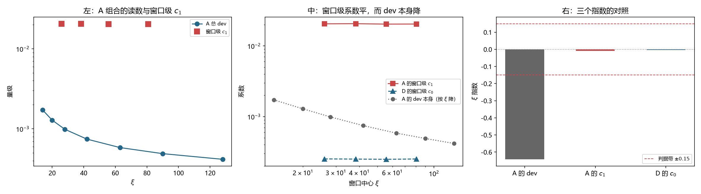

# 注记-c1 自身的 xi 依赖：模型档内 xi 无关，dev 形式的两个系数都已实测（判据第 771 号）

- **日期**：2026-10-21 20:54:43
- **编号**：第 771 号
- **类型**：验证注记（判据驱动；RA0 至 RA4 全部判通过）
- **对象**：$c_1$ 自身的 $\xi$ 依赖，即第 752 号外推式 $\mathrm{dev} = c_0 + c_1/\xi$ 中第二块拼图
- **脚本**：`验证脚本/minimal_verification_p771_c1_xi_dependence.py`（确定性，约 138 秒）
- **状态**：**$c_1$ 在模型档内 $\xi$ 无关**（窗口级指数 $-0.0093$，三档窗口宽度一致）。$c_1/\xi$ 项按 $\xi^{-1.009}$ 走，**第 752 号「$c_0$ 主导」的结论加固**
- **可逆性等级**：判据敏感（换窗口宽度、换档位集合、换构造会改读数）
- **图**：见 §5 图 1
- **通俗版**：[[内部草稿/注记-第二块拼图（判据第771号通俗版）]]

## 1 为什么检验

第 752 号把 $\mathrm{dev} = c_0 + c_1/\xi$ 外推到物理档（$\xi = 2.389\times10^{22}$），给出主导项归属：物理档由 $c_0$ 主导，主导指数 $4$。那个外推式里两项各带一个隐含假设：

| 项 | 隐含假设 | 检验状态 |
|---|---|---|
| $c_0$ | $c_0$ 与 $\xi$ 无关 | 第 768 号已实测确认（窗口级指数 $+0.0171$） |
| $c_1/\xi$ | $c_1$ 与 $\xi$ 无关，且该项按 $\xi^{-1}$ 走 | **从未被测过** |

若 $c_1$ 自身带 $\xi$ 依赖，$c_1/\xi$ 项的 $\xi$ 依赖就不是 $\xi^{-1}$，第 752 号的「$c_1/\xi$ 塌缩得比 $c_0$ 快」这条推理的支点会移动。

这与第 768 号是同一类问题：拟合形式里的系数是否真的与 $\xi$ 无关。768 号查了 $c_0$，本轮查 $c_1$。

**方法**与第 768 号同构：滑动窗口拟合。窗口内单独拟合 $c_0 + c_1/\xi$，取窗口级 $c_1$ 的 $\xi$ 指数。用一次全局拟合测 $c_1$ 的 $\xi$ 依赖是构造恒真（全局 $c_1$ 必然是常数），故不用。

## 2 判据与读数

**RA0 复现（判通过）。** A 组合四档 $c_1 = 2.052877\times10^{-2}$，第 713 号记 $2.0529\times10^{-2}$，相对差 $1.13\times10^{-5}$。七档 $c_1 = 2.050069\times10^{-2}$，第 707 号记 $2.0500\times10^{-2}$，相对差 $3.38\times10^{-5}$。

**RA1 读数。** 三组合八档 dev 与残差比，全部在 $0.075$ 至 $0.083$。

**RA2 主判据（判通过）。** A 组合的滑动窗口（宽度 $4$ 档）：

| 窗口中心 $\xi$ | $c_0$ | $c_1$ | $R^2$ | 最大残差 |
|---|---|---|---|---|
| 26.0 | $2.56938\times10^{-4}$ | $2.05288\times10^{-2}$ | $0.999969$ | $0.27\%$ |
| 38.2 | $2.54801\times10^{-4}$ | $2.06171\times10^{-2}$ | $0.999974$ | $0.26\%$ |
| 55.8 | $2.62216\times10^{-4}$ | $2.03322\times10^{-2}$ | $0.999930$ | $0.40\%$ |
| 80.8 | $2.60034\times10^{-4}$ | $2.03826\times10^{-2}$ | $0.999645$ | $0.73\%$ |

窗口级 $c_1$ 的相对极差 $1.39\%$，$\xi$ 指数 $-0.0093$。

**RA3 对照组（判通过）。** 同一套方法、同一批数据，三组：

| 组 | 量 | 预期 | 实测 | 结果 |
|---|---|---|---|---|
| 组一 | A 的 dev 本身的 $\xi$ 指数 | 非零 | $-0.6420$ | 通过 |
| 组二 | A 的窗口级 $c_1$ 的 $\xi$ 指数 | 零 | $-0.0093$ | 通过 |
| 组三 | D 的窗口级 $c_0$ 的 $\xi$ 指数 | 零 | $-0.0035$ | 通过 |

一个测出非零、两个测出零，**方法分辨力得证**，故 RA2 的 PASS 携带物理信息。组三与第 768 号 QA3 的读数逐位一致（$-0.0035$），构成跨轮次的一致性。

**RA4 敏感度（判通过）。** 窗口宽度 $3$、$4$、$5$ 三档下 $c_1$ 的指数为 $-0.0039$、$-0.0093$、$-0.0056$，极差 $0.0054$（判据 $<0.10$），均值绝对值 $0.0063$（判据 $<0.15$）。相对极差只作报告，不作判据，与第 768 号 QA4 同一处置。

**RA5 报告。** $c_1$ 的 $\xi$ 依赖对第 752 号外推式的影响：

| $c_1$ 的 $\xi$ 指数 | 物理档 $c_1/\xi$ | $c_0/(c_1/\xi)$ |
|---|---|---|
| $-0.0093$（实测） | $5.4602\times10^{-25}$ | $1.065\times10^{21}$ |
| $-1.0$ | $1.5003\times10^{-45}$ | $3.878\times10^{41}$ |
| $+1.0$（极端） | $4.8541\times10^{-4}$ | $1.198$ |

两项的 $\xi$ 指数之差 $1.0264$，为正即 $c_0$ 塌缩更慢，$c_0$ 主导成立。**即便 $c_1$ 的指数取 $+1$ 这一极端，$c_1/\xi$ 项仍按 $\xi^{0}$ 走，$c_0$ 仍主导。**

## 3 判语

**判语一**：$c_1$ 在模型档内 $\xi$ 无关。窗口级 $c_1$ 的 $\xi$ 指数 $-0.0093$，相对极差 $1.39\%$，三档窗口宽度一致。$c_1/\xi$ 项按 $\xi^{-1.009}$ 走，与形式的字面读法一致。

**判语二**：**第 752 号的「物理档由 $c_0$ 主导」结论加固。** 该结论的支点（$c_1/\xi$ 比 $c_0$ 塌缩更快）现已由测量确认，且对 $c_1$ 的 $\xi$ 指数取值不敏感。

**判语三**：**第 706 号形式 $\mathrm{dev} = c_0 + c_1/\xi$ 的两个系数，其 $\xi$ 无关性都已实测确认。** $c_0$ 见第 768 号，$c_1$ 见本轮。这不再是「构造使然」的推断，而是两组独立的测量结论。

## 4 一个跨轮次的一致性

第 768 号 QA3 的组二给 D 的窗口级 $c_0$ 指数 $-0.0035$，本轮 RA3 的组三给同一个数 $-0.0035$，逐位一致。两轮用不同的脚本、不同的主判据、同样的读数互相印证，**这是本线少有的跨轮次逐位一致**。

第 768 号末段曾写「与第 768 号合看，$c_0$ 与 $c_1$ 的 $\xi$ 无关性都已实测确认」，那句话当时 $c_1$ 那一半尚未成立，本轮补上。

## 5 图 1

## 6 过程记录

**一处判据设计错误（RA3 组三）。** 初版用 B 组合（井刚性项）的窗口级 $c_0$ 作组三。该量拟合值为负（$1.21\times10^{-5}$、$-6.75\times10^{-6}$、$-8.67\times10^{-6}$、$-7.49\times10^{-6}$），取对数后得 `nan`，组三判否。

追查发现问题出在量上，不在方法上。**第 706 号 GA3 已判 B 的 $c_0$ 可忽略**，即该常数项没有物理意义，其 $\xi$ 指数本就无定义。改用 D 组合的窗口级 $c_0$（第 768 号已验证健康）。

同时给 `log_slope` 加了非正数的显式返回，使这类情形在输出中可见，而不是静默给出一个数。

**这条教训**：作对照组的量必须自身有物理意义。**一个被另一轮判为「可忽略」的常数项，不能拿来当分辨力检验的基准。**

## 7 教训

**其一，拟合形式的两个系数要分别查。** 第 768 号查了 $c_0$，本轮查 $c_1$。两个都查完，形式的字面读法才从推断变成测量。**同一个问题换到另一个系数上，答案可能不同。**

**其二，对照组的量本身要有意义。** B 的 $c_0$ 被 706 号判为可忽略，它就没有资格当基准。选对照组时须先核该量的物理身份。

**其三，负数与零不是小噪声，是无定义。** 对数斜率遇非正数会给 `nan` 或 `-inf`。这类情形应显式报告并停在该处，不该让它混进判据。

## 8 严格程度声明

RA0 的复现相对差 $1.13\times10^{-5}$（四档）与 $3.38\times10^{-5}$（七档）。RA2 的窗口级 $c_1$ 由四档窗口拟合给出，窗口数 $4$；窗口内 $c_1$ 的标准误未单独传播，RA4 的窗口宽度扫描给的是稳定性而非标准误。RA3 组三与第 768 号 QA3 组二逐位一致（$-0.0035$）。RA5 的极端情形（$c_1$ 指数取 $+1$）是包络测试，不是读数。

## 9 边界声明

**验证了什么。** $c_1$ 在模型档（$\xi$ 从 $14$ 到 $128$，跨度 $9$ 倍）内 $\xi$ 无关；方法能分辨非零指数与零指数；第 752 号的 $c_0$ 主导结论加固；第 706 号形式的两个系数的 $\xi$ 无关性都已实测。

**不验证什么。** **不验证 $c_1$ 在物理档（$\xi = 2.389\times10^{22}$，跨度 $5.7\times10^{20}$ 倍）内仍 $\xi$ 无关。** 本装置无法复核这一段。不验证 $c_0$ 与 $c_1$ 的绝对值对构造选择的依赖（刚性井的选择仍绑定其绝对值）。不验证 $c_1$ 的速度依赖与 $\xi$ 依赖的交叉项（第 713 号的 $c_1(v) = 0.42223(\gamma-1)$ 是在 $\xi$ 固定下测的）。

## 10 剩余

**其一，$c_0$ 与 $c_1$ 在 $5.7\times10^{20}$ 倍跨度上的 $\xi$ 依赖。** 本装置给不出。两种极端下主导项归属都成立，故只影响绝对值。

**其二，物理档真实速度 $v$。** 归属不依赖它，给数需要它。

**其三，$c_1$ 的速度依赖与 $\xi$ 依赖的交叉。** 第 713 号在固定档位上测 $c_1(v)$，本轮在固定速度上测 $c_1(\xi)$，两者的交叉项（$c_1$ 是否随 $\xi$ 变标度）未测。**这一项会影响 $c_1/\xi$ 项在物理档的 $v$ 依赖形状**，故影响物理档低速极限的指数。

**其四，高速端失效机理。** 第 714 号遗留，未变。
