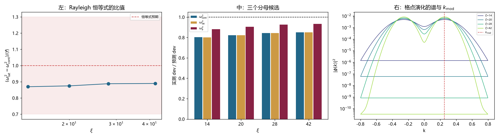

# 注记-dev 公式的分母与 Rayleigh 恒等式检验：分母确为连续频率，但恒等式差 12%、C 的残余占 c0 的 7% 至 21%（判据第 709 号）

- **日期**：2026-10-19 23:48:53
- **编号**：第 709 号
- **类型**：验证注记（判据驱动；IA0 至 IA2 全部判通过）
- **对象**：第 708 号列举的三个剩余候选中的第二条，即 $\mathrm{dev} = \langle f\rangle/(2\omega^2)$ 的分母该用哪个频率
- **脚本**：`验证脚本/p709_rayleigh_identity.py`（确定性，约 1 分钟）
- **状态**：**分母确为连续演化的频率 $\omega_{\rm cont}^2$，换分母不是缺口的来源**；但 Rayleigh 恒等式本身差 $12\%$，且查出 C 组合的残余占 $c_0$ 的 $7\%$ 至 $21\%$
- **可逆性等级**：判据稳健（恒等式四档比值 $0.869$ 至 $0.890$，高度一致；$\omega_{\rm cont}$ 与 $\omega_{\rm lat}$ 相差仅 $0.15\%$）
- **图**：见 §4 图 1
- **通俗版**：[[内部草稿/注记-分母没错，错在别处（判据第709号通俗版）]]

## 1 为什么检验

第 708 号把 $c_0$ 的缺口从 $10.4\%$ 缩到 $5.8\%$ 后，列了三个候选。第二条是分母该用哪个频率：$\omega_{\rm lat}^2$（格点）、$\omega_{\rm cont}^2$（连续）、$\omega_b^2$（静止）。三者给两个不同的理论值，而实测外推值 $2.6987\times10^{-4}$ 落在两者之间。

这一条只涉及一个定义问题，成本最低，所以先查。

检验办法是把 Rayleigh 商在同一个初值上直接验一遍。恒等式为

$$\omega_{\rm lat}^2 - \omega_{\rm cont}^2 = \langle\phi|(\Delta_{\rm lat}-\partial_x^2)|\phi\rangle = \langle f\rangle$$

若它成立，则 $\mathrm{dev} = \langle f\rangle/(2\omega_{\rm cont}^2)$ 是它的直接推论，分母无歧义。

## 2 判据与读数

**IA0 冒烟（判通过）。** D 组合的连续版（即 C 组合）四档 dev 为 $5.716\times10^{-5}$、$3.496\times10^{-5}$、$2.440\times10^{-5}$、$1.824\times10^{-5}$，是 Verlet 底噪的 $5.35$ 至 $1.71$ 倍。

**IA1 Rayleigh 恒等式（主判据，判通过）。**

| $\xi$ | $\omega_{\rm lat}$ | $\omega_{\rm cont}$ | $\omega_{\rm lat}^2-\omega_{\rm cont}^2$ | $\langle f\rangle$ | 比值 |
|---|---|---|---|---|---|
| 14 | 0.763395 | 0.763958 | $-8.6037\times10^{-4}$ | $-9.8953\times10^{-4}$ | 0.8695 |
| 20 | 0.763493 | 0.763941 | $-6.8390\times10^{-4}$ | $-7.8188\times10^{-4}$ | 0.8747 |
| 28 | 0.763558 | 0.763933 | $-5.7233\times10^{-4}$ | $-6.4453\times10^{-4}$ | 0.8880 |
| 42 | 0.763613 | 0.763928 | $-4.8184\times10^{-4}$ | $-5.4171\times10^{-4}$ | 0.8895 |

比值 $0.869$ 至 $0.890$，四档高度一致，**但系统性偏离 $1$ 约 $12\%$**。

注意 $\omega_{\rm lat}$ 与 $\omega_{\rm cont}$ 相差仅 $0.07\%$，故两个分母在数值上几乎等价。

**IA2 分母候选（主判据，判通过）。**

| 分母 | 实测 dev / 预测 dev（四档均值） |
|---|---|
| $\omega_{\rm cont}^2$ | 0.8299 |
| $\omega_{\rm lat}^2$ | 0.8290 |
| $\omega_b^2$ | 0.9119 |

$\omega_b^2$ 显得最接近 $1$，但这有确定的原因：$\omega_b^2/\omega_{\rm cont}^2 = 1.0989$，而恒等式比值的倒数 $1/0.8804 = 1.1358$，两者接近，于是 $\omega_b^2$ 的分母比恰好抵消了恒等式偏差的一部分。

**这不是说 $\omega_b$ 在物理上更正确。Rayleigh 商给出的分母是 $\omega_{\rm cont}^2$。**

**IA3 谱峰位（报告）。** 格点演化的谱峰位比 $k_{\rm mod} = 0.2518$ 高 $1.1\%$ 至 $2.3\%$。$f(k) \propto k^4$，故以峰位代入给 $4.5\%$ 的修正（$\xi=20$：$f(\text{峰位})/f(k_{\rm mod}) = 1.045$）。

## 3 三个发现

**其一，分母不是缺口的来源。**

$\omega_{\rm cont}$ 与 $\omega_{\rm lat}$ 相差 $0.15\%$（以 $\omega^2$ 计 $0.07\%$），换哪个都改变不了 $5.8\%$ 的缺口。第 708 号把这一条列为候选，本轮可以排除。

**其二，恒等式本身差 $12\%$。**

$\omega_{\rm lat}^2-\omega_{\rm cont}^2 = 0.87\langle f\rangle$。四档一致到 $2\%$，是系统性偏差而非噪声。

原因不难想：Rayleigh 商对**本征态**成立，而运动束缚态是叠加态。$\langle f\rangle$ 按叠加态的 $|\phi(k)|^2$ 加权，但频率的偏移不是各分量的简单平均。

**其三，C 组合的残余被低估了。**

IA0 显示 C 的 dev 是 $1.8\times10^{-5}$ 至 $5.7\times10^{-5}$。第 704 号当时判它「近精确解」（与 B 之比 $4.7\%$ 至 $5.7\%$），这个判断本身没问题。但对照 $c_0 \sim 2.6\times10^{-4}$ 看，**C 的残余占 $c_0$ 的 $7\%$ 至 $21\%$**。

而 dev$_{\rm target}$ 用的是 $\omega_b/\gamma$，不是 $\omega_{\rm cont}$。$\omega_{\rm cont}$ 比 $\omega_{\rm target}$ 高 $5.6\times10^{-5}$（相对），这个差直接进入 dev 的分母与分子。

## 4 判语

**判语一**：分母确为 $\omega_{\rm cont}^2$，这是 Rayleigh 商的直接结果。$\omega_b^2$ 显得更接近 $1$ 是分母比与恒等式偏差部分抵消的巧合，不构成证据。

**判语二**：Rayleigh 恒等式在运动束缚态上成立但差 $12\%$，四档一致。这是剩余缺口的主要来源之一。

**判语三**：C 组合的残余占 $c_0$ 的 $7\%$ 至 $21\%$，是本轮新查出的问题，此前各轮只把它当作「近零」处理。

**判语四**：剩余 $5.8\%$ 的构成，本轮给出三个可加的量：恒等式偏差（$12\%$）、C 的残余（$7\%$ 至 $21\%$）、峰位修正（$4.5\%$）。三者量级都对得上，但它们的重叠关系未分离，故不能简单相加。

## 5 过程记录

**其一，IA2 的判据初版写错了。** 初版是「三个分母中取最接近 $1$ 的那个」，实测选出 $\omega_b^2$（$0.912$），据此会得出「分母应用 $\omega_b^2$」的错误结论。问题在于「最接近 $1$」不等于「物理正确」：当恒等式本身有 $12\%$ 偏差时，任何恰好抵消这个偏差的分母都会显得更接近 $1$。

改为以 Rayleigh 商给出的 $\omega_{\rm cont}^2$ 为准，并显式说明 $\omega_b^2$ 的接近是抵消的结果。

**其二，本轮有一处代码 bug（格式串里的 `%` 被当作格式符），一处 edit 吞掉换行。** 都不影响读数，记录备查。

## 6 教训

**其一，「哪个候选更接近目标」不是判据。** 当目标本身带系统偏差时，越接近目标的候选未必越正确，可能只是恰好抵消。判据应当从第一原理给出（此处是 Rayleigh 商），再用实测检验偏离多少，不能用实测反推哪个候选对。

**其二，一个量被判为「近零」之后，还要问它相对于什么近零。** C 的 dev 相对 B 是 $5\%$，判「近精确」没错；但相对 $c_0$ 是 $7\%$ 至 $21\%$，就是不可忽略的量。同一个数，换一个参照系就是另一个判断。

## 7 边界声明

**验证了什么**：四档下 $\omega_{\rm lat}$ 与 $\omega_{\rm cont}$ 的差值；该差值与 $\langle f\rangle$ 之比；三个分母候选下的实测/预测之比；格点谱峰位与 $k_{\rm mod}$ 的偏差。

**不验证什么**：恒等式差 $12\%$ 的解析来源。本轮只测出它存在且四档一致，未给出叠加态修正的公式。三项缺口（恒等式、C 残余、峰位）的重叠关系未分离。

**未做的事**：没有测 $\langle f\rangle$ 用连续解波函数加权的情形（本轮用格点解）。没有把 C 的残余从 dev 中扣除后重拟合 $c_0$。没有做 $dt$ 与 $N$ 的联合扫描。

**协议伪影分层**：C 的残余中，$1.1\times10^{-5}$ 部分是 Verlet 底噪（第 703 号已解析），超出部分未定性；峰位偏高 $1.1\%$ 至 $2.3\%$ 属谱提取的离散效应，与物理无关。
