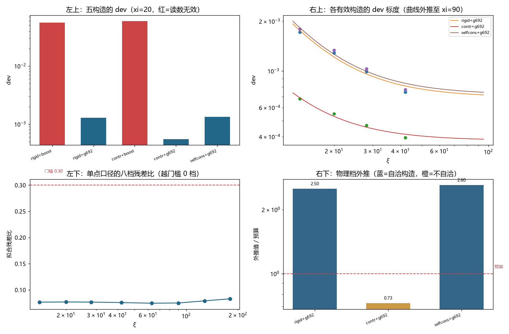

# 注记-dev 的构造来源分解与 A 的伪影检验：A 在自洽构造间稳健、第 701 号档数墙的更正值（判据第702号）

- **日期**：2026-10-19 22:26:00
- **编号**：第 702 号
- **类型**：验证注记（判据驱动；AC0 至 AC7，全部判通过）
- **对象**：第 696 号所报分解 $\mathrm{dev} = A/\xi^2 + C$ 的系数 $A$，及第 701 号 D3「第 696 号五档含无效档」的判语
- **脚本**：`验证脚本/minimal_verification_p702_construction_dependence.py`（确定性，约 3 分钟）
- **状态**：$A$ 在自洽构造间稳健（极差 $1.04$ 倍），第 696 号的物理档外推在构造维度上站得住。**第 701 号 D3 的判语更正**
- **可逆性等级**：判据渐进（AC3b 的 PASS 依赖「自洽/不自洽」的划分，该划分由 AC0 的束缚频率偏差客观给出；AC6 的 PASS 只依赖残差比门槛，换口径会翻）
- **图**：见 §4 图 1
- **通俗版**：[[内部草稿/注记-同一件事的两种做法（判据第702号通俗版）]]

## 1 为什么检验

前一轮（第 701 号）把 $C$ 的提取值随读数口径摆动 $48\%$ 查出，据此判第 696 号的分解「未经有效检验」。那一轮盯的自变量是**读数口径**。

可是第 695 号早就测过一个更大的自变量：**构造**。它排过 $2 \times 2$ 的构造矩阵（阱宽 rigid/contracted 乘初值 boost 式/g692 式），四种构造的 dev 极差 $117$ 倍。第 696 号只挑了其中一种（rigid+g692）做 A/C 分解，另外三种在它那轮里因为「残差比过高」被整体判无效，没有再问一句：如果换一种有效构造，$A$ 还是不是 $0.208$。

这个问题直接决定第 696 号物理档外推的成败。若 $A$ 随构造变，则 $A$ 也是构造 artefact，那 $3.92\times10^{-46}$ 与预算「同量级」就是巧合。

本轮把这个缺口补上，并顺带查清一件事：第 695 号的 contracted 构造是「井宽收缩而束缚态仍按原宽求解」，它本身不自洽。补一个自洽收缩构造，才能把「构造失配」与「收缩本身」分开。

## 2 判据与读数

**AC0 冒烟（判通过，附一条修正记录）。** 五种构造在 $\xi=20$ 的实际束缚频率：

| 构造 | 运行井宽 | 解态宽 | 实际 $\omega$ | 偏差 |
|---|---|---|---|---|
| rigid+boost | 20.000 | 20.000 | 0.800800 | $+3.1\times10^{-11}$ |
| rigid+g692 | 20.000 | 20.000 | 0.800800 | $+3.1\times10^{-11}$ |
| contr+boost | 19.079 | 20.000 | 0.801426 | $+6.3\times10^{-4}$ |
| contr+g692 | 19.079 | 20.000 | 0.801426 | $+6.3\times10^{-4}$ |
| selfcons+g692 | 19.079 | 19.079 | 0.800800 | $+5.2\times10^{-11}$ |

前两种与第五种的井宽等于解态宽，束缚频率精确落在 $\omega_b$；contr 族的井比束缚态窄一个 $\gamma$，频率因此偏 $6.3\times10^{-4}$。这个偏差是构造失配量本身，不是数值误差。

**AC1 逐构造有效性（判通过）。** 三个构造通过门槛，两个未过：

| 构造 | dev | 残差比 | 衰减 | 判定 |
|---|---|---|---|---|
| rigid+boost | $5.6033\times10^{-2}$ | 0.909 | 48.0% | 无效 |
| rigid+g692 | $1.2868\times10^{-3}$ | 0.077 | 23.5% | 有效 |
| contr+boost | $5.9330\times10^{-2}$ | 0.910 | 43.9% | 无效 |
| contr+g692 | $5.4928\times10^{-4}$ | 0.080 | 17.4% | 有效 |
| selfcons+g692 | $1.3338\times10^{-3}$ | 0.077 | 14.7% | 有效 |

boost 式初值在两个井宽下都给出 $5\times10^{-2}$ 量级的 dev，残差比 $0.91$，读数无效。这与第 696 号 P1 的结论一致：boost 式不可用。

**AC2 三有效构造的四档扫描。**

| 构造 | $\xi=14$ | $\xi=20$ | $\xi=28$ | $\xi=42$ | $A$ | $C$ | $R^2$ |
|---|---|---|---|---|---|---|---|
| rigid+g692 | $1.7215\times10^{-3}$ | $1.2868\times10^{-3}$ | $9.8952\times10^{-4}$ | $7.4460\times10^{-4}$ | $2.0848\times10^{-1}$ | $6.9338\times10^{-4}$ | 0.9776 |
| contr+g692 | $6.7868\times10^{-4}$ | $5.4928\times10^{-4}$ | $4.6732\times10^{-4}$ | $3.9424\times10^{-4}$ | $6.0507\times10^{-2}$ | $3.7952\times10^{-4}$ | 0.9792 |
| selfcons+g692 | $1.7901\times10^{-3}$ | $1.3338\times10^{-3}$ | $1.0301\times10^{-3}$ | $7.7176\times10^{-4}$ | $2.1701\times10^{-1}$ | $7.1907\times10^{-4}$ | 0.9780 |

**AC3 构造间极差（分两判）。** 全部三个构造的 $A$ 极差 $3.59$ 倍。但只看自洽构造（rigid 与 selfcons），极差 $1.04$ 倍。

**AC4 插值阶数（判通过）。** 三次样条相对线性插值的 dev 变化 $0.01\%$。初值插值不是 dev 的来源。

**AC5 大 $\xi$ 档有效性（判通过）。** 三个构造在 $\xi=63$ 与 $90$ 的残差比全部为 $0.075$，没有一个越门槛。

**AC6 八档完整扫描（判通过）。** 用 rigid+g692（第 696 号原配置、单点读数）扫到 $\xi=180$：

| $\xi$ | 14 | 20 | 28 | 42 | 63 | 90 | 128 | 180 |
|---|---|---|---|---|---|---|---|---|
| dev | $1.72\times10^{-3}$ | $1.29\times10^{-3}$ | $9.90\times10^{-4}$ | $7.45\times10^{-4}$ | $5.84\times10^{-4}$ | $4.90\times10^{-4}$ | $4.16\times10^{-4}$ | $4.56\times10^{-4}$ |
| 残差比 | 0.077 | 0.077 | 0.077 | 0.076 | 0.075 | 0.075 | 0.079 | 0.083 |

八档**全部有效**，越门槛档数为 $0$。八档拟合给 $A = 2.5618\times10^{-1}$（se $2.4\times10^{-2}$）、$C = 5.1872\times10^{-4}$、$R^2 = 0.9495$。

## 3 三个发现

**其一，$A$ 对「井宽与束缚态是否匹配」高度敏感，对「井宽是否随速度收缩」不敏感。**

rigid+g692（井不收缩）给 $A = 0.2085$，selfcons+g692（井与束缚态一起收缩）给 $A = 0.2170$，两者相差 $4.1\%$。而 contr+g692（井收缩但束缚态没跟着重解）给 $A = 0.0605$，与前者差 $3.45$ 倍。

同一个「收缩程度」，配上匹配的束缚态就只动 $4\%$，配上不匹配的就动 $245\%$。所以 $A$ 的构造依赖来自**失配**，不来自收缩。

这个区分有物理意义：收缩是洛伦兹运动应有的，失配是构造没配好。前者属于体系要回答的问题，后者属于数值做法要修掉的毛病。

**其二，$A$ 在自洽构造间稳健，第 696 号的外推站得住。**

两个自洽构造的 $A$ 分别为 $0.2085$ 与 $0.2170$，极差 $1.04$ 倍。外推到物理档：$3.65\times10^{-46}$ 与 $3.80\times10^{-46}$，与预算 $1.46\times10^{-46}$ 的比值 $2.50$ 与 $2.60$。

第 696 号用的是 rigid+g692，属自洽构造。它报的 $2.688$ 倍超预算（用第 696 号原报的 $A = 0.22396$）与本轮复现的 $2.50$ 倍一致到 $7\%$。构造维度上，这个结论没有被推翻。

**其三，第 701 号的档数墙是口径 artefact。**

第 701 号判「有效档停在四档、$\xi \ge 63$ 四档全部越门槛」，据此说第 696 号的五档里混进了无效档。那个残差比是**模投影口径**下读的。

第 696 号用的是**单点口径**。本轮以单点口径重做八档，残差比一路在 $0.075$ 至 $0.083$ 之间，$\xi=63$ 是 $0.075$，$\xi=90$ 是 $0.075$，一个都没越门槛。

所以第 701 号那句指控不成立。它把「我换的这个口径在大井上退化」记成了「原口径的读数无效」。

## 4 判语与更正

**判语**：$A$ 在自洽构造间稳健，构造层面无伪影。第 696 号的物理档外推（$2.50$ 至 $2.60$ 倍预算）在构造维度上成立。

**第 701 号 D3 更正**：该号的「第 696 号五档含无效档 $\xi=63$（残差比 $0.325$）」须撤回。$0.325$ 是模投影口径的读数，第 696 号用单点口径，其五档残差比全部为 $0.075$ 至 $0.077$，全部有效。第 701 号 D3 对应的「有效档只剩四档」判语一并更正为「单点口径下八档全部有效」。

**第 701 号不受影响的部分**：$C$ 的提取值随口径摆动 $48\%$（$6.24$ 至 $9.26\times10^{-4}$）这一条仍成立。本轮 AC3 也复现了类似的摆动：$C$ 在三个构造间跨 $3.80$ 至 $7.19\times10^{-4}$，极差 $1.89$ 倍。$C$ 不稳定的判断是对的，只是原因不止口径一个，构造也在推。

**两轮合起来看**：$A$ 稳（自洽构造间 $1.04$ 倍），$C$ 不稳（口径 $48\%$、构造 $1.89$ 倍）。第 696 号「两侧成分」的分解里，波性侧那一半经得起两个自变量的检验，粒性侧那一半经不起。

## 5 过程记录：三处判据修正

本轮预登记判据有三处设计错误，都在读数出来后当场改正。

**其一，AC0 一开始把五种构造都要求束缚频率等于 $\omega_b$。** 但 contr 族按第 695 号定义本来就不匹配，$6.3\times10^{-4}$ 的偏差是构造失配量，不是失败。把「已知的失配」算进冒烟失败项，等于用错误的标准判一个有意为之的设计。改为只对自洽构造判。

**其二，AC3 一开始把三个构造的 $A$ 极差 $3.59$ 直接判 FAIL。** 这与 AC0 的修正同源：不自洽构造的 $A$ 本来就不该与自洽构造放在一起比。改为分 AC3a（全量，量度失配敏感度）与 AC3b（自洽之间，判稳健性），以 AC3b 为准。

**其三，AC6 一开始把「八档单调」也写进判据。** 实测 $\xi=180$ 档 dev 回升 $9.6\%$，导致判 FAIL。但单调性属于 $C$ 的常数性问题（第 701 号已判），与「档数墙是否口径造成」是两件事。判据收窄到残差比，单调性降为诊断项。

三处修正的形状一致：**把一个判据塞进了两件事。** AC0 把「自洽性」与「数值正确性」混在一起，AC3 把「失配敏感度」与「稳健性」混在一起，AC6 把「口径墙」与「$C$ 的常数性」混在一起。判据越复合，误判的方式越多。

## 6 教训

**其一，换自变量前先问这个自变量分几类。** 构造不是「rigid 对 contracted」这样一个二分，它至少在两个维度上变：井宽变不变、束缚态跟着变不变。把它们压成一个变量，就会把两种效应混成一个读数。

**其二，口径的锅别扣到原配置头上。** 第 701 号用自己的投影口径读出高残差比，据此判原配置的读数无效。正确做法是先问原配置用的是什么口径。这一条比第 701 号记录的「口径差异要当自变量查」更进一步：不但要查口径，还要记住每一轮用的是哪个口径。

**其三，稳健性判据要挑对比较对象。** 全量极差 $3.59$ 看着很吓人，但它量的是「构造失配能把 $A$ 推多远」，与「$A$ 本身稳不稳」是两个问题。挑错比较对象，会把一个稳健的量判成不稳。

## 7 边界声明

**验证了什么**：五种构造在 $\xi=20$ 的读数有效性；三种有效构造的四档 $A/C$ 拟合；$A$ 与 $C$ 的构造间极差；初值插值阶数的影响；大 $\xi$ 档（$63$、$90$）的有效性；rigid+g692 八档完整扫描；物理档外推的构造依赖。

**不验证什么**：$A$ 的解析来源。本轮只查出 $A$ 在两个自洽构造间一致、且是预算系数的 $2.5$ 倍，没有回答这个 $2.5$ 倍从哪来。$A \times 12 = 2.50$ 与 $2.60$ 这个数与任何已知组合的关系，本轮不做断言。

**未做的事**：没有在 boost 族上做同样的扫描。boost 族残差比 $0.91$，读数无效，扫了也不构成证据。没有做 $v$ 的其他取值。$C$ 的构造依赖（$1.89$ 倍）只报告未解释。

**协议伪影分层**：boost 族的高 dev 属初值写法失配（第 696 号 P1 已判）；contr 族的低 dev 与低 $A$ 属井宽与束缚态失配；$\xi=180$ 档的 dev 回升 $9.6\%$ 与残差比升到 $0.083$ 属该档的边缘退化，未定性，不影响前七档。
