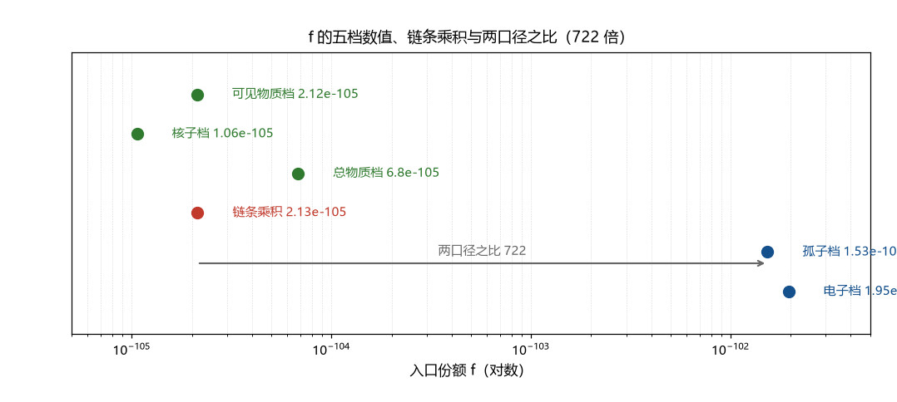

# 注记-f 线首轮（第398条）：Kibble 链条四环清点与 f 的口径表

- **日期**：2026-09-24 06:24:13
- **类型**：首轮清点（缺陷产额线：从反解量到可算链的第一段）
- **脚本**：`验证脚本/f_chain_first.py`（第 398 条）
- **图**：见 §3 图 1（`images/f_chain_first.png`）
- **依据**：[[内部草稿/判别材料-W1 轮：稀释的框架内重算与 Reading A 的裁决（相变时标钉到 10^-6 秒档）]]（边界解与三杠杆）；[[内部草稿/裁决请求-m_delta 密度侧质量档：计数锚的识别句与三档数值表]]（R1 裁决与三档表）；[[内部草稿/注记-Kibble机制：标准内容、体系内对接与适用性审查]]（标准内容与前提）；[[wiki/入口份额]]（定稿值与四计数口径）
- **状态**：首轮完成。链条四环清点、边界解复核与口径表三项就位；三条判句移交

## 1 判据与设定

S 机制线收束后（其唯一跨线接口为「缺陷形成率」），f 线接续开工。本轮把缺陷产额链清成四环（产量、稀释、湮灭、对接），复核 W1 轮的边界解，并把 f 的全部数值口径列成一张表（F1 至 F4）。全部为确定性算术加材料清点。

## 2 结果

F1（链条四环）：环一产量为缺陷占据率 $f_{\rm prod} = (l_P/\xi)^3$，$\xi$ 为冻结关联长度；环二稀释为 $D = (t_*/t_{\rm eq})^{3/2}/z_{\rm eq}^3$（分段膨胀标度）；环三湮灭为因子 $A$（W1 边界读法取 1，从「必需」降为「可选」）；环四为与观测的对接（$f_{\rm obs}$ 的口径，见 F3）。

F2（边界解复核）：$\xi = w_{\rm def} = 3.80\times10^{21}\,l_P$ 给 $f_{\rm prod} = 1.8224\times10^{-65}$；$D = 1.17\times10^{-40}$；乘积 $2.1322\times10^{-105}$，与可见物质档 $2.12\times10^{-105}$ 吻合到 $0.58\%$。$t_*$ 反解复核为 $4.093\times10^{-8}$ 秒（与第 364 条区间的下界一致）。

F3（口径表）：五档数值为电子锚口径（定稿，$M = m_e$）$1.9498\times10^{-102}$、孤子口径（MB-8 中间读数）$1.5313\times10^{-102}$、计数口径（可见物质）$2.12\times10^{-105}$、计数口径（核子）$1.06\times10^{-105}$、计数口径（总物质）$6.8\times10^{-105}$。口径关系核对：孤子档与可见物质档之比 $722.33$ 对应质量比 $M_{\rm vis}/M_{\rm sol} = 721.05$（差 $0.18\%$）；电子锚档与可见物质档之比 $919.7$ 对应 $M_{\rm vis}/m_e = 918.1$（差 $0.17\%$）。两者确认为同一物理量的不同归一（因子为质量比）。

**修正（2026-09-25）**：本注记初版把孤子档标为「定稿」，实际定稿为电子锚口径（2026-09-22 作者裁决回填；孤子值属 MB-8 中间读数），此处按 [[理论攻坚/量纲桥攻坚计划：从本体层单位到物理质量标度的导出]] 与 [[wiki/入口份额]] 修正。

**判句三（2026-09-25 执行）**：口径命名统一为「电子锚口径（定稿）」与「计数口径（Kibble 链条，可见物质档）」，引用处按此区分；档位核对完成并登记一处敏感性：第 366 条的 $\ln 9$ 相容度（相对差 $3.0\times10^{-5}$）用孤子档深度 $234.44$，定稿口径（电子锚）深度 $234.20$ 给 $0.11\%$（落在精度括号之外）；该敏感性已补记入 [[wiki/入口份额]]。

F4（综合）：链条在边界解上闭合到 $0.58\%$，该闭合依赖三个角点条件（$\xi$ 取健全性下界 $w_{\rm def}$、$A = 1$、$t_*$ 取下界）；放开任一条件，产量上界下降（$\xi$ 每加两个数量级，$t_*$ 需加四个数量级，见补充评审报告）。

## 3 图

## 4 结论与判句移交

首轮的三个读数：其一，链条在边界解上闭合（0.58% 吻合），W1 的边界解与三杠杆重排经复核确认；其二，闭合是角点性质，依赖三个条件，其中 $\xi = w_{\rm def}$ 尚无独立依据；其三，f 的两口径（质量与计数）差 $722$ 倍，因子已识别（质量比），但命名尚未区分。

判句移交：其一，$\xi = w_{\rm def}$ 的独立依据（为何冻结关联长度恰好取缺陷宽度）；其二，湮灭因子 $A$ 的动力学（当前为边界读法）；其三，两口径的命名统一（建议在引用处写作 $f_{\rm 质量}$ 与 $f_{\rm 计数}$，或注明语境）。三条判句完成后，缺陷密度从「角点吻合」升为「机制链」。

与 S 线的接口：S 线收束留下的「缺陷形成率」在此获得定位：链的产量环（$f_{\rm prod}$ 与其时标结构）即是该量；两线共享的待定量由此落在 $f$ 线的可见位置。

## 5 严格程度与边界声明

严格程度：F1 为材料清点（判据级）；F2 为定义加代数的复核（换算级，与 W1 逐位一致）；F3 为算术与关系核对（判据级）；F4 为综合判读（角点性质为 W1 已登记的口径）。

边界：不重算第 364 条与 W1 材料；不改任何裁决记录；两口径的命名统一为建议（由作者裁决）；不建立 $\xi$ 与 $A$ 的机制。

## 6 过程记录

触发：S 机制线收束（第 395 条与收束报告）后，按跨线接口转缺陷产额线。首轮把 W1 的边界解复核了一遍（与登记逐位一致，$t_*$ 反解 $4.093\times10^{-8}$ 秒），并把此前散布在四处（MB-8、R1、D-6、wiki）的 f 数值收成一张口径表；两口径关系的因子核对（722 与 721 差 0.18%）是清点的实质产出。
