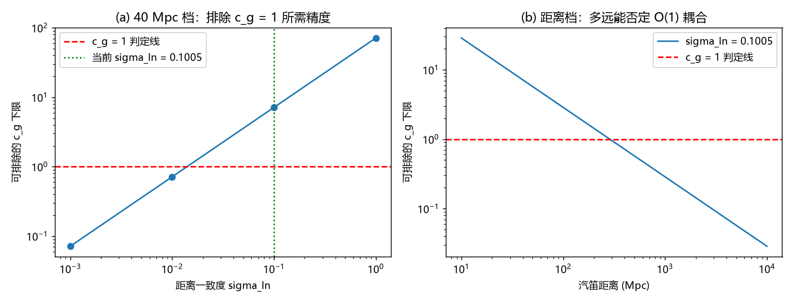

# 注记-gamma 的量级判定：膨胀落位率候选与所需观测精度

- **日期**：2026-09-20 03:16:26
- **对应脚本**：`验证脚本/gamma_scale.py`（判据 H1 至 H5 共 5 项，5/5 通过；纯换算与算术，确定性，运行约 1.5 秒；图存 `images/gamma_scale_test.png`，见 §二 图 1）
- **依据**：[[验证脚本/注记-M6-S2G（γ 取数，可做部分）：最小模型的守恒性与观测上限]]（观测上界与其汽笛对照口径）；[[验证脚本/注记-动态写入协变形式与阻尼观测量级（G3与判据C合轮）：判据D1至D7]]（候选率阶梯与筛选长度）；[[内部草稿/注记-碰撞的完美弹性：无内部自由度与符号翻转实现的结构性论证]]（碰撞侧封口）；[[理论总纲/元相子理论的时空观：体系对时空的完整认识]] §八（落位概率 $p = 3H_0t_P$）
- **状态**：判定线与所需精度已算出；候选 $\gamma = c_\gamma\cdot 3H_0$ 为待检假定，非导出
- **图**：`images/gamma_scale_test.png`（两面板，见 §二 图 1）

## 一、判定对象与关系式

判据 C 的量级侧已收口，来源侧经碰撞侧封口后只剩多体与场耦合一条通道。本材料判定该通道**最经济**的候选：膨胀落位率 $3H_0$。理由是该率在框架内已有本体位置（落位概率 $p = 3H_0t_P$），且它是唯一与观测上界量级接近的率。

判定用的关系式来自汽笛对照的阻尼逻辑：若记录阻尼为 $\gamma$，则按引力波振幅反推的距离与电磁距离相比会差一个 $\ln$ 因子 $\gamma D/(2c)$，要求这一差落在距离一致度 $\sigma_{\ln}$ 内，得

$$\gamma \le \frac{2c\,\sigma_{\ln}}{D}.$$

## 二、判据与结果

| 判据 | 内容 | 实测 | 判定 |
|---|---|---|---|
| H1 | 换算：上界对 $3H_0$ 与对每拍的比 | $3H_0 = 6.806\times10^{-18}$ 每秒；上界/$(3H_0) = 15.28$；上界$\cdot t_P = 5.61\times10^{-60}$；$(3H_0)\cdot t_P = 3.67\times10^{-61} = p$ | 通过 |
| H2 | 候选 $\gamma = c_\gamma\cdot3H_0$ 的当前允许上限 | $c_\gamma \le 15.3$（TF 档）、$\le 11.6$（基本面档 $1\sigma$） | 通过 |
| H3 | 排除 $c_\gamma = 1$ 所需精度（$D = 40$ Mpc） | $\sigma_{\ln} \le 0.0140$（当前 $0.1005$，需改善 $7.2$ 倍）；约 $51$ 个同精度汽笛；或同等精度下 $287$ Mpc 档 | 通过 |
| H4 | 候选率阶梯（相对上界的 $\log_{10}$） | 抄写平均 $+59.25$；太阳档门槛 $+21.49$；上界 $0.00$；落位率 $3H_0$ $-1.18$；哈勃率 $-1.66$ | 通过 |
| H5 | 未来带同精度（$\sigma_{\ln} = 0.101$）可排除的 $c_\gamma$ | ET 级 300 Mpc：$c_\gamma \ge 0.96$；LISA 级 1 Gpc：$\ge 0.29$；LISA 级 3 Gpc：$\ge 0.10$ | 通过 |

## 三、解读

其一，**候选量级是唯一「近」的**。候选率阶梯上，抄写平均率高出上界 $59.25$ 个数量级（已排除），太阳档门槛高出 $21.49$ 个数量级（那是「即时跟随」的内部门槛，不是来源），而 $3H_0$ 只比上界**低 $1.18$ 个数量级**、$H_0$ 低 $1.66$ 个数量级。换言之，若阻尼由膨胀落位过程给出，它与现有观测只差一个多数量级；若它由更弱的宇宙学率给出，则远在上界之下、与现有数据无张力。

其二，**判定 $c_\gamma = O(1)$ 的代价已经算得出来**。在 40 Mpc 档，需要把距离一致度从 $0.1005$ 压到 $0.0140$（$7.2$ 倍），等价于约 $51$ 个同精度汽笛的统计，或一个同等精度、距离 $287$ Mpc 的汽笛。这是一个可执行的观测目标，不是空泛的「更高精度」。

其三，**未来带自带答案**。同精度下，ET 级 300 Mpc 汽笛即可排除 $c_\gamma \ge 0.96$（即 $O(1)$ 耦合的整条判定线），LISA 级 1 Gpc 与 3 Gpc 分别排除 $c_\gamma \ge 0.29$ 与 $\ge 0.10$。因此「阻尼跟着膨胀率走」这个候选在未来十年内可判，无需等待精度革命。

## 四、严格程度声明

H1 至 H5 为换算与算术读数，输入为 M6-S2G 的观测上界与常数表，不含新物理假设；关系式 $\gamma \le 2c\sigma_{\ln}/D$ 是汽笛对照的标准逻辑（阻尼导致按振幅反推的距离偏移），在本材料中只作判定线使用。候选 $\gamma = c_\gamma\cdot3H_0$ 是**待检假定**，本材料不主张它成立。

## 五、边界声明（验证什么、不验证什么）

- 验证：上界与 $3H_0$、$H_0$ 的量级关系；候选系数 $c_\gamma$ 的当前上限；排除 $c_\gamma = 1$ 所需的精度、事件数与距离档；未来带在同精度下的可排除范围。
- 不验证（留待后续）：$\gamma$ 与 $3H_0$ 的机制性联系（为什么阻尼应正比于落位率，需要一条具体的耦合推导，属多体/场耦合侧）；$\gamma$ 的频率依赖；标量扇区与张量扇区是否共用同一个 $\gamma$。

## 六、过程记录

订正一处单位：H3 首版把「同等精度下所需距离」以米为单位印成 Mpc（读数 $8.85\times10^{24}$），改为除以 Mpc 后为 $287$ Mpc。
