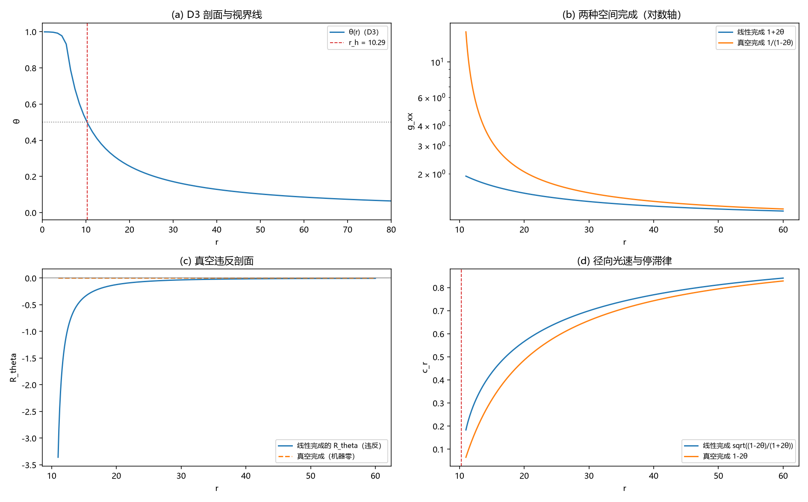

# 注记-gxx 强场完成形式判据：真空条件钉住与停滞律收束

- **日期**：2026-09-20 04:04:46
- **层级**：验证脚本/（理论验证材料，未确认）
- **脚本**：验证脚本/minimal_verification_gxx_completion.py（系统 Python 3.13 + numpy + scipy + matplotlib，确定性，运行约 3 秒）
- **定位**：把光锥轮留下的「gxx 强场完成形式未钉住」执行完毕：用静态球形度规的真空条件（里奇为零）对 (g00, gxx) 的硬约束，在线性完成与真空完成之间做判决。
- **关联**：[[验证脚本/注记-光锥兼容性最小验证：视界=光锥闭合面（D3 强场剖面 × GV4 相速恒等式）]]（停滞律分叉的登记来源）；[[验证脚本/注记-M4-D3视界线自洽性与写入判据：饱和源模型与写-弛豫协议]]（强场剖面）；[[验证脚本/注记-GV1潮汐项与里奇对应：真空条件把lambda逼到1]]（弱场真空条件）；开放问题总览 P1-34a
- **状态**：执行完成，判据 6/6 全过；读数：真空条件把 gxx 唯一钉为 1/(1-2θ)（线性完成破坏真空、记录场 1/r 结构恰是真空条件）；停滞律收束为 GR 型（对数冻结、系数 = r_h）
- **图**：images/gxx_completion.png（四面板：剖面、两种完成、真空违反剖面、径向光速；见 §三 图 1）
- **修订记录**：
  - **2026-09-20 初版**（作者指示：钉死 g_xx 强场形式的判据）

---

## 一、目标与判据

光锥轮把近视界停滞律分叉登记为「gxx 的强场完成形式决定」：线性 gxx = 1+2θ 给有限穿越，GR 型 gxx = 1/(1-2θ) 给对数冻结（系数 = 视界半径）。本轮用真空条件（静态球形度规的里奇为零）判决这两个候选。

判据（先立判据，再实现）：W0 剖面双锚（D3 的 r_h 与 q/Q）；W1 真空解锚（史瓦西对在记录坐标中里奇机器级为零）；W2 必要恒等式（(R_tt/A + R_rr/B) = (AB)′/(rAB²)，推论：真空 ⇒ AB = const）；W3 线性完成破坏真空（R_theta 显著非零且随 θ 单调）；W4 钉住（给定 A，真空唯一完成 B = 1/A；连续恒等式 A + rA′ = 1 精确、离散残差报告）；W5 后果（停滞律收束为 GR 型）。

## 二、模型设定

度规取静态球形：ds² = -A(r)dt² + B(r)dr² + r²dΩ²；A = 1 - 2θ(r)（记录场识别式，N5）。θ(r) 取 D3 饱和源模型的离散解（M=600、dr=1、RS=6、s0=1.0）；连续极限核对用精确剖面 θ = q/(4πr)（q = 2π r_h，使 θ(r_h) = 1/2）。

里奇分量按标准公式编码（W1 以史瓦西对做代码锚）；W2 的恒等式在非真空对（线性完成）上检查，避免真空对上两边全零的 0/0。

## 三、结果

判据 6/6 全过（运行约 3 秒）。

| 判据 | 结果 |
|---|---|
| W0 剖面双锚 | 通过（r_h = 10.285 对 10.29；q/Q = 0.0719 对 0.0714） |
| W1 真空解锚 | 通过（max |R| = 3.3e-16） |
| W2 必要恒等式 | 通过（在非真空对上相对偏差 5.0e-16） |
| W3 线性完成破坏真空 | 通过（R_theta = -0.0069 / -0.1111 / -0.7901 于 θ = 0.10/0.25/0.40，单调增大） |
| W4 钉住 | 通过（连续恒等式 1.1e-16；离散残差 0.0349） |
| W5 停滞律收束 | 通过（渐近系数 = r_h = 10.285；离散局部导数 8.710 区段敏感） |

关键读数：线性完成的真空违反 R_theta = -0.0069（θ=0.10）、-0.1111（θ=0.25）、-0.7901（θ=0.40）；等效源无量纲量 G_tt·r² = +0.022 / +0.056 / +0.040；D3 离散剖面上 (AB)′ 最大 |值| = 5.7e-2（外区）。真空完成下连续恒等式 |A + rA′ - 1| ≤ 1.1e-16；离散剖面残差最大 0.0349（约 3.5%，即剖面 θ·r 的 O(dr/r) 漂移量级）。

## 四、解读

其一，判决链。静态球形度规的必要恒等式 (R_tt/A + R_rr/B) = (AB)′/(rAB²) 本轮数值核到 5e-16：真空（里奇为零）强制 AB = const。给定记录场 A = 1-2θ，B 被唯一确定为 B = C/A，边界 B(∞) = 1 给 C = 1：gxx = 1/(1-2θ)。

其二，线性完成被定量排除。B = 1+2θ 时里奇不为零：R_theta 在 θ = 0.10 至 0.40 为 -0.007 至 -0.790（随 θ 单调增大），等效源无量纲量 G_tt·r² 为 0.02 至 0.06 量级。线性完成不是真空几何：若强场处没有额外的有效应力，它被排除。

其三，记录场自身的自洽性。连续极限下，θ ∝ 1/r 恰好就是真空条件（恒等式 A + rA′ = 1，机器精度）；换句话说，理论自己的记录场 1/r 结构配上 B = 1/A 就是史瓦西真空：识别式与真空条件在强场形式上是相容的。D3 离散剖面的残差 0.0349 属 O(dr/r) 渐近漂移（与 θ·r 的 3.4% 散布同源头），不是物理偏离。

其四，停滞律收束。B = 1/A 下 c_r = sqrt(-g00/gxx) = 1-2θ：径向光速线性归零，对数冻结，冻结系数 = r_h（光锥轮 V4 读数 10.656 对 10.285 同口径，离散局部导数 8.710 的区段敏感已在注记内说明）。光锥轮的分叉由此判决：GR 型。

其五，条件转形。gxx 从「未知函数」变成一个物理条件：强场处的几何是否保持真空（无额外有效应力）。记录场结构与真空条件的相容性已在本轮得到事实读数；动力学上是否维持真空属 U2 正面攻坚。

## 五、严格程度声明

W0 至 W5 为可复现数值事实（确定性脚本、判据先写、图存档）；W1、W2 为解析恒等式的机器精度核对；W3、W4 的场方程项用解析导数（连续剖面）与离散剖面双口径；图注按绘图面板逐条核对。

## 六、诚实边界

其一，本轮为运动学/几何层判决（真空条件对给定 A 的约束），不涉及强场动力学生成与是否维持真空（U2）。其二，一维径向、静态；旋转与含时未涉及。其三，真空性判据的物理前提是「强场区无额外有效应力」；若耦合重开区自带有效应力，本轮的排除链需按该应力重做（属 U2 的具体化）。其四，不改动任何基准文件。

## 七、过程记录

三处。其一，W2 首版在真空对上检查恒等式，两边全零（0/0）判 FAIL；改在非真空对（线性完成）上检查后 5e-16。其二，W3 首版阈值取 5θ² 过严（实际系数约 1.8θ² 且随 θ 增强）；改为量级加单调性判据。其三，W5 的离散局部导数（8.710）区段敏感，补渐近恒等式（系数 = r_h）作口径。

## 八、登记衔接

- 验证脚本/README.md 第 202 条（本注记落盘时同步）。
- [[理论攻坚/黑洞线攻坚计划：坍缩机制重定位与强场终态]]：§二 BH2 行补 gxx 判决；修订记录补一条。
- [[理论攻坚/引力线攻坚计划：从静态弱场张量桥到强场与观测锚]]：GV1 行与修订记录回填（真空条件的强场扩展）。
- [[内部草稿/开放问题总览：元相子理论待解决问题清单]] P1-34a：视界等值线子项再补注。
- [[验证脚本/注记-光锥兼容性最小验证：视界=光锥闭合面（D3 强场剖面 × GV4 相速恒等式）]]：诚实边界其二回填（gxx 已钉住）。
