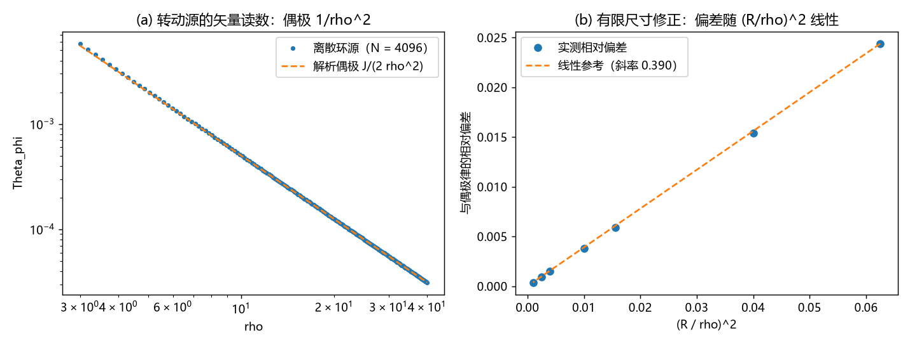

# 注记-h0i 的链接级合成：动量读数项的度规组装与拖曳强度（判据 K1 至 K5）

- **日期**：2026-09-20 05:24:24
- **对应脚本**：`验证脚本/minimal_verification_h0i_link_synthesis.py`（判据 K1 至 K5 共 5 项，5/5 通过；确定性，运行约 2 秒；图存 `images/h0i_link_synthesis.png`，见 §二 图 1）
- **依据**：[[验证脚本/注记-动量读数项的第一原理：逐拍写入的协变完备化与拖曳强度（判据Z1至Z4）]]（源口径与强度钉定）；[[验证脚本/注记-G6：h00等于2theta的显式链接合成（判据J1至J4）]]（标量侧链接合成与核归一，本材料沿用同一装置）；[[验证脚本/注记-G5GV6：拖曳通道的微观来源与强度归一（判据N1至N3）]]；[[理论总纲/元相子理论的时空观：体系对时空的完整认识]] §七
- **状态**：矢量扇区的链接级合成给出：通道存在、强度无自由系数（唯一入口）、几何为偶极、绕源回路读数非零；判据 V 的零读数由此定性归入旧版写规则的截断
- **图**：`images/h0i_link_synthesis.png`（两面板，见 §二 图 1）

## 一、模型设定

链接级合成沿用 G6 的装置：写事件（拍）落在链接上，站点读数由链接读数沿路径累加得到；路径无关性（回路和恒为零）由 G6 判据 J1 确立，核的 $4\pi$ 归一与"源只住链接"由 J2、J3 钉住。

矢量侧新增一个同址读数：每笔写入除质量幅度 $\delta m_s$ 外还携带该拍的动量 $\delta m_s \vec v_s$，它作用在同一核上。取 $G = c = 1$（比值与系数无量纲，换算回 SI 时回到唯一入口 $l_P/m_P = G/c^2$），两个读数为

$$\theta(\vec x) = \sum_s \frac{\delta m_s}{|\vec x - \vec x_s|}, \qquad \Theta_i(\vec x) = \sum_s \frac{\delta m_s\, v_{i,s}}{|\vec x - \vec x_s|}.$$

度规组装按相对论约定登记：$h_{00} = 2\theta$、$h_{0i} = 4\Theta_i$。两个系数不含新参数，$h_{00}$ 的 $2$ 与 $h_{0i}$ 的 $4$ 出自同一归一（$\bar h$ 的迹修正与 $T$ 的指标结构），G6 判据 J4 已把因子 $2$ 登记为约定而非合成产物。

唯一入口 $l_P/m_P = G/c^2$ 在两个扇区各出现一次，故 K2 核对的比值必须恰为 $2$，没有任何可调余地。零拖曳的旧读数由此得到定位：它属于只写时间分量的截断版本。

## 二、判据与结果

| 判据 | 内容 | 实测 | 判定 |
|---|---|---|---|
| K1 | 静止极限：$v = 0$ 给零矢量读数 | 最大绝对值 $0.00\times10^{0}$ | 通过 |
| K2 | 入口唯一：$h_{0i}/(h_{00}v_i) = 2$，与速率无关 | 三档速率（$0.01c$、$0.1c$、$0.5c$）比值均为 $2.000000000000000$，最大偏差 $4.44\times10^{-16}$ | 通过 |
| K3 | 取向无关性：速度沿三取向给同一强度 | $[100]$、$[110]$、$[111]$ 相对偏差 $0.00$ 与 $2.22\times10^{-16}$；对照立方各向异性键权重 $1 : 0.5 : 0.333$（即 $6:3:2$） | 通过 |
| K4 | 转动源偶极：$\Theta_{\hat\phi} = J/(2\rho^2)$，径向斜率 $-2$，角依赖 $\sin\theta$ | 斜率 $-2.0027$；$\rho = 5, 10, 20$ 偏差 $1.54\%$、$0.377\%$、$0.0939\%$，随 $(R/\rho)^2$ 线性（拟合斜率 $0.390$）；两极角偏差 $4.17\times10^{-4}$ 至 $1.15\times10^{-3}$ | 通过 |
| K5 | 回路签名：绕源闭合回路积分 $= 4\pi J/\rho$，离散与连续求积一致 | $\rho = 5, 10, 20$ 相对偏差 $8.9\times10^{-16}$、$2.0\times10^{-15}$、$2.4\times10^{-15}$；标量侧望远镜求和恒为 $0.00\times10^{0}$ | 通过 |

## 三、解读

其一，**通道的存在与强度同轮钉住**。K1 给出静止源的严格零读数，K2 给出运动源的强度恰为标准值。两件事合起来是 Z1 至 Z4 的链接级版本：通道存在，且没有第二个耦合常数可调。

其二，**等向键在这里有后果**。K3 的取向无关性是框架选等向键的直接后果；若改用含方向指标的立方键，同一 $|\vec v|$ 的三取向强度按 $6:3:2$ 分裂，且该键在 [100] 方向把横波刚度归零（2026-09-19 的构造性判定已排除）。用哪一种键能在矢量扇区同样是有后果的物理选择。

其三，**几何被数值锁定**。K4 的径向斜率与角依赖落在偶极形式上，偏差只随 $(R/\rho)^2$ 线性下降、拟合斜率为 $O(1)$ 常数，说明偏差来自源的有限尺寸，未出现额外结构。K5 的回路读数是矢量侧独有的签名：标量链接读数绕回路的望远镜求和恒为零（G6 J1），矢量侧同一回路给出非零值，且与连续求积一致到机器精度。

其四，**与 GPB 的关系**。拖曳读法 $\omega = h_{\hat\phi}/\rho = 2J/\rho^3$（$G = c = 1$；SI 下即 $2GJ/(c^2\rho^3)$）与广义相对论的同名式一致，GPB 的拖曳岁差预期 $-39.2\ \mathrm{mas/yr}$ 由本框架继承（换算登记，非新导出）；终值确认后的定量复核仍为开放项。

## 四、严格程度声明

K1 为精确零（机器精度）。K2 为结构性恒等（唯一入口只出现一次），数值形式为机器精度核验，不构成独立测定。K3 为等向键的后果，含一个已排除的对照选项。K4、K5 为可复现数值事实，与高阶求积（20 万点）一致到机器精度，与偶极律的偏差为 $(R/\rho)^2$ 阶几何修正。本材料不含新物理假设，属矢量扇区链接级合成的完成登记。

## 五、边界声明

- 验证：静止极限的零读数；强度无自由系数（唯一入口）；取向无关性；偶极几何与径向衰减；绕源回路签名的存在与数值。
- 不验证（留待后续）：[[注记-写事件的分配细节：链接层面的显式规则与核的方向结构（判据L1至L5）]] 已于 2026-09-20 显式化分配规则；转动源岁差的显式数值与 GPB 终值核对；非线性与强场（由 C1 门控）；转动源的缺陷排布模型本身。

## 六、过程记录

首版把面板 (b) 设计为环采样数收敛，实测在 $N = 16$ 已到 $4.9\times10^{-11}$、$N \ge 32$ 触底于机器精度（解析周期被积函数上的中点求和超代数收敛），该设计在地板处退化，改为有限尺寸修正的线性核对（即现面板 (b)）。表内数值均为改版后读数，其余判据未动。
