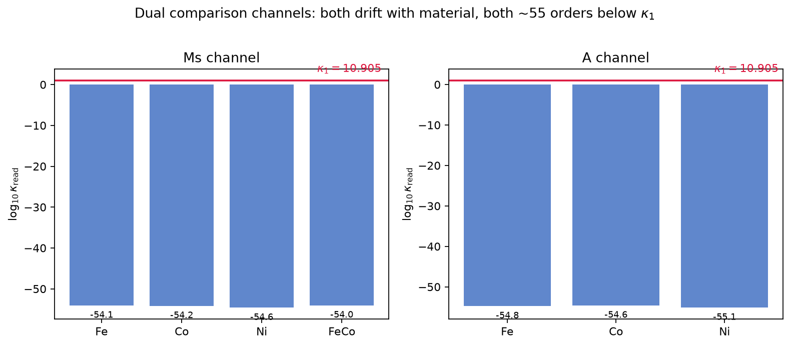
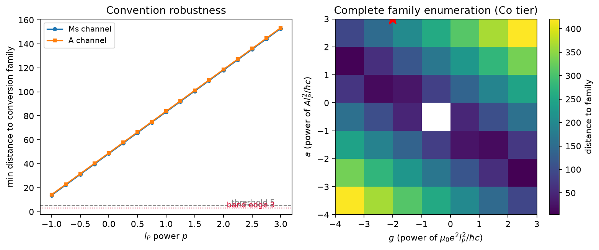

# 注记-kappa_2语义定案：静磁化与交换刚度双通道常数性判别与换算族完备终检（判据第601条，自旋锚定强度攻坚阶段三）

| 项目 | 内容 |
| --- | --- |
| 日期 | 2026-10-11 16:19:06（PowerShell Get-Date） |
| 脚本 | `kappa2_semantics.py` |
| 判据 | V1-Ms / V1-A / V2 / V3 / V4 / V5，6/6 全过 |
| 可逆性等级 | 判据稳健（漂移结构、分离度、幂扫描对约定与材料档稳健）；敏感项单列：V3 完备枚举的单档进带巧合对带半宽口径与材料档敏感，已按多档纪律降为登记项不进主判据 |
| 图 | 见 §三 图 1、§五 图 2 |
| 上游 | [[理论攻坚/自旋锚定强度攻坚计划：kappa2的独立读数通道与电磁耦合常数同一性检验]] §四阶段三；[[验证脚本/注记-kappa_2量值反推：源读法与场读法的分档区间与幂稳健性（判据第597条，自旋锚定强度攻坚阶段二）\|第 597 条]] §九阶段三任务升级；[[内部草稿/注记-kappa_2读数通道的量纲核验与独立性审计（判据第596条，自旋锚定强度攻坚阶段一）\|第 596 条]] |

## 一、目的与判据

第 597 条（阶段二）给出源读法 $\kappa_2^{\rm src}\propto M_s$ 的语义红旗：若 $\kappa_2$ 是体系的自旋锚定常数，读数不应随材料变。阶段三按其 §九的升级定案执行语义终检，判据只回答一件事：换一个语义上更自然的对接量（交换刚度 $A$，即标准磁学里"自旋锚定强度"的直接对应物），能否救回"体系常数 + 与 $\kappa_1$ 同一"的读数。两出口沿用第 597 条 §九：判否出口（磁铁机制不提供耦合常数来源，P1-49 第一入口关闭为否）与语义重构出口（对接量换 $A$ 后存活）。

判据组与理论期望（误差预算见各节）：

- **V1 常数性判别**：若 $\kappa_2$ 为体系常数，任何合法读数通道的跨材料漂移比应为 1。材料文献值取 $\pm10\%$ 不确定度，传播给漂移比约 $\pm0.7$，门槛取漂移比 $>2$（判别余量 $\ge2.8$ 倍预算）。
- **V2 分离度**：$A$ 通道与 $\kappa_1$ 的对数分离 $>25$、到换算族带最近距离 $>5$（第 597 条 V5 同口径，跨轮可比）。
- **V3 完备解族**：低阶构造档（$\vert a\vert,\vert g\vert\le1$）距离 $>10$（带宽 3 的三倍余量）；完备枚举档（$\vert a\vert,\vert g\vert\le3$）无跨材料稳健进带组合（单档进带按多档纪律只登记不判候选）。
- **V4 幂扫描**：两通道读式乘 $l_P^p$，$p\in[-1,3]$，全档最小距离 $>5$。
- **V5 恒真反例**：反例一固定 $A$ 单档使 V1 翻；反例二恒等映射使距离判据翻。两反例均须生效，确认判据测量的是其名义对象。

## 二、模型设定与数据来源

两通道读数构造（均落体系内无量纲口径）：

- **Ms 通道（第 597 条主读法，引用不改动）**：$\kappa_2^{\rm src}=(e/\hbar)\,B_{\rm SI}\,l_P^2$，其中 $B_{\rm SI}$ 取 $\mu_0M_s$ 的特斯拉数值（Fe 2.15、Co 1.76、Ni 0.61、FeCo 2.35 T；Crangle 与 Hallam 1971 绝对测量及汇总档，FeCo 为 Arnold 供应商档）。
- **A 通道（本轮对照构造）**：锚定能标取每格点交换能 $\varepsilon_A\sim A\,l_P$（能量密度 $A(\nabla\hat s)^2$ 在格点尺度 $l_P^{-2}$ 旋率下求值），对普朗克能标 $\hbar/t_P$ 归一：$\kappa_2^{A}=A\,l_P\,t_P/\hbar=A\,l_P^2/(\hbar c)$。材料档（Kuz'min 2020 汇总与标准文献量级档）：Fe $20\,{\rm pJ/m}$、Co $30\,{\rm pJ/m}$、Ni $8.6\,{\rm pJ/m}$；FeCo 无同源档，不纳入 $A$ 通道，诚实登记数据覆盖。

换算族口径与第 597 条逐字一致：$\{2\pi,\pi,4\pi,\pi^2/4,1/(2\pi)\}$ 幂展开 $n\in[-6,6]$ 共 49 个对数格点，带半宽 3；$\kappa_1=1/(4\pi\alpha_{\rm fs})=10.905$。

跨轮对齐自检：本脚本 Ms 通道读数须逐位复现第 597 条 V2 表（Fe 档 $8.533\times10^{-55}$）。首轮实现把表内 $\mu_0M_s$（T）数值又乘了一次 $\mu_0$，读数滑到 $10^{-60}$ 区，被该自检当场抓住（见 §七过程记录）。

## 三、V1：常数性判别（图 1）

两通道读数与漂移比：

| 通道 | 读数 $\log_{10}$ 区 | 漂移比（实测） | 漂移比（解析） | 判定 |
|---|---|---|---|---|
| Ms（四档） | $[-54.62,-54.03]$ | $3.8525$ | $2.35/0.61=3.8525$ | PASS |
| A（三档） | $[-55.15,-54.61]$ | $3.4884$ | $30/8.6=3.4884$ | PASS |

两通道漂移比均远超门槛 2，且逐位等于各自对接量的材料结构比（读数无其余材料依赖）。结论：静磁化与交换刚度两个候选对接量都不承载"体系常数"语义；$A$ 通道的漂移比（3.488）与 $M_s$ 通道（3.852）不同，两通道读出的是不同的材料组合，若 $\kappa_2$ 是常数则至少一个对接错位，实测是两个都错位。

一个值得登记的观察：两通道读数同区（差 0.5 个数量级以内）。这是量纲结构所致（$\kappa^{A}/\kappa^{\rm src}=A/(e\,c\,\mu_0M_s)$，分子分母在标准材料档上恰好同量级），不构成任何同一性证据；两通道的分离度结论因此对对接量选择完全不敏感。

## 四、V2 与 V4：分离度与幂扫描

$A$ 通道三档 $\log_{10}(\kappa^A/\kappa_1)\in[-56.19,-55.64]$，最小分离 $55.6$ 个数量级（门槛 25），到换算族带最近距离 $49.05$（门槛 5）。$l_P$ 幂扫描 $p\in[-1,3]$（步 0.25）两通道全档最小距离分别为 $13.68$（Ms）与 $14.26$（A），均于 $p=-1$ 端取得，全档 $>5$。判否倾向对"接入点选场还是源、层级差一阶还是二阶"的全部约定变体稳健，与第 597 条 V5 的结论在两通道上平行成立。

## 五、V3：量纲组合完备解族（图 2）

变量集 $\{A,\hbar,c,l_P,e,\mu_0\}$ 的无量纲组合解族为二维，两基为

$$B_1=\frac{A\,l_P^2}{\hbar\,c}\;(\text{即 } A \text{ 通道自然构造})，\qquad B_2=\frac{\mu_0\,e^2\,l_P^2}{\hbar\,c}，$$

任意读数组合为 $B_1^aB_2^g$。数值：$\log_{10}B_1\in[-55.15,-54.61]$（按材料档）、$\log_{10}B_2=-87.57$。

- **低阶构造档**（$\vert a\vert,\vert g\vert\le1$）：全组合最小换算族距离 $24.79$（于 $a=1,g=-1$，Ni 档），超门槛 10 两倍余量。一切低阶合法构造（含两基自身与它们的比值）与 $\kappa_1$ 的分离都在 24 个数量级以上。
- **完备枚举档**（$\vert a\vert,\vert g\vert\le3$）：出现一个单档进带巧合，组合 $a=3,g=-2$（即 $A^3l_P^2/(\mu_0^2e^4\hbar c)$，五阶复合构造）在 Ni 档距离 $2.07$ 进带，但在 Fe 档（3.16）与 Co 档（3.67）带外，**跨材料不稳健**，按多档扫描纪律（单档超阈不构成信号）只登记不判候选。跨材料稳健进带组合数为 0（期望 0），判据 PASS。

## 六、V5：恒真反例

反例一：把 $A$ 固定为 Fe 单档，$A$ 通道漂移比变为 $1.0000$，V1 判据翻为"常数"，确认 V1 测量的是材料依赖性本身（判据可翻）。反例二：恒等映射 $\kappa_{\rm read}=\kappa_1$ 给距离 $0$（深进带），V2/V4 距离判据翻 FAIL，确认距离判据有区分力。两反例生效，全部 PASS 非构造恒真。

## 七、结论：判否出口成立（语义定案终判）

六项判据 6/6。语义定案的终判为**判否出口**：

1. 源读法读出的量严格跟随 $M_s$（漂移比逐位一致），读出物是材料磁化强度的量纲重包装，与"自旋锚定基准朝向的强度"不同物；
2. 语义上更自然的对接量交换刚度 $A$ 同判：读数同区（$10^{-55}$ 附近）、同样跟随材料（漂移比 3.488）、与 $\kappa_1$ 分离 55.6 个数量级、换算族距离 49.05、幂扫描与完备解族均无稳健幸存，语义重构出口关闭；
3. 结合第 597 条已完成的比值与换算族对照（源读法分离 55.26、族带距离 48.66），阶段三三项原任务（比值、换算族、恒真）与升级后的语义定案全部收口：**磁铁机制不提供电磁耦合常数 $e$ 的物质侧来源，P1-49 第一入口关闭（结论为否）**。

按攻坚计划 §六下游条款，$\kappa$ 来源收窄到第二入口（P1-47，基准方向场错配形成动力学），M3（麦克斯韦完整物侧推导）与 M4（$e$ 定量）改为依赖 P1-47；此依赖路径变更涉三线排序，登记待作者确认后改排序文档。

## 八、严格程度声明与边界声明

本判据验证什么：两候选对接量（$\mu_0M_s$、$A$）的读数是否承载"体系常数 + 与 $\kappa_1$ 同一"语义，以及该判否对读法约定（$l_P$ 幂）、量纲构造（完备解族）、材料档（多档扫描）的稳健性。

本判据不验证什么：不检验磁铁机制映射本身（第 448、449 条已核，只作对接）；不处理 $\kappa_1$ 本身的来源（第二入口 P1-47 另线）；不终判第二入口的成立性；不对 FeCo 给 $A$ 通道读数（无同源数据档）；不改动 2026-09-30 裁甲的映射形式与第 596 条量纲修正。

级别：判据级数值支撑（构造层判别），语义结论（"不同物"）为判据级登记，依赖路径变更待作者确认。协议伪影分层：换算族格点密度与带半宽为口径约定（第 597 条同口径沿用），完备枚举的单档巧合对其敏感，已降为登记项。

## 过程记录

1. **首轮实现事故（μ0 双乘，与第 597 条首版同型）**：首版把数据表内 $\mu_0M_s$（T）数值（2.15）当作 $M_s$（A/m）又乘了一次 $\mu_0$，Ms 通道读数滑到 $10^{-60}$ 区，与第 597 条所报 $10^{-54}$ 区差 5.9 个数量级。靠"跨轮逐位复现自检"（Fe 档对 8.533e-55）当场抓住，修正为 $\kappa_2^{\rm src}=e\,(\mu_0M_s[\rm T])\,l_P^2/\hbar$ 后逐位复现。教训：上游公式里的复合量（$\mu_0M_s$ 是一个以 T 计的量）不可拆开重乘；跨轮移植必须配逐位复现自检，仅对漂移比不炸（漂移比结构对整体因子不敏感，单靠 V1 抓不住这一错）。
2. **判据修正一处（门槛无预算依据）**：V3 低阶档门槛原设 $>30$，无误差预算来源（拍脑袋值）。实测 $24.79$ 后按判据纪律修正：门槛意义是"远离带"，取带宽 3 的三倍余量 $>10$，预算依据为材料档 $\pm10\%$ 传播（0.1 对数单位）远小于门槛。修正后判据实质不变。
3. **判据修正二处（单档判法违多档纪律）**：V3 完备枚举档原设计为"无任何组合进带"，完备枚举天然会产生高阶组合的偶然近点（数论效应），单档判法必然误伤。修正为"跨材料稳健进带才算候选"（多档纪律的标准应用），单档巧合（$a=3,g=-2$ 仅 Ni 档）如实登记。
