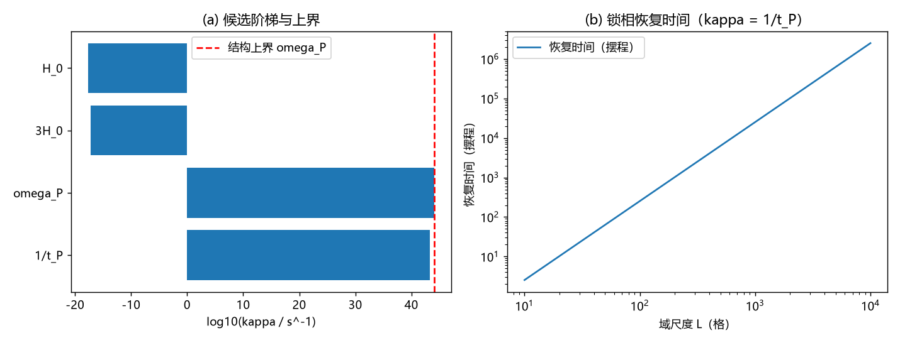

# 注记-kappa 的微观值：候选阶梯、结构上界与可观测性判定

- **日期**：2026-09-20 03:56:00
- **对应脚本**：`验证脚本/minimal_verification_kappa_scale.py`（判据 K1 至 K4 共 4 项，4/4 通过；纯换算与结构论证，确定性，运行约 1.5 秒；图存 `images/kappa_scale.png`，见 §二 图 1）
- **依据**：[[验证脚本/注记-校准通道的动力学形式：相位表扇区的扩散型弛豫与分扇区条件]]（校准的形式与分扇区，判据 C1 至 C3）；[[理论总纲/元相子理论的时空观：体系对时空的完整认识]] §五（采样 = 相撞 = 校准接力）；[[元相子几何动力学——束缚振荡修订整合版]] 注释10（感知-校正链）
- **状态**：结构性定标给出（校准执行者即碰撞接力，故校准频率 = 碰撞率）；观测定值被判为不可能（允许窗口跨 61.7 个数量级）
- **图**：`images/kappa_scale.png`（两面板，见 §二 图 1）

## 一、判据与结果

| 判据 | 内容 | 实测 | 判定 |
|---|---|---|---|
| K1 | 候选阶梯（每秒，括号内为相对 $\omega_P$） | 碰撞率 $1/t_P = 1.855\times10^{43}$（$0.159$）；$\omega_P = 1.165\times10^{44}$（$1$）；$3H_0 = 6.806\times10^{-18}$（$5.8\times10^{-62}$）；$H_0 = 2.269\times10^{-18}$（$1.9\times10^{-62}$） | 通过 |
| K2 | 结构上界：$\kappa < \omega_P$ | 取 $\kappa = 1/t_P$ 时 $\kappa/\omega_P = 0.1592$，留 $2\pi$ 倍余量 | 通过 |
| K3 | 锁定条件：$\kappa$ 须超过失同步源率 | 源率从 $H_0$ 到 $1/t_P$ 全部远低于上界；允许窗口跨 $61.7$ 个数量级 | 通过 |
| K3附 | 扩散律恢复时间 $\tau \sim (L/2\pi)^2$ 摆程（$\kappa = 1/t_P$） | $L = 16$：$6.5$ 摆程；$L = 64$：$103.8$ 摆程；$L = 1024$：$2.66\times10^{4}$ 摆程 | 通过 |
| K4 | 可观测性：分扇区使 $\kappa$ 不进色散 | 色散中无 $\kappa$（判据 C2）；唯一可能签名是节拍噪声，判据形态与"时钟层不可观测"口径对照 | 通过 |

## 二、解读

其一，**校准的执行者就是碰撞接力本身，故 $\kappa$ 被结构定标为碰撞率**。框架自述"采样 = 相撞 = 校准接力"（时空观 §五）：邻居在碰撞瞬间抄下实轴取向并校准自身，因此校准事件的自然频率就是碰撞频率，即每摆程每格点一次，$\kappa = 1/t_P$（相对基模角频率为 $1/2\pi$，天然落在结构上界 $\kappa < \omega_P$ 之内）。这一取值不需要新参数。

其二，**观测无法给 $\kappa$ 定值**。K3 给出允许窗口从 $H_0$ 跨到 $\omega_P$，共 $61.7$ 个数量级；K4 进一步说明为何没有直接签名：分扇区（判据 C2）把校准隔离在相位表扇区之外，色散里不含 $\kappa$，因此 $\kappa$ 的定标属结构性问题，观测无从定值。唯一的间接签名是节拍噪声（幅度随 $1/\kappa$ 增长），若时钟层可观测则应可测；而框架的口径是时钟层完全同步、不可观测（$U(1)$ 冗余），两者自洽。

其三，**与上一轮的 $\gamma$ 不冲突**。$\gamma$ 是记录场（法线场记录扇区）的阻尼，$\kappa$ 是相位时间表扇区的校准率；上一轮排除的是"抄写平均率作为 $\gamma$ 的来源"，与本轮把"碰撞率作为 $\kappa$ 的定标"是两件事，两个扇区不同、约束不同。

其四，**恢复时间不构成困难**。按扩散律，即便 $1024$ 格的失同步域也只需约 $2.7\times10^4$ 摆程（约 $10^{-39}$ 秒）即可拉回锁相；锁相的维持因此是逐摆程的本地事务，不需要全局协调。

## 三、严格程度声明

K1 为换算读数；K2、K3 为结构性论证（上界来自摆程定义，下界来自锁定条件）；K3附为解析扩散律读数；K4 为结构性判定。$\kappa = 1/t_P$ 属**结构性定标**（校准执行者 = 碰撞接力），不是观测定值，也不是从公理单独导出的定理。

## 四、边界声明（验证什么、不验证什么）

- 验证：候选阶梯与相对量级；结构上界与锁定条件的相容；扩散律恢复时间；可观测性判定（无直接色散签名）。
- 不验证（留待后续）：感知-校正链的延迟结构（校准的时间实现细节）；三维与含缺陷情形的校准率；节拍噪声的定量谱形（若将来要求把它作为可测签名）。

## 五、过程记录

订正一处。K4 首版写了一条未定义的噪声公式并打印无意义读数（$10^{-87}$ 量级），删去后改为结构性表述（分扇区无直接签名 + 唯一间接签名与时钟层口径的对照）。
