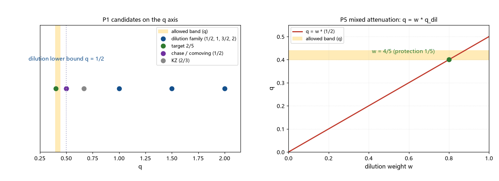

# 注记-q 的来源清点（第417条）：稀释继承下界与校准保护分数

- **日期**：2026-09-26 01:58:21
- **类型**：判识轮（P0-5 候选机制五轮；几何路线 q 来源首轮）
- **脚本**：`验证脚本/minimal_verification_q_source_audit.py`（第 417 条）
- **图**：见 §3 图 1（`images/q_source_audit.png`）
- **依据**：[[验证脚本/注记-成核-接缝几何的最小模型（第416条）：alpha = 1 - q 标度定理与三分之五的几何靶]]（$\alpha = 1-q$ 与靶 $q = 2/5$）；[[验证脚本/注记-结晶扩张相变的标度清点（第415条）：标准临界标度全判负与三分之五的机制域]]（几何入口）；[[验证脚本/注记-KZ 适用性判定（第381条）：临界冻结不适用、注入-接缝机制与畴尺度候选]]（追赶变体）；[[时空的持续创生：元相子理论的膨胀机制]]（创生膨胀形式）
- **状态**：判定完成。稀释继承类全体判负（下界 $q = 1/2$ 高于允许带上端 $0.4402$）；共动膨胀读法判负或不适用；两个待建口径（校准衰减律、锁定时间律）；形式读数：保护分数 $1/5$
- **可逆性等级**：判据稳健（候选集合与下界为清点加代数；「稀释继承全体带外」由 $q \ge 1/2 > 0.4402$ 保障；保护分数为形式读数、不翻）

## 1 判据与设定

第 416 条把几何路线压到「波前速度衰减指数 $q = 2/5$」。本轮清点 $q$ 的来源：稀释继承类（P1）、共动膨胀读法（P2）、校准衰减自由幂（P3）、锁定时间增长（P4）、部分保护混合（P5）。设定：凝固期在辐射期（$t_* = 4.09\times10^{-8}$ 秒远小于 $t_{\rm eq} = 1.48\times10^{12}$ 秒），膨胀取 $a \propto t^{1/2}$；允许带取 $q$ 口径 $[0.3985, 0.4402]$（第 416 条 V3）。

## 2 结果

P1（稀释继承类，速度线性继承衰减量）：共动波数 $k \propto 1/a$、场振幅（红移）$\propto 1/a$、温度 $\propto 1/a$ 给 $q = 1/2$；数密度 $\propto a^{-3}$ 给 $3/2$；能量密度 $\propto a^{-4}$ 给 $2$。值集合为 $\{1/2,\,3/2,\,2\}$，下界 $1/2$。靶 $2/5$ 比下界低 $20\%$，全部候选落在允许带外。

P2（共动膨胀读法）：共动推进指数 $q = 1-n$，辐射期 $n = 1/2$ 给 $q = 1/2$，与 P1 下界一致，带外。创生膨胀为指数形式 $R(t) = (R_0 + c/H_0)e^{H_0 t} - c/H_0$，不产生幂律 $n$ 与幂律 $q$，判不适用。

P3（校准衰减自由幂，$v \propto A^{s}$，$A \propto t^{-m}$，$q = ms$）：目标条件为 $m = (2/5)/s$，即 $s = 1$ 需 $m = 0.4$、$s = 1/2$ 需 $m = 0.8$、$s = 2$ 需 $m = 0.2$。纯稀释给出的最小 $m$ 为 $1/2$，大于 $s = 1$ 所需，故纯稀释不足；需要有效衰减指数 $m_{\rm eff} < 0.5$。

P4（锁定时间增长，每格锁定拍数 $k(t) \propto t^{m}$，$q = m$）：靶条件为 $k(t) \propto t^{2/5}$（每格锁定时间按 $t^{0.4}$ 增长）。无框架内机制读数，登记为待建口径。

P5（部分保护混合，$q = w\,q_{\rm dil} + (1-w)\,q_{\rm src}$，取 $q_{\rm src} = 0$）：若稀释分量取最小值 $q_{\rm dil} = 1/2$，靶 $q = 2/5$ 给出 $w = 4/5$，保护分数 $1-w = 1/5$；若 $q_{\rm dil} = 1$，保护分数为 $3/5$。属形式读数。

## 3 图

## 4 结论与移交

结论一（硬）：稀释继承类（共动化、红移、温度、密度稀释）全体判负。其下界 $q = 1/2$ 高于允许带上端 $0.4402$，即「波前被膨胀被动拖慢」的任何实现都减速过多；靶 $2/5$ 要求减速慢于共动化 $12\%$ 至 $20\%$。

结论二（机制画像更新）：$3/5$ 要求的机制属「波前自身推进律的温和衰减」；被动稀释一侧已被本轮的判负读数排除。物理指向校准的主动供给（框架里校准归于本原，本原供给可对稀释做部分补偿）；形式读数给出保护分数 $1/5$（取最小稀释分量时）。

结论三（两个待建口径）：校准衰减律（需要 $m_{\rm eff} < 0.5$，或响应指数与幂的联合取值）与锁定时间律（$k \propto t^{2/5}$），两者共同归属「校准通道的时变动力学」这一前置。

移交两条。其一，校准通道的时变动力学首轮：从 [[束缚振荡动力学的物侧闭合：完美弹性定理、交错基态与校准通道]] §八其一（感知-校正链的延迟结构未建模）出发，给出校准强度或锁定时间的时变形式并与 $q = 2/5$ 对接。其二，供给-稀释平衡的独立读数：校准供给率与稀释率的比若能独立给出（不经过 $f$），则保护分数 $1/5$ 可从另一侧核对。

## 5 严格程度与边界声明

严格程度：P1 为清点加代数（自然量集合的枚举，未声称穷尽）；P2 为框架形式核对；P3 与 P4 为条件换算；P5 为形式模型（混合的参数化读数）。

边界（本脚本不验证的内容）：其一，不声称稀释继承类穷尽所有被动机制；其二，不建立校准衰减律；其三，保护分数为形式读数，不称机制；其四，辐射期假设沿用第 413 至 416 条的分段口径；其五，不重算第 416 条。

## 6 过程记录

其一，清点口径取「速度线性继承稀释量」；非线性响应情形由 P3 的响应指数 $s$ 参数覆盖（$s = 1$、$1/2$、$2$ 三档）。

其二，P5 的保护分数对稀释分量取值敏感（$q_{\rm dil} = 1/2$ 给 $1/5$，$q_{\rm dil} = 1$ 给 $3/5$），已在结果中并列，避免单值读数的误引。

其三，与第 416 条的接口核对：本轮 $q$ 带 $[0.3985, 0.4402]$ 与第 416 条 V3 输出一致。
