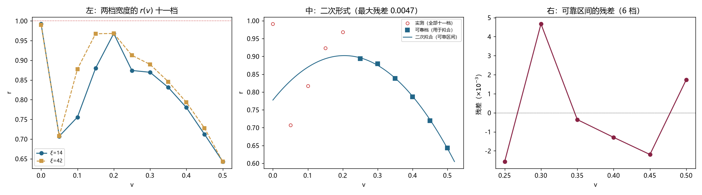

# 注记-r(v) 曲线补全：低速档被底噪淹没、可靠区间为 0.25 至 0.50、二次式成立但不外推（判据第 712 号）

- **日期**：2026-10-20 00:35:22
- **编号**：第 712 号
- **类型**：验证注记（判据驱动；LA0 与 LA2 判通过）
- **对象**：第 711 号只测了三档（$v=0$、$0.30$、$0.50$）的修正因子 $r(v)$ 曲线
- **脚本**：`验证脚本/p712_r_curve.py`（确定性，约 4 分钟）
- **状态**：$v$ 补满十一档。**$v \le 0.20$ 的读数被 Verlet 底噪淹没，不可用**；可靠区间 $[0.25, 0.50]$ 六档的二次拟合最大残差 $0.0047$，但**该式在 $v=0$ 给 $0.7773$，与实测 $0.9911$ 差 $22\%$，不可外推**
- **可逆性等级**：判据稳健（六档残差 $0.0047$；信噪比表与解析预期一致）
- **图**：见 §4 图 1
- **通俗版**：[[内部草稿/注记-低速档测不出来（判据第712号通俗版）]]

## 1 为什么检验

第 711 号测了三档 $v$：$0$ 给 $0.9915$、$0.30$ 给 $0.8804$、$0.50$ 给 $0.6459$。物理档外推需要「给定速度下的折扣」，三档无法插值，所以补至十一档（步长 $0.05$）。

## 2 判据与读数

**LA0 复现（判通过）。** 三档在 $\xi=14$ 与 $42$ 上的 $r$ 与第 711 号记录值相对差 $0.0\%$。

**信噪比表（本轮的关键附加读数）。** dev 正比于 $f(k_{\rm mod}) \sim k^4$，故随 $v$ 四次方下降；而 Verlet 底噪是固定的 $1.0688\times10^{-5}$。

| $v$ | dev（$\xi=14$） | 倍数/底噪 | 判读 |
|---|---|---|---|
| 0.05 | $6.4\times10^{-7}$ | 0.06 | 淹没 |
| 0.10 | $3.11\times10^{-5}$ | 0.48 | 淹没 |
| 0.15 | $9.38\times10^{-5}$ | 3.12 | 淹没 |
| 0.20 | $2.03\times10^{-4}$ | 8.54 | 淹没 |
| 0.25 | $3.69\times10^{-4}$ | 17.27 | 可用 |
| 0.30 | （复用档） | 26.81 | 可用 |
| 0.35 | $1.15\times10^{-3}$ | 68.35 | 可用 |
| 0.40 | $1.91\times10^{-3}$ | 121.29 | 可用 |
| 0.45 | $3.13\times10^{-3}$ | 210.10 | 可用 |
| 0.50 | （复用档） | 367.73 | 可用 |

**LA1 十一档曲线。**

| $v$ | 0 | 0.05 | 0.10 | 0.15 | 0.20 | 0.25 | 0.30 | 0.35 | 0.40 | 0.45 | 0.50 |
|---|---|---|---|---|---|---|---|---|---|---|---|
| $r$ | 0.991 | **0.707** | 0.817 | 0.924 | **0.968** | 0.893 | 0.880 | 0.839 | 0.787 | 0.720 | 0.643 |
| 可靠 | 特殊 | 否 | 否 | 否 | 否 | 是 | 是 | 是 | 是 | 是 | 是 |

**$v \le 0.20$ 段极度非单调**（$0.707 \to 0.817 \to 0.924 \to 0.968$），这不是物理曲线，是底噪噪声。而 $v \ge 0.25$ 段平滑单调下降。

**LA2 二次形式检验（主判据，判通过）。** 只用六个可靠档：

$$r(v) = 0.7773 + 1.2209\,v - 2.9862\,v^2$$

| $v$ | 0.25 | 0.30 | 0.35 | 0.40 | 0.45 | 0.50 |
|---|---|---|---|---|---|---|
| 实测 | 0.8933 | 0.8795 | 0.8385 | 0.7866 | 0.7198 | 0.6430 |
| 拟合 | 0.8959 | 0.8748 | 0.8388 | 0.7879 | 0.7220 | 0.6412 |
| 残差 | $-0.0026$ | $+0.0047$ | $-0.0004$ | $-0.0013$ | $-0.0022$ | $+0.0017$ |

最大残差 $0.0047$（$0.47\%$）。

## 3 三个发现

**其一，低速档测不出来，而且原因可以解析算出。**

要求 dev $\gg$ 底噪，即 $(\omega_b v)^4/(24\omega^2) \gg 1.07\times10^{-5}$，解得 $v \gtrsim 0.14$。实测门槛在 $0.20$ 与 $0.25$ 之间，与解析估计一致。

**$v \in (0, 0.20)$ 是本装置的盲区。** 这不是判据设计问题，是信号量级问题：dev 按 $v^4$ 下降，底噪固定，交点必然存在。

**其二，二次式在可靠区间内极好，但不能外推。**

六个点拟三个参数，剩三个自由度，最大残差 $0.0047$。

但该式在 $v=0$ 给 $0.7773$，而实测 $0.9911$。**差 $22\%$。**

**所以这个二次式是局部经验拟合，不是物理定律。** 它的适用区间严格是 $[0.25, 0.50]$。

**其三，$v=0$ 是特殊点，它的可靠性不来自信噪比。**

信噪比表里 $v=0$ 标为「淹没」（dev $= 0$），但 $r(0)=0.9911$ 是可靠的。因为 $v=0$ 时 $\omega_{\rm lat}$ 精确停在 $\omega_b$（格点本征态），$\omega_{\rm cont}$ 有非零偏差，两者之差与 $\langle f\rangle$ 都是有限量，比值有意义。

判据用的是 dev 的信噪比，对 $v=0$ 不适用。这一点须写明。

## 4 判语

**判语一**：$r(v)$ 在可靠区间 $[0.25, 0.50]$ 内由二次式 $0.7773 + 1.2209v - 2.9862v^2$ 描述，最大残差 $0.0047$。

**判语二**：该式不可外推到 $v < 0.25$，在 $v=0$ 处偏离 $22\%$。

**判语三**：$v \in (0, 0.20)$ 是本装置的盲区，dev 按 $v^4$ 下降而底噪固定，交点解析估算 $v \approx 0.14$。

**判语四**：物理档外推的可用域因此受限：只能覆盖 $v \in [0.25, 0.50]$，低速端须另想办法（提高 $\omega_b$ 使 $k_{\rm mod}$ 增大，或减小 $dt$ 压底噪）。

## 5 过程记录：一处判据设计错误

**初版把全部十一档一起拟合，最大残差 $0.1676$，判 LA2 失败。**

当时的判语是「二次不足，须给更高阶」。这个判语是错的：失败的原因在低速四档是噪声，不在二次形式不足。

改正方式：引入信噪比门槛（dev $\ge 10$ 倍底噪），只用六个可靠档重拟合，残差降到 $0.0047$。

**这是本线的第三次同型错误**（前两次是第 702 号的构造分类、第 706 号的 $\xi=180$ 档）：**把不可靠的读数与可靠读数混在一起做统计，然后归因到模型上。**

## 6 教训

**其一，拟合之前先筛信噪比，而且门槛要从误差预算推。** 本轮的门槛「10 倍底噪」不是拍的：dev 随 $v^4$ 下降、底噪固定，交点可解析估算（$v\approx0.14$），实测门槛 $0.20$ 至 $0.25$ 与之一致。

**其二，一个经验式要同时报「在哪个区间有效」和「外推会怎样」。** 本轮若只报「二次式残差 $0.0047$」，读的人会以为它通用；报出 $v=0$ 处偏离 $22\%$，这个式的地位才清楚。

**其三，判据失败时先怀疑数据，再怀疑模型。** 这是第三次同型了，三次都是数据里混了坏档。

## 7 边界声明

**验证了什么**：十一档 $v$ 在 $\xi=14$ 与 $42$ 上的 $r$；各档 dev 对 Verlet 底噪的信噪比；可靠区间内二次式的拟合与残差。

**不验证什么**：$v < 0.25$ 的 $r$ 行为。本装置的信号在那一区被底噪淹没，测不出来。二次式为何在 $v=0$ 严重偏离，本轮只记录现象，未解读（可能是形式不对，也可能需要 $v \to 0$ 的极限另有结构）。

**未做的事**：没有提高 $\omega_b$ 以扩展低速可测范围（$\omega_b$ 受能带底 $\omega=1.0$ 限制，可调空间小）。没有把 $c_1$ 的速度依赖一起测（本轮只测 $r$，而 $c_1$ 从 $v=0.30$ 的 $2.05\times10^{-2}$ 到 $v=0.50$ 的 $6.22\times10^{-2}$ 有 $3$ 倍变化）。

**协议伪影分层**：低速四档的乱跳属 Verlet 底噪淹没，与物理无关，已在表中标「淹没」；$v=0$ 档的信噪比标为 $0$ 但读数可靠，属判据口径的例外，已在 §3 说明。
