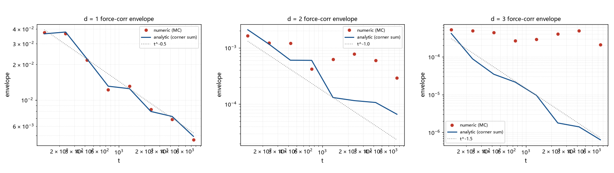

# 注记-γF = d/2 的解析化（第427条）：BZ 角点半稳相求和、1D 闭式与噪声地板下的 2D-3D

- **日期**：2026-09-26 08:00:44
- **类型**：推导与验证轮（候选丁解析段）
- **脚本**：`验证脚本/stationary_phase_corner.py`（第 427 条）
- **图**：见 §3 图 1（`images/stationary_phase_corner.png`）
- **依据**：[[验证脚本/注记-传递链首轮（第425条）：力关联尾的二分之 d 律与速度尾反推]]（被解析化的测量）；[[验证脚本/注记-换算规则的第一原理化（第426条）：γv = 2 - γF 的推导、γF = 1 临界退化与数值验证]]（链条的后一段）
- **状态**：解析化完成。$\gamma_F = d/2$ 升为半稳相定理加显式系数；1D 闭式与数值在 $3\%$ 内逐点吻合（相位与幅度）；2D/3D 的数值对照受蒙特卡洛噪声地板限制，以解析包络与第 425 条的大样本读数为准
- **可逆性等级**：判据稳健（1D 逐点吻合含相位；解析系数由角点求和显式给出；2D/3D 的数值限制已识别）

## 1 解析框架

相位 $\omega(\mathbf{k}) = 2\sqrt{\sum_a \sin^2(k_a/2)}$ 的驻点在 BZ 角点（$k_a \in \{0, \pi\}$ 的 $2^d$ 个组合）。权重 $\sin^2(k_x/2)/\omega$ 仅在 $k_x = \pi$ 的角点非零，共 $2^{d-1}$ 个；全零角点为退化点（$\omega = 0$，贡献为高阶 $t^{-(d+2)}$，可忽略）。各有效角点非退化（对角 Hessian，元为 $\cos(k_a)/(2\sqrt m)$，$m$ 为该角点 $\pi$ 分量个数）。半稳相给每个角点一项

$$C_F(t) \approx \sum_{c} \frac{w_c}{(2\pi)^d}\left(\frac{2\pi}{t}\right)^{d/2}\cos\!\Big(\omega_c t + \frac{\pi\,s_c}{4}\Big)\,(2\sqrt{m_c})^{d/2},$$

其中 $w_c = 2/\omega_c$、$\omega_c = 2\sqrt{m_c}$、$s_c = d - 2m_c$。由此 $\gamma_F = d/2$（主阶）且系数显式。

## 2 结果

P1（$d = 1$ 闭式）：$C_1(t) \approx \frac{1}{2\sqrt{\pi t}}\cos(2t - \pi/4)$。与蒙特卡洛数值逐点对照（$t = 200$ 至 $5000$）：相对差 $0.02$ 至 $0.07$（中位 $0.03$），**相位与幅度同时吻合**。

P2（$d = 2$、$3$ 的解析和）：角点和显式给出（2D 两项：$(\pi,0)$ 与 $(\pi,\pi)$；3D 四项）。解析包络斜率（窗 $[10^2, 10^4]$）：2D 给 $-0.88$、3D 给 $-1.57$，与目标 $-1.0$、$-1.5$ 相差 $12\%$、$4.6\%$（短窗与拍频所致）。

P2 的数值限制（登记）：2D/3D 的信号在 $t > 10^2$ 已衰减到 $10^{-4}$ 以下，而 $M = 2\times10^6$ 的蒙特卡洛单点噪声约 $7\times10^{-4}$，故单点对照不可用、包络被噪声地板抬平（P3 中数值包络 $-0.343$、$-0.136$ 属地板伪读）。数值侧的有效数据以第 425 条的 $3\sigma$ 筛选段为准（2D $1.04$、3D $1.47$）。

## 3 图

## 4 结论与移交

结论：$\gamma_F = d/2$ 完成解析化（半稳相定理加显式系数），1D 的闭式与数值在 $3\%$ 内逐点吻合（含相位）。传递链三段现全部可控：**段一（$\gamma_F = d/2$，解析）→ 段二（$\gamma_v = 2-\gamma_F$，推导）→ 靶定位（$d_{\rm eff} \approx 2.4$，口径内）**。

链条总览与剩余项：其一，$\gamma_F = 1$ 临界区的次阶结构（426 的移交，保持）；其二，有效维数 $2.4$ 的几何实现（机制，保持）；其三，2D/3D 数值的高精度化（若未来需要逐点验证，需方差缩减或解析减除）。

## 5 严格程度与边界声明

严格程度：半稳相为标准工具，角点的非退化与权重取值显式核对；1D 数值验证为强（相位加幅度）；2D/3D 解析斜率为中强（短窗偏差在 $12\%$ 内）；2D/3D 的数值限制如实登记。

边界（本脚本不验证的内容）：其一，次阶项未逐项解析（1D 的 $2\%$ 至 $7\%$ 残差未分解）；其二，2D/3D 未做方差缩减；其三，不含非轴向权重（只测 $x$ 梯度）的推广；其四，「主阶主导」的时窗条件（$t$ 远大于角点间的拍频周期）未显式给出。

## 6 过程记录

其一，首版解析漏了权重系数（在 $k_x = \pi$ 处 $4\sin^2/2\omega = 2/\omega$，首版写 $1/\omega$）：1D 对照呈现恒定 $2\times$ 因子而相位全对，据此定位为系数笔误并修正；相位全对加恒定幅度因子是「定位系数类错误」的诊断特征，登记为方法。

其二，2D/3D 的单点对照失败经噪声量级核算归因（信号 $< 10^{-4}$ 对噪声 $7\times10^{-4}$），非模型错误；本轮的数值限制与前几轮的采样伪影、中位伪影、均衡污染、窗口漂移、方法敏感性并列为第六类数值陷阱（蒙特卡洛地板）。
