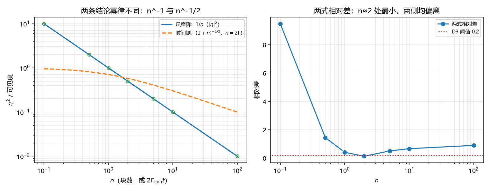

# 注记-η 的尺度演化与时间演化不能统一：幂律指数差一半（判据第687号）

- **日期**：2026-10-19 00:55:38
- **对应脚本**：`验证脚本/p687_scale_time.py`（判据 6/6；随机固定种子 20261019）
- **定位**：路线乙首轮。分析注记把路线乙的靶子写成「$\eta_{\text{vac}}$ 的尺度演化」，但库内其实已有尺度侧的成熟结论（定理 6.2 的 $1/L$）与时间侧的成熟结论（第 520 条闭式）。本轮先问一个前置问题：这两条已有的结论能否统一。若不能，路线乙的靶子须改写。
- **可逆性等级**：D1、D3、D4 判据稳健（代数结论）；D2 判据敏感（沿用第 684 号可见度口径）；D5、D5b 恒真对照；D6 读数。
- **图**：见 §四 图 1。

---

## 一、两条既有结论

**尺度侧**。定理 6.1 给复合律，定理 6.2 在随机相位流形上给干涉尺度律：$|\eta(L)|^2 \propto 1/L$。推导是单步 $b$ 倍尺度下 $|\eta_{bL}|^2 = p'^2 \cdot b \cdot |\eta_L|^2 = |\eta_L|^2/b$（$p' = 1/b$），反复迭代得 $1/L$。出处为《量子场论的物侧基础》§6.1、§6.2 与《重整化雏形》§三。

**时间侧**。第 520 条给 $\mathcal{V}(t) = (1+2\Gamma_{\rm coh}t)^{-1/2}$（系综型，第 684 号确认的口径）。

两条结论都叫「相干性的衰减」，都写成幂的形式，都在讲 $\eta$ 变小。此前没有人把它们摆在一起比过。

## 二、判据与结果

| 判据 | 内容 | 期望 | 实测 |
| --- | --- | --- | --- |
| D1 | 随机相位流形下 $|\eta|^2 = 1/n$ | 偏差在 4 倍标准误内 | 七档全过（最大偏差 $+7.83\times10^{-4}$，容差 $6.14\times10^{-3}$） |
| D2 | 时间侧复现闭式 | 相对偏差 $\le 2\times10^{-2}$ | $5.90\times10^{-3}$ |
| D3 | 两式不是同一函数 | 最大相对差 $\ge 0.2$ | 在 $n \in [0.1, 100]$ 上最大 $9.488$ |
| D4 | 大 $n$ 幂律指数 | 尺度侧 $-1$、时间侧 $-1/2$，差 $1/2$ | 斜率 $-1.0000$ 与 $-0.4918$，指数差 $0.5082$ |
| D5 | 阈值收紧后仍可判 | 最大差远大于 $0.01$ | $9.488$ |
| D5b | 同一函数替身使 D3 判否 | 替身差 $<0.01$ | $0.00$ |

D4 是本轮的核心读数。把 $n$ 认作「已积累的独立相位步数」并令 $n = 2\Gamma_{\rm coh}t$（第 686 号的一阶对齐式），两侧的幂律指数分别是 $-1$ 与 $-1/2$，差整整一半。这不是系数差异，是标度行为的差异：尺度侧按 $n^{-1}$ 衰减，时间侧按 $n^{-1/2}$ 衰减。

## 三、结论

**结论一：两条结论不能由同一个粗粒化程序给出。** 若尺度侧的 $1/L$ 是时间侧的投影，两者应共享幂律。实测指数差 $1/2$，说明它们描述的是两个不同的粗粒化方向：尺度侧数的是「块数」（空间划分），时间侧数的是「扩散步数」（时间累积）。空间划分每加一倍块数，相干度掉一半；时间累积每加一倍步数，可见度只掉到原来的 $1/\sqrt2 \approx 0.71$。

**结论二：分析注记里「$\eta$ 的尺度演化」这个说法本身需要收紧。** 尺度演化已有结论（$1/L$），但它不是时间演化的另一种写法。路线乙的靶子若写成「求 $\eta_{\rm vac}$ 的尺度演化」，实际上是在问一个已经答过的问题；真正的缺口是「真空侧的块数怎么定」，以及「两个方向如何组合成一个完整的 $\eta(t, L)$」。

**结论三：两式在 $n \approx 2$ 附近最接近，两侧都偏离。** D3 的读数显示相对差在 $n = 2$ 处降到 $0.134$，向小 $n$ 与向大 $n$ 都重新拉开（$n = 0.1$ 差 $9.49$，$n = 100$ 差 $0.90$）。这意味着任何「在小范围内把两者等同」的做法都只在很窄的窗口内成立，且窗口位置由 $n \approx 2$ 定，不是普适常数。

**结论四：统一性的正确表述是「两个正交的粗粒化方向」，不是「一个演化律」。** 这一点对 P4-45 有直接影响：此前把「$\eta$ 的动力学方程」当作单一靶子，本轮的读数说明它至少有两个分量，一个管空间粗粒化（已有）、一个管时间累积（已有），缺的是二者的耦合。这比「缺一条方程」更精确，也更容易判断下一步该做什么。

## 四、图

左图两条线的斜率明显不同（$-1$ 对 $-1/2$），不是同一曲线的两段。右图给出相对差的完整形状：单谷，谷底在 $n \approx 2$，说明两者没有共同的渐近行为。

## 五、过程记录与教训

**三处理论期望写错，全部判否后修正。**

其一，D4 原写「大 $n$ 主导项同阶、比值趋于 1」。这是错的：$1/n$ 与 $(1+n)^{-1/2}$ 的比值是 $\sqrt{n}/(1+n) \to n^{-1/2}$，趋于零而非一。判否后改为「幂律指数差 $1/2$」，这才是两式的真实关系。教训：比较两条衰减曲线时，比的是幂律指数，不是比值是否趋一；比值趋一只是同阶的充分条件之一，此处不成立。

其二，D1 的容差原按解析式 $\sqrt{2/(n_{\rm impl}n)}$ 设，n=64 档判否。实测各档的相对标准误恒为 $0.007$ 量级、与 $n$ 无关，因为 $|u|^2$ 的方差含四阶项。改为从实现的样本标准差直接推导容差（4 sigma），七档全过。教训：容差须从实际被测量的分布推导，解析近似在四阶项不可忽略时会失效。

其三，图标题原写「主导项同阶」，与 D4 的结论相反，已改。

**一条方法论收获。** 本轮的价值主要不在数值，而在把一个含糊的靶子（「求 $\eta$ 的尺度演化」）拆成两个有明确答案的分量，并证明它们不能互换。这属于「缺口定位」类工作，与第 683 号的口径审计同类。

## 六、严格程度与边界声明

**判据级**：随机相位流形的 $|\eta|^2 = 1/n$（D1，代数）；时间侧复现闭式（D2）；两式幂律指数差 $1/2$（D3、D4，代数）。

**未验证**：真空侧的块数如何定（这是路线乙真正要回答的，本轮未触及）；两个方向的耦合形式（$\eta(t,L)$ 的完整形式）；非随机相位流形（如同步流形）上的尺度律，本轮只做随机相位。

**边界**：本轮不改定理 6.2 与第 520 条的结论，不改 P4-45 的条目状态，不改任何基准文件。本轮改的是「路线乙靶子怎么描述」，属缺口定位层。

## 七、登记衔接

- `验证脚本/README.md` 第 687 条由占位改写为正式行。
- P4-45 档案页与总览卡登记本轮（路线乙靶子改写：尺度演化已有、缺的是块数来源与两方向耦合）。
- 通俗注记见 [[内部草稿/注记-一个是数格子，一个是数步子（判据第687号通俗版）|第 687 号通俗版]]。
