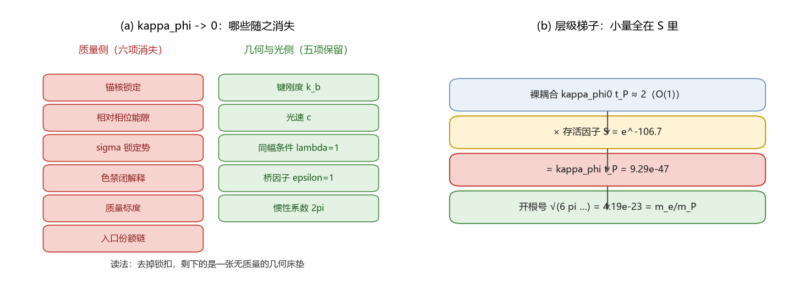

# 注记-κ_φ 必要性（第359条）：N1 极限清单与 N2 替代机制的读数复现要求

- **日期**：2026-09-22 07:13:14
- **类型**：判据执行轮（判据草案 N1、N2 首轮执行）
- **脚本**：`验证脚本/minimal_verification_kappa_phi_necessity.py`（第 359 条）
- **图**：见 §2 图 1（`images/kappa_phi_necessity_map.png`）
- **依据**：[[内部草稿/判据草案-κ_φ 的必要性：极限清单、替代机制与有效刚度分布]]；[[验证脚本/注记-量纲桥MB-9：惯性归一的独立导出：公理4哈密顿的显式系数（判据MB9-a至MB9-e）]]；[[理论总纲/元相子理论的时空观：体系对时空的完整认识]]（光速三个侧面不依赖弹性参数）；[[有质量粒子的形成：大爆炸同步相变的局域缺陷方案]] §7.2 第四项（裁决二十八）
- **状态**：N1、N2 完成；N3 的措辞部分前轮已收口，数值部分移交粒子线

## 1 判据与设定

N1：收齐 $\kappa_\phi$ 的全部角色，逐条判定 $\kappa_\phi \to 0$ 的去向（消失、保留或待定），凡标保留者须说明不依赖 $\kappa_\phi$。N2：列出替代机制必须复现的读数，并对候选路线给出判句。输入：$\kappa_\phi t_P = 9.293805\times10^{-47}$、$K = 3\kappa_\phi t_P$、$u$ 场 $m_\Phi = 2\pi$、$\theta$ 场 $k_b = 1/(2\pi)$、$\omega_P = 2\pi/t_P$、$S = e^{-106.7}$（裁决二十八）。全部为确定性算术。

## 2 N1 结果：极限清单

| 角色 | $\kappa_\phi \to 0$ 去向 | 依据 |
| --- | --- | --- |
| 锚核振幅锁定 | 消失 | 绑定能按 $\kappa_\phi$ 标度（实测 3.13/121.9/359.4）；锁不住则无质量标签 |
| 相对相位能隙 $\omega_0^2 = 3\omega_P\kappa_\phi$ | 消失 | 能隙归零，缺口模式不存在，M-E 锚失去对象 |
| $\sigma$ 锁定势 $K = 3\kappa_\phi t_P$ | 消失 | 孤子质量 $(4/\pi)\sqrt{K/J}\,m_P$ 随 $K$ 归零 |
| 色禁闭的几何解释 | 消失 | 三轴解耦，三元组可分解 |
| 质量标度 $m_f \sim \hbar\sqrt{\kappa_\phi}$ | 消失 | 全部静止质量归零 |
| 入口份额反解链 $f = \rho_b/(M\rho_P)$ | 失效 | 分母归零 |
| 键刚度 $k_b$、光速 $c$、同幅条件 $\lambda = 1$、桥因子 $\epsilon = 1$、惯性系数 | 保留 | 各自依据均不引用 $\kappa_\phi$（公理 4、时空观、GV 轮、MB-1、MB-9） |

读法：去掉锁扣，质量侧六项同时消失，几何与光侧五项原样保留，剩下的是一张无质量的几何床垫。$\kappa_\phi$ 因此是结构必需项，不是可剥离的补丁；同时它只出现一次，六个后果是同一项的多重读法，不是六次独立拟合。

## 3 N1 恒等式核对

三条核对全过：$\sqrt{6\pi\kappa_\phi t_P} = 4.185500\times10^{-23}$ 对 $m_e/m_P = 4.185463\times10^{-23}$，相对差 $8.9\times10^{-6}$；$\sqrt{3\omega_P\kappa_\phi} = 7.763510\times10^{20}$ s$^{-1}$ 对 $m_ec^2/\hbar = 7.763441\times10^{20}$ s$^{-1}$，相对差 $8.9\times10^{-6}$；$K/J = 6\pi\kappa_\phi t_P = 1.751841\times10^{-45}$ 逐位相同。前两条的残差落在 $\kappa_\phi t_P$ 的有效位数内。

## 4 N2 结果：替代机制的读数复现要求

五条读数：缺口 $= 0.51100$ MeV、孤子 $= 4/\pi$ 倍（$0.65063$ MeV）、能隙式 $\omega_0^2 = 3\omega_P\kappa_\phi$、换算恒等式 $K/J = 6\pi\kappa_\phi t_P$、入口份额 $f = 1.949756\times10^{-102}$（2026-09-22 裁决后取缺口读数）。三条候选路线的判句：相变冻结须给出 $S$ 的动力学计算或解析形式；诱导耦合须写出诱导算符及其系数并与公理 4 形式一致；边界或宇宙学机制须复现五条读数。三者均要求不引入新的自由参数，目前都未成立。

数量级侧有一个自洽发现：按裁决二十八的分解反解，裸耦合 $\kappa_\phi^{(0)}t_P = 2.030$，即 O(1)。层级不在裸层，全部小量集中在存活因子 $S = e^{-106.7} = 4.579\times10^{-47}$。机制目标因此可以从「为什么 $\kappa_\phi$ 是 $10^{-47}$」收窄为「为什么存活因子是 $e^{-106.7}$」。

## 5 结论与登记

N1 判定：$\kappa_\phi$ 的项不可去（六项质量侧结论随它消失）。N2 判定：三条替代路线都未成立，数值保持输入，但角色收窄为整体标度，机制目标锁定为 $S$。对应草案的结局二（角色收窄），并保留结案一的通道：$S$ 一旦算出，$\kappa_\phi$ 即从输入降为导出。

## 6 严格程度与边界声明

严格程度：N1 清单为文档级判定，第 3 节三条为机器精度算术（判据级）；N2 为机制比较（纲领级）。边界：不判定 $S$ 的机制，不重算既有读数，不覆盖谱形侧（N3 数值部分归粒子线）。

## 7 过程记录

触发为作者提问「$\kappa_\phi$ 是否有必要加入，也许它本来就不存在」。执行中发现两点：其一，质量侧六项的同时消失说明「项」与「数」必须分开处理；其二，裁决二十八的分解使裸耦合回到 O(1)，原先笼统的层级问题可以收窄到一个具体因子 $S$。
