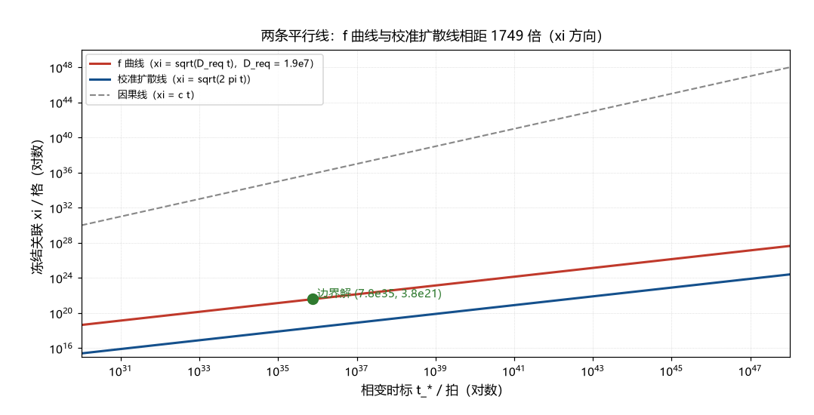

# 注记-ξ 的独立依据（第408条）：单参数曲线结构与扩散建立的对照

- **日期**：2026-09-25 06:35:43
- **类型**：判定轮（f 线判句一）
- **脚本**：`验证脚本/xi_independence.py`（第 408 条）
- **图**：见 §3 图 1（`images/xi_independence.png`）
- **依据**：[[验证脚本/注记-f 线首轮（第398条）：Kibble 链条四环清点与 f 的口径表]]（三件未齐与判句移交）；[[内部草稿/判别材料-W1 轮：稀释的框架内重算与 Reading A 的裁决（相变时标钉到 10^-6 秒档）]]（边界解与「ξ 每加两个数量级、t_* 加四个数量级」）；[[评审报告/补充评审报告-结晶时刻的定位-2026-09-20]]（ξ 自由度）
- **状态**：判定完成。ξ 无独立依据；链条为单参数曲线；扩散建立假设要求 D = 1.9e7（超校准上界 3.1e6 倍）
- **可逆性等级**：判据稳健（单参数曲线结构与超校准判定不随实现或口径翻；$D_{\rm req}$ 的具体数字随 $f$ 档位与 $t_{\rm eq}$、$z_{\rm eq}$ 取值移动）

## 1 判据与设定

第 398 条把 f 链条的闭合定位为「边界解角点」（$\xi = w_{\rm def}$、$A = 1$、$t_*$ 取下界），并移交判句一：$\xi = w_{\rm def}$ 的独立依据。本轮清点 $\xi$ 的全部约束（X1），验证单参数曲线结构（X2），把「扩散建立」假设代入求解（X3），给出时间匹配读法与综合判定（X4）。全部为确定性算术，格点单位取 $l_P = t_P = 1$。

## 2 结果

X1（约束清点）：$\xi$ 只有两条不等式与一个方程。健全性下界 $\xi \ge w_{\rm def} = 3.80\times10^{21}$ 格；因果上界 $\xi \le c t_*$；f 方程 $\xi^{-3}(t_*/t_{\rm eq})^{3/2}z_{\rm eq}^{-3} = 2.12\times10^{-105}$。两个未知量对一个方程，故 $\xi$ 与 $t_*$ 呈单参数联动。

X2（曲线验证）：$\xi$ 取 $w_{\rm def}$、$100\,w_{\rm def}$、$10^4\,w_{\rm def}$ 时，$t_*$ 分别为 $7.562\times10^{35}$、$7.562\times10^{39}$、$7.562\times10^{43}$ 拍，f 复核逐点不变。曲线为 $\xi \propto t_*^{1/2}$（$\xi$ 每乘 $100$，$t_*$ 乘 $10^4$），与第 W1 轮的登记一致。边界解 $(\xi = w_{\rm def},\, t_* = 7.562\times10^{35}$ 拍 $= 4.08\times10^{-8}$ 秒$)$ 是曲线上的产量最大角点。

X3（扩散建立假设）：设 $\xi^2 = D t_*$（扩散建立），代入 f 方程消去 $t_*$，得 $f = D^{-3/2}t_{\rm eq}^{-3/2}z_{\rm eq}^{-3}$，即 $D$ 有唯一解 $D_{\rm req} = 1.909\times10^{7}$ 格²每拍。与校准扩散上界 $2\pi$ 之比为 $3.039\times10^{6}$（$\xi$ 方向 $1743$ 倍）。交叉复核：在 $t_* = 7.562\times10^{35}$ 拍处，校准扩散只能建立 $\xi = 2.18\times10^{18}$ 格，为 $w_{\rm def}$ 的 $1/1743$。

X4（时间匹配读法）：边界解处 $D_{\rm req} \times t_* = w_{\rm def}^2$（数值同一，差 $0.0\%$）。读法：$D t_* = w_{\rm def}^2$ 即「建立缺陷宽度所需时间等于相变时标」，边界解由此获得一个时间匹配的表述。

## 3 图

## 4 结论与判句移交

ξ 的独立依据没有找到：全部约束（两条不等式加一个方程）允许 $\xi$ 沿单参数曲线自由滑动；「$\xi = w_{\rm def}$」是产量最大的角点选择，其唯一可表述的额外内容是时间匹配条件 $D t_* = w_{\rm def}^2$（推不出 $D$ 的机制）。

若取「扩散建立」读法，则 $D$ 被 f 方程唯一钉定：$D_{\rm req} = 1.909\times10^7$ 格²每拍，超校准扩散上界 $3.1\times10^6$ 倍。该超扩散在体系内无依据，与朗道-齐纳路线的宽度困境（需 $\kappa$ 超校准 $2.7$ 至 $10.8$ 倍）同构，倍数更大。

判句移交：其一，超扩散机制（$D = 1.9\times10^7$ 的来源）或「扩散建立」读法的否定；其二，$\xi$ 自由度的正式处置（沿用 P1-2a 的「钉住 $\xi$ 上界的独立链」登记，本轮的补充是：下界端已有解、上界端（因果）很远、自由度在中间）。

## 5 严格程度与边界声明

严格程度：X1 至 X4 为定义加代数（换算级与判据级）；单参数曲线与时间匹配为等价改写；「超扩散无依据」为阴性陈述（不声称穷尽）。

边界：不建立 $\xi$ 的动力学；不改 W1 与第 398 条的读数；「扩散建立」为候选读法（其否定留给判句）；$D_{\rm req}$ 依赖 $f$ 档（可见物质档）与标准 $t_{\rm eq}$、$z_{\rm eq}$，换档时数字移动而结构不变（见可逆性等级）。

## 6 过程记录

触发：第 398 条判句一移交后开工。判定路径：先列约束（发现只有一个方程）、再验证曲线结构（与 W1 登记一致）、再把「扩散建立」代入（消去 $t_*$ 后得到 $D$ 的唯一解，这是本轮的关键一步：两个未知量的联立被一个「平行线」结构替代）、最后给出时间匹配读法。附带读数：两条线平行（斜率同为 $1/2$），这一几何是「扩散标度与膨胀标度相容」的表现。
