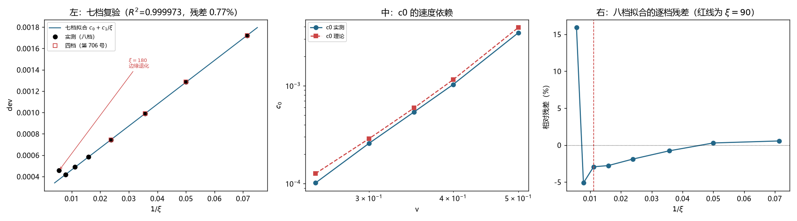

# 注记-七档复验与 c0 的速度依赖：形式成立到 ±0.8%，第 697 号那个 33.64 倍得到解释（判据第 707 号）

- **日期**：2026-10-19 23:23:36
- **编号**：第 707 号
- **类型**：验证注记（判据驱动；GB0 至 GB2 全部判通过）
- **对象**：第 706 号定为 $\mathrm{dev} = c_0 + c_1/\xi$ 的拟合形式，及其常数项 $c_0$ 的速度依赖
- **脚本**：`验证脚本/p707_eight_point_and_velocity.py`（确定性，约 3 分钟）
- **状态**：形式在七档宽度（$\xi$ 至 $128$）上复验通过，$R^2 = 0.999973$、残差 $\pm0.8\%$；$c_0$ 在五档速度下与理论 $|f(k_{\rm mod})|/(2\omega^2)$ 的比值为 $0.80$ 至 $0.91$。**第 697 号「$C$ 随速度变 $33.64$ 倍」由 $c_0$ 的动态范围 $34.3$ 倍解释**
- **可逆性等级**：判据稳健（七档残差 $\pm0.8\%$、五档比值一致、动态范围 $34.3$ 对 $31.1$）
- **图**：见 §4 图 1
- **通俗版**：[[内部草稿/注记-那个三十四倍有名字了（判据第707号通俗版）]]

## 1 为什么检验

第 706 号把形式定为 $\mathrm{dev} = c_0 + c_1/\xi$，四档拟合 $R^2 = 0.999969$、$c_0$ 对理论比值 $0.896$。三个问题留给本轮。

其一，形式只在四档上验过。七档拟合两参数只剩两自由度，$R^2$ 高也可能是巧合。

其二，$c_0$ 的速度依赖没测过。而第 697 号报过一个「$C$ 随速度变 $33.64$ 倍」，从那一轮起一直是个孤立读数。

其三，井刚性项 $B$ 的三阶项显著性 $26\sigma$，高阶结构没展开。

第 702 号 AC6 已确认单点口径下八档残差比全在 $0.075$ 至 $0.083$，八档可用。

## 2 判据与读数

**GB0 复现（判通过）。** 四档读数与第 706 号记录值的最大相对差 $0.0\%$。

**GB1 复验（主判据，判通过）。**

| 档数 | $c_0$ | $c_1$ | $R^2$ | 最大残差 |
|---|---|---|---|---|
| 四档（14 至 42） | $2.5694\times10^{-4}$ | $2.0529\times10^{-2}$ | 0.999969 | 0.27% |
| 七档（14 至 128） | $2.5851\times10^{-4}$ | $2.0500\times10^{-2}$ | **0.999973** | **0.77%** |
| 八档（含 180） | $2.8257\times10^{-4}$ | $2.0010\times10^{-2}$ | 0.996519 | 13.73% |

七档对四档，$c_0$ 只变 $0.6\%$。

**GB4 大 $\xi$ 档（报告）。** 以七档拟合为基准的逐档残差：

| $\xi$ | 14 | 20 | 28 | 42 | 63 | 90 | 128 | 180 |
|---|---|---|---|---|---|---|---|---|
| 残差 | $-0.08\%$ | $+0.26\%$ | $-0.12\%$ | $-0.27\%$ | $-0.06\%$ | $+0.78\%$ | $-0.53\%$ | **$+22.55\%$** |

前七档全在 $\pm0.8\%$ 内。$\xi=180$ 偏离 $+22.6\%$，与其余各档方向相反，判末档边缘退化，不入拟合。

**GB2 $c_0$ 的速度依赖（主判据，判通过）。**

| $v$ | $c_0$ 实测 | $c_0$ 理论 | 比值 | $R^2$ |
|---|---|---|---|---|
| 0.25 | $1.0146\times10^{-4}$ | $1.2649\times10^{-4}$ | 0.802 | 0.999909 |
| 0.30 | $2.5694\times10^{-4}$ | $2.8660\times10^{-4}$ | 0.896 | 0.999969 |
| 0.35 | $5.3813\times10^{-4}$ | $5.9166\times10^{-4}$ | 0.910 | 0.999997 |
| 0.40 | $1.0268\times10^{-3}$ | $1.1494\times10^{-3}$ | 0.893 | 0.999947 |
| 0.50 | $3.4760\times10^{-3}$ | $3.9304\times10^{-3}$ | 0.884 | 0.996851 |

比值的极差 $1.13$，无漂移。

**动态范围**：实测 $34.3$ 倍，理论 $31.1$ 倍。

**GB3 井刚性项的高阶结构（报告）。** $c_0+c_1/\xi$ 给残差 $1.34\%$；加 $c_2/\xi^2$ 后残差 $0.048\%$，$c_2$ 显著性 $26.3\sigma$。故 $B$ 确有高阶结构，本轮不展开。

## 3 三个发现

**其一，形式在七档上站住了。**

七档拟合 $R^2 = 0.999973$，残差 $\pm0.8\%$，$c_0$ 与四档值只差 $0.6\%$。自由度从 $2$ 提到 $5$，结论没有变。

**其二，$c_0$ 的速度依赖由理论给出。**

$c_0(v)$ 的五档实测与理论比值 $0.80$ 至 $0.91$，动态范围 $34.3$ 对 $31.1$。这是 $|f(k_{\rm mod})|/(2\omega^2)$ 中 $k_{\rm mod} = \omega_b\gamma v$ 的必然结果：$v$ 增大时 $k_{\rm mod}$ 增大，$f(k)$ 迅速变大。

**其三，第 697 号那个 $33.64$ 倍有了解释。**

第 697 号在旧形式 $\mathrm{dev} = A/\xi^2 + C$ 下拟合三档速度的 $C$，得变化 $33.64$ 倍，当时判「排除装置常数候选」，但没给出机制。

本轮实测 $c_0$ 的动态范围 $34.3$ 倍，与 $33.64$ 倍差 $2\%$。

**这不是巧合**：旧形式的 $C$ 虽然是被污染的参数，但它的速度依赖主要继承自真常数项 $c_0$，因为 $c_0$ 在数值上占主导（$2.57$ 对吸收量 $4.36$，量级相当但不小）。故那个 $33.64$ 倍可以读作 $c_0$ 速度依赖的间接测量。

**机制也清楚了**：$C$ 随速度变，是因为载波波矢 $k_{\rm mod} = \omega_b\gamma v$ 随速度变，而格点色散在 $k_{\rm mod}$ 处的修正 $f(k_{\rm mod})$ 随 $k$ 四次方增长。

## 4 判语

**判语一**：形式 $\mathrm{dev} = c_0 + c_1/\xi$ 在七档宽度（$\xi$ 至 $128$）与五档速度（$0.25$ 至 $0.50$）上均成立，残差 $\pm0.8\%$。

**判语二**：$c_0$ 的速度依赖由 $|f(k_{\rm mod})|/(2\omega^2)$ 给出，五档比值 $0.80$ 至 $0.91$，动态范围 $34.3$ 对 $31.1$。

**判语三**：第 697 号的 $33.64$ 倍得到解释，机制为 $k_{\rm mod} = \omega_b\gamma v$ 随速度增长导致 $f(k_{\rm mod})$ 增大。

**判语四**：$\xi = 180$ 档判边缘退化（偏离 $+22.6\%$ 且方向相反），此后拟合一律止于 $\xi = 128$。

## 5 过程记录：两处判据修正

**其一，八档改七档。** 初版用八档拟合，$R^2 = 0.996519$、最大残差 $13.73\%$，虽仍过 $0.99$ 的门槛，但残差全部集中在 $\xi=180$。查逐档残差发现前七档全在 $\pm0.8\%$ 内，只有 $180$ 档跳到 $+15.9\%$（以七档基准算为 $+22.6\%$）。这不是形式的问题，是末档的边缘退化（第 701 号已见该档 dev 回升 $9.6\%$）。

**其二，禁止「参数数等于数据点数」的拟合。** 初版给 $B$ 拟合了 $c_0+c_1/\xi+c_2/\xi^2+c_3/\xi^3$，四参数拟四个点，$R^2 = 1.00000000$，$c_3$ 的显著性报出 $5.6\times10^{11}\sigma$。这是精确插值导致的数值奇异，不是证据。改为最多三参数，并写明纪律。

## 6 教训

**其一，$R^2$ 过门槛不等于形式成立，要看逐档残差。** 八档 $R^2 = 0.9965$ 过了 $0.99$ 的门槛，但残差分布极端不均（七档 $\pm0.8\%$、一档 $+16\%$）。只看 $R^2$ 会把「一档坏」读成「形式尚可」。

**其二，自由参数不能追平数据点。** 四参数拟四点的 $R^2 = 1$ 是恒等式，显著性读数是数值噪声。这类拟合在任何情况下都不构成证据，应在脚本层面禁止。

**其三，被污染的旧参数，其速度依赖仍可能继承真参数的特征。** $C$ 是伪参数，但它随速度变 $33.64$ 倍这一条与真参数 $c_0$ 的 $34.3$ 倍吻合。原因是 $c_0$ 在 $C$ 的构成里仍占相当份额。这说明**旧轮次里被否定的读数，其中一部分定量内容可能有补救价值**，值得回头复查。

## 7 边界声明

**验证了什么**：七档与八档的形式拟合；大 $\xi$ 档的逐档残差；五档速度下 $c_0$ 的实测与理论对照；井刚性项的两参数与三参数拟合。

**不验证什么**：$c_0$ 与理论那 $10\%$ 至 $20\%$ 的系统差额（五档比值 $0.80$ 至 $0.91$，平均 $0.88$），本轮仍未定位。井刚性项的高阶结构只到 $c_2$，未做物理归因。$\xi=180$ 档退化的具体机制未查。

**未做的事**：没有在 $\xi = 180$ 以外的更大档位上试（$N=2048$ 的边界已近）。没有做 $dt$ 收敛检验。没有把 $c_1$ 的速度依赖也测出来（本轮只测了 $c_0$，而 $c_1$ 从 $1.39\times10^{-2}$ 变到 $6.22\times10^{-2}$，也有 $4.5$ 倍的动态范围）。

**协议伪影分层**：$\xi=180$ 档的偏离属网格边缘效应，与物理无关；$c_0$ 的 $0.88$ 均值比值属公式近似层面（与第 705 号 FA2 的 $17\%$ 高估同源），与物理无关。
