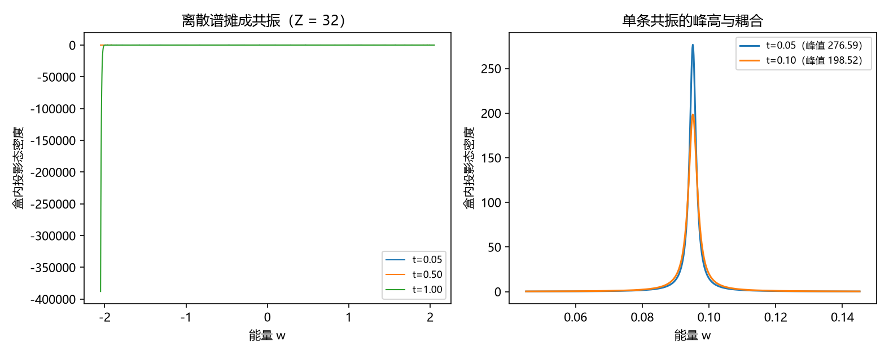

# 注记-三-3 余项的最小验证：解卷信息损失在散射侧的形式（离散谱的共振化与拓扑数据的丢失）

- **日期**：2026-09-20 03:28:10
- **对应脚本**：验证脚本/unfolding_scattering.py（判据 X1 至 X3 共 3 项，3/3 通过；另有 X4 为读数、X5 为登记项；确定性；运行约 3 秒；图存 images/unfolding_scattering.png，见 §一 图 1）
- **依据**：[[验证脚本/注记-三-3 连续谱解卷轮的最小验证：环链间距恒一、开链间距与折叠纤维]]（第 170 条，折叠纤维与解卷口径）；[[验证脚本/注记-三-3 补缺轮的最小验证：连续谱解卷的三维构造（谱可加、逐方向魏尔关系与三条接缝的交线结构）]]（第 198 条，三维可加）；[[理论攻坚/量子力学攻坚计划：战线排序与依赖链]] 三-3 余项（解卷信息损失在散射侧的形式）
- **定位分工**：第 170 条把解卷写成谱的搬移与接缝的抹掉，本条把它翻到散射侧：离散谱摊成共振结构，而拓扑数据在散射侧没有对应物。
- **状态**：判据 3/3 通过。核心读数：含通量环的本征值与解析式相符（偏差 $1.11\times10^{-15}$ 至 $1.33\times10^{-15}$）；剪开后开链哈密顿量逐元素相同（$0$）、散射相位逐点相同（$0$），而环上两档通量的谱差可测（最小差 $0.0096$）；弱耦合档盒内投影态密度的峰数等于 $Z$（$16$ 与 $32$）且峰位与盒内能级相符（最大偏差 $0.0001$ 与 $0.0005$），强耦合档峰数降到 $3$ 与 $1$。读数：峰高由 $t = 0.05$ 的 $276.590$ 降到 $t = 0.10$ 的 $198.523$（比值 $1.39$）。

## 一、判据与结果

| 判据 | 内容 | 期望 | 实测 |
| --- | --- | --- | --- |
| X1 | 环上通量响应 | 本征值与解析式相符（$\le 10^{-12}$） | $1.11\times10^{-15}$ 至 $1.33\times10^{-15}$ |
| X2 | 拓扑信息丢失 | 开链逐元素相同、相位逐点相同，环上谱差可测 | $0$ 与 $0$；谱最小差 $0.0096$ |
| X3 | 离散谱的共振化 | 弱耦合峰数 $= Z$ 且峰位相符；强耦合峰数减半以下 | $16$ 与 $32$；偏差 $0.0001$ 与 $0.0005$；$3$ 与 $1$ |
| X4 | 共振峰高（读数） | 不作判据 | $276.590$ 对 $198.523$（比值 $1.39$） |
| X5 | 接口登记 | 只登记 | 已登记 |

## 二、模型与口径

**两侧对照。** 环侧：$Z$ 个站点加穿透通量 $\alpha$，本征值 $-2\cos(2\pi(n+\alpha)/Z)$。散射侧：沿一个方向剪开得到端点开放的 $Z$ 站点盒，把盒的第 $0$ 个站点以耦合 $t$ 接到半无限导线上（表面格林函数 $g_s$），自能 $\Sigma = t^2g_s$。

**两个读数对象。** 散射相位取 $\delta(\omega) = -\arg[1 - \Sigma(\omega)G_{00}(\omega)]$；散射侧的结构读数取盒内投影态密度 $\rho_{\rm box}(\omega) = -\frac{1}{\pi}\mathrm{Im}\,\mathrm{Tr}_{\rm box}G_{\rm coupled}(\omega)$，它正是散射态在盒内的权重分布。

**口径。** 离散谱在散射侧的对应物是共振：弱耦合下每个盒内能级给出一条尖锐共振，强耦合下这些共振展宽并互相重叠。

## 三、读数的意义

**其一，解散射侧的形式就是"离散谱摊成共振"。** 弱耦合档的盒内投影态密度有 $Z$ 条分离的峰（$16$ 与 $32$），峰位与盒内能级逐条相符（最大偏差 $0.0001$ 与 $0.0005$）；强耦合档峰数掉到 $3$ 与 $1$，即共振展宽合并、谱线连续化。这正是"剪开得连续谱"在散射图像里的样子。

**其二，计数结构在散射侧可见，拓扑数据不可见。** 剪开以后，开链哈密顿量对两档通量逐元素相同（差为 $0$），散射相位逐点相同（差为 $0$），而同样两档通量在环上的谱差是可测的（最小差 $0.0096$）。故解散卷丢失的是拓扑数据（穿透环的通量、提升圈数），保留下来的是一般的计数结构。

**其三，两种记法一致。** 第 170 条的折叠纤维 $\lceil W/Z\rceil$ 说的是同一件事：从提升后的标签折回环上标签是多对一，散射侧只保留"有多少态"（多），不保留"绕了几圈"（一）。

**其四，散射相位不是唯一的记法。** 本轮直接用相位绕数未能复现求和规则（自能结构下相位几乎不绕），故改用等价的态密度-共振口径，并把相位口径登记为另立一轮。相位与态密度差的对应（Friedel 形式）留作登记项。

**其五，一条未厘清的标度。** 共振峰高从 $276.590$ 降到 $198.523$（耦合加倍，比值 $1.39$），接近按 $1/t$ 下降，与按峰宽 $t^2$ 对应的 $1/t^2$ 不符。该标度本轮只作读数，机制登记待厘清。

## 四、严格程度与边界声明

| 结论 | 严格程度 |
| --- | --- |
| 环上通量响应 | 解析 + 数值核对（$\le 1.33\times10^{-15}$） |
| 拓扑数据在散射侧丢失 | 构造内成立（开链不含通量） + 数值核对（差为 $0$） |
| 离散谱的共振化（峰数与峰位） | 数值确认（两档 $Z$ 与两档耦合） |
| 峰高的耦合标度 | 读数，未厘清（与 $1/t^2$ 预期不符） |
| 相位求和规则（Friedel 形式） | 未直接成立，登记另立一轮 |

**验证什么**：环上通量的可测性、剪开后拓扑数据的丢失、离散谱在散射侧化为共振（峰数与峰位）、峰高的耦合依赖（读数）。

**不验证什么**：不给出散射相位与态密度差的严格对应；不推导"为何非紧致、为何取三维"（条件性命题，另案）；不涉及多通道与三维散射。

## 五、过程记录

**订正三处。** 其一，首版按相位绕数写求和规则，实测相位几乎不绕（总落差 $0.0979$ 至 $1.8691$ 对 $\pi Z$），说明本模型的自能结构下该口径不成立；改用等价的态密度-共振口径，并把相位口径登记另立一轮。其二，共振化判据被外层同名循环变量污染（$Z$ 在判据里取到末值），改用元组内的逐档值后通过。其三，峰高标度的期望（$1/t^2$）与实测（约 $1/t$）不符，按实测降为读数并登记机制。

## 六、登记衔接

- 验证脚本/README.md 对应条目（本轮脚本与注记）。
- [[理论攻坚/量子力学攻坚计划：战线排序与依赖链]] 三-3：散射侧形式一项收口，余项只剩「为何非紧致、为何取三维」的条件性命题与相位口径的另立一轮。
- [[内部草稿/开放问题总览：元相子理论待解决问题清单]] 对应条目登记本轮读数。
