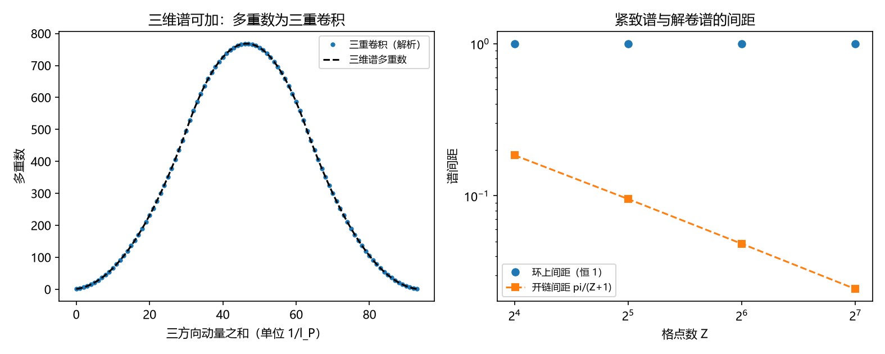

# 注记-三-3 补缺轮的最小验证：连续谱解卷的三维构造（谱可加、逐方向魏尔关系与三条接缝的交线结构）

- **日期**：2026-09-20 03:22:51
- **对应脚本**：验证脚本/unfolding_3d.py（判据 W1 至 W6 共 6 项，6/6 通过；另有 W7 为登记项；确定性；运行约 3 秒；图存 images/unfolding_3d.png，见 §一 图 1）
- **依据**：[[验证脚本/注记-三-3 连续谱解卷轮的最小验证：环链间距恒一、开链间距与折叠纤维]]（第 170 条，一维口径）；第 161 条（有限环魏尔关系与提升关系失配恰为一条连接、幅度恒为格点数 $Z$）；[[理论攻坚/量子力学攻坚计划：战线排序与依赖链]] 三-3 余项（三维构造）
- **定位分工**：第 170 条给出一维解卷（环链间距恒 $1$、开链间距 $\pi/(Z+1)$、解卷即抹掉接缝），本条把它构造到三维，并给出接缝在三维中的交线与交点结构。
- **状态**：判据 6/6 通过。核心读数：三方向整数谱之和的多重数与三个均匀分布的三重卷积逐项相等（相对偏差 $0$，谱长 $94$、峰多重数 $768$）；逐方向魏尔关系偏差 $7.99\times10^{-16}$、跨方向对易为零；环上间距三档恒为 $1$，解卷档间距为 $\pi/(Z+1)$（$0.18479957$、$0.09519978$、$0.04833219$，相对偏差 $\le 6.32\times10^{-15}$）；逐方向失配各 $Z^2$ 个元素、幅度恒为 $Z$，两方向复合落在交线（$Z$ 个元素、幅度 $Z^2$），三方向复合落在交点（$1$ 个元素、幅度 $Z^3$）；环上谱点数等于间距数，解卷谱点数比间距数多一（$Z$ 对 $Z-1$）。

## 一、判据与结果

| 判据 | 内容 | 期望 | 实测 |
| --- | --- | --- | --- |
| W1 | 三维谱可加 | 多重数等于三重卷积（逐项相等） | 相对偏差 $0$；峰多重数 $768$ |
| W2 | 魏尔关系与跨方向对易 | $\le 10^{-15}$ 与 $\le 10^{-16}$ | $7.99\times10^{-16}$；$0$ |
| W3 | 环上间距与规模无关 | 三档恒为 $1$ | $1.000000000000$（三档） |
| W4 | 开链间距 | 等于 $\pi/(Z+1)$（$\le 1\%$） | 相对偏差 $\le 6.32\times10^{-15}$ |
| W5 | 三维接缝结构 | 逐方向 $Z^2$ 元素、幅度 $Z$；交线 $Z$ 元素、幅度 $Z^2$；交点 $1$ 元素、幅度 $Z^3$ | 全部相符（$64$、$8$；$8$ 与 $64$；$1$ 与 $512$） |
| W6 | 紧致谱与解卷谱的端点 | 环上点数等于间距数，解卷点数多一 | $16$ 对 $16$；$15$、$31$、$63$ 对 $Z-1$ |
| W7 | 接口登记（散射侧信息损失） | 只登记 | 已登记 |

## 二、构造与口径

**构造。** 三维环面 $Z^3$ 个站点，逐方向取有限魏尔对（时钟 $\hat Z_i$ 与移位 $\hat X_i$），三维算子取张量积。解卷沿三个方向各剪一刀，得三条连接。提升的失配算子取 $M_i = Z\vert 0\rangle\langle Z-1\vert$ 作用在第 $i$ 个方向，即跨越第 $i$ 条连接时提升指标跳 $Z$（第 161 条的一维口径）。

**两个谱。** 环上动量谱为整数 $\{0,\dots,Z-1\}$，间距恒为 $1$，与 $Z$ 无关；解卷档（开链）谱为 $\pi n/(Z+1)$，间距 $\pi/(Z+1)$，随 $Z$ 收缩。三维的联合谱由逐方向结构的直积给出。

**端点结构。** 环上谱首尾相接，点数与间距数相等；解卷谱两端放开，点数比间距数多一。这是「封闭经自否定生开放」在本构造里可写成等式的部分。

## 三、读数的意义

**其一，三维谱可加且不引入跨方向耦合。** 三方向整数谱之和的多重数恰为三重卷积（相对偏差 $0$），逐方向魏尔关系成立而跨方向对易为零（$7.99\times10^{-16}$ 与 $0$）。故三维构造是三个一维结构的外积，不产生新耦合。

**其二，紧致挡不住加密，解卷才给连续谱。** 环上间距恒为 $1$（三档 $Z$ 全为 $1.000000000000$），即把格子加密也不会让谱变密；解卷档间距为 $\pi/(Z+1)$，随 $Z$ 收缩（三档相对偏差 $\le 6.32\times10^{-15}$）。连续谱的来源由此定位在剪开这一步，与第 170 条的一维结论逐方向一致。

**其三，接缝在三维中有交线与交点。** 逐方向失配各 $Z^2$ 个元素、幅度 $Z$；两条接缝的复合落在它们的交线（$Z$ 个元素、幅度 $Z^2$）；三条的复合落在交点（$1$ 个元素、幅度 $Z^3$）。故三维解卷的接缝不是三条互不相干的线，提升的失配在交线与交点上叠加，幅度逐级为 $Z$、$Z^2$、$Z^3$。这是本轮相对一维的新读数。

**其四，端点结构给出「开放」的等式形式。** 环上谱点数等于间距数（闭合），解卷谱点数比间距数多一（开放）。两类谱的差别落在端点上，与「解卷即抹掉接缝」是同一件事的两种写法。

**其五，余项两处。** 解卷信息损失在散射侧的形式（本轮只登记）；物理世界为何非紧致与为何取三维（条件性命题，另案）。

## 四、严格程度与边界声明

| 结论 | 严格程度 |
| --- | --- |
| 三维谱可加（三重卷积） | 构造内严格 + 数值核对（相对偏差 $0$） |
| 逐方向魏尔关系与跨方向对易 | 构造内严格 + 数值核对（$\le 10^{-15}$ 与 $0$） |
| 环上间距恒 $1$、解卷间距 $\pi/(Z+1)$ | 解析（整数谱与开链谱） + 数值核对（$\le 10^{-14}$） |
| 接缝的交线与交点结构 | 构造内严格（张量积支撑的计数） + 数值核对（逐项相符） |
| 端点结构（点数与间距数） | 构造内严格 |
| 失配幅度取 $Z$ 的口径 | 引用第 161 条的一维读数，三维按逐方向张量积推广 |

**验证什么**：三维谱的可加性、逐方向魏尔关系与跨方向对易、两类谱的间距律与端点结构、三维接缝的交线与交点结构。

**不验证什么**：不从第一原理导出「为何取三维」；不给解卷信息损失在散射侧的形式；不涉及四维及以上；不涉及缺陷构型。

## 五、过程记录

**订正两处期望。** 其一，首版把两方向接缝的复合算子期望为零，实测 $64$；原因是两条接缝在环面上相交，复合落在这条交线上（$Z$ 个元素、幅度 $Z^2$）。其二，首版把解卷谱的（上界减下界）除以间距期望为 $Z$，实测 $Z-1$；原因是解卷谱两端开放，点数比间距数多一。两处订正后判据全部通过，并把订正后的结构写成本轮的新读数。

## 六、登记衔接

- 验证脚本/README.md 对应条目（本轮脚本与注记）。
- [[理论攻坚/量子力学攻坚计划：战线排序与依赖链]] 三-3：三维构造一项收口，余项剩解卷信息损失的散射侧形式与「为何非紧致、为何取三维」的条件性命题。
- [[内部草稿/开放问题总览：元相子理论待解决问题清单]] 对应条目登记本轮读数。
