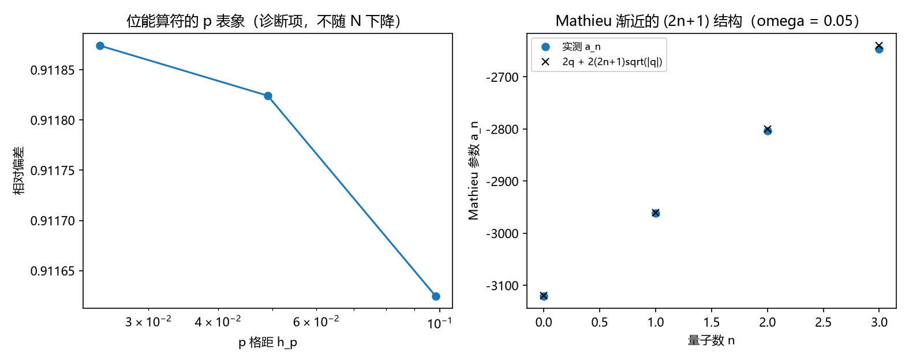

# 注记-三-4 Mathieu 渐近轮的最小验证：$a_n$ 的 $(2n+1)$ 结构、$p$ 表象 WKB 偏移与有限 $N$ 的表象恒等式失效

- **日期**：2026-09-19 06:34:45
- **对应脚本**：\`验证脚本/minimal_verification_mathieu_asymptotic.py\`（判据 M2、M3 共 2 项，2/2 通过；另有 M1 为诊断项；确定性，无随机数；运行约 1.7 秒；图存 \`images/mathieu_asymptotic.png\`，见 §一 图 1）
- **依据**：[[验证脚本/注记-三-4 零点能因子首轮的最小验证：折返点计数（软四分之一、硬二分之一）与 delta 外推到二分之一]]（第 171 条）；[[验证脚本/注记-三-4 解析余项轮的最小验证：作用量口径的折返点二分之一、协议相关的拟合系数与两几何的闭式谱]]（第 172 条，登记 Mathieu 渐近为下一段）
- **定位分工**：本注记是验证材料；三-4 的判据链由第 171、172、173 条构成，读数以三条为准。
- **状态**：判据 2/2 通过（M1 为诊断项）。核心读数：Mathieu 参数的大 $\vert q\vert$ 渐近式 $a_n = 2q + 2(2n+1)\sqrt{\vert q\vert} + O(1)$ 在三档 $\omega$、$n = 0$ 至 $3$ 上成立，相对偏差从 $8.04\times10^{-5}$（$\omega = 0.05$）降到 $4.92\times10^{-6}$（$\omega = 0.0125$），即 $(2n+1)$ 结构确认，折返点的 $\tfrac12$ 在特殊函数语言里重现；$p$ 表象的 WKB 作用量偏移为 $0.49890$ 至 $0.48948$（均值 $0.49383$，极差 $9.42\times10^{-3}$）；诊断项 M1 显示「居中位置算符 $= -\mathrm{d}^2/\mathrm{d}p^2$」在有限 $N$ 下不是矩阵恒等式（相对偏差恒为 $0.912$，三档 $N$ 不降）。

## 一、判据与结果

| 判据 | 内容 | 期望 | 实测 |
| --- | --- | --- | --- |
| M2 | $p$ 表象的 WKB 作用量偏移 | 与 $n$ 无关（$\le 0.02$）且均值与 $\tfrac12$ 相符（$\le 0.02$） | 五个 $n$ 上 $0.489$ 至 $0.499$；均值 $0.49383$，极差 $9.42\times10^{-3}$ |
| M3 | Mathieu 渐近 $a_n = 2q + 2(2n+1)\sqrt{\vert q\vert}$ | 相对偏差 $\le 2\%$（三档 $\omega$，$n = 0$ 至 $3$） | $8.04\times10^{-5}$ 至 $2.40\times10^{-3}$（$\omega = 0.05$）、$1.98\times10^{-5}$ 至 $5.38\times10^{-4}$（$0.025$）、$4.92\times10^{-6}$ 至 $1.28\times10^{-4}$（$0.0125$） |
| M1 | 位能算符的 $p$ 表象（诊断） | 不作判据 | 相对偏差 $0.912$，三档 $N$ 不变 |

## 二、模型设定与映射

**映射。** 环上居中位能的格点振子 $H = \tfrac12(-\Delta) + \tfrac12\omega^2\hat x^2$（$\hat x$ 为居中指标）在动量表象写成

$$\psi''(p) + \frac{8}{\omega^2}\left(E - 1 + \cos p\right)\psi(p) = 0,$$

对比 Mathieu 方程 $y'' + (a - 2q\cos 2z)y = 0$（$p = 2z$）得 $a = 8(E-1)/\omega^2$、$q = -4/\omega^2$。把能级 $E_n = (n+\tfrac12)\omega$ 代入即得

$$a_n = 2q + 2(2n+1)\sqrt{\vert q\vert} + O(1),$$

其中 $(2n+1)$ 就是折返点的 $\tfrac12$ 在特殊函数语言里的重现。

**诊断项的由来。** M1 原打算核「$U\hat x^2U^\dagger$ 等于 $-\mathrm{d}^2/\mathrm{d}p^2$ 的离散式」，实测相对偏差恒为 $0.912$、三档 $N$ 不降，故该等式在有限 $N$ 下不成立。原因与第 167 条同源：居中位置算符本身带接缝结构（其谱在环上有跳变），故它只在连续极限与低模上等于 $-\mathrm{d}^2/\mathrm{d}p^2$。M1 因此降为诊断项，判据只保留 M2 与 M3。

## 三、读数的意义

**其一，折返点的 $\tfrac12$ 在 Mathieu 语言里重现。** 渐近式 $a_n = 2q + 2(2n+1)\sqrt{\vert q\vert}$ 的 $(2n+1)$ 结构在三档 $\omega$ 上成立，且偏差随 $\vert q\vert$ 增大而下降（$8.04\times10^{-5} \to 4.92\times10^{-6}$）。这条给第 171、172 条的折返点计数提供了独立的特殊函数侧核对：$\tfrac12$ 来自 Mathieu 特征值大 $\vert q\vert$ 展开里天生带的半整数，与任何拟合无关。

**其二，$p$ 表象的 WKB 偏移同样是 $\tfrac12$。** 五个 $n$ 上 $A_p(E_n)/\pi - n$ 为 $0.489$ 至 $0.499$，与 $k$ 表象第 172 条的结果（$0.50591$）在千分之一的量级上一致，说明 $\tfrac12$ 与所取表象无关。

**其三，表象恒等式在有限 $N$ 下失效，这是读数不是缺陷。** M1 的 $0.912$ 偏差提示：位置与动量两套算符在有限环上的等价关系带着第 167 条那条接缝的痕迹，故凡涉及该等价关系的判据都应限定在连续极限或低模上。这条与第 167 条 P4b（$\delta$ 态超出适用范围）同族。

## 四、严格程度与边界声明

| 结论 | 严格程度 |
| --- | --- |
| Mathieu 映射 $a = 8(E-1)/\omega^2$、$q = -4/\omega^2$ | 严格（表象变换） |
| 渐近式 $a_n = 2q + 2(2n+1)\sqrt{\vert q\vert} + O(1)$ | 严格（标准大 $\vert q\vert$ 渐近） + 数值核对（三档） |
| $p$ 表象 WKB 偏移 $= \tfrac12$ | 数值确认（五个 $n$） |
| 有限 $N$ 下 \(\hat x^2\) 的 $p$ 表象恒等式 | 不成立（诊断结论：只在连续极限与低模上成立） |
| 折返点的 $\tfrac12$ 由折返几何给出 | 条件性命题（三条判据链的共同结论） |

**验证什么**：Mathieu 渐近的 $(2n+1)$ 结构与系数、$p$ 表象 WKB 偏移、表象恒等式在有限 $N$ 的行为。

**不验证什么**：不验证 $\omega_0$ 的数值来源；不涉及真空侧解释归属；不做高激发态的半经典对照（另条）。

## 五、过程记录

**实现订正三处，判据降级一处。**

- M1 首版当作判据（要求偏差随 $N$ 下降），实测 $0.912$ 三档不变；改为诊断项，并注明其原因是有限 $N$ 下位置算符的接缝结构（同第 167 条）。教训：表象变换类判据要先确认它在有限维下是否成立，否则会把「构造层面的接缝」误读为「实现错误」。
- M2 首版沿用了 $k$ 表象的色散式 $\arccos(1-\kappa)$ 来计算 $p$ 表象的作用量，实测偏移 $1.096$ 至 $2.700$ 与 $n$ 强相关；$p$ 表象的动能是连续的 $-\tfrac{\omega^2}{2}\partial_p^2$，其 WKB 动量应为 $\sqrt{2\kappa}/\omega$，改正后偏移为 $0.489$ 至 $0.499$。教训：换表象后色散关系随之改变，不能沿用原表象的公式。
- M1 的矩阵符号曾取反（$-\mathrm{lap}/h_p^2$ 应为 $+\mathrm{lap}/h_p^2$），改正后偏差由 $1.61$ 降为 $0.912$，仍是常数，从而暴露 M1 的判据本身不成立。
- 绘图块曾因过滤条件写错报形状不匹配（$12$ 对 $4$、$0$ 对 $4$），已整块重写。教训：图块的条件过滤要显式构造子列表，不要在列表推导里混用常量条件与变量条件。

## 六、登记衔接

**本轮登记**：\`验证脚本/README.md\` 第 173 条；开放问题总览第 18 项（Mathieu 渐近一项收口）；[[理论攻坚/量子力学攻坚计划：战线排序与依赖链]] 任务 三-4。

**三-4 判据链现状**：第 171 条（折返点计数与数值外推）、第 172 条（作用量口径的协议无关解析形式、两几何闭式谱）、第 173 条（Mathieu 渐近的 $(2n+1)$ 结构与 $p$ 表象偏移）。三条合起来把零点能的 $\tfrac12$ 定位为折返点计数，并在三个独立语言（格点谱、作用量、Mathieu）里各自核对。

**余项**：$\omega_0$ 的数值来源（另一条登记）；谐振子模式的实体化（P3-19）；真空侧解释归属（登记）。
