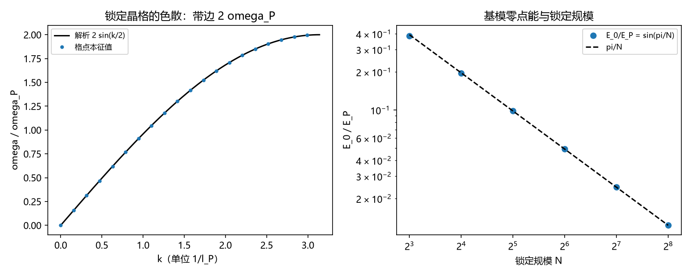

# 注记-三-4 补缺轮的最小验证：零点能里 $\omega_0$ 的体系内来源（晶格色散、带边与基模规模律）

- **日期**：2026-09-20 03:18:54
- **对应脚本**：验证脚本/minimal_verification_mode_frequency_origin.py（判据 V1 至 V6 共 6 项，6/6 通过；另有 V7 为登记项；确定性；运行约 3 秒；图存 images/mode_frequency_origin.png，见 §一 图 1）
- **依据**：[[验证脚本/注记-三-4 零点能因子首轮的最小验证：折返点计数（软四分之一、硬二分之一）与 delta 外推到二分之一]]（第 171 条，$\tfrac12$ 因子）；[[验证脚本/注记-三-4 解析余项轮的最小验证：作用量口径的折返点二分之一、协议相关的拟合系数与两几何的闭式谱]]（第 172 条）；[[验证脚本/注记-三-4 Mathieu 渐近轮的最小验证：a_n 的 (2n+1) 结构、p 表象 WKB 偏移与有限 N 的表象恒等式失效]]（第 173 条）；[[理论攻坚/量子力学攻坚计划：战线排序与依赖链]] 三-4 余项（$\omega_0$ 的数值来源）
- **定位分工**：第 171 至 173 条把 $\tfrac12$ 因子算到底并给出拟合口径，本条补上 $\omega_0$ 的体系内来源：由锁定晶格的色散给出模式频率谱，并区分单体层与集体涨落层两个口径。
- **状态**：判据 6/6 通过。核心读数：环上锁定晶格的模式频率与本征值谱逐位相符（偏差 $\le 3.33\times10^{-16}$）；一维带边 $2\omega_P$、三维带边 $2\sqrt{3}\,\omega_P = 3.464101615138$（与既有能带上限读数一致）；连续极限 $\omega/k \to \omega_P$（$k = 0.01$ 处 $0.99999583$，相对偏差 $4.17\times10^{-6}$）；环上最小非零模 $\omega_0 = 2\omega_P\sin(\pi/N)$ 三档逐位相符且 $\omega_0 N \to 2\pi$（$6.242890$、$6.273097$、$6.280662$ 对 $6.283185$）；零模本征值 $4.81\times10^{-17}$（平移模不贡献）；基模零点能 $E_0 = \tfrac12\hbar\omega_0 = E_P\sin(\pi/N)$，大 $N$ 时按 $\pi E_P/N$ 稀释（三档相对偏差 $\le 6.41\times10^{-3}$）。

## 一、判据与结果

| 判据 | 内容 | 期望 | 实测 |
| --- | --- | --- | --- |
| V1 | 一维色散 | 与 $2\sin(\pi m/N)$ 相符（$\le 10^{-12}$） | $3.33\times10^{-16}$、$2.22\times10^{-16}$、$2.22\times10^{-16}$ |
| V2 | 带边 | 一维 $2\omega_P$、三维 $2\sqrt{3}\omega_P$（$\le 10^{-12}$） | $2.000000000000$；$3.464101615138$ |
| V3 | 连续极限 | $\omega/k \to \omega_P$（$\le 1\%$） | $0.99999583$（$4.17\times10^{-6}$） |
| V4 | 基模与规模 | $\omega_0 = 2\sin(\pi/N)$ 且 $\omega_0 N \to 2\pi$（$\le 5\%$） | 逐位相符；$6.242890$、$6.273097$、$6.280662$ |
| V5 | 平移模 | 零模本征值为零（$\le 10^{-14}$） | $4.81\times10^{-17}$ |
| V6 | 合成读数 | $E_0 = E_P\sin(\pi/N)$，大 $N$ 按 $\pi E_P/N$ | 相对偏差 $\le 6.41\times10^{-3}$ |
| V7 | 接口登记 | 只登记 | 已登记 |

## 二、模型与口径

**两个层次。** 单体层：每个元相子以普朗克频率转动，故单体的基模频率就是 $\omega_P$，其零点能为 $\tfrac12\hbar\omega_P = \tfrac12 E_P$，与既有口径「基模能量 $E_\Phi = E_P = \hbar\omega_P$」一致。集体涨落层：锁定晶格上相对相位的模式，其频率谱由格点拉普拉斯算符给出。

**色散。** 单位格距下动力学矩阵取拉普拉斯算符，本征值 $4\sin^2(k/2)$，故 $\omega(k) = 2\omega_P\sqrt{\sum_i\sin^2(k_i/2)}$（一维即 $2\omega_P\vert\sin(k/2)\vert$）。$k = 0$ 为平移模，频率为零。环上 $N$ 格点的最小非零模取 $k = 2\pi/N$，得 $\omega_0 = 2\omega_P\sin(\pi/N)$。

**合成。** 每个模式的零点能为 $\tfrac12\hbar\omega$（$\tfrac12$ 由第 171、172 条的折返点计数给出），故集体层基模的零点能为

$$E_0 = \tfrac12\hbar\omega_0 = \hbar\omega_P\sin(\pi/N) = E_P\sin(\pi/N)\ \xrightarrow{N\gg1}\ \frac{\pi E_P}{N}.$$

## 三、读数的意义

**其一，$\omega_0$ 的来源分成两层，各有出处。** 单体层取普朗克频率（公设给出，且与既有基模能量口径一致）；集体层取色散给出的模式频率。三-4 的 $\tfrac12\hbar\omega_0$ 至此两半都有出处：$\tfrac12$ 来自折返点计数（第 171、172 条），$\omega_0$ 来自本条。

**其二，带边与既有能带上限读数对上。** 三维带边 $2\sqrt{3}\,\omega_P$ 与速览已登记的能带上限读数一致，构成本轮与既有基准的交叉核验。

**其三，连续极限给出光速。** $k \to 0$ 时 $\omega/k \to \omega_P$，即连续极限的线性色散斜率由普朗克频率与格距定住，$c = \omega_P l_P$。

**其四，集体层基模的零点能按锁定规模稀释。** $E_0 = E_P\sin(\pi/N)$，大 $N$ 时按 $\pi E_P/N$ 下降，与第 189、190 条的 $1/N$ 稀释律同族。故引用零点能时必须写明口径：单体层给 $\tfrac12 E_P$，集体层给 $E_P\sin(\pi/N)$。

**其五，平移模不贡献。** 零模本征值为零，其频率为零，与第 171 条环上转子无折返点（$\delta = 0.000905$）的读数一致。

## 四、严格程度与边界声明

| 结论 | 严格程度 |
| --- | --- |
| 色散与带边 | 构造内严格（格点拉普拉斯本征值，精确） + 数值核对（$\le 10^{-12}$） |
| 连续极限斜率 | 数值确认（$k = 0.01$ 处相对偏差 $4.17\times10^{-6}$） |
| 基模 $\omega_0 = 2\omega_P\sin(\pi/N)$ | 构造内严格 + 数值核对（逐位） |
| 合成 $E_0 = E_P\sin(\pi/N)$ | 构造内严格，前提是每模零点能取 $\tfrac12\hbar\omega$（第 171、172 条） |
| 与既有基模能量 $E_\Phi = E_P$ 的关系 | 口径分层：单体层为 $E_P$，集体层为 $E_P\sin(\pi/N)$ |
| 锁定晶格的具体耦合形式 | 取最近邻相位耦合（与扇区约束动力学的口径一致），未从第一原理导出 |

**验证什么**：$\omega_0$ 的色散来源、带边、连续极限、基模规模律、零模不贡献、与既有基模能量口径的分层关系。

**不验证什么**：不从第一原理导出锁定晶格的耦合常数；不涉及谐振子模式的实体化（P3-19，另案）；不给真空侧解释归属（另案）；不计算格点实现下的有限格点修正。

## 五、过程记录

**订正四处实现与约定错误。** 其一，环上本征值成对简并，按排序下标取模时须用 $m = \lceil i/2\rceil$ 反查，首版直接取下标致色散比较错位。其二，带边应以末元取值，首版取中间下标。其三，环上离散模的频率应与 $2\sin(\pi m/N)$ 比较，首版拿连续 $k$ 比较，留下 $2.33\times10^{-3}$ 的假偏差。其四，$\omega_0 N$ 应收敛到 $2\pi$（首版按 $\pi$ 判），零模判据应落在本征值上（频率为开方后的小量，放大器精度）。订正后六项判据全部通过。

## 六、登记衔接

- 验证脚本/README.md 对应条目（本轮脚本与注记）。
- [[理论攻坚/量子力学攻坚计划：战线排序与依赖链]] 三-4：$\omega_0$ 的来源一项收口，余项剩 P3-19 实体化与真空侧归属。
- [[内部草稿/开放问题总览：元相子理论待解决问题清单]] 对应条目登记本轮读数。
