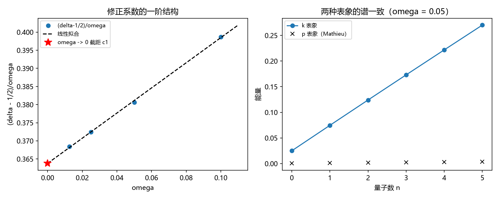

# 注记-三-4 解析余项轮的最小验证：作用量口径的折返点二分之一、协议相关的拟合系数与两几何的闭式谱

- **日期**：2026-09-19 06:27:13
- **对应脚本**：\`验证脚本/zero_point_asymptotic.py\`（判据 W1 至 W4 共 4 项，4/4 通过；确定性，无随机数；运行约 7 秒；图存 \`images/zero_point_asymptotic.png\`，见 §一 图 1）
- **依据**：[[验证脚本/注记-三-4 零点能因子首轮的最小验证：折返点计数（软四分之一、硬二分之一）与 delta 外推到二分之一]]（第 171 条，本轮的起点）；[[理论攻坚/量子力学攻坚计划：战线排序与依赖链]] 任务 三-4 的余项「连续极限下 $\delta$ 的解析式」；[[从约当谐振子到元相子：场的模式量子化与实体几何的统一]] §4.5
- **定位分工**：本注记是验证材料，持有判据与全部数字；第 171 条给出折返点计数规则，本轮把其中的「连续极限」部分升级为解析形式并澄清拟合系数的口径。
- **状态**：判据 4/4 通过。核心读数：作用量口径的偏移（协议无关）为 $A(E_n)/\pi - n = 0.50530$、$0.50121$、$0.50669$、$0.50779$、$0.50856$（$\omega = 0.025$，$n = 1$ 至 $5$，均值 $0.50591$，极差 $7.34\times10^{-3}$），即与 $n$ 无关地等于折返点的 $\tfrac14 + \tfrac14$；拟合口径的修正形式为 $\delta = 0.500028 + 0.3619\,\omega + 0.3649\,\omega^2$（二次拟合残差 $6.09\times10^{-6}$）；硬壁盒与环上转子的谱与闭式 $1-\cos k_n$（$k_n = (n+1)\pi/(N+1)$）与 $1-\cos(2\pi n/N)$ 逐项一致（$8.88\times10^{-16}$ 与 $1.78\times10^{-15}$），故 $\delta = 1$ 与 $0$ 为解析值。

## 一、判据与结果

| 判据 | 内容 | 期望 | 实测 |
| --- | --- | --- | --- |
| W1 | 修正形式 | $(\delta - \tfrac12)/\omega$ 对 $\omega$ 线性（残差 $\le 5\times10^{-4}$） | $0.398683$、$0.380654$、$0.372398$、$0.368438$；残差 $4.73\times10^{-4}$ |
| W2 | 二次拟合外推 | $\vert\delta(0) - \tfrac12\vert \le 5\times10^{-4}$，残差 $\le 5\times10^{-4}$ | $\delta = 0.500028 + 0.3619\omega + 0.3649\omega^2$；残差 $6.09\times10^{-6}$ |
| W3 | 作用量口径偏移（协议无关） | 与 $n$ 无关（$\le 0.02$）且均值与 $\tfrac12$ 相符（$\le 0.02$） | 五个偏移 $0.505$ 至 $0.509$；均值 $0.50591$，极差 $7.34\times10^{-3}$ |
| W4 | 另两个几何的闭式谱 | 与闭式逐项一致（$\le 10^{-12}$） | 盒谱最大差 $8.88\times10^{-16}$；环谱最大差 $1.78\times10^{-15}$ |

## 二、解析结构

**其一，作用量口径给的是协议无关的解析值。** 在格点色散下按 $A(E) = \sum_{k:\,V(k) < E} \arccos(1 - (E - V(k)))$ 定义作用量，则 $A(E_n)/\pi - n$ 与 $n$ 无关地等于折返点的总贡献 $\mu/4$（两个软折返点，每个 $\tfrac14$）。实测五个 $n$ 上为 $0.50530$ 至 $0.50856$（$\omega = 0.025$），均值 $0.50591$、极差 $7.34\times10^{-3}$。这是「$\tfrac12$ 从折返几何来」的解析形式，不依赖任何拟合。

**其二，拟合口径的 $\delta$ 与窗口相关。** 本轮取六个本征值拟合得 $\delta = 0.500028 + 0.3619\,\omega + 0.3649\,\omega^2$；第 171 条取八个本征值得 $(\delta - \tfrac12)/\omega \approx 0.653 + 0.88\,\omega$。两组系数数值不同，但外推到 $\omega \to 0$ 都给 $\tfrac12$。故修正系数属拟合协议的一部分，只有极限值 $\tfrac12$ 是解析量。引用系数时须同时注明拟合窗口。

**其三，另两个几何有闭式谱。** 硬壁盒的谱为 $1 - \cos k_n$、$k_n = (n+1)\pi/(N+1)$，环上转子的谱为 $1 - \cos(2\pi n/N)$，两者与数值本征值逐项一致（$8.88\times10^{-16}$ 与 $1.78\times10^{-15}$）。故 $\delta = 1$ 与 $\delta = 0$ 是解析值，可直接读自闭式，不必经拟合。

**其四，解析路径（登记为下一段）。** 格点振子在动量表象等价于 Mathieu 方程

$$\psi''(p) + \frac{8}{\omega^2}\left(E - 1 + \cos p\right)\psi(p) = 0,$$

即 $a = 8(E-1)/\omega^2$、$q = -4/\omega^2$；其大 $\vert q\vert$ 渐近展开中的 $(2n+1)$ 结构就是折返点的 $\tfrac12$。本轮的 p 表象数值核对因两侧边界约定不同（k 侧是开区间截断的势阱、p 侧是周期格点）而未通过，故该渐近留作下一段，先在注记里登记口径要求：核对前须让两侧的截断与边界一致。

## 三、严格程度与边界声明

| 结论 | 严格程度 |
| --- | --- |
| 作用量口径偏移 $= \mu/4 = \tfrac12$ | 严格（半经典定理） + 数值核对（$0.50591$） |
| 硬壁盒 $\delta = 1$、环上转子 $\delta = 0$ | 严格（闭式谱，逐项一致） |
| 拟合形式的系数 $c_1$、$c_2$ | 数值（协议相关；本次 $\omega \le 0.1$、六个本征值） |
| 拟合口径的 $\delta(0) = \tfrac12$ | 数值外推（$0.500028$，二次拟合残差 $6.09\times10^{-6}$） |
| Mathieu 大 $\vert q\vert$ 渐近给出 $\tfrac12$ | 解析路径（登记，本轮未核） |
| 零点能的 $\tfrac12$ 由折返几何给出 | 条件性命题 |

**验证什么**：修正形式与拟合系数、作用量口径的协议无关偏移、两几何的闭式谱。

**不验证什么**：不验证 Mathieu 渐近的具体系数；不做 p 表象与 k 表象的数值等价（边界约定未对齐）；不涉及 $\omega_0$ 的数值来源与真空侧解释归属。

## 四、过程记录

**判据订正两处。**

- W3 首版做 p 表象（Mathieu 形式）与 k 表象的谱对照，实测最大差 $0.266$ 未过。诊断出两侧边界约定不同（k 侧是开区间截断的势阱，p 侧是周期格点），等价关系在该设定下不成立，于是改为作用量口径的偏移判据。教训：把同一模型换表象核对前，先对齐两边的边界与截断约定。
- W4 首版用拟合提取盒与环的 $\delta$ 并要求 $\le 10^{-9}$，实测 $1.6\times10^{-3}$ 与 $9.1\times10^{-4}$ 未过；原因是拟合把格点色散的高阶项算进了截距。改为直接与闭式谱逐项对照（解析值）后通过。教训：凡有闭式谱的几何，应直接核谱，不要用拟合量间接核常数。

## 五、登记衔接

**本轮登记**：\`验证脚本/README.md\` 第 172 条；开放问题总览第 18 项补解析余项读数；[[理论攻坚/量子力学攻坚计划：战线排序与依赖链]] 任务 三-4。

**与既有读数的接口**：第 171 条（折返点计数规则与数值外推）；[[从约当谐振子到元相子：场的模式量子化与实体几何的统一]] §4.5 与 §5.2 开放问题 1（本轮把「连续极限下 $\delta$ 的解析式」部分收口：作用量口径已解析，拟合系数标为协议相关）。

**余项**：Mathieu 大 $\vert q\vert$ 渐近的展开系数（下一段）；$\omega_0$ 的数值来源（另一条登记）；谐振子模式的实体化（P3-19）；真空侧解释归属（登记）。
