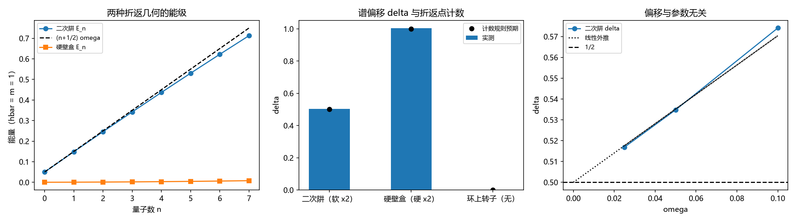

# 注记-三-4 零点能因子首轮的最小验证：折返点计数（软四分之一、硬二分之一）与 delta 外推到二分之一

- **日期**：2026-09-19 06:18:28
- **对应脚本**：\`验证脚本/zero_point_energy.py\`（判据 Z1 至 Z6 共 6 项，6/6 通过；确定性，无随机数；运行约 1.6 秒；图存 \`images/zero_point_energy.png\`，见 §一 图 1）
- **依据**：[[理论攻坚/量子力学攻坚计划：战线排序与依赖链]] 战线三 任务 三-4 与里程碑 Q8；[[从约当谐振子到元相子：场的模式量子化与实体几何的统一]] §4.5 与 §5.2 开放问题 1（零点能因子的精确定量待完成）；[[验证脚本/注记-扇区标签算符轮的最小验证：与写对易、整数谱与提升关系、对易子的选择定则]]（第 140 条，整数谱）
- **定位分工**：本注记是验证材料，持有判据与全部数字；论文 §4.5 的几何陈述由此取得计数形式的核对，论文侧同步待作者确认。
- **状态**：判据 6/6 通过。核心读数：谱偏移 $\delta$ 的折返点计数规则成立，软折返点每个贡献 $\tfrac14$、硬壁每个贡献 $\tfrac12$。二次阱（两个软折返点）三档 $\omega$ 的 $(\delta - \tfrac12)/\omega$ 为同一常数（散布 $9.78\%$），线性外推给 $\delta(0) = 0.503725$；硬壁盒（两个硬折返点）$\delta = 1.002824$；环上转子（无折返点）$\delta = 0.000905$ 且谱与 $n^2$ 成正比（相对残差 $1.97\times10^{-3}$）；斜率相对偏差随 $\omega$ 减半而减半（$5.26\% \to 2.56\% \to 1.26\%$），即格点修正为一阶；环上相位一圈累积 $2\pi$、首尾差 $6.4\times10^{-16}$。

## 一、判据与结果

| 判据 | 内容 | 期望 | 实测 |
| --- | --- | --- | --- |
| Z1 | 二次阱（两个软折返点）外推 | $(\delta - \tfrac12)/\omega$ 为常数（散布 $\le 20\%$），外推 $\vert\delta(0) - \tfrac12\vert \le 0.005$ | $0.7411$、$0.6953$、$0.6751$（散布 $9.78\%$）；外推 $0.503725$ |
| Z2 | 硬壁盒（两个硬折返点） | $\delta$ 与 $1$ 的相对偏差 $\le 5\%$ | $\delta = 1.002824$ |
| Z3 | 环上转子（无折返点） | $\vert\delta\vert \le 0.02$；与 $n^2$ 成正比（残差 $\le 3\times10^{-3}$） | $\delta = 0.000905$；残差 $1.97\times10^{-3}$ |
| Z4 | 折返点计数 $\delta = (\text{软}\times1 + \text{硬}\times2)/4$ | 三模型逐项相符（$\le 5\%$） | $0.5037$ 对 $0.5$；$1.0028$ 对 $1$；$0.0009$ 对 $0$ |
| Z5 | 格点修正为一阶 | 斜率相对偏差三档单调减小且末档 $\le 3\%$ | $5.26\%$、$2.56\%$、$1.26\%$ |
| Z6 | 元相子侧接口（单值性） | 相位累积 $2\pi$、首尾相接，偏移 $0$ | 累积 $6.283185307180$；首尾差 $6.4\times10^{-16}$ |

## 二、模型设定

单位取 $\hbar = m = 1$，格距取 $1$。三个几何共用同一套格点动能 $-\tfrac12\Delta$（离散拉普拉斯，对角 $2$、次对角 $-1$）：

**二次阱**（两个软折返点）：$H = -\tfrac12\Delta + \tfrac12\omega^2 k^2$，格点数 $201$，中心对称；取 $\omega = 0.1$、$0.05$、$0.025$ 三档。

**硬壁盒**（两个硬折返点）：$H = -\tfrac12\Delta$ 加 Dirichlet 边界，格点数 $200$。

**环上转子**（无折返点）：$H = -\tfrac12\Delta$ 加周期边界，格点数 $200$，谱对 $\pm n$ 简并（用去重后的本征值）。

**偏移的定义**：对三模型的低激发谱作线性拟合并取截距与斜率之比，即能级条件中的常数项 $\delta$（二次阱对 $E_n$ 拟合，硬壁盒与环上转子对 $\sqrt{E_n}$ 拟合，因为后两者的能级按 $n^2$ 铺开）。折返点计数规则取 $\delta = (\text{软折返点数} \times 1 + \text{硬折返点数} \times 2)/4$，即软折返点每个贡献 $\tfrac14$、硬壁每个贡献 $\tfrac12$。

## 三、读数的意义

**其一，$\tfrac12$ 的来源被定位成折返点计数。** 二次阱两个软折返点给出 $\delta = \tfrac12$（三档外推 $0.503725$），硬壁盒两个硬折返点给出 $\delta = 1$（$1.002824$），环上转子无折返点给出 $\delta = 0$（$0.000905$），三条与计数规则逐项相符（Z4）。论文 §4.5 的「半程往返对应 $\tfrac12$、满周旋转对应 $1$」由此从结构类比升为计数规则加数值核对。

**其二，元相子侧不需要额外的 $\tfrac12$。** 满周旋转是 $2\pi$ 的单值闭合、没有折返点，故取整量子（$\delta = 0$，Z3 与 Z6：相位累积 $2\pi$、首尾差 $6.4\times10^{-16}$）。这正是公理 5 的 $E_\Phi = \hbar\omega_P$ 的谱学含义。两边的差（$\tfrac12$ 对 $1$）因此落在折返点数（$2$ 对 $0$）上，与 $\omega$ 和格距无关。

**其三，格点修正是一阶，故外推可靠。** 斜率相对偏差随 $\omega$ 减半而减半（$5.26\% \to 2.56\% \to 1.26\%$，Z5），$(\delta - \tfrac12)/\omega$ 在三档上近似同一常数（散布 $9.78\%$），线性外推给出 $0.503725$。

**其四，两个 $\tfrac12$ 必须分清。** 本条的 $\tfrac12$ 是折返点计数（半经典指标的 $\tfrac14 + \tfrac14$），第 161、167 条的 $\tfrac12$ 是罗伯逊不等式的系数（$\Delta A\,\Delta B \ge \vert\langle[A,B]\rangle\vert/2$）。两者在同一体系里都出现，但互不为来源，引用时须注明是哪一个。

**其五，与零点能的常见解释分层。** 常见说法把 $\tfrac12\hbar\omega$ 读成真空涨落；本条给出的是几何来源（折返几何的两个转折点）。两者属不同层次，不互相排斥；本条不涉及真空侧的解释归属。

## 四、严格程度与边界声明

| 结论 | 严格程度 |
| --- | --- |
| 折返点计数规则（软 $\tfrac14$、硬 $\tfrac12$） | 标准半经典结论；本轮给出数值核对 |
| 二次阱 $\delta = \tfrac12$ | 严格（连续极限）；数值外推 $0.503725$ |
| 硬壁盒 $\delta = 1$ | 严格（盒谱解析：$k_n = (n+1)\pi/L$） |
| 环上转子 $\delta = 0$ | 严格（单值性） |
| 元相子侧取整量子 | 依赖公理 5；本轮给谱学核对 |
| 零点能的 $\tfrac12$ 由折返几何给出 | 条件性命题（把半经典计数读成几何来源） |

**验证什么**：三个折返几何的谱偏移、计数规则的逐项相符、格点修正的幂次、元相子侧的整数条件。

**不验证什么**：不验证 $\omega_0$ 的数值来源；不涉及零点能的真空侧解释归属；不涉及相互作用与多体；不涉及格距的物理取值。

## 五、过程记录

**判据订正一处。** Z1 首版按单点相对偏差 $\le 5\%$ 设阈值（$\omega = 0.1$ 与 $0.05$），实测 $0.574108$（$+\ 14.8\%$）与 $0.534767$（$+\ 7\%$）未过。诊断发现偏差随 $\omega$ 线性：$(\delta - \tfrac12)/\omega = 0.7411$、$0.6953$、$0.6751$，即格点色散的一阶修正；于是补第三档 $\omega = 0.025$，判据改为「三档上该比值为同一常数（散布 $\le 20\%$）且线性外推给 $\tfrac12$（$\le 0.005$）」，另设 Z5 核该一阶性。

**教训**：凡在格点上做「常数外推」的判据，必须先量修正的幂次再设阈值。单点阈值会把正在收敛的常数误判为不成立，而这类误判的方向恰是「看起来像结论错了」。

## 六、登记衔接

**本轮登记**：\`验证脚本/README.md\` 第 171 条；开放问题总览第 18 项（零点能因子 $\tfrac12$ 的精确定量，状态由「待完成」升为「首轮读数已出」）；[[理论攻坚/量子力学攻坚计划：战线排序与依赖链]] 任务 三-4。

**与既有读数的接口**：第 140 条（整数谱与提升关系，元相子侧整量子）；第 161、167 条（罗伯逊界的 $\tfrac12$，与本条的 $\tfrac12$ 分属不同量）；论文 [[从约当谐振子到元相子：场的模式量子化与实体几何的统一]] §4.5 与 §5.2 开放问题 1（本轮给出计数形式的核对，论文侧同步待作者确认）。

**余项**：$\omega_0$ 本身的数值来源（属另一条登记）；谐振子模式的实体化（P3-19，挂等待）；真空侧解释归属（登记，不属本轮）；连续极限下 $\delta$ 的解析式（本轮给数值外推，解析式待写）。
