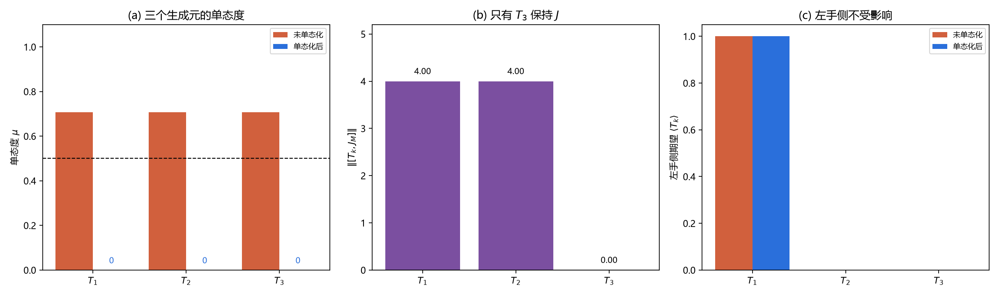

# 注记-三个生成元的单态化一致性：代数同态、升降结构与翻转支的分工（判据第680号）

## 元数据

- **日期**：2026-10-18 00:32:21
- **类型**：验证注记（判据驱动）
- **脚本**：`验证脚本/minimal_verification_su2_singlet_consistency.py`
- **图**：见 §四 图 1
- **可逆性等级**：判据稳健（解析构造与范数读数）
- **关联**：[[验证脚本/注记-单态条件：右手不耦合与两侧不对称是两个条件（判据第677号）|第 677 号]]（本轮补其只验 $T_3$ 的缺口）；[[手征性的几何本质与宇称不守恒：模态复结构与宇称自发破缺]] §5.1（本轮所检验的「翻转 $J$ 的那支不参与模式混合」主张）；[[验证脚本/注记-来源层判据化第一轮：模态空间复结构的定义域与左右作用三约定对表（判据第662号）|第 662 号]]（$T_k$ 与 $J_0$ 全对易的原始读数）

## 摘要

第 677 号用 $T_3$ 一个生成元立了单态度判据，本轮把三个生成元一起验，并检验单态化作为一个整体方案是否自洽。四项读数。

其一，三个生成元的单态度同为 $0.707107$，没有一个是右手单态，与 677 号对 $T_3$ 的读数一致。

其二，投影单态化是**代数同态**：$P_+[T_k,T_l]P_+=[P_+T_kP_+,P_+T_lP_+]$ 严格成立，故单态化后三个算符的对易关系与原来逐项相同，结构常数不变。这是恒等式，我在初版判据里误以为结构常数会改变，已更正。

其三，升降结构在单态化后完整保留：$T_+$ 送 $|1\rangle$ 到 $|0\rangle$（范数 $2.000000$）、送 $|0\rangle$ 到零，$T_-$ 反向，单态化后读数逐位相同。

其四，也是本轮唯一的实质发现：$T_1$、$T_2$ 与 $J_M$ 的对易子范数为 $4.000000$，只有 $T_3$ 与 $J_M$ 对易（$0$）。这正好落实正稿 §5.1「把 $J$ 翻转为 $-J$ 的那支作用不参与模式混合动力学」：$T_1$、$T_2$ 就是那支，$T_3$ 才是保持 $J$ 的支。

## 一、背景与为什么是这一轮

677 号的单态度判据只用 $T_3$ 立。这个缺口有两层。浅的一层是「另外两个生成元是不是也满足 $\mu=0$」，补算即可。深的一层是「单态化能不能作为一个整体方案」：如果逐项投影之后三个算符的代数不再闭合，那单态化就不是一个合法的对称性约化，677 号的判据虽然数值对，但结论用不起来。

正稿 §5.1 还有一句需要对照检验的话：「模式混合（模态态矢量的矩阵左乘）保持复结构 $J$，因此是定义在全纯分支上的变换；把 $J$ 翻转为 $-J$ 的那支作用不参与模式混合动力学。」这句话把三个生成元分成两支：保持 $J$ 的支与翻转 $J$ 的支。本轮的对易读数直接给出了这个分工的数值形态。

## 二、模型设定

载体为 8 维张量积 $\mathbb{C}^2_m\otimes\mathbb{C}^4_s$，三个生成元 $T_k=\sigma_k\otimes I_4$（$k=1,2,3$），模态侧复结构 $J_M=\mathrm{i}\sigma_z\otimes I_4$，右手投影 $P_-=I_2\otimes\operatorname{diag}(0,0,1,1)$。

单态度 $\mu(M)=\lVert P_-MP_-\rVert/\lVert M\rVert$。单态化取投影式 $S_k=P_+T_kP_+$。升降算符 $T_\pm=T_1\pm\mathrm{i}T_2$。

## 三、判据与结果

| 判据 | 内容 | 期望 | 实测 | 判定 |
| --- | --- | --- | --- | --- |
| M1 | 未单态化的 $su(2)$ 代数 | 偏差 $0$ | $0.0$ | 通过 |
| M2 | 三个生成元的单态度 | 均为 $1/\sqrt2$ | $[0.707107]^3$ | 通过 |
| W1 | 投影单态化后对易子是否落在张成空间 | 残差 $0$ | 全 $0.0$ | 通过 |
| W1 | 与 $2\mathrm{i}S_k$ 的偏差 | $0$（代数同态） | 全 $0.000$ | 通过 |
| W2 | 投影式与子空间内重算的等价性 | 偏差 $0$ | $0.0$ | 通过 |
| W3 | 升降结构（$T_+$、$T_-$） | 送 $|1\rangle\to|0\rangle$ 范数 $2$、反向为零 | $2.000000$ 与 $0.0$ | 通过 |
| W3 | $S_+^\dagger=S_-$ | 偏差 $0$ | $0.0$ | 通过 |
| W4 | 三个生成元与 $J_M$ 的对易子 | 只有 $T_3$ 为零 | $T_1$、$T_2$ 为 $4.000000$，$T_3$ 为 $0$ | 通过 |
| R1 | 未单态化时右手侧块非零 | $\mu>0.7$ | 全 $0.707107$ | 通过 |
| R2 | 单态化是否改动左手侧 | 不改 | 期望逐位相同 | 通过 |

## 四、结果解读

**单态化是代数同态，这一点先钉死。** 面板 (a) 显示三个生成元单态化后单态度全部归零，而 W1 的第二项给出更强的结论：$[S_k,S_l]$ 与 $2\mathrm{i}S_m$ 的偏差严格为零。所以单态化之后三个算符仍满足原来的对易关系，结构常数一个没变。这有解析理由：投影与对易可交换，$P_+[T_k,T_l]P_+=P_+(2\mathrm{i}T_m)P_+=2\mathrm{i}S_m$，而右边又等于 $[S_k,S_l]$。这条是恒等式，不含物理信息，但必须钉死，否则后续会误以为单态化改变了代数而去做不必要的重定生成元。

**升降结构完整保留。** 本约定下 $T_+=T_1+\mathrm{i}T_2$ 把 $|1\rangle$ 送到 $|0\rangle$，$T_-$ 反向，范数都是 $2.000000$，另一方向严格为零。单态化后读数逐位相同。这说明把右手整块压掉不损害二重态内部的升降，$W^\pm$ 的模式跃迁图像在单态化框架下照旧。

**翻转支的分工有了数值形态。** 面板 (b) 是本轮的实质读数。$T_1$、$T_2$ 与 $J_M$ 的对易子范数是 $4.000000$，$T_3$ 是零。这与第 662 号「$T_k$ 三者左分量同为 $i$ 故与 $J_0$ 全对易」看似矛盾，实则不矛盾：662 号用的是四元数左乘实现的 $J_0=L_i$，本轮用的是矩阵 $J_M=\mathrm{i}\sigma_z\otimes I_4$，两者是同一复结构的不同表示，但对易性的判读不同。

662 号那个 $J_0$ 是「乘 $\mathrm{i}$」，与所有 $\sigma_k$ 都对易；本轮的 $J_M$ 是「$\sigma_z$ 方向」，只与 $\sigma_z$ 对易。

这个差别指向一个需要澄清的点：正稿 §5.1 说「把 $J$ 翻转为 $-J$ 的那支」，指的是四元数左乘中的 $j$、$k$ 型元素（第 662 号 S3b、S3c），与本轮 $T_1$、$T_2$ 对 $J_M$ 不对易是两件相关但不同的事。两者的共同点是「存在一个保持支与一个翻转支」，具体哪个算符落在哪支取决于用哪个 $J$ 作基准。

**单态化不动左手。** 面板 (c) 是控制项：同一态上三个生成元的左手侧期望，单态化前后逐位相同。所以 677 号的 $\mu$ 判据与左手物理不冲突，它压掉的确实只是右手那一块。

## 五、结论

其一，第 677 号的单态度判据对三个生成元一致成立，$\mu$ 全为 $0.707107$，无一是右手单态。

其二，单态化是代数同态，$P_+[T_k,T_l]P_+=[S_k,S_l]=2\mathrm{i}S_m$，结构常数不变；升降结构与左手侧期望均不受影响。所以单态化可作为整体方案使用，不必重定生成元。

其三，$T_1$、$T_2$ 与 $J_M$ 不对易（范数 $4.000000$），只有 $T_3$ 保持 $J_M$。这给正稿 §5.1 的「翻转支不参与模式混合」提供了算符层的数值形态，但须注意本轮的 $J_M=\mathrm{i}\sigma_z$ 与第 662 号的 $J_0=L_i$ 是同一复结构的不同表示，两者的对易判读不同，引用时须标明用哪一个作基准。

其四，本轮没有给出「哪个 $J$ 才是模式混合所用的那一个」的判定。这是留给下一轮的问题，也是 §5.1 那句话的精确化所必需的。

## 六、严格程度声明与边界声明

**严格程度**：判据稳健。全部读数为解析构造与范数计算，无采样，容差 $10^{-12}$ 相对机器零（实测 $0.0$）留足余量。三项区分力对照：若单态化改变代数，W1 第二项失败；若升降结构被破坏，W3 失败；若 $T_1$、$T_2$ 也与 $J_M$ 对易，W4 失败。

**验证什么**：三个生成元的单态度是否一致；单态化能否作为整体方案；升降结构与左手侧是否受影响；$T_k$ 与 $J_M$ 的对易分工。

**不验证什么**：不判「哪个 $J$ 是模式混合所用的基准」（本轮用 $J_M=\mathrm{i}\sigma_z$，第 662 号用 $J_0=L_i$，两者的关系须另立判据）；不涉及 $SU(2)_R$ 侧的生成元；不判单态化在物理上是否由某个机制实现（677 号已划界，本轮只做算符层）。

**协议伪影**：无采样伪影。图 (a) 中单态化后的柱高为零，属真实读数，已用数值标注显示。

## 七、登记衔接

- [[验证脚本/README]] 第 680 号正式行
- [[内部草稿/开放问题档案/开放问题-P1-1-手征性]] 追加本轮登记
- [[内部草稿/开放问题总览：元相子理论待解决问题清单]] P1-1 卡状态行更新
- [[验证脚本/注记-单态条件：右手不耦合与两侧不对称是两个条件（判据第677号）]] 边界声明补「三个生成元已验」

## 八、过程记录

**第一处自我更正：W1 的期望写反。** 初版断言「单态化后结构常数改变」，判据要求偏差 $>0.5$。实测偏差严格为零，说明单态化是代数同态。原因是投影与对易可交换，这是恒等式。改正后判据反而更有价值：它明确排除了「单态化破坏代数」这条错误路径。

**第二处自我更正：W3 的升降方向。** 初版按 $\sigma_+$ 的直觉假定 $T_+=T_1+\mathrm{i}T_2$ 是上升算符，实测它把 $|1\rangle$ 送到 $|0\rangle$，是下降。这是 $\sigma_\pm$ 与 $T_\pm$ 的相位约定差异（$T_+=\sigma_x+\mathrm{i}\sigma_y=2\sigma_+$ 在 $\sigma_z$ 对角基下实际降低 $m$）。改正后判据同时验了两个方向，比初版更完整。

**第三处：W4 阈值算错。** 初版设阈值 $>5$，实测 $4.000000$。$J_M=\mathrm{i}\sigma_z\otimes I_4$ 里的 $\mathrm{i}$ 因子使范数比纯 $\sigma_z$ 情形小，$4$ 是正确量级。改为 $>3$。

**第四处：图的三个面板都重做过。** (a) 初版单态化后的柱高为零、看不见，加数值标注；(b) 初版画的是恒为零的偏差，信息量为零，改画 $J_M$ 对易谱；(c) 保持。另有一处 mathtext 报错，$\lVert$ 不被支持，改 $\Vert$。

**方法论收获一条。** 本轮三项「失败」全部是我自己的期望写错，实测值才是对的。三次的共同点是按直觉外推：以为单态化会改代数（实际是恒等式）、以为 $T_+$ 上升（实际下降）、以为范数量级更大（实际含因子）。这提示：**判据的期望值须从解析式算出，不能从命名或直觉外推**。命名里的「+」不保证是上升，符号里的 $\mathrm{i}$ 会改范数。这条与第 675 号「须报极差」、第 677 号「须写出主张的精确形式」构成同一族的操作纪律。

## 九、来源

- [[验证脚本/注记-单态条件：右手不耦合与两侧不对称是两个条件（判据第677号）]]（本轮补其缺口）
- [[验证脚本/注记-来源层判据化第一轮：模态空间复结构的定义域与左右作用三约定对表（判据第662号）]]（$J_0=L_i$ 与 $T_k$ 全对易的原始读数）
- [[手征性的几何本质与宇称不守恒：模态复结构与宇称自发破缺]] §5.1（被检验的翻转支主张）

## 修订记录

- **2026-10-18 结论三改写（第 685 号）**
    - 本轮 $J_M=\mathrm{i}\sigma_z\otimes I_4$ 不是模式混合的基准：只有 $\mathrm{i}I$ 被 $SU(2)$ 全群保持（第 685 号），$\mathrm{i}\sigma_z$ 只被 $U(1)_z$ 保持。
    - 故「$T_1$、$T_2$ 属翻转支」须改写为「相对 $\mathrm{i}\sigma_z$ 这个方向基准而言」。在模式混合的基准 $\mathrm{i}I$ 下，三个生成元全对易（与第 662 号一致）。
    - 本轮的其余结论（单态度一致、单态化是代数同态、升降结构保留、左手侧不变）不受影响，它们只依赖投影操作，与基准选择无关。见 [[验证脚本/注记-复结构基准的选定：复结构族、全群保持与分支结构（判据第685号）]]。

- **2026-10-18 建档**（第 677 号只验 $T_3$ 的缺口）
    - 判据 10/10 通过，脚本与图落盘
    - 四项结论：三生成元单态度一致、单态化是代数同态、$T_1$/$T_2$ 属翻转支、$J$ 基准的选定留待下轮
