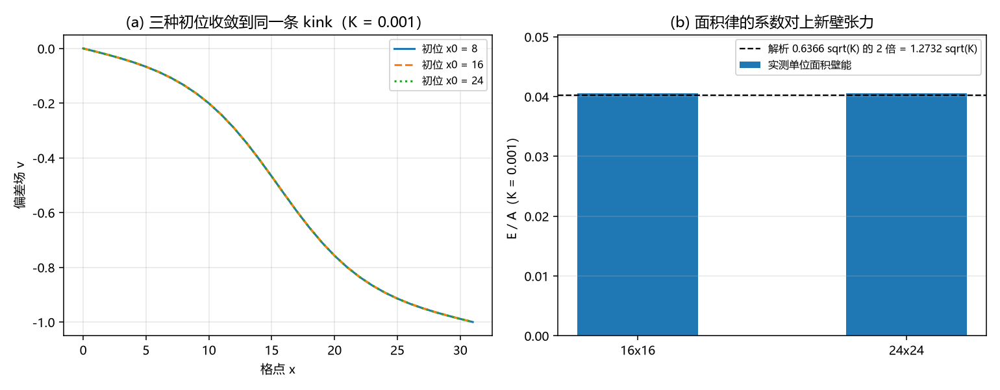

# 注记-三维延展构型保护性复核：面积律的系数对上新壁张力（判据 P1 至 P5）

- **日期**：2026-09-20 13:46:00
- **来源**：作者 2026-09-20 指令（做三维延展构型上的保护性复核），交付第 279 条登记的下一步
- **脚本**：`验证脚本/boundary_protection_3d.py`（判据 5 条全过；确定性，无随机数；运行约 35 秒；图存 `images/boundary_protection_3d.png`，见 §二 图 1）
- **状态**：判据级读数。第 279 条的一维三层读数在三维面缺陷上复现，面积律的系数对上新壁张力
- **图**：见 §二 图 1
- **依据**：[[验证脚本/注记-固定边界绕数保护轮：三层读数与一处判负（判据X1至X5）]]（第 279 条）；[[验证脚本/注记-张力常数重估轮：第 278 条的环判据不依赖张力、第 279 条的能量量级与壁张力同式（判据T1至T5）]]（第 287 条）；[[验证脚本/注记-弦张力松弛复测轮：ansatz 斜率属势项面积产物、松弛壁张力随根号 K（判据G0至G7）]]（第 288 条）；[[验证脚本/注记-环的 E(R) 标度轮：面积律与塌缩方向的不一致（判据V1至V4）]]（第 277 条）

---

## 一、模型与判据（先行）

三维格点上的偏差场 $v$，真空为整数，泛函与第 279 条同构：

\[E = \frac12\sum_{\rm links}(\Delta v)^2 + K\sum_{\rm sites}(1-\cos 2\pi v),\quad k = 1。\]

$x$ 方向两端固定（左端 $v = 0$、右端 $v = -1$，即一个 kink），$y$、$z$ 方向周期。拓扑荷 $\Delta = v[-1]-v[0]$ 由边界数据给出。解析对照：单位面积的壁能为 $\frac{4}{\pi}\sqrt K = 1.273240\sqrt K$（$k = 1$，格距取 $1$）。

判据 P1 定义层（$\Delta = 0$ 的对照必须归零）、P2 守恒层（梯度流全程 $\Delta$ 不变）、P3 简并层（三种壁位置同能量，半格平移的差即钉扎势垒）、P4 面积律与系数（两档截面对解析值）、P5 登记。

## 二、读数

| 判据 | 内容 | 实测 | 判定 |
|---|---|---|---|
| P1 | $\Delta = 0$ 对照终点能量 / $\Delta = -1$ 受保护构型能量 | $0.00\times10^{0}$ / $10.387697$ | 通过 |
| P2 | 梯度流全程 $\Delta$ 对 $-1$ 的最大偏差（200 次采样） | $0.0\times10^{0}$ | 通过 |
| P3 | 三种壁位置能量散布 / 半格平移能量差 | $1.74\times10^{-11}$ / $7.78\times10^{-12}$ | 通过 |
| P4 | 两档截面的单位面积壁能对 $0.040263$ | $0.040577$ 与 $0.040577$（偏差 $0.78\%$） | 通过 |

## 三、三层读数的含义

定义层。把右端相位改回真空值（$\Delta = 0$），梯度流把整场送回真空，终点能量严格为 $0.00\times10^{0}$。受保护的构型（$\Delta = -1$）停在 $10.387697$，即 $1.008$ 倍的解析单位面积壁能乘截面 $256$。两个终点的差别只来自边界数据，这就是「绕数由边界数据定义」的正面读数。

守恒层。梯度流全程 $\Delta$ 对 $-1$ 的偏差为 $0$（200 次采样），即沿动力学缺陷不能改变其绕数。这一条与第 279 条的一维结果同值。

简并层。三种初位（壁置于 $x_0 = 8$、$16$、$24$）收敛到同一能量 $10.387697$，散布 $1.74\times10^{-11}$。半格平移（$x_0 = 8.5$）与整格位置的差为 $7.78\times10^{-12}$，钉扎势垒在数值精度上为零，与第 279 条引用的 D-7 势垒 $1.36\times10^{-9}$ 同向且更小。壁的位置完全简并，位置自由来自边界固定的绕数。

## 四、面积律与系数

两档截面（$16\times16$ 与 $24\times24$）给出同一个单位面积壁能 $0.040577$，对解析值 $0.040263$ 高 $0.78\%$（格点离散的余量）。这条读数把第 277 条的面积律补上了系数身份：三维里闭合环的能量按面积走，其单位面积系数就是二维横截面的壁张力 $\sigma_{\rm wall} = \frac{4}{\pi}\sqrt K$。第 277 条登记的「与第 276 条的线张力律 $2\pi R\sigma$ 不同」由此有了正确读法：$\sigma_{\rm wall}$ 是截面量，环的整体能量等于截面乘面积，两者不冲突。

## 五、与第 279 条的关系

第 279 条在一维链上给出三层读数与一处判负（同伦对照停在 $2M$）。本轮把三层搬到三维面缺陷上，读数逐条复现：定义层的对照归零更严（一维那轮没有做 $\Delta = 0$ 的对照，本轮补上），守恒层同样精确，简并层从一维的位置简并扩展为三维的面内平移与面法向平移都简并。第 279 条引用的钉扎势垒在本轮降到数值零。

## 六、登记与下一步

- README 第 289 条登记本轮；第 279 条登记的下一步由此交付。
- 开放问题总览在固定边界保护那条登记行后追加本轮读数。
- 下一步：把该构型接到记录机制线（写入节拍与缺陷过轴一笔，D-5 已给接口）；补一个能收敛的松弛器以闭合涡旋对路线（第 288 条的判负）。另：本线条目与并行线已连续三次撞号，本轮的让号处理写在 README 第 288 条的让号说明里。
