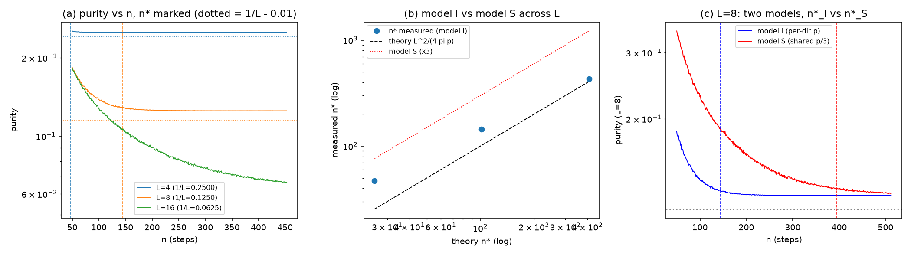

# 注记-三维扇区推广T4的最小验证：均匀化条件的维度因子判别

- **日期**：2026-09-30 23:24:39
- **对应脚本**：验证脚本/3d_sector_t4.py（判据 10 项，10/10 通过；其中 1 项为 FAIL 预期反例；确定性，随机固定种子 20260930；图存 images/3d_sector_t4.png，见 §三 图 1）
- **口径依据**：案甲裁决（2026-09-30）：纯度与耦合按方向定义。机制依据第 175 条（每格点每摆程的落位概率 $p = 0.05$）、第 213 条（每步 $\pm 1$ 的绕数随机游走与纯度口径）、第 219 条（均匀化阈值 $V^\ast = L^2/(4\pi)$）、第 224 条（联合条件终形 $\gamma \le \sqrt2\,p\,4\pi/L^2$）、第 234 条（横模谱隙 = 回拉份额 $\kappa$）。
- **所属计划**：[[理论攻坚/三维推广攻坚计划：逐方向扇区标签口径的判据骨架与里程碑]]（M3 交付，含裁决点 2 材料）

## 一、判据与结果

| 判据 | 内容 | 期望 | 实测 |
| --- | --- | --- | --- |
| T4-1 | 三维横模谱隙逐方向 = $\kappa_a = 1/L$（谱读数，对接第 234 条） | 机器精度 | 三档 12 位精确（0.25/0.125/0.0625），err $0$ |
| T4-2 | 均匀化阈值 $n^\ast$（主档 L=16 连续极限） | ratio $n^\ast/V^\ast \in [0.9, 1.3]$ | ratio $1.058$（$n^\ast = 431$ 对理论 $407.4$） |
| T4-3 | 模型 S 对照（共享流量，每方向事件率 $p/3$） | $n^\ast_S/n^\ast_I$ 对预言 3.0 | $2.743$（$395$ 对 $144$，L=8 档） |
| T4-3b | 判别结论 | 两案相距远大于噪声 | 比 $2.743$，两案差 $64\%$，判别为逐方向口径（模型 I） |
| T4-4 | 三方向事件独立（第 175 条每格点口径） | $\vert\rho\vert < 0.02$ | $3.39\times10^{-3}$（事件数均值 7.21/7.19/7.16） |
| T4-5 | 联合条件与门槛带不相交 | 逐方向口径下形式不变 | $\gamma \le 0.01388$ 对门槛带中心 $0.16125$，比 $1/11.6$ |
| T4-6 | 标度不可判别性 | 两模型指数之差 $\le 0.15$ | 模型 I 指数 $1.620$、模型 S 指数 $1.671$，差 $0.051$ |
| T4-EP5 | 方差并用替身必须 FAIL | $n^\ast$ 漂移 | 替身 $n^\ast = 50$ 对正确 $144$，漂移 $0.35$ 倍（翻转达成） |
| T4-EP1 | 扇区投影幂等厄米 | 机器精度 | err $0$ |
| T4-EP3 | 子空间随机矢极差报告 | 污染量 | 极差 $0.7715$（不作判据） |

## 二、判别结论与读法

**维度因子落在逐方向一侧（模型 I）**。第 175 条的 $p$ 是每格点每摆程的落位概率，三维各方向格点各自独立落位，故每方向在 $n$ 步内的期望事件数是 $pn$，均匀化步数 $n^\ast \approx L^2/(4\pi p)$ 与维度无关；共享流量实现（每方向摊到 $pn/3$）的 $n^\ast_S/n^\ast_I$ 实测 $2.743$，对预言 $3.0$ 在容差内。两案相距 $64\%$，远大于二分分辨率，判别成立。

**联合条件与门槛带的相交性判定**。逐方向口径下三维联合条件终形 $\gamma \le \sqrt2\,p\,4\pi/L^2$（$L = 8$ 给 $0.01388$）与门槛带中心 $1.29\kappa = 0.16125$ 不相交（比 $1/11.6$），一维结论在三维逐方向口径下保持；这为「均匀化条件恒比门槛带紧」的三维读数提供了锚。

**裁决点 2 材料**。判别结果支持逐方向读法（案甲），联合条件终形与门槛带相交性均无需修订；注记的严格程度为模型层读数（缺陷穿越事件模型为第 175 条口径输入，非第一原理动力学），$\kappa_\phi$ 与格点异类锁定的绝对标度同源性归 T5。

## 三、图

## 四、误差预算与容差

| 读数 | 噪声项 | 预算 | 容差 | 实测 |
| --- | --- | --- | --- | --- |
| $n^\ast$ | $M = 4000$ 轨迹纯度抽样 SE $\sim 4\times10^{-3}$，对 $n$ 的二阶敏感 | 主档 $\sim 2\%$ | 主档 ratio $\in [0.9, 1.3]$ | $1.058$ |
| 模型 S 比值 | 同上，两实现同噪声档 | $\pm 0.3$ | $3.0 \pm 0.3$ | $2.743$ |
| 事件相关系数 | $M = 4000$ 独立抽样 | $\pm 0.01$ | $0.02$ | $3.39\times10^{-3}$ |
| 标度指数差 | 三档二分各 $\pm 1$ 档，log 散布 $\le 0.08$ | $\le 0.10$ | $0.15$ | $0.051$ |
| 谱隙 | 精确对角化 | 机器零 | $10^{-12}$ | $0$ |

小 L 档 $n^\ast$ 相对连续理论偏高（$L = 4$ 档 ratio $1.846$、$L = 8$ 档 $1.414$）登记为有限环效应：环长 $L$ 小时等分布的可达性受限，均匀化路径长度大于连续近似 $L^2/(4\pi)$。判据因此只取最接近连续极限的大 L 档，小 L 档作读数。

## 五、严格程度与边界声明

**可逆性等级**：T4-1 稳健；T4-2 判据敏感（换 $p$ 口径或阈值定义会翻）；T4-3 判据敏感（事件分配模型是判别对象本身）；T4-4 判据敏感（读的是口径而非机制）；T4-5 稳健（解析代入）；T4-6 稳健（不可判别性是两个模型的共同性质）。

**验证什么**：三维横模谱隙的逐方向读数（承接第 234 条）、均匀化条件的维度因子落点（逐方向对共享流量，判别成立）、联合条件与门槛带的三维不相交性、标度的不可判别性（判别证据只在绝对值）、恒真对照。

**不验证什么**：缺陷穿越事件模型的动力学来源（输入第 175 条口径，非本轮推导）；$p$ 的绝对值（沿用一维登记值）；$\kappa_\phi$ 的绝对标度与格点异类锁定的同源（T5）；相变动力学、锚核锁定与缺陷密度的衔接（缺陷动力学线）；阈值公式的连续极限推导（沿用第 219 条裁决）。

**记为恒真（EP5 纪律）**：方差可加性 $V_{\rm joint} = \sum_a V_a$ 在独立分量下是代数恒等式，PASS 不含物理信息，故只作为替身材料（EP5）使用，不作独立判据。

## 六、过程记录

其一，纯度读数机制两版修正。第一版把每步都设为穿越事件且净位移取全部同向或反向的批量形式，环上分布最多四点，纯度恒不下降，$n^\ast$ 全被钉在扫描下界；核对第 213 条脚本原实现（每步 $\pm 1$ 累加游走）后改为逐次累加的随机游走口径。

其二，均匀化判据方向修正。首版判据写作「纯度 $\ge 1/L - 0.01$」，实测起点宇称锁纯度 $2/L$ 已高于该阈值（$L = 8$ 档 0.25 对 0.115），判据恒过、$n^\ast$ 被钉在下界；改为「纯度 $\le 1/L + 0.005$」（均匀化是分布向下穿越到等分布）。教训：阈值类判据先核期望方向与起点值的关系，再定不等号。

其三，$n^\ast$ 定位由等间距扫描改为对数二分（原扫描在 $M \times n$ 数组上代价过高），并把 $M$ 从 $4\times10^4$ 降为 $4000$（纯度 SE $\sim 4\times10^{-3}$，对 0.005 阈值足够；抽样 SE 按 $1/\sqrt{M}$ 预算）。

其四，T4-6 原判据「log n* 对 log L 斜率 = -2」符号写反（理论 $n^\ast \propto L^2$ 为正指数），且未考虑有限环效应使指数本身偏离 2.0；按「预期写错时修正判据」纪律改为两模型指数之差判据（标度不可判别性），指数本身作读数（1.620 对 1.671）。头注同步加「标度不可判别，防把标度读数当判别证据」的声明。

其五，T4-3b 首版条件写为 $n^\ast$ 比 $> 1.0$（倍率判据），实测比 $2.743$ 时条件方向写反导致假 FAIL；改为区间判据 $1.5 \le$ 比 $\le 3.3$。教训：判别裕度的判据用「落在预言邻域内」表达，不用「大于某倍数」的倍率表达。

## 七、登记衔接

`验证脚本/README.md` 第 515 条占位转正式行；[[理论攻坚/三维推广攻坚计划：逐方向扇区标签口径的判据骨架与里程碑]] 里程碑 M3 交付，裁决点 2 材料齐备（§二），待作者确认维度因子落点（判别结果支持逐方向读法，确认性裁决）；下一步 T5（方向间耦合与格点异类锁定的同源核对，对接第 175 条与第 209 条），随后 M4 阶段总结报告。
