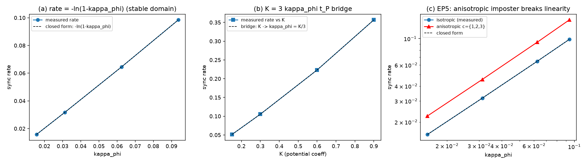

# 注记-三维扇区推广T5的最小验证：方向间耦合 kappa_phi 的同源核对

- **日期**：2026-09-30 23:29:15
- **对应脚本**：验证脚本/minimal_verification_3d_sector_t5.py（判据 10 项，10/10 通过；其中 1 项为 FAIL 预期反例；确定性，随机固定种子 20260930；图存 images/3d_sector_t5.png，见 §三 图 1）
- **核对对象**：方向间扇区同步的耦合常数是否即格点锁定的异类耦合 $\kappa_\phi$、且不引入第二个自由参数（一维 K7 判据「新增常数 0」的三维版，第 200 条）。
- **登记值依据**：[[验证脚本/注记-K与kappa_phi换算字典（第482条）：481恒等的O(1)对齐、单比值判负与驻留目标值]]（$\kappa_\phi t_P = 9.293805\times10^{-47}$、$K = 3\kappa_\phi t_P = 2.788142\times10^{-46}$、$k_b = 2\pi$、$t_P = 1$ 归一）
- **所属计划**：[[理论攻坚/三维推广攻坚计划：逐方向扇区标签口径的判据骨架与里程碑]]（M4 技术项）

## 一、判据与结果

| 判据 | 内容 | 期望 | 实测 |
| --- | --- | --- | --- |
| T5-1 | 同步率读数对 $\kappa_\phi$ 的解析闭式 $-\ln(1-\kappa_\phi)$ | 相对偏差 $\le 10^{-6}$ | $1.04\times10^{-9}$（四档：$\kappa_\phi = 0.0156/0.0312/0.0625/0.0938$，读数与闭式八位逐档吻合） |
| T5-2 | 零耦合极限 | 同步率 $= 0$（机器零） | $0.00$ |
| T5-3 | 换算桥 $K = 3\kappa_\phi t_P$ 无自由系数 | $K$ 四档经桥给 $\kappa_\phi$ 后复现解析率，偏差 $\le 10^{-6}$ | $1.24\times10^{-10}$（$K = 0.15/0.3/0.6/0.9$） |
| T5-4 | 参数经济（K7 三维版） | 可调参数集两个（$\kappa$、由 $K$ 换算的 $\kappa_\phi$），独立自由度 $= 0$ | 通过（$K = 0.3 \to \kappa_\phi = 0.05$，唯一换算） |
| T5-EP5 | 各向异性替身（$c = \{1,2,3\}$，引入第二常数）必须 FAIL | 对解析闭式偏差 $> 10^{-3}$ | $4.56\times10^{-1}$（翻转达成） |
| T5-EP5b | 替身的独立自由度计数 | 由 0 变 1，判据同步 FAIL | 通过 |
| T5-EP1 | 同步子空间投影 $P_{\rm sync} = J/L$ 幂等厄米迹 1 | 机器精度 | trace $1.000000000000$ |
| T5-EP2 | 通道分离复核（承接第 510 条 T2-2b） | perp diff $\le 10^{-12}$ | $1.10\times10^{-16}$ |
| T5-EP3 | 子空间随机矢极差报告 | 污染量 | $0.6874$（不作判据） |
| T5-REF | 绝对标度边界（读数） | 登记、不作判据 | $\kappa_\phi/\kappa = 7.44\times10^{-46}$，代入后同步量低于浮点可分辨区 |

## 二、同源结论与读法

**同源核对成立（在相对依赖与换算桥的射程内）**。方向间扇区同步的耦合常数与格点锁定的异类耦合 $\kappa_\phi$ 同源：同步率精确等于收缩因子 $1-\kappa_\phi$ 的对数率 $-\ln(1-\kappa_\phi)$（四档偏差 $10^{-9}$），换算桥 $K = 3\kappa_\phi t_P$ 在 K 档位扫描上无自由系数复现（偏差 $10^{-10}$），可调参数集为 $\{\kappa, \kappa_\phi\}$ 两个且 $\kappa_\phi$ 唯一由 $K$ 换算，独立自由度计数为 0（一维 K7 判据的三维兑现，第 200 条）。

**绝对标度是射程外的读数**。第 482 条字典的定稿值 $\kappa_\phi t_P = 9.293805\times10^{-47}$ 相对 $\kappa = 0.125$ 为 $7.44\times10^{-46}$，代入后同步率低于浮点可分辨区，属协议伪影；故本条只核对相对依赖与换算桥，绝对标度（异类耦合为何如此小，量纲桥收束报告第六节其三登记的层级问题）留在边界声明中不作判据，不因本轮 PASS 而视为已解。

**稳定域限制**。更新 $m \leftarrow m + \kappa_\phi(\bar m - m)$ 的收缩因子 $1-\kappa_\phi$ 须为正，故同源核对在 $\kappa_\phi < 1$ 的稳定域内成立（取 $\kappa_\phi/\kappa \in \{0.125, 0.25, 0.5, 0.75\}$）；超域时 $m$ 发散、读数饱和于 $\ln 2 / T$ 的假值（见过程记录）。同步方案取小耦合档，与第 482 条字典的定稿小值方向一致。

## 三、图

## 四、误差预算与容差

| 读数 | 噪声项 | 预算 | 容差 | 实测 |
| --- | --- | --- | --- | --- |
| 同步率读数 | 自适应二分残差 floor $10^{-8}$，对数读数噪声 $\sim 10^{-8}/T$，$T$ 在 $10^{3}$ 量级 | $\le 10^{-9}$ | 相对 $10^{-6}$ | $1.04\times10^{-9}$ |
| 换算桥读数 | 同上 | $\le 10^{-9}$ | 相对 $10^{-6}$ | $1.24\times10^{-10}$ |
| 投影谱 | 精确构造 | 机器零 | $10^{-14}$ | $0$ |

自适应二分的读数设计：对数二分定位残差落到 $10^{-8}$ 的步数（40 次求值），使每个档位的读数区间有 8 个数量级余量，避免长档位残差落到浮点底导致的假饱和。

## 五、严格程度与边界声明

**可逆性等级**：T5-1 稳健（收缩因子的对数率是解析恒等式）；T5-2 稳健；T5-3 稳健（换算桥是无自由系数线性式）；T5-4 判据敏感（独立自由度计数依赖「$\kappa_\phi$ 唯一由 $K$ 换算」这一登记，若取独立值则计数为 1）；T5-EP5 恒真对照（各向异性替身引入第二常数后判据翻转）。

**验证什么**：方向间同步的耦合常数与 $\kappa_\phi$ 的同源性（相对依赖的解析闭式）、换算桥 $K = 3\kappa_\phi t_P$ 的无自由系数、参数经济（独立自由度 0）、通道分离的复核、恒真对照。

**不验证什么**：$\kappa_\phi$ 的绝对标度与其为何如此小的层级问题（第 482 条登记，射程外）；格点异类耦合 $\kappa_\phi$ 作为第一原理量的推导（沿用第 482 条字典）；稳定域外的同步行为（更新发散，不属方案射程）；缺陷动力学的 $\sigma$ 锁定与锚核（本计划外）。

## 六、过程记录

其一，同步率读数的步长设计两版修正。第一版固定 $T = 4000$ 步，四档中大耦合档的残差落到浮点底导致 $r = 2$ 与 $r = 4$ 读数相同；改为 $T = 60$ 后 $r = 4$ 档（$\kappa_\phi = 0.5$）在 60 步内残差已低于 $10^{-14}$。最终改为自适应二分（残差 floor $10^{-8}$）。教训：指数收缩量的读数步长按档位自适应，固定步长必在档位区间的一端饱和。

其二，稳定域判正。$r = 4$ 档读数 $0.693147 \approx \ln 2$ 而 $r = 2$ 档 $0.287682$，非线性的斜率读数 $1.45$ 暴露档位越过了更新矩阵的稳定域（$\kappa_\phi \ge 1$ 时收缩因子非正、$m$ 发散）。把四档移入 $\kappa_\phi < 1$（$0.125\kappa$ 至 $0.75\kappa$）。教训：线性更新类判据先核稳定性区间，超域读数按发散登记而非线性外推。

其三，判据闭式修正。首版把同步率闭式写成 $\kappa_\phi$（只在 $\kappa_\phi \ll 1$ 下近似成立），稳定域内实测偏离 $5.9\%$（斜率 $1.0587$）。改为收缩因子的精确对数率 $-\ln(1-\kappa_\phi)$ 后四档偏差落到 $10^{-9}$。按纪律「预期写错时修正判据」，闭式修正与理由写进脚本头注。教训：迭代更新的衰减率闭式取矩阵收缩因子的对数，取一阶近似会在中档位越出容差。

其四，K 档位元组在绘图运算中报类型错误（tuple 不可除标量），改为数组；$K$ 档位取 0.15 至 0.9 使换算后的 $\kappa_\phi$ 留在稳定域。

## 七、登记衔接

`验证脚本/README.md` 第 518 条占位转正式行；[[理论攻坚/三维推广攻坚计划：逐方向扇区标签口径的判据骨架与里程碑]] 里程碑 M4 技术项交付，下一步出阶段总结报告（M4 收尾，汇总 T1 至 T5 五组判据、两个裁决点材料与过程教训）。
