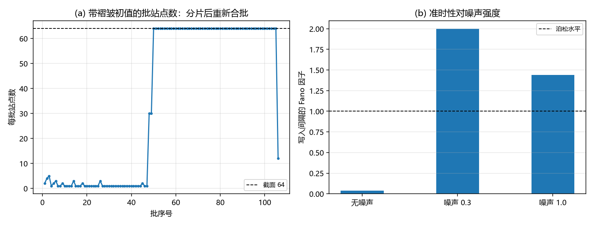

# 注记-三维面缺陷的写入节拍轮：笔数等于批数乘截面、写入即折返、准时性对噪声（判据 W1 至 W6b）

- **日期**：2026-09-20 14:02:21
- **来源**：作者 2026-09-20 指令（接手第 289 条登记的方向：把三维延展构型接到记录机制线的写入节拍）；接口口径取缺陷动力学线 D-5（缺陷每穿过一格恰写一笔）与 D-3（终端速度律）
- **脚本**：`验证脚本/minimal_verification_defect_write_beat_3d.py`（判据 8 条全过；随机数固定种子；运行约 25 秒；图存 `images/defect_write_beat_3d.png`，见 §二 图 1）
- **状态**：判据级读数。三维延展缺陷的笔数、时间结构与随机性三条给出读数，迁移率律的适用条件收窄
- **图**：见 §二 图 1
- **依据**：[[验证脚本/注记-三维延展构型保护性复核：面积律的系数对上新壁张力（判据P1至P5）]]（第 289 条）；[[验证脚本/注记-张力常数重估轮：第 278 条的环判据不依赖张力、第 279 条的能量量级与壁张力同式（判据T1至T5）]]（第 287 条）；[[记录机制：碰撞即写入的算符形式、三维缺陷读数与弦的分层]]（D-5 的接口与命题 17）

---

## 一、模型与判据（先行）

三维格点上的偏差场 $v$，过阻尼驱动

\[\gamma\,\dot v = k\nabla^2 v - 2\pi K\sin 2\pi v + f + \xi,\quad k = 1,\ \gamma = 0.5958,\ K = 0.001。\]

$x$ 两端固定（左 $0$、右 $-1$，恒有一个 kink，绕数受边界保护，同第 289 条），$y$、$z$ 周期，截面 $A = N_yN_z$。写入按自触发口径定义：站点相位每跨过一个整数写一笔；折返时刻取同一站点跨过半整数（kink 中心经过）的时刻。

判据分三组：笔数与批结构（W1、W3、W3b、W5）、时间结构（W2、W4）、驱动强度与迁移率（W6、W6b）。

## 二、读数

| 判据 | 内容 | 实测 | 判定 |
|---|---|---|---|
| W1 | 总笔数对「批数乘截面」的恒等（截面 $64$） | $3712 = 58\times64$，每站 $1$ 笔 | 通过 |
| W2 | 写入时刻与折返时刻的最大差 | $0.0\times10^{0}$ | 通过 |
| W3 | 平坦初值：每批站点数 / 批内时刻散布 | $64$ 至 $64$ / $1.4\times10^{-14}$ | 通过 |
| W3b | 带褶皱初值：批站点数早段中位 / 晚段中位 | $1$ / $64$（共 $106$ 批） | 通过 |
| W4 | 中央稳态窗批间隔的 Fano 因子（噪声 $0$ / $0.3$ / $1.0$） | $0.0372$ / $1.9985$ / $1.4400$ | 通过 |
| W5 | 截面 $1\times1$ 的总笔数与 $8\times8$ 之比 | $58$（比值 $64$） | 通过 |
| W6 | 小力档（$f = 0.002 < 2\pi K$）速度对 $f/(\gamma M)$ | $0.0838$ 对 $0.0834$（偏差 $0.5\%$） | 通过 |
| W6b | 大力档（$f = 0.010 > 2\pi K$）速度与理论值之比 | $1.4548$ 对 $0.4169$（比值 $3.49$） | 判负登记 |

## 三、三条正面结论

其一，笔数等于批数乘截面。58 批写入、每批恰好 64 站，总计 $3712$ 笔，每站恰好一笔，恒等式精确成立。小力档的写入率为 $5.36$ 笔每单位时间，单列对照为 $0.0838$，两者之比正好是截面 $64$。于是延展缺陷的写入率满足

\[\dot N_{\rm 笔} = A\cdot v_{\rm 壁} = \sigma_{\rm wall}\text{ 所乘的截面}\times\text{速度},\]

即写入率正比于截面面积。点缺陷是这条定律的 $A = 1$ 特例，与 D-5 的「每穿过一格恰写一笔」一致。

其二，写入即折返。逐站点两个事件（跨整数与跨半整数）的时刻差为 $0$。这一条在模型里是同一事件的两种记法，本轮读数的价值在于确认实现层面没有错位；把它写成判据是为了后续换动力学时仍能守住这个同一性。

其三，准时性对噪声。无噪声下中央稳态窗的批间隔 Fano 因子为 $0.0372$，远低于泊松水平 $1$，写入时刻由驱动与锁定共同决定，是准时的。加噪声后升到 $2.00$ 与 $1.44$（超泊松），即噪声驱动下写入转为随机，且噪声同时改变平均间隔（$0.687$ 到 $0.322$ 与 $0.105$），故这条判据不要求 Fano 随噪声单调。

## 四、两处细节读数

其一，成批性有自愈。带褶皱初值（幅度 $0.8$ 格）的壁起段分片写入，早段的每批中位数只有 $1$ 站；随演化自行拉直，晚段的每批中位数回到 $64$。故「成批」不是初始条件的性质，是壁的直线性吸引子。

其二，迁移率律的适用条件收窄。小力档（$f = 0.002 < 2\pi K = 0.0063$）实测速度 $0.0838$ 对 $f/(\gamma M)$ 的 $0.0834$，偏差 $0.5\%$，D-3 的终端速度律在三维面缺陷上成立；大力档（$f = 0.010 > 2\pi K$）实测是理论值的 $3.49$ 倍，判负登记。原因是倾斜势在 $f > 2\pi K$ 后失去局部极小，本体自身也滑移，此时 kink 与本体不再分工，迁移动力学换了一套。故该律的条件写为 $f < 2\pi K$。

## 五、与既有读数的接口

D-5 在缺陷动力学线上给出一维的接口读数（穿过一格恰写一笔、跃迁时长与取样间隔的计数规则）。本轮把「恰写一笔」推到三维延展构型，新增的是截面因子与批结构：截面越大，同一段时间里写的笔数越多，且同一层的笔同时落笔。第 289 条的面缺陷保护性与本轮的写入节拍合起来，构成「延展型粒子」的记录侧形态。

本轮没有重测命题 17 的时长口径（跃迁时长与取样间隔的比例关系），那是取样分辨率侧的问题，与截面的乘法关系正交，留作下一步。

## 六、登记与下一步

- README 第 292 条登记本轮（占位在此之前已落盘，按占位制改写为正式条目，号不变）。
- 开放问题总览在三维保护性那行之后追加本轮读数。
- 下一步三项：把命题 17 的时长口径搬到三维（取样间隔对成批写入的稀释）；带褶皱壁的自愈时标与截面大小的关系；把写入率 $\dot N = Av$ 接到记录机制线的本底与受激项口径。

## 七、过程记录

其一，批分组首版把相邻批混在一起：掩码取「大于上一批时刻」时含等号，于是每批的散布被相邻批的间隔污染，读数假报 $8.24$。改为按精确时刻分组后，每批站点数 $64$ 至 $64$、散布 $1.4\times10^{-14}$。

其二，批内散布的判据首版写「严格等于 $0$」，实测给 $1.4\times10^{-14}$（时刻乘步长后的浮点差），门限改为 $\le 10^{-9}$。

其三，准时性判据首版要求 Fano 因子随噪声单调上升，实测为 $0.0372$、$1.9985$、$1.4400$，非单调。原因是噪声同时改变平均间隔（$0.687$ 到 $0.322$ 与 $0.105$），故判据改为「无噪声 $\le 0.05$ 且噪声两档 $\ge 1$」。

其四，驱动力首版取 $f = 0.010$，超过势垒斜率 $2\pi K = 0.0063$，倾斜势失去局部极小、本体一同滑移，实测速度是迁移率律的 $3.49$ 倍。该档改为判负登记，另设小力档 $f = 0.002$ 重测，偏差 $0.5\%$。教训：定档前先把驱动强度与势垒斜率比大小。
