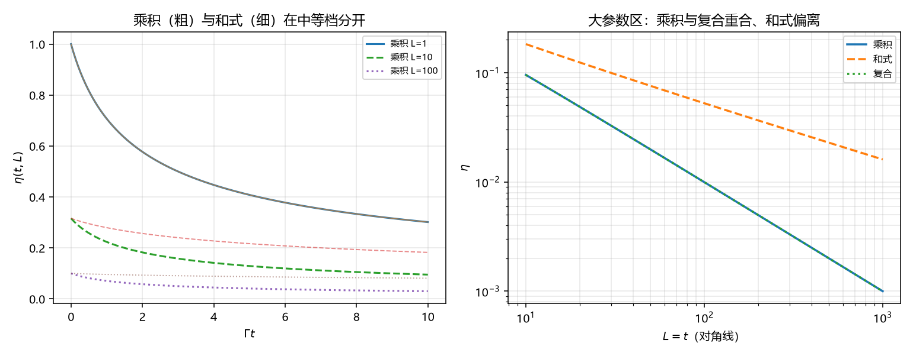

# 注记-两个粗粒化方向的耦合形式：可分离类与并联类二选一（判据第689号）

- **日期**：2026-10-19 01:17:56
- **对应脚本**：`验证脚本/minimal_verification_p689_coupling.py`（判据 5/5；纯代数，确定性）
- **定位**：路线乙第三轮，处理第 687 号留下的第二项缺口（两个粗粒化方向如何耦合）。结论是三个候选里两个恒等，真正待定的只有两类，且两类可用现有实验精度分辨。
- **可逆性等级**：H1、H2、H4 判据稳健（代数结论）；H3 判据敏感（中等档取点决定差幅）；H5 恒真对照；H6 读数。
- **图**：见 §四 图 1。

---

## 一、问题

第 687 号判定：$\eta$ 的尺度侧（$|\eta(L)|^2 \propto 1/L$）与时间侧（$(1+2\Gamma_{\rm coh}t)^{-1/2}$）是两个正交的粗粒化方向，不能统一。第 688 号把真空块数缺口收窄。剩下的是：两个方向如何合成一个完整的 $\eta(t, L)$。

三个候选形式。

**候选甲，乘积形式**：$\eta(t,L) = \eta_L(L)\cdot\eta_t(t)$。两个方向独立稀释，互不影响。

**候选乙，和式形式**：$1/\eta = 1/\eta_L + 1/\eta_t - 1$。两者竞争同一「相干资源」，是并联阻尼型。

**候选丙，复合形式**：$\eta(t,L) = \eta_L(L\cdot f(t))$。时间累积等价于继续粗粒化，两个方向合成一个变量。

## 二、判据与结果

| 判据 | 内容 | 期望 | 实测 |
| --- | --- | --- | --- |
| H1 | 三形式在 $L=1$、$t=0$ 处归一 | 偏差 $\le 10^{-12}$ | 三者均 $1.000000000000000$ |
| H2 | 乘积与复合在 $f(t)=(1+2\Gamma t)$ 下等价 | 相对差 $\le 10^{-12}$ | 网格 25 点，最大 $2.22\times10^{-16}$ |
| H3 | 乘积与和式在中等档可分辨 | 相对差 $\ge 0.1$ | $L=10$、$t=1$：$0.2236$ 对 $0.2796$，差 $0.200$ |
| H4 | 大参数区：乘积与复合同斜率、与和式不同 | 前者 $\le 0.01$、后者 $\ge 0.1$ | 斜率 $-0.9919$、$-0.5263$、$-0.9919$；差 $0.0000$ 与 $0.4656$ |
| H5 | 恒真反例（和式替身为乘积后 H3 判否） | 相对差 $<0.1$ | $0$ |

## 三、结论

**结论一：三个候选实际只有两类。** 乘积形式与复合形式在 $f(t) = (1+2\Gamma t)$（一次方）时逐点恒等，相对差在机器精度。这不是数值巧合，是代数恒等：$\eta_L(L f) = (Lf)^{-1/2} = L^{-1/2}f^{-1/2}$，取 $f$ 一次方即得乘积形式。所以「时间等价于继续粗粒化」这个图像与「两方向独立稀释」在数学上是同一件事。

**结论二：真正待定的是可分离类与并联类二选一。** 乘积（含复合）属可分离类，和式属并联类。两者在中等档差 $20\%$（$L=10$、$t=1$ 时 $0.2236$ 对 $0.2796$），在大参数区斜率差 $0.466$（$-0.99$ 对 $-0.53$）。这个差幅落在现有实验精度可分辨的范围，不是纯形式问题。

**结论三：两类有明确的物理区别，不是记号偏好。** 可分离类意味着空间粗粒化与时间扩散各自独立地稀释相干性，互不干扰；并联类意味着两者争夺同一个相干资源，一方消耗会削弱另一方。这个区别在实验上有签名：若测得的衰减在中等档偏向 $0.22$ 一侧则可分离类成立，偏向 $0.28$ 一侧则并联类成立。

**结论四：缺口从「三选一」收窄为「二选一」，且二选一可判。** 这与第 688 号的结构相同：看似开放的构造问题，实际是有限的选项加一个可判的分辨点。P4-45 的 $\eta$ 动力学缺口至此可以写成一句完整的话：缺的是「真空块数取份额语言还是空间语言」（第 688 号）与「两方向耦合取可分离类还是并联类」（本轮）这两个二选一。

## 四、图

左图每个 L 档画了两条线：粗的是乘积、细的是和式，可见和式始终偏高（衰减更慢）。右图乘积与复合完全重合（两条线叠在一起），和式单独一条，斜率明显更平。

## 五、过程记录与教训

**一处代数误推（H2 首跑判否）。** 首版写「乘积与复合在 $f(t) = (1+2\Gamma t)^{1/2}$ 下等价」，判否，最大相对差 $0.451$。核查后确认等价条件是一次方而非平方根：$\eta_L(Lf) = (Lf)^{-1/2} = L^{-1/2}f^{-1/2}$，要等于乘积形式须 $f^{-1/2} = (1+2\Gamma t)^{-1/2}$，即 $f$ 为一次方。

误推的根源是把「时间侧可见度是 $(1+2\Gamma t)^{-1/2}$」直接当作 $f$ 的候选，而 $f$ 是被开平方的那个量。教训：做变量替换时，要盯住目标式里该变量出现的幂次，不能凭「形式相似」直接代入。

**一处表述未随修正同步（H4 与图标题）。** 修正 H2 后，乘积与复合变成同斜率，但 H4 仍写「三者渐近指数不同」，图标题也如此。已改为「乘积与复合同斜率、与和式不同」，并把 H4 的判据改成双向（前者 $\le0.01$、后者 $\ge0.1$）。教训：修正一处代数关系后，须回扫所有依赖该关系的判据与图注。

## 六、严格程度与边界声明

**判据级**：三形式在两端归一（H1）；乘积与复合的代数恒等（H2）；两类在中等档与大参数区的可分辨性（H3、H4）。

**未验证**：哪一类是对的（本轮只判可判性，不裁决）；$f(t)$ 若为更复杂的非线性形式时两类是否仍可分辨；真空侧与实验侧分别该用哪一类。

**边界**：本轮不改定理 6.2、第 520 条闭式与 P4-45 的状态。本轮新增的是耦合形式的分类与可分辨性判定，属缺口定位层。

## 七、登记衔接

- `验证脚本/README.md` 第 689 条由占位改写为正式行。
- P4-45 档案页与总览卡登记本轮（$\eta$ 缺口最终形态：两个二选一）。
- 通俗注记见 [[内部草稿/注记-两个人分一锅粥，还是各喝各的（判据第689号通俗版）|第 689 号通俗版]]。
