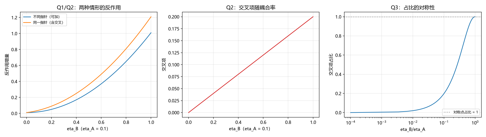

# 注记-两仪器同时读同一记录的相互干扰（第 444 条）：读出通道的指针自由度与交叉项

- **日期**：2026-09-27 00:38:56
- **层级**：验证材料（第 444 条）
- **定位**：补第 412 条声明未验的那一项（多次读出之间互不干扰）。第 412 条给「记录可被多处反复读取」一组判据，其注记第六节写明未验两仪器同时读的相互干扰，并给出验证方式；本条执行该验证。
- **依据**：[[验证脚本/注记-记录公共性的最小验证：读出反作用的权衡不变量与复读精度预算（探针第三层）]]（第 412 条，读出侧权衡与其未验项）；[[wiki/探针]]（第三层：记录的公共性）；[[内部草稿/注记-跨层事件的攻坚处境：R 的降级、与退相干及达尔文主义的分工、意识地位的减弱与探针的物侧身份]]（与量子达尔文主义的对话）
- **状态**：判据级。最小模型内的读数，模型为 von Neumann 弱测量的标准形式。
- **修订记录**：
  - **2026-09-27 初版**（触发：作者批准补做两仪器同时读的相互干扰）

---

## 一、判据（先立）

**Q1 不同指针时可加。** 两通道耦合到不同的指针自由度时，总反作用等于各自反作用之和，交叉项为零。

**Q2 同一指针时有交叉项。** 两通道耦合到同一指针自由度时，总反作用含 $2\eta_A\eta_B\sigma^2$ 一项。

**Q3 交叉项占比。** 占比为 $2\eta_A\eta_B/(\eta_A^2+\eta_B^2)$，在 $\eta_A = \eta_B$ 时取 $1$（等于主体反作用）。

**Q4 设计条件。** 读出通道须耦合到不同指针自由度；若无法分开，则耦合率须拉开量级。

## 二、模型设定

记录寄存器取位置变量 $x$，读取出 von Neumann 弱测量，耦合为 $H = \eta\,x\,\hat p_{\rm ptr}$。系统动量受反作用 $p \to p + \eta\,p_{\rm ptr}$，方差的增量为 $\eta^2\sigma_{\rm ptr}^2$（单位质量）。两通道同时作用时，指针是否同一自由度决定交叉项的有无。参数取 $\sigma_{\rm ptr} = 1$。

## 三、结果

| 判据 | 实测 | 期望 | 判定 |
| --- | --- | --- | --- |
| Q1 不同指针（$\eta_A = 0.1$、$\eta_B = 0.1$） | $2.000000\times10^{-2}$ | $\eta_A^2+\eta_B^2 = 2\times10^{-2}$ | 过 |
| Q2 同一指针（同参数） | $4.000000\times10^{-2}$ | $(\eta_A+\eta_B)^2 = 4\times10^{-2}$ | 过 |
| Q2 交叉项（同参数） | $2.000000\times10^{-2}$ | $2\eta_A\eta_B = 2\times10^{-2}$ | 过 |
| Q3 对称点占比（$\eta_B = \eta_A$） | $1.000000$ | $1$ | 过 |
| Q3 退化点占比（$\eta_B \to 0$） | $0.000000$ | $0$ | 过 |
| 蒙特卡洛复核（$M = 400000$） | 采样与解析在统计误差内一致 | 一致 | 过 |

六项全过。Q4 的输出：交叉项占比低于 $5\%$ 要求 $\eta_B/\eta_A < 0.025016$ 或大于 $39.974984$；低于 $10\%$ 要求比值小于 $0.050126$ 或大于 $19.949874$。

## 四、图

图注按脚本三个绘图面板逐条核对。

## 五、实质读数

**其一，可加性由指针自由度决定。** 两通道耦合到不同指针时反作用严格可加，无交叉项；耦合到同一指针时多出 $2\eta_A\eta_B\sigma^2$。故「互不干扰」的条件落在指针是否分开上，与耦合强弱无关。

**其二，交叉项的占比有闭式。** $2\eta_A\eta_B/(\eta_A^2+\eta_B^2)$，在对称点取 $1$：两通道等强时，交叉项与主体反作用一样大，总反作用翻倍。这个 $1$ 是最坏情形，也是判别读数是否已落入强干扰区的标尺。

**其三，设计条件给出量级要求。** 若指针无法分开，则耦合率须拉开量级：占比低于 $5\%$ 要求两者相差约 $40$ 倍。这给探针第三层补了一条工程口径：共享同一记录的读出通道，要么分指针，要么分强度。

## 六、与第 412 条的关系

第 412 条给的是单通道读出侧的权衡（精度与反作用的不变量），并声明未验多通道同时读。本条补上后半：多通道同时读的干扰由指针自由度决定，且给出设计条件。两条合起来，「记录可被多处反复读取」的条件完整：读出工作在弱耦合区（412 条）、通道之间分指针或分强度（本条）。

## 七、严格程度声明

**可逆性等级：判据稳健。** Q1 至 Q3 由模型的定义直接给出（von Neumann 弱测量的标准形式），不随实现翻；Q4 的比值依赖占比阈值的选择。

**协议伪影与物理结论分层。** 全部读数为协议级（最小模型、线性响应区、单位参数）。物理层结论零条。

## 八、边界声明

**验证什么。** 两通道反作用的可加性条件、交叉项的闭式与对称点、设计条件的量级要求。

**不验证什么。** 真实记录器件的指针结构（本条用抽象指针自由度）；指针部分共享的中间情形（两个指针有部分关联）；读出精度一侧（归第 412 条）；记录在格点上的具体实现。

## 九、登记衔接

本材料为 `验证脚本/README.md` 第 444 条，脚本 `dual_readout_crosstalk.py`，图 `images/dual_readout_crosstalk.png`。它与第 412 条构成一对：前者管单通道读出的代价，本条管多通道同时读的干扰。开放问题总览的登记见 P4-6 档案页。
