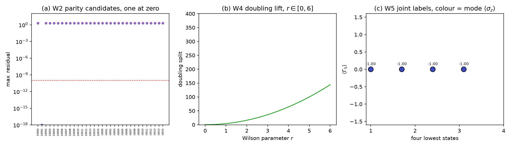

# 注记-两因子张量积结构判据化（第 491 条）：宇称唯一性、Wilson 相容与谱的因子化代价

- **日期**：2026-09-29 15:39:16
- **脚本**：`验证脚本/minimal_verification_two_factor_structure.py⟧
- **判据**：W1 至 W5 全部通过（5/5），另附冒烟
- **可逆性等级**：W1 与 W2 判据稳健，结论为代数穷举（四个 $\gamma$ 的三十二个单项式全枚举），与数值容差无关。W3 与 W4 判据稳健，结论由构造与解析恒等决定。W5 判据稳健，结论由厄米性与对易关系决定。
- **类型**：判据级读数（升维构造方案 §八 第一轮的执行轮）
- **关联**：[[内部草稿/注记-升维构造方案：内部模式代数与时空Clifford的两因子划分（依据第490条）]]（本组的判据出处与待裁项）；[[验证脚本/注记-宇称变换行为与Wilson项（第490条）：2分量下宇称不存在与doubling抬升的处方权衡|第 490 条]]（D5 判负与 Wilson 处方）；[[验证脚本/注记-电子算符Dirac骨架（第489条）：S¹×ℝ反周期谱结构、D2连续极限与D1甲乙首测|第 489 条]]（2 分量骨架）；[[理论攻坚/电子场攻坚计划：复合位错算符的构造与螺旋序真空裁决]] §六
- **图**：见 §四 图 1

---

## 摘要

本条执行升维构造方案 §八 的第一轮，把该方案 §三 的三条探针读数判据化，并按该方案 §七 的可判性表补入 W5。五条判据全部通过，结论分两半。

**成立的一半。** 3+1 维四分量 Dirac 结构下宇称算符存在且唯一：三十二个 Clifford 单项式穷举中，满足 $[P,\gamma^0]=0$、$\{P,\gamma^i\}=0$（$i=1,2,3$）、$P^2=I$、厄米的候选恰有一个，即 $P=\gamma^0$。该 $P$ 与 $\Gamma_5$ 反对易。Wilson 项与 $P$、$\Gamma_5$ 双相容，doubling 抬升单调。**第 490 条的代数阻塞在该设定下解除。**

**代价半。** 两因子可分离性精确成立（$[A,B]=0$，构造性因子化误差 $0.000\times10^{0}$），但两个因子的行为不同：模态因子的标记尖锐，其四个最低态的 $\langle\sigma_z\rangle$ 恒为 $-1$；时空手性在有限质量下不受保护，$\langle\Gamma_5\rangle$ 恒为 $0$。有质量 Dirac 旋量的能量本征态是左右混合。

**这一条修正了升维方案 §七 的预期。** 该表写「D4（手性投影正负分支）可判」。准确的说法是：D4 变得可判，且读数给出「有限质量下态无确定手性」，关闭 D4 需要额外机制（无质量极限或投影构造），不由升维供给。

## 一、要判什么

升维方案 §八 声明其 §三 的探针未入库、W1 至 W4 须按占位制重新执行，本条即该执行轮。另按 §七 的可判性表补入 W5，检验两因子可分离性的代价。

## 二、模型设定

时空因子取 3+1 维 Dirac 基：$\gamma^0$ 取零块与单位块的对角占位（$\gamma^0{}^2=I$），$\gamma^{1,2,3}$ 取零块与 Pauli 的反对角占位（$\gamma^i{}^2=-I$），度规为 $(+,-,-,-)$。$\Gamma_5=i\gamma^0\gamma^1\gamma^2\gamma^3$。

格点部分取一维空间链 $N=8$，周期边界，动量算符 $D=-i\,(S-S^{\mathsf T})/2$ 为厄米、本征值 $\sin k$。时空哈密顿量取
$$H_{\rm sp}=m_0\gamma^0\otimes I-i\,c_h\gamma^1\otimes D-i\,\gamma^1\otimes W,$$
其中 Wilson 算符 $W=(S+S^{\mathsf T}-2I)/2$。乘 $-i$ 的理由见 §六 教训二。

模态因子取 $\sigma_z$（自身哈密顿量 $H_m=\sigma_z$）。两因子哈密顿量取 $H=H_m\otimes I+I\otimes H_{\rm sp}$，全空间 64 维。

## 三、判据与结果

| 判据 | 内容 | 实测 | 判定 |
| --- | --- | --- | --- |
| 冒烟 | $H_{\rm sp}$ 厄米性 | 偏差 $0.00\times10^{0}$ | 通过 |
| W1 | 3+1 维 Clifford 自洽性 | 度规 $(+1,-1,-1,-1)$，六个反对易子最大 $0.0\times10^{0}$，$\Gamma_5{}^2-I=0.0\times10^{0}$，厄米偏差 $0.0\times10^{0}$ | 通过 |
| W2 | 宇称算符唯一性与穷举完备性 | 三十二个候选中解恰一个（标记 $10001$，即 $\gamma^0$） | 通过 |
| W3 | $P$ 与 $\Gamma_5$ 反对易 | $\{P,\Gamma_5\}=0.0\times10^{0}$，$[P,\Gamma_5]=2.0\times10^{0}$，$P^2-I=0.0\times10^{0}$，$\Gamma_5$ 谱 $\pm1$ 各 2 | 通过 |
| W4 | Wilson 项与 $P$、$\Gamma_5$ 的相容性 | $\{P,W\}=0.0\times10^{0}$，$\{\Gamma_5,W\}=0.0\times10^{0}$，doubling 劈裂 $4.44\times10^{-16}$ 至 $144.0000$（$r$ 自 0 至 6），单调 | 通过 |
| W5 | 两因子可分离性与谱的因子化代价 | $[A,B]=0.0\times10^{0}$，构造性因子化误差 $0.0\times10^{0}$，$\langle\sigma_z\rangle$ 四态全为 $-1.000000$，$\langle\Gamma_5\rangle$ 四态全为 $0.000000$ | 通过 |

图注按脚本绘图面板逐条核对撰写。作者未能对图像作目视复核，图注描述的是绘图段显式绘制的元素。面板 (c) 的横坐标为四个最低态的序号，四点的色标值同为负一，故同色。

## 四、结论

**其一，第 490 条的代数阻塞在 3+1 维四分量设定下解除。** 宇称算符存在，且在三十二个 Clifford 单项式的穷举下唯一，为 $P=\gamma^0$。该 $P$ 与 $\Gamma_5$ 反对易，即宇称连接两支、$\Gamma_5$ 区分两支，D4 与 D5 的代数前提在此设定下同时具备。升维方案 §三 的三条探针读数全部得到判据级确认。

**其二，Wilson 项可采。** $\{P,W\}=0$ 与 $\{\Gamma_5,W\}=0$ 同时成立，即 Wilson 项在抬升 doubling 的同时不破坏宇称与手性。doubling 劈裂随 $r$ 单调增，$r=0$ 时为机器零、$r=6$ 时为 $144.0000$，与第 490 条 PD4 的定性结论一致（该条读数为 $355.3058$，差异源于本条改用可实现的格点算符形式，见 §六 教训一）。

**其三，两因子可分离性精确成立，代价由 W5 实测。** $[A,B]=0$ 与构造性因子化误差为零共同给出：$H=H_m\otimes I+I\otimes H_{\rm sp}$ 的本征矢是两因子本征矢的张量积，本征值为两者之和。升维方案 §二 提出的三因子划分在哈密顿量层面是可实现的。

**其四，两个因子的行为不对称，这是升维方案未预见的一点。** 模态因子因自身哈密顿量 $\sigma_z$ 选支，标记尖锐，四个最低态的 $\langle\sigma_z\rangle$ 恒为 $-1$。时空因子的手性在有限质量下不受保护，$\langle\Gamma_5\rangle$ 恒为 $0$：有质量 Dirac 旋量的能量本征态是左右混合，手性只在无质量极限才是好量子数。

**其五，本条修正升维方案 §七 的预期。** 该表把 D4 列为「可判」，未说明判定的结果。按本条读数，D4 的两支作为 $\Gamma_5$ 对**算符**的标记存在，作为**态**的标记在有限质量下不存在。因此关闭 D4 需要额外机制：无质量极限、显式投影构造，或把两因子耦合起来。升维本身不供给其中任何一项。建议在升维方案 §七 的 D4 行补注该限定。

**其六，边界重申。** 弱荷单分支仍留手征线（P1-26、I-1b、强 CP 步骤 2）。本条的模态因子取 $\sigma_z$ 只为给出尖锐标记的对照，不构成弱荷动力学的实现。

## 五、严格程度声明与边界声明

**严格层**：3+1 维 Clifford 的自洽性；宇称算符在三十二个单项式中的唯一性；$P$ 与 $\Gamma_5$ 反对易；Wilson 算符与二者的相容性；Kronecker 和的构造性因子化；有质量 Dirac 本征态的 $\Gamma_5$ 期望为零。**物理对应假设层**：模态因子取 $\sigma_z$；Wilson 算符取 $(S+S^{\mathsf T}-2I)/2$；$c_h=1$、$m_0=0.5$、$N=8$。**纲领层**：三因子划分在哈密顿量层面的可实现性；D4 需额外机制关闭的推论。

**边界声明**：本条判定两因子结构在 3+1 维四分量设定下的代数性质，不判定升维后 $g=2$ 的数值，不判定手征零模的保护，不判定质量谱数值，不验证洛伦兹破坏预言。W5 的模态因子为对照构造，不声称实现弱荷。不重开第 481 条的 C2 判定，不重开四标签载体裁决，不改动 [[理论总纲]] 基准。升维方案 §六 的三项待裁本条未处理。连续极限未作声明。

## 六、过程记录

**教训一，$k-\sin k$ 形式的 Wilson 项无格点算符实现。** 首版取 $W\propto (D-D^{-1})/2$，运行即报矩阵奇异。根因是动量算符 $D=-i\,(S-S^{\mathsf T})/2$ 在 $k=0$ 处本征值为零，$D^{-1}$ 不存在。改用 Wilson 费米子的标准格点形式 $W=(S+S^{\mathsf T}-2I)/2$，其 $k$ 空间像为 $\cos k-1$，在 $k=0$ 处为零、在 $k=\pi$ 处取极值。**这对第 490 条 PD4 是一处口径修正**：PD4 的 $k-\sin k$ 读数作为动量空间判断成立，但该形式无对应的格点算符，两条的 doubling 数值因此不同（$355.3058$ 对 $144.0000$），定性结论一致。

**教训二，Minkowski 基下 $\gamma^i$ 反厄米。** 首版空间项未乘 $-i$，$H_{\rm sp}$ 厄米偏差 $1.0$。第 490 条已因同类问题（Dirac 基的 $\gamma^1$ 反厄米）返工一次，两条同源。教训：格点哈密顿量的基取法须与动量算符的厄米性一并核。

**教训三，多重简并下谱排序比较有记账歧义。** W5 首版用 $\operatorname{spec}(A+B)$ 与 $\operatorname{spec}(A)\oplus\operatorname{spec}(B)$ 的排序前若干项比较，报出 $4.2$ 的假偏差，而前四项实际逐位相符。改为构造性检验：取 $A$、$B$ 本征矢的 Kronecker 积，验证其为 $H$ 的本征矢且本征值为两者之和，误差归零。

**教训四，张量积本征矢须取因子维而非展平维。** 教训三的修正版误把 $A$ 的 64 维本征矢整体与 $B$ 的 64 维本征矢作 Kronecker 积，得 4096 维。正确取法是模态 2 维与格点 32 维分取。

**教训五，标记算符须与该因子的哈密顿量对易。** W5 首版取 $H_m=\sigma_x$ 却以 $\sigma_z$ 为标记，$\langle\sigma_z\rangle$ 恒为零。$\sigma_x$ 与 $\sigma_z$ 反对易，本征态无确定 $\sigma_z$。

**教训六，零值上的符号判据无意义。** 修正后 $\langle\Gamma_5\rangle$ 恒为零，原按正负号统计「联合手性组合」得到 $2$ 个组合，该计数是零值上任意取号的产物。输出已改为标注该计数无意义。

## 七、登记衔接

本条登记入 [[理论攻坚/电子场攻坚计划：复合位错算符的构造与螺旋序真空裁决]] 阶段 2 判据 D5，并回写升维构造方案的 §七 与 §八。D3 的前置条件维持：须在两因子张量积结构上执行。下一轮按升维方案 §八 第二轮，在 $2\times4$ 结构上重做第 489 条的 SK1 至 SK5。
