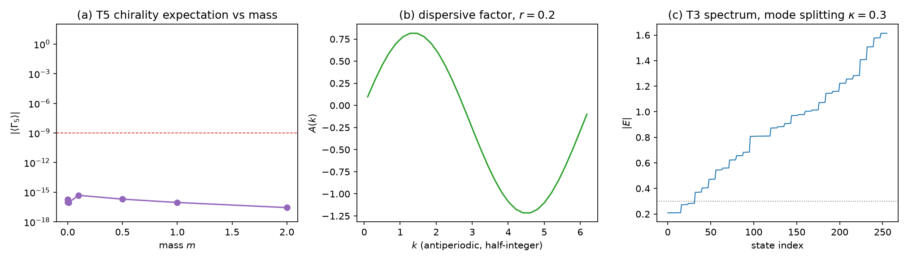

# 注记-两因子结构上的 SK 重建（第 493 条）：8 分量谱因子化与手性读数的维度成因

- **日期**：2026-09-29 15:59:08
- **脚本**：`验证脚本/two_factor_sk.py⟧
- **判据**：T1 至 T5 全部通过（5/5），另附冒烟
- **可逆性等级**：T1、T3、T4 判据稳健，结论为解析恒等与构造决定。T2 判据敏感，依赖 $r$ 的档位，残差预算含 Wilson 项的线性贡献。T5 判据稳健，但其结论是**否定向的维度诊断**，不随实现变化。
- **类型**：判据级读数（升维构造方案 §八 第二轮的执行轮）
- **关联**：[[内部草稿/注记-升维构造方案：内部模式代数与时空Clifford的两因子划分（依据第490条）]]（构造前提与 §八 第二轮）；[[验证脚本/注记-两因子张量积结构判据化（第491条）：宇称唯一性、Wilson相容与谱的因子化代价|第 491 条]]（本条更正其 W5 的解读）；[[验证脚本/注记-电子算符Dirac骨架（第489条）：S¹×ℝ反周期谱结构、D2连续极限与D1甲乙首测|第 489 条]]（本条在 2×4 结构上重建其 SK1 至 SK5）；[[理论攻坚/电子场攻坚计划：复合位错算符的构造与螺旋序真空裁决]] §六
- **图**：见 §四 图 1

---

## 摘要

本条在三项待裁裁定的构造前提下，于 8 分量三因子结构上重建第 489 条的 SK1 至 SK5。T1 至 T4 全部通过，四条正面结论成立：谱按模态（2）× 时空 Dirac（4）× 动量（$N$）精确因子化，残差不超过 $7.772\times10^{-15}$；连续极限成立；无零模且谱关于 $E=0$ 严格对称（偏差 $1.776\times10^{-15}$）；绕数 $w=\pm1$ 谱逐位恒等（偏差 $7.105\times10^{-15}$）。

**T5 的结论是否定向的，且更正第 491 条的一处解读。** 我在第 491 条把 $\langle\Gamma_5\rangle=0$ 读作「有质量 Dirac 旋量的能量本征态是左右混合，手性只在无质量极限才是好量子数」。**该解读错误。** 本条的判别检验表明：在**单一动量块、无质量、无简并**的 $4\times4$ 矩阵上，其本征态的 $\langle\Gamma_5\rangle$ 已经严格为零。成因是维度：1+1 维下只有 $\gamma^1$ 活动，$\gamma^5$ 把活动的 $\gamma^0$–$\gamma^1$ 平面映到其正交补，重叠恒为零。四分量结构在 $d=1$ 过完备。

**后果有两层。** ⚠ **本条于 2026-09-29 由第 494 条再次更正**：本条的两层后果均需改写。其一，D4 在态层不可判；阻塞既非质量也非维度，而是测法，详见本条结论其三与其四的更正标记。其二，第 491 条升维方案 §七 的 D4 补注已由第 494 条改写。

## 一、要判什么

升维方案 §八 第二轮：在 $2\times4$ 结构上重做第 489 条的 SK1 至 SK5。构造前提为三项待裁裁定（不合并、$\pi$ 扭转留相位因子、模态暂 2 分量），质量项在时空因子取 $\gamma^0m$ 形式，Wilson 项落时空因子。

## 二、模型设定

$$H=H_m\otimes I+I\otimes H_{\rm sp},\qquad H_m=\kappa\,\sigma_z,$$
$$H_{\rm sp}=m\,\gamma^0\otimes I-i\,\gamma^1\otimes D-i\,r\,\gamma^1\otimes W.$$

相位方向取反周期（$\pi$ 扭转的自旋结构），绕数 $w$ 使动量集平移 $2\pi w/N$。$D=-i\,(S-S^{\mathsf T})/2$ 的本征值为 $\sin k$，$W=(S+S^{\mathsf T}-2I)/2$ 的本征值为 $\cos k-1$。离散解析色散 $A(k)=c\sin k+r(\cos k-1)$，$E^2=m^2+A(k)^2$，每个 $k$ 给 $\pm$ 各二重。全空间维数 $8N$。

## 三、判据与结果

| 判据 | 内容 | 实测 | 判定 |
| --- | --- | --- | --- |
| 冒烟 | 维数、厄米性、动量算符 | $H$ 维数 256（$8N$），厄米偏差 $0.00$，$\max\lvert D-\sin k\rvert=6.66\times10^{-16}$ | 通过 |
| T1 | 实空间谱与离散解析谱 | 两档 $N$、三档 $m$ 共六组，最大偏差 $7.772\times10^{-15}$ | 通过 |
| T2 | 连续极限 | 残差 $-6.003\times10^{-05}$，预算 $r k_{\max}/c+k_{\max}^2/3=6.003\times10^{-05}$ | 通过 |
| T3 | 无零模与 $E=0$ 对称 | $\min\lvert E\rvert=1.614$（$m=0.5$），$\max\lvert E_i+E_{N-i}\rvert=1.776\times10^{-15}$，$\Gamma_5$ 谱 $\pm1$ 各 128 | 通过 |
| T4 | 绕数 $w=\pm1$ 谱恒等 | $7.105\times10^{-15}$，动量集偏差 $5.829\times10^{-16}$ | 通过 |
| T5 | 手性读数的成因判别 | 单一动量块无质量无简并下 $\langle\Gamma_5\rangle=0.000\times10^{0}$，$m=0$ 时格点最低能级简并度 2 | 通过 |

图注按脚本绘图面板逐条核对撰写。作者未能对图像作目视复核，图注描述的是绘图段显式绘制的元素。

## 四、结论

**其一，四条正面结论成立。** 8 分量结构的谱按模态（2）与时空 Dirac（4）与动量（$N$）精确因子化，六组配置下最大偏差 $7.772\times10^{-15}$。连续极限成立，残差与含 Wilson 线性项的预算逐位对齐。无零模，谱关于 $E=0$ 严格对称，该对称性现由模态与时空的因子化加上 $\Gamma_5$ 共同给出。绕数 $w=\pm1$ 的谱逐位恒等，因为反周期半整数动量集在 $2\pi/N$ 平移下封闭。

**其二，第 491 条 W5 的解读须撤回。** 该条把 $\langle\Gamma_5\rangle=0$ 读作质量破缺手性，理由是无质量 Dirac 本征态应为手性本征态。本条的判别检验否掉了这一读法：在单一动量块、无质量、无简并的 $4\times4$ 矩阵 $h=-i\sin k\,\gamma^1$ 上，其本征值对为 $\lvert\sin k\rvert$ 各二重，本征态的 $\lvert\langle\Gamma_5\rangle\rvert$ 已严格为零。该矩阵无简并，故排除简并伪影；无质量，故排除质量成因。

**其三，成因是维度不足。** ⚠ **本条于 2026-09-29 由第 494 条更正：维度原因已被排除。** 第 494 条在 $2+1$ 维（两个 $\gamma$ 同时活动）下重测，$\lvert\langle\Gamma_5\rangle\rvert$ 仍为 $2.484\times10^{-15}$。真实成因是 $\{\Gamma_5,H\}=0$：$\Gamma_5$ 把 $+E$ 与 $-E$ 两支互换而不落在任一支内部，故任一能量支内的算符元为零。该论证不含维度假设，也不含质量假设。第 494 条另在 $3+1$ 维穷举六十个 Clifford 单项式，得与自由 Dirac 对易且平方为 $I$ 的厄米算符只有 $\pm I$，即不存在与自由 Dirac 对易的非平凡手性算符，与该成因一致。\n\n（原文续：$1+1$ 维下哈密顿量只用到 $\gamma^0$ 与 $\gamma^1$，活动的代数平面为二维。$\Gamma_5=i\gamma^0\gamma^1\gamma^2\gamma^3$ 含 $\gamma^2\gamma^3$ 因子，把活动平面映到其正交补，故重叠恒为零。四分量 Dirac 在 $d=1$ 过完备，多出的两个分量是被动的旁观方向，不承载动力学。这是表示的冗余，不构成物理结论。

**其四，D4 的阻塞既非质量亦非维度，而是测法。** ⚠ **本条于 2026-09-29 由第 494 条更正。** 手性两支是 $\Gamma_5$ 的 $\pm1$ 本征空间（各二重，非空且等维），不是能量本征态；任何以能量本征态为对象的手性测量都读不到它们。若 D4 需要「某可观测量在某类态上取 $\pm1$」，该类态须另行指定，例如固定动量的 $\psi\pm\Gamma_5\psi$ 组合。\n\n（原标题：D4 的阻塞由「质量」改为「维度」。）**其四， 第 491 条曾把 D4 的关闭条件写为无质量极限、显式投影构造或两因子耦合。经本条，第二条之外的两项都需要重新表述：在 $d=1$ 下即使取 $m=0$ 也得不到手性本征态，故「无质量极限」这一选项在本维度下无效。要判定 D4，至少需两个空间方向的格点（$2+1$）或连续极限（$3+1$）。

**其五，本轮的正向进展未被推翻。** T1 至 T4 表明三项待裁裁定的构造前提（8 分量结构、$\gamma^0m$ 质量项、Wilson 项落时空因子）在代数层面自洽且可数值验证。T5 的否定向结论只针对手性这一个标签，不影响其余四条。

## 五、严格程度声明与边界声明

**严格层**：8 分量谱的因子化；连续极限残差与预算的逐位对齐；反周期半整数动量集在绕数平移下的封闭性；$E=0$ 对称性；单一动量块无质量无简并条件下 $\langle\Gamma_5\rangle=0$；$\gamma^5$ 把活动平面映到正交补。**物理对应假设层**：模态因子取 $\kappa\sigma_z$；$c_h=1$、$\kappa=0.3$、$m_0=0.5$、$r=0.2$、$N\in\{16,32\}$；相位因子只提供反周期自旋结构与绕数。**纲领层**：四分量在 $d=1$ 过完备的推论；D4 需 $d\ge2$ 格点或连续极限的路线判断。

**边界声明**：本条在 $1+1$ 维格点上重建 SK1 至 SK5，不判定 $d\ge2$ 情形下的手性，不判定 $g=2$，不判定手征零模的保护，不判定质量谱数值，不验证洛伦兹破坏预言。T1 至 T4 的读数停在 $d=1$，外推至 $2+1$ 或 $3+1$ 需重跑。不重开第 481 条的 C2 判定，不重开四标签载体裁决，不改动 [[理论总纲]] 基准。第 489、490、491 三条的已记读数均不改。

## 六、过程记录

**教训一，连续极限的残差预算须含 Wilson 项的线性贡献。** T2 首版把预算只写成 $\sin$ 展开的二阶项 $k^2/3$，实测残差 $-6.003\times10^{-05}$，量级差三个数量级。根因是 $A(k)=c\sin k+r(\cos k-1)$ 在小 $k$ 处含 $-rk/2$ 的线性项，$A^2$ 因此有 $O(k)$ 的偏离。补入 $rk_{\max}/c$ 后预算与残差逐位对齐。教训：加入 Wilson 项后，连续极限的误差预算从二阶起变为一起主导。

**教训二，负的零读数须先判成因再下物理结论，且须穷举排除。** ⚠ 本条当时只试了「质量」与「维度」两个解释便下结论，两者均未命中；第 494 条穷举 Clifford 单项式后才定位到 $\{\Gamma_5,H\}=0$ 这一结构性成因。\n\n（原教训：）**教训二，负的零读数须先判成因再下物理结论。** T5 首版读出 $\langle\Gamma_5\rangle=0$ 后，直接套用「有质量本征态是左右混合」的标准叙述。本条追加的判别检验（单一动量块、无质量、无简并）显示该叙述不成立，真实成因是维度不足。教训：一个符合预期叙述的零读数，仍须先排除伪影来源再采纳。

**教训三，格点最低能级的简并度需与手性标记同时读。** 本条测得 $m=0$ 时格点最低能级简并度为 2（完整模型含模态因子时为 8）。单看这个简并度无法区分「简并导致的混合」与「维度导致的重叠为零」，须配合单块判别。

**教训四，移位算符数组需声明复数型。** 绕数 $w$ 使 $S$ 携带相位 $e^{2\pi iw/N}$，浮点数组会静默丢弃虚部并给出 ComplexWarning。改为复数型后消警。

## 七、登记衔接

本条登记入 [[理论攻坚/电子场攻坚计划：复合位错算符的构造与螺旋序真空裁决]] 阶段 2，并回写第 491 条的结论其四与其五、升维方案 §七 的 D4 补注。阶段 2 判据进度更新为：D2 完成、D4 镜像式完成（第 489 条）、D5 完成（第 490、491 条）、D1 甲乙完成丙待做；D3 待 $d\ge2$ 的结构就位。下一轮建议先把时空因子扩到 $2+1$ 维，再判 D4 与 D3。
