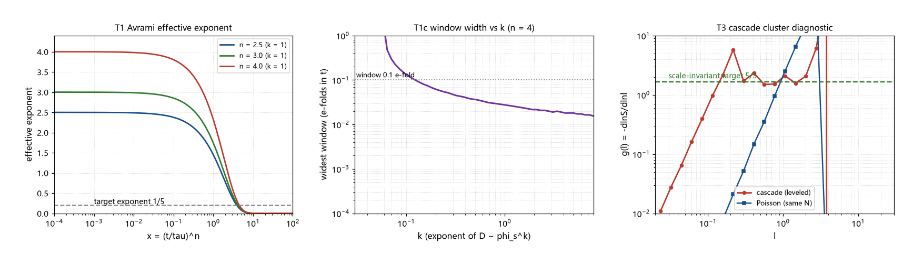
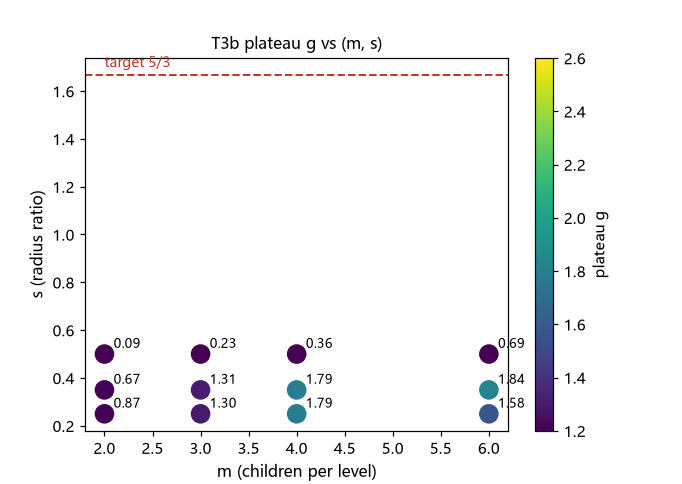

# 注记-两相混合的渗透型输运判定（第420条）：Avrami 窗口两难与级联簇的幂律平台信号

- **日期**：2026-09-26 02:29:16
- **类型**：判定与侦察轮（P0-5 候选机制八轮；丁首轮 + 级联簇初测）
- **脚本**：`验证脚本/minimal_verification_two_phase_transport.py`（第 420 条）
- **图**：见 §3 图 1 与图 2（`images/two_phase_transport.png`、`images/two_phase_transport_scan.png`）
- **依据**：[[验证脚本/注记-超扩散输运的候选机制清点（第418条）：长时尾接口与短程结构判负]]（丁的定位）；[[验证脚本/注记-钉扎网络的空间分布形状判定（第419条）：平稳点集无幂律尾与尺度不变遇见率条件]]（平稳点集判负与甲的合流观察）；[[验证脚本/注记-KZ 适用性判定（第381条）：临界冻结不适用、注入-接缝机制与畴尺度候选]]（成核图景）
- **状态**：判定与侦察完成。丁（两相混合）判负（Avrami 窗口两难）；级联等级结构初测给出幂律平台信号（平台值随参数移动，覆盖 $5/3$ 附近），口径敏感性已登记，精扫为下一轮
- **可逆性等级**：判据敏感（级联簇平台值对级数 $K$ 与测量窗口敏感：同参数下 $K = 3$ 给 $1.79$、$K = 4$ 给 $2.1$ 至 $2.3$；丁的判负两难项本身稳健）

## 1 判据与设定

第 418 条把「两相混合」（丁）登记为 $D \propto \phi_s(t)^k$；本轮先判丁（T1、T1c、T2），再按第 419 条的合流观察初测「级联成核的等级簇」（T3、T3b）。设定：$\phi_s = 1 - e^{-x}$、$x = (t/\tau)^n$（Avrami）；有效指数 $\mathrm{d}\ln\phi_s/\mathrm{d}\ln t = n f(x)$，$f(x) = x e^{-x}/(1-e^{-x})$；判据容差取指数在 $[0.16, 0.24]$ 内（$1/5$ 的 $\pm 20\%$）。

## 2 结果

T1（Avrami 端部）：$k = 1$ 时，指数等于 $1/5$ 出现在 $x \approx 3.9$ 至 $4.5$（$n = 2.5$ 至 $4$），即 $\phi_s \approx 0.98$ 至 $0.99$ 的极晚区；该处斜率漂移约 $-0.2$ 每 e 折，幂律行为不可能持续。

T1c（窗口扫描，$n = 4$）：窗口宽度与 $k$ 呈双端点结构。$k = 0.05$ 落在早期平台侧，窗口 $2.09$ e 折（$\phi_s \in [0.0001, 0.35]$）；$k = 0.08$ 收窄到 $0.21$ e 折；$k \ge 0.2$ 全部落在晚期瞬时侧，窗口仅 $0.02$ 至 $0.06$ e 折。丁的两难由此成立：宽窗口需要 $k = 1/(5n) \approx 0.05$（此时「分数控制」名存实亡），晚期间歇点又只有约 $2\%$ 的时间宽度、无自然定时。

T2（渗透变体）：$D \propto (\phi_s - \phi_c)^{t_P}$ 在 $\phi_s > \phi_c$ 时重标为 $k \to t_P$（约 $2$），落入 $k \ge 1$ 的判负档，结论不变。

T3（级联簇初测）：母点 $100$、每级支数 $m = 4$、半径比 $0.35$、级数 $K = 4$（总点 $34100$）。诊断量 $g(\ell) = -\mathrm{d}\ln S/\mathrm{d}\ln\ell$：级联点集在 $\ell \in [0.16, 1.07]$ 给出平台段（$2.09$ 至 $2.32$），与泊松的上升型明显不同；大 $\ell$ 处的 $g \to 0$ 属有限盒效应（母点间距约 $12.9$），已排除。

T3b（参数粗扫，$K = 3$）：平台中位值随 $(m, s)$ 从 $0.09$ 移动到 $1.84$；$m = 4$、$s = 0.25$ 与 $0.35$ 给 $1.79$，$m = 6$、$s = 0.35$ 给 $1.84$，$m = 3$、$s = 0.35$ 给 $1.31$。目标 $5/3 \approx 1.667$ 落在扫描值域内（$m \approx 3$ 至 $4$、$s \approx 0.3$ 附近）。

## 3 图

## 4 结论与移交

判定两条。其一，丁判负：$D \propto \phi_s^k$ 的两条活路都不可用（宽窗口需 $k \approx 0.05$ 的无内容取值；晚期瞬时点窗口约 $2\%$、无自然定时）；渗透变体为等价重标，一并判负。其二，甲的候选来源初现：级联成核的空间等级结构给出幂律平台信号（平台与平稳点集的上升型分道），平台值随 $(m, s)$ 移动且覆盖 $5/3$ 附近，这是八轮以来第一条「值域对撞」的路线。

两条口径提醒。级联平台值对级数 $K$ 敏感（同参数 $K = 3$ 给 $1.79$、$K = 4$ 给 $2.1$ 至 $2.3$）；「5/3 可达」目前是值域比较，不是命中。精扫必须锁定 $K$、测量窗口与拟合口径。

移交两条。其一，级联簇精扫：锁定 $K$ 与口径，在 $(m, s)$ 平面上给 $c = 5/3$ 的等值线，并检查平台的稳定性（$K$ 从 3 到 5 的平台收敛性）。其二，$(m, s)$ 的框架内取值论证：子核的支数与半径比的物理来源（局域催化的成核规则），若两者能被独立钉定且落在 $c = 5/3$ 线上，甲的来源闭合；否则退回「参数调优」的判负档。

## 5 严格程度与边界声明

严格程度：T1 与 T1c 为解析式加数值扫描（判据级）；T2 为等价换算；T3 与 T3b 为蒙特卡洛初测（固定种子；平台值的中位口径为粗口径）。

边界（本脚本不验证的内容）：其一，不建立级联成核的物理动力学（子核局域与半径比为模型设定）；其二，「5/3 可达」为值域比较，不含口径锁定与误差界；其三，不含有限盒效应的修正（大 $\ell$ 处 $g \to 0$ 已排除但未做精确截断）；其四，不重算第 418、419 条。

## 6 过程记录

其一，T3 与 T3b 的口径分家：初测（$K = 4$）与扫描（$K = 3$）在同参数下给不同平台值（$2.1$ 至 $2.3$ 对 $1.79$），据此把「平台值」登记为口径敏感量，精扫任务中列为第一锁定项。

其二，T1c 的双端点结构纠正了初版「丁只有 2% 窗口」的单边印象：早期平台（$k = 0.05$）确有 2.09 e 折的宽窗口，丁的判负理由相应改写为「宽窗口与 $k$ 的物理内容互斥」的两难表述。

其三，级联点集生成器的参数（母点数、$m$、$s$、$K$）与盒长已登记，供精扫复现；大 $\ell$ 的伪零 $g$ 值在判读中按盒效应处理并排除。

## 7 补记（2026-09-26，第 421 条精扫复核）

第 421 条以严格平台检测器（滑动窗口散布不超过 $12\%$）复核本轮信号：细网格下 $g(\ell)$ 为峰谷交替的振荡（$[0.05, 2]$ 内范围 $0.21$ 至 $6.94$），粗网格读数为采样混叠；$12$ 个级数档与 $54$ 组网格扫描全部未通过平台检测。**本注记 §4 的「幂律平台信号」与「值域覆盖 $5/3$」两条表述收回**；精确结论以 [[验证脚本/注记-级联簇精扫（第421条）：离散级联的振荡判负与三分之五信号的收回]] 为准（离散级联判负，尺度不变需要连续尺度谱）。
