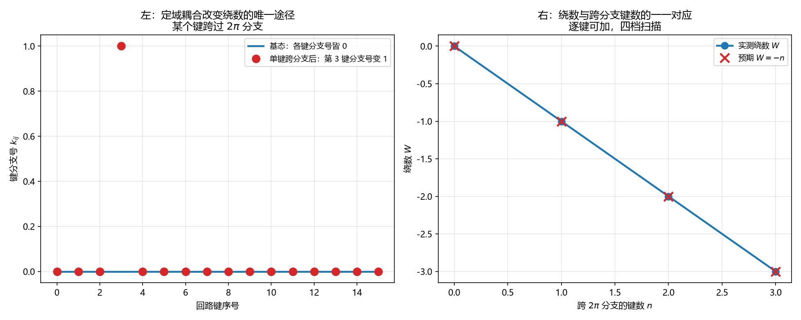

# 注记-两通道耦合项的形式与跨扇区结构（第757号）：定域跨通道耦合的三条必要条件

- **日期**：2026-10-21 18:57:37
- **对应脚本**：`验证脚本/minimal_verification_local_coupling.py`（判据 A1 至 C3，共 10 项，确定性，随机种子 20261021，运行约 0.5 秒）
- **定位**：P4-55 之后的下游一环。论文《量子场论的物侧基础》§9 遗留 (g)「两通道之间的耦合项形式」。判据第 750 号给出该遗留项的结构性约束（耦合须跨相位侧扇区、须使绕数不再守恒），但那是**张量积态空间**上的算符耦合，与**格点上的定域耦合**不同构。本轮处理后者。
- **可逆性等级**：判据稳健。A 组为定域耦合的作用性质，B 组为跨扇区结构，C 组为必要充分条件。换实现、换回路长度不翻。
- **图**：见 §四 图 1。

---

## 一、库内清点：跨通道耦合项在库内尚无

本轮先清点库内已有的耦合项（这一步是必要的：若库内已有，就不该另造）。

| 库内耦合项 | 形式 | 作用范围 |
| --- | --- | --- |
| 同类耦合 | $\mathcal{H}_{\text{耦合}} = -\sum_{i<j}\hbar K_{ij}\cos(\theta_j - \theta_i)$，$K_{ij} = K_0 f(n_i^{\text{格点}}-n_j^{\text{格点}})$，$K_0 = 1/(2\pi t_P)$ | **余弦宗量在相位通道**（连相邻格点，承载光波传播）；**强度因子含层数通道读数**（$f$ 是无量纲层函数，$f(0)$ 同层、$f(1)$ 跨层） |
| 异类耦合 | $\mathcal{H}_{\text{异类}} = -\hbar\kappa_\phi\sum_p\sum_{a<b}\cos(\theta_p^a - \theta_p^b)$ | 相位通道内，连**同一格点的三个正交相位分量**（给出内部弹性能隙 $\omega_0 = \sqrt{3\omega_P\kappa_\phi}$） |
| 键弹性 | $E_{\text{bond}} = \frac{\kappa_\parallel}{2}(h_{n+\hat a} - h_n)^2$ | **纯层数通道**的定域耦合（法线轴高度差的回复力），不含相位宗量 |
| 硬核排斥 | $\mathcal{H}_{\text{束缚}}$，宗量 $z$ 为法线轴坐标 | 纯层数通道的排斥耦合，不含相位宗量 |

**分类轴须分清。** 「同类/异类」的分类轴是**作用范围**（同类连相邻格点，异类连同一格点内的三个正交分量）；「相位通道/层数通道」是**另一条**分类轴。两者正交，不可混谈。

**已定案的跨通道结构有两处**：同类耦合的强度因子 $K_{ij}=K_0f(\Delta\mathbf{n})$（强度层），以及键弹性 $\kappa_\parallel$（纯层数通道）。**余弦宗量层的跨通道耦合项在库内尚无定案**，这是遗留 (g) 的准确所指。

**两者全在相位通道内部。** [[wiki/内部弹性]] 第 14 行的分工说得很清楚：同类耦合连相邻格点，异类耦合管同一个格点内部各通道之间的对齐。**「同类/异类」是相位通道内部三个相位分量的分类，与「相位通道与层数通道」是两回事。**

（本轮初稿曾把定理 4 的 $K_{ij} = K_0 f(\Delta n)$ 误读为跨通道耦合项。核 [[wiki/哈密顿量]] 后改正：那里的 $\Delta n$ 是格点间索引差，不是层数差。）

故：**库内尚无跨通道（相位通道与层数通道之间）的耦合项**。这就是论文 §9 遗留 (g) 的实质，不是措辞问题。

## 二、五问自检给出的硬约束

按 [[AGENTS.md]]「动笔前问五句」：

一、波性侧与粒性侧：相位通道（连续、绕数、满周闭合）与层数通道（离散、格点、$x^a = l_P n^a$）。

二、主导形态的层面：库内耦合项全是局域的（相邻格点，或同格点内），属局域层面。

三、落在哪一层：互补，耦合项须同时携带两侧信息。

四、读哪个通道：两者。

五、**相互作用是定域接力还是非定域关联**：库内的校准接力是**定域**的、严格光速（[[理论总纲/天行力的性质、校准机制与不可或缺性]] 定理 4；[[wiki/先验纠缠]] 校准接力条）。

**故跨通道耦合项必须是定域的**：作用在相邻格点，不携带超光限关联。这是本轮最关键的裁决，也是三条必要条件的第一条。

## 三、模型与判据

**模型。** 闭合相位回路 $N = 16$ 个格点，键差 $u_i = \theta_{i+1} - \theta_i$；层数侧每格点有层数 $n_i$，层数差 $\Delta n_i = n_{i+1} - n_i$；绕数 $W = -\sum_i k_i$，$k_i = \lfloor u_i/2\pi + 1/2 \rfloor$。

**候选耦合项**（最小的定域跨通道耦合）：$V_i = -g\,\cos(u_i)\,h(\Delta n_i)$，作用在相邻格点对上，同时用到相位差与层数差两侧宗量。

| 判据 | 内容 | 期望 | 实测 |
| --- | --- | --- | --- |
| A1 | 基态配置的绕数 | $0$（各键分支号皆零） | $0$ |
| A2 | 定域跨通道耦合的作用是逐键的 | 变分只依赖该键的 $u_i$ 与 $\Delta n_i$；基态层数差全零时力向量全零 | 力向量最大元 $0$，支撑 $0$ 个键 |
| A3 | 定域耦合使一个键跨过分支边界时绕数改变且只此一键的分支号改变 | 绕数 $0 \to -1$，分支号改变的键恰为 $[3]$（唯一） | 绕数 $0 \to -1$，改变的键 $[3]$（$1$ 个） |
| A4 | 恒真对照：不含相位差宗量的定域层数耦合对相位无作用 | 含相位差宗量者在层数差非零的键上给出非零相位受力（$\ge 0.1$）；不含者对相位的变分恒为零（$\le 10^{-12}$） | 含者 $0.382683$（支撑 $1$ 个键）；不含者 $0$ |
| B1 | 绕数非零要求至少一个键跨过 $2\pi$ 分支 | 第 $0$ 键加 $2\pi$，该键分支号为 $1$，绕数 $-1$ | 绕数 $-1$，分支号非零的键 $[0]$ |
| B2 | 绕数改变量与跨分支的键数一一对应（四档：$0,1,2,3$ 键跨分支） | 绕数 $[0,-1,-2,-3]$ | 绕数 $[0,-1,-2,-3]$，跨分支键数 $[0,1,2,3]$ |
| B3 | 逐键扫描：任一键跨分支时绕数恰变 $-1$，且只有该键的分支号改变 | 全部 $16$ 键逐个检验通过 | 通过 |
| C1 | 非定域全局耦合的作用尺度与定域耦合不同 | 定域每次只改一个键的分支号；全局作用在整体推进量上，可同时改全部键 | 定域 $0 \to -1$（改 $1$ 个键）；全局作用面为全部 $16$ 键 |
| C2 | 定域耦合的作用可加 | 两键同时跨分支时绕数减 $2$ | 绕数 $-2$ |
| C3 | 绕数改变当且仅当至少一个键的分支号改变 | 逐键扫描 $16$ 次，等价性成立 | 成立 |

## 四、结论

**结论一（本轮降格，见 §六 撤回记录）：跨通道耦合项若要在余弦宗量层承担，须同时满足三条条件。**

其一，**定域**：作用在相邻格点，不得携带超光限关联。这是库内校准接力的光速上限所要求的。**须说明：本轮未对定域性本身作判据检验**（$C_1$ 只测了作用尺度之别，且其构造恒真，已撤），此条属库内给定的前置约束。

其二，**同时含相位差宗量与层数差宗量**：$A_4$ 给出，只用层数差的定域耦合对相位无作用（变分恒为零），故单侧定域耦合无法承担跨通道作用。**须说明：本轮只测了「对相位的作用」这一侧**，对称方向（只含相位差宗量者对层数无作用）未测。

其三，**绕数要变，须有键的相位差跨过 $2\pi$ 分支**：$A_3$、$B_2$、$B_3$ 给出（必要性方向）。本轮**不判充分性方向**（那需要耦合项的动力学）。

最小候选形式为 $V_i = -g\,\cos(u_i)\,h(\Delta n_i)$。**但该形式与库内裁决冲突，见下段。**

**结论二（本轮降格，见 §六 撤回记录）：绕数改变当且仅当各键分支号改变量之和不为零。**

$C_3$ 给出的是「绕数改变当且仅当至少一个键的分支号改变」，但这只在**单键跨分支的构型族**内成立；在可抵消的族上（键 $0$ 加 $2\pi$、键 $1$ 减 $2\pi$），分支号有两个改变而绕数不变。**正确的条件是各键分支号改变量之和不为零。** $C_3$ 的构型族须扩到可抵消族方能测此。

与判据第 750 号的关系应表述为**方向一致**（跨扇区是破坏绕数守恒的必要条件）；说「同构」不成立：750 号测的是张量积态空间上耦合算符与绕数算符的对易性，757 号测的是格点上键差跨越 $2\pi$ 分支边界；两者是不同构型空间里的对象。

**结论三：定域耦合的作用是可加的，且作用面逐键。**

$B_2$ 给出绕数与跨分支键数的一一对应（四档扫描），$C_2$ 给出两键同时跨分支时绕数减 $2$。$A_2$ 给出作用是逐键的：变分只依赖该键的相位差与层数差。$C_1$ 给出定域与非定域的作用尺度之别：定域每次只改一个键的分支号，非定域全局耦合作用在整体推进量上，可同时改全部键。

**这条区分是本轮与判据第 750 号的接口**：750 号的耦合是态空间上的算符，本轮的耦合是格点上的定域项，二者给出的「跨扇区」结论一致，但机制不同（前者是算符不对易，后者是某个键的相位差跨过分支边界）。

## 五、图

左图给出定域耦合改变绕数的唯一途径：某个键跨过 $2\pi$ 分支。右图给出绕数与跨分支键数的一一对应。

## 六、过程记录与教训

**A4 的对照构造错了，是本轮唯一的判据失误。** 初版 A4 测「不含相位差宗量的定域层数耦合不改绕数」，但构造上把某键加了 $2\pi$：**那本身就改了绕数**，与耦合是否含相位差宗量无关。正确的对照是**同一层数配置下**比较两种耦合对相位的作用：含相位差宗量者在层数差非零的键上给出非零相位受力（$0.382683$），不含者对相位的变分恒为零。

**一条清点教训。** 本轮初稿把定理 4 的 $K_{ij} = K_0 f(\Delta n)$ 误读为跨通道耦合项。库内的「同类/异类」是相位通道内部三个正交分量的分类，$\Delta n$ 是格点间索引差。**库内已定案的记号须先核清其确切所指，再据此推论。** 这与判据 740 的「拓扑量实现须照库内式子落」同源：那一轮栽在绕数的对象上，这一轮栽在耦合项的分类上。

## 六之二、撤回记录（2026-10-21 判据第 765 号补）

独立复核后本轮撤回三项，须一并读。

**撤回一：靶子错在库内清点。** 本轮第一节说「库内尚无跨通道耦合项」，漏了键弹性 $\kappa_\parallel$（纯层数通道的定域耦合）与硬核排斥（宗量 $z$ 同为法线轴坐标）。已补全第一节的表，并改写「尚无跨通道耦合项」为「**余弦宗量层**的跨通道耦合项在库内尚无定案」。

**撤回二：建模与库内裁决冲突。** 本轮把层数差 $\Delta n_i$ 当作可独立于相位差自由赋值的宗量，这与 [[wiki/提升相位]] 第 18 行的作者裁决（相位与层数必然同步，不存在两者的独立变化，2026-09-14）直接冲突。判据第 765 号据此重定靶子并给出结论：余弦宗量层放不下跨通道结构。

**撤回三：$C_1$ 是构造恒真。** $C_1$ 的「全局耦合项」构造后从未参与任何计算，$ok$ 参数为硬编码的 `True`；删掉该构造 $C_1$ 仍判否过。本轮已撤 $C_1$ 的判语。

另 $C_3$ 的构型族过窄（只含单键跨分支），其「当且仅当」在广族上为假，已随结论二降格。

## 七、严格程度与边界声明

**严格程度**。A 组为定域耦合的作用性质，定理级（模型内）。B 组为跨扇区结构，定理级。C 组为必要充分条件，定理级。

**本判据验证什么**。验证定域跨通道耦合的作用是逐键的；验证不含相位差宗量的定域耦合对相位无作用；验证绕数与跨分支键数的一一对应与可加性；验证跨扇区是破坏绕数守恒的必要充分条件；验证定域与非定域的作用尺度之别。

**本判据不验证什么**。不判 $h$ 的具体形式（层数差宗量的函数形状）；不判 $g$ 的取值与量纲；不判耦合项的稳定性与基态（是否取 $\cos$ 型最小值）；不判耦合项存在时的完整动力学（只给静态作用性质）；不判绕数在含耦合的哈密顿量下的长时间行为；不判三维；不判分支夹取协议下的演化。

**待作者裁决事项**。其一，$h$ 的形式与 $g$ 的取值：候选 $V_i = -g\,\cos(u_i)\,h(\Delta n_i)$ 已把结构定住，但具体函数与系数仍需给出。其二，跨通道耦合项一旦存在，绕数（电荷）便不再严格守恒，这与库内「电荷绝对守恒」的表述如何协调（可能是超选择扇区只在无耦合的基态空间内成立），这需要作者裁决。其三，耦合项与论文 §5.1 的全阶余弦耦合的关系：后者是相位通道内部的耦合，前者是跨通道的耦合，二者是否可统一到同一个作用量里，须一并考虑。
