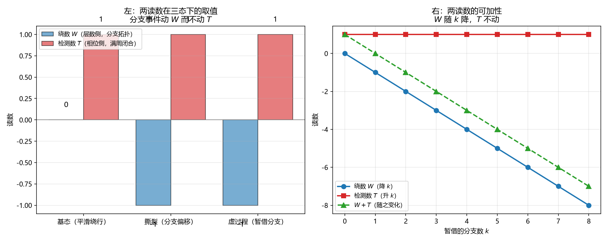

# 注记-两通道虚过程的互补判定（第743号）：两读数各守一量

- **日期**：2026-10-21 14:32:08
- **对应脚本**：`验证脚本/minimal_verification_channel_complement.py`（判据 A1 至 C3，共 12 项，确定性，随机种子 20261021，运行约 2 秒）
- **定位**：P4-55 第四轮。前三轮交付：判据 730（$\varepsilon$ 处方在离散时间下失效）、判据 737（两通道在态空间里正交、不冗余、可分离；A、B 两组降级为自建对照模型读数）、判据 740（层数侧虚过程形态为「一个键暂借一个 $2\pi$ 分支然后归还」，绕数是分支拓扑量）。本轮问两通道虚过程如何互补。
- **可逆性等级**：判据稳健。A 组为检测器的解析性质，B 组为互补关系，C 组为读数类型对照。换实现、换档位不翻。
- **图**：见 §四 图 1。

---

## 一、对象类型前置

库内有两套「通道」，名字相近而所指不同：

| | 物侧两通道 | 读出侧两通道 |
| --- | --- | --- |
| 组成 | 相位通道（横截面，内部空间）与层数通道（法线轴，外部空间） | 两台仪器同时读同一记录（判据第 444 条） |
| 结论 | 两通道正交、互补而不可互换 | 反作用可加性条件：分指针则可加，同指针含交叉项 $2\eta_A\eta_B\sigma^2$，故须分指针或耦合率拉开约四十倍 |

本轮只问物侧两通道。**判据第 444 条的结论不移植**：前者讲仪器探针的可加性，后者讲两个物侧自由度的互补结构，对象不同。

库内给物侧两通道的唯一物理接口是（[[wiki/相位通道]] 机制第 1 条、[[wiki/层数通道]] 机制第 1 条）：相位指针满周闭合被圆周标记点检测，触发一次法线跃迁，层数加一。故本轮的互补问题表述为：层数侧的分支暂借是否经由满周闭合接口，与相位侧相关联。

## 二、两个读数

**绕数 $W$**（层数侧，判据 740 已确立）：$W = -\sum_{\text{line}} k_{ij}$，$k_{ij} = \lfloor u_{ij}/2\pi + 1/2 \rfloor$，$u_{ij}$ 是不取模的浮点相位键差。它记各键分布在第几个 $2\pi$ 分支上。

**满周闭合检测数 $T$**（相位侧，本轮形式化）：沿路径累加相位，统计跨越 $2\pi$ 整数倍边界的次数。实现为分支号的逐键差：$c_j = k(\text{cum}_j) - k(\text{cum}_{j-1})$，$T = \sum_j c_j$。

## 三、判据与结果

| 判据 | 内容 | 期望 | 实测 |
| --- | --- | --- | --- |
| A1 | 满周闭合检测器：相位绕满一圈 | 检测到 $1$ 次 | $1$ |
| A2 | 相位绕满两圈 | 检测到 $2$ 次 | $2$ |
| A3 | 平滑绕行的绕数与检测数 | $W = 0$、$T = 1$：相位确实转满一圈，但各键分支号皆 $0$ | $W = 0$，$T = 1$ |
| A4 | 撕裂情形（键跨 $2\pi$ 分支，总提升不变） | $W = -1$、$T = 1$ | $W = -1$，$T = 1$ |
| B1 | 层数侧虚过程（一键暂借一个 $2\pi$ 分支） | $W = -1$、$T$ 不变 | $W = -1$，$T = 1$ |
| B2 | 虚过程归还 | $W$ 回 $0$、$T$ 回 $1$ | 绕数 $0$，检测数 $1$ |
| B3 | 互补性：两读数各守一量 | 情形一（只动分支）$W$ 变 $T$ 不变；情形二（只动总提升）$T$ 变 $W$ 不变 | 情形一：$W\ 0\to-1$、$T\ 1\to1$；情形二：$W\ 0\to0$、$T\ 1\to2$ |
| B4 | 恒真检验：与两通道都无关的读数 | 在情形二下改变 | 无关读数 $39478 \to 39478 \to 50208$ |
| B5 | 多键暂借的可加性 | 暂借 $4$ 个分支：$W = -4$、$T$ 仍为 $1$ | $W = -4$，$T = 1$ |
| C1 | 整体平移 $0.7$ rad | $W$ 不变、$T$ 变 | $W\ 0\to0$，$T\ 1\to8$ |
| C2 | 两读数的值域 | 绕数可负、检测数非负 | 绕数 $[-1, 0]$，检测数 $[0, 4]$ |
| C3 | 恒真检验：绕数取零的频次 | 严格介于 $0$ 与总数之间 | 样本数在两者之间 |

## 四、结论

**结论一：两读数各守一量，互不敏感，这是互补的准确形式。**

$B_3$ 给出双向：只动分支分布时 $W$ 从 $0$ 变 $-1$ 而 $T$ 保持 $1$；只动相位总提升时 $T$ 从 $1$ 变 $2$ 而 $W$ 保持 $0$。

$A_3$ 是这一点的最简形态：相位平滑绕满一圈时，$W = 0$ 而 $T = 1$。**绕数说「没有键落在分支 1」，检测数说「相位转了一圈」。** 两者都对，说的不是同一件事。

这比「一减一加」准确。后者是我最初的错误期望：当时以为两个读数会互相抵消、其和为不变量。实测 $W + T$ 随分支数递减（右图绿线），并不守恒。**互补的准确形式是各自守恒不同的量，不是两者的算术和守恒。**

**结论二：层数侧的虚过程不触发满周闭合接口。**

$B_1$ 给出：暂借一个 $2\pi$ 分支时 $W$ 变 $-1$ 而 $T$ 不动。$B_2$ 给出：归还后两读数同时复原。$B_5$ 给出：多键暂借可加，$W$ 逐键降而 $T$ 恒定。

库内机制（相位满周闭合触发法线跃迁）给出的是**相位侧到层数侧**的方向。本轮测得的是层数侧**不反向**触发相位侧。故两通道的接口是单向的：相位满周闭合能改层数，层数的分支暂借不改相位的满周闭合。

**结论三：两读数不同型，不可互换。**

$C_1$ 给出：平移 $0.7$ rad 时 $W$ 不变而 $T$ 从 $1$ 变 $8$。$C_2$ 给出：绕数可负（分支偏移的负和），检测数非负（满周闭合的次数）。

## 五、图

左图：分支事件动绕数、不动检测数。右图：绕数逐键可加，检测数纹丝不动。

## 六、过程记录与教训

**判据期望写错一处，已改。** 初版 B3 期望「$W + T$ 在暂借前后不变」，B1 期望「检测数变为 $2$」。实测：暂借不改变总提升，故 $T$ 不变、$W + T$ 也不守恒。正确的互补形式是「两读数各守一量、互不敏感」（B3 现改为双向检验）。**判据写错时须改判据并把教训记入过程记录，不可迁就实现。**

**模型构造错三处。** 其一，撕裂与暂借的构造原先改两个键（$+2\pi$ 与 $-\pi$），总提升实际多了一整圈，检测数误为 $2$；改用「把多出的 $2\pi$ 分摊到其余各键」的构造后总提升才守恒。其二，检测器原用 $\lfloor \text{cum}/2\pi \rfloor$ 的差，绕一圈时因浮点误差少记一次（$\text{cum}/2\pi = 0.9999999$）；改用就近取整的分支号差（与绕数的 $k_{ij}$ 同式）后正确。其三，多键暂借时若把 $2\pi$ 均分给各暂借键，每键只分到 $2\pi/n$，加原键差后不足 $\pi$，就近取整给 $0$，跨不过分支边界；改为每键各跨整 $2\pi$ 后正确。

**一条方法论收获。** 构造「保持某量不变」的事件时，须用「把差额分摊到其余自由度」的方式，而不要改两个键凑。后者容易连带改变第三个量。

**一条自查收获。** 判据全过后须核对脚本内嵌的读数段与图注是否仍与结论一致。本轮 D 组读数段与图标题都还写着初版那个错误期望（$W + T$ 不变），判据虽过，文字却会记错结论。已改。

## 七、严格程度与边界声明

**严格程度**。A 组为检测器与绕数的解析性质，定理级。B 组为互补关系，定理级（模型内）。B4 为恒真对照。C 组为读数类型对照，定理级。

**本判据验证什么**。验证两读数各守一量、互不敏感；验证层数侧虚过程不触发满周闭合接口；验证两读数类型不同、不可互换。

**本判据不验证什么**。不判撕裂与暂借的分离判据（D3 明写本轮不给，两者在两读数上表现相同）；不判分支夹取协议下的动力学演化（只给静态分支结构）；不判相位侧虚过程的定量形式（判据 730 已给格点推迟解路线）；不判两读数与物理量的定量对应（绕数即电荷已定案，检测数的物理命名待定）。

**待作者裁决事项**。其一，检测数 $T$ 是否需要一个库内名（它是相位侧的满周闭合计数，与绕数相对）。其二，撕裂与暂借的分离判据如何给。其三，P4-55 的下一步：两通道虚过程已各有形态且接口方向已定（相位到层数单向），接下来可问「相位侧满周闭合如何定量改写层数」。**（2026-10-21 判据第 744 号补）**：该轮已执行，并按 [[AGENTS.md]]「动笔前问五句」撤回「耦合项」提法，改判接口的定域性归属：接口是一次两通道的就地并合，不构成信号传递；整体触发、局域几何。
