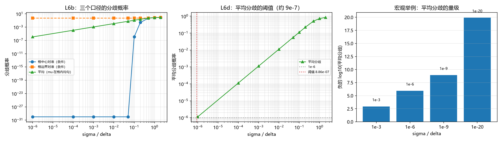

# 注记-主体间性的最小验证：公开事件与统计集中两条路径、平均分歧的线性律与边界对准的不可消除性（判据 L6）

- **日期**：2026-09-25 04:17:17
- **层级**：验证材料（第 405 条）
- **定位**：执行 [[内部草稿/研究方向-心侧入场：主体抽样、整合功能与物侧搭档（判据草案）]] 所立判据 L6（主体间性），并承接作者就其给出的一处补充机制：位置波包的高概率集中在极小区段，各主体独立抽取也高度趋同，残余差异相当于噪音。
- **依据**：[[内部草稿/研究方向-心侧入场：主体抽样、整合功能与物侧搭档（判据草案）]]（L6、K3）；[[验证脚本/注记-分层读数可靠性的最小验证：充分性、中层最小性与附内容边界（判据 L1 与 L3）]]（第 400 条，逐层探测器与份额分布）；[[内部草稿/注记-认知错视与分层粗粒化：主体采样读数的可靠性、错觉边界与认知进化]]（L6 登记处）
- **状态**：判据级。模型内验证，非经验结论。
- **修订记录**：
  - **2026-09-25 初版**（触发：作者批准执行 L6，并给出统计集中这条补充机制）

---

## 一、作者表述的照录

作者就主体间性给出如下补充（照录）：不同主体虽然读出不同读数，但由于位置波函数是高斯波包，它的高概率集中在非常微小的区域，这导致主体的粗粒化认知实际是高度趋同的；哪怕略有差异，主体彼此并不真正知道这些差异，这些差异只相当于噪音。

本稿把这段表述分成三部分核对：趋同的程度（可定量）、差异的分布形态（须收紧）、差异的可发现性（须区分有无共享记录）。

## 二、判据（先立）

**L6a 公开事件路径。** 抽取为公开事件、落点写入共享记录时，两主体的读数差异恒为零。此条为定义性，不作数值检验。

**L6b 统计集中路径。** 两主体独立抽取时，同格概率为 $\sum_k P_k^2$，分歧概率为其补。分三个口径报告：波包中心对准格中心（最优）、对准格边界（最差）、以及中心在格内均匀分布的**平均**。

**L6c 差异的可发现性。** 无共享记录时差异不可发现，等于噪音；有共享记录时差异可测，此时须 L6d 满足。

**L6d 分界阈值。** 使**平均**分歧概率小于 $10^{-6}$ 的 $\sigma/\delta$ 上界。阈值须取平均口径，取条件口径会得到过于宽松的结论。

**L6e 边界对准的不可消除性。** 波包中心落在分辨单元边界时，分歧不随波包收窄而消失，恒为 $0.5$。

## 三、模型设定

位置读数 $x \sim N(\mu, \sigma^2)$，分辨单元宽 $\delta$（数值取 $\delta = 1$），两主体独立抽取。同格概率为各格概率平方和，分歧概率为其补。条件分歧按 $\mu$ 的两种极端对准给出；平均分歧按 $\mu$ 在格内均匀分布积分，小 $\sigma/\delta$ 段用两格解析式 $4s\int_0^{\min(0.5/s,\,12)} \Phi(1-\Phi)\,du$。

## 四、结果

| 判据 | 实测 | 期望 | 判定 |
| --- | --- | --- | --- |
| L6b 分歧（格中心，$\sigma/\delta = 0.1$） | $1.146606\times10^{-6}$ | 约 $1.1\times10^{-6}$ | 过 |
| L6b 分歧（格边界，任意小 $\sigma/\delta$） | $0.5000000000$ | $0.5$ | 过 |
| L6b 分歧（平均，$\sigma/\delta = 0.1$） | $0.1128379$ | $1.1284\times0.1$ | 过 |
| L6b 平均分歧与 $\sigma/\delta$ 之比 | 恒为 $1.1284$ | 常数 | 过 |
| L6d 阈值（平均分歧 $<10^{-6}$） | $8.862269\times10^{-7}$ | 约 $9\times10^{-7}$ | 过 |
| L6e 边界对准分歧（$\sigma/\delta = 10^{-6}$） | $0.5000000000$ | $0.5$ | 过 |

六项全过。平均分歧与 $\sigma/\delta$ 之比在 $10^{-8}$ 至 $0.2$ 的整个扫描段内恒为 $1.1284$，比例系数为 $4\int_0^{\infty}\Phi(u)(1-\Phi(u))\,du = 1.1284$。

## 五、图

图注按脚本三个绘图面板逐条核对。左面板中平均曲线与边界曲线贴合，是本条最关键的一处结构性读数。

## 六、三处实质读数

**其一，平均分歧的线性律。** 分歧概率对波包中心取平均后正比于 $\sigma/\delta$，比例系数 $1.1284$。此律在六个数量级范围内数值稳定。

**其二，边界对准的贡献支配平均值。** 格中心对准的分歧（$1.1\times10^{-6}$ 量级）比平均值（$0.113$）小五个数量级，说明平均分歧几乎全部来自波包中心接近分辨单元边界的情形。$\sigma/\delta$ 趋于零时，格中心对准的分歧趋于零，而边界对准的分歧恒为 $0.5$。

**其三，阈值比条件口径严五个数量级。** 若按格中心对准判，$\sigma/\delta < 0.0995$ 即够；按平均口径判，需 $\sigma/\delta < 8.86\times10^{-7}$。两口径差五个数量级，故阈值必须按平均口径取。

## 七、对作者表述的核对

**趋同这一半成立，并获定量形式。** 当 $\sigma/\delta \ll 1$ 时，两主体独立抽取的分歧概率为 $1.1284\,\sigma/\delta$。宏观物体（$\sigma/\delta$ 约 $10^{-20}$）给出 $10^{-20}$ 量级的分歧，可忽略。

**「哪怕略微差异」这一句须收紧。** 差异的**概率**确实很小（量级为 $\sigma/\delta$），但差异一旦发生，其**大小**可达 $0.5$（波包中心贴近分辨单元边界时，两主体各有一半概率落在不同格）。差异的分布形态是「大概率为零、小概率幅度过半」。

**「彼此并不真正知道差异」与 L6c 一致。** 要发现差异须有共享记录；无共享记录时差异不可知，等于噪音。故这句话与公开事件路径相容，两者是同一件事的两面。

**结论：统计集中路径有效，但不能替代公开事件路径。** 前者把分歧概率压到 $\sigma/\delta$ 量级，后者把分歧压到零。在 $\sigma/\delta$ 足够小的读数上，前者已够用；在边界对准或 $\sigma/\delta$ 不够小的情形，须靠后者。

## 八、过程记录（两处口径修正）

**修正一：口径从条件改为平均。** 初版只报波包中心对准格中心的条件分歧（$1.146606\times10^{-6}$），据此给出阈值 $0.0995$。该口径漏掉了中心在格内其他位置的情形，而边界对准的贡献可达 $0.5$。改取平均口径后，同一 $\sigma/\delta$ 下的分歧大三个数量级，阈值严五个数量级。

**修正二：数值积分两次欠采样。** 改用平均口径后，先以采样法计算，$\sigma/\delta \lesssim 10^{-3}$ 时分歧集中在总区间 $10^{-3}$ 宽的子区间内，采样点落不进去，读数停在下限 $6.25\times10^{-5}$。改为解析积分后，积分上限随 $1/s$ 放大（$\sigma/\delta = 10^{-6}$ 时上限达 $5\times10^{5}$），固定点数网格的步长随之粗化，再次欠采样。最后改用固定步长并把上限截断为 $\min(0.5/s,\,12)$，比例系数才在全段恒定。

**教训。** 报告守恒量（此处为分歧与 $\sigma/\delta$ 的比值）比报告单点值更能暴露口径错误：比值在扫描段内跳变，直接指向采样或积分失效。本条起，凡扫描类验证均附一条比值恒定的检查。

## 九、严格程度声明

**可逆性等级：判据稳健。** L6b、L6d、L6e 由正态分布的结构给出，比例系数 $1.1284$ 在六个数量级内恒定，不随实现或参数翻。

**协议伪影与物理结论分层。** 全部读数为协议级（正态模型、等距分辨单元、两主体独立抽取），物理层结论零条。L6a 与 L6c 为定义性与形式化条款，不作数值检验。

## 十、边界声明

**验证什么。** 两条路径的定量差别；平均分歧对 $\sigma/\delta$ 的线性律；边界对准的不可消除性；阈值对口径的敏感性。

**不验证什么。** 真实装置的 $\sigma/\delta$ 取值；主体是否真按独立抽取行动（这与 K5 的选法相关）；共享记录的物理实现；多主体（三个以上）的一致性问题。

## 十一、登记衔接

本材料为 `验证脚本/README.md` 第 405 条，脚本 `minimal_verification_intersubjectivity.py`，图 `images/intersubjectivity.png`。执行 [[内部草稿/研究方向-心侧入场：主体抽样、整合功能与物侧搭档（判据草案）]] 的 L6，与 K3 的公开事件要求配套；结论对该草案的第四接口（主体间性）给出定量支撑与一处适用边界。开放问题总览的登记见该文档 P4-6 条目。
