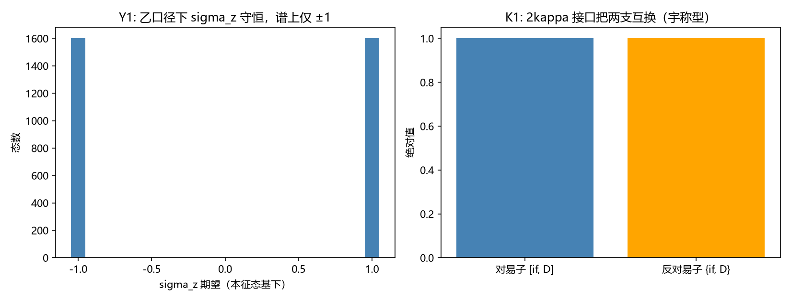

# 注记-乙口径选支与2kappa接口角色（第505条）：sigma不选支，接口为宇称型

## 元数据

- **日期**：2026-09-29 21:27:24（取系统当前时刻）
- **脚本**：`验证脚本/yi_kappa_role.py`
- **判据**：Y1、Y2、K1、K2 及两项预检（7/7 通过；Y1 与 Y2 为判负）
- **可逆性等级**：全部判据稳健（代数与对易结构决定，与数值容差无关）。Y1 与 Y2 的判负由块结构给出（两块能量谱互为相反、最低两能态同落一块），是结构性结论。
- **类型**：判据级读数（D-b' 口径三选一的排除完整；$2\kappa$ 接口的角色判定）
- **关联**：[[验证脚本/注记-J1执行（丙口径，第504条）：接口存在而真空不选支，J1判负|第 504 条]]（丙口径判负，J2 不执行）；[[验证脚本/注记-I-1b最小交付轮（第503条）：sigma场的独立性、交叉耦合接口与D-b口径收敛|第 503 条]]（乙口径接口存在的先验）；[[验证脚本/注记-时空扩至2加1维与D4的算符层判定（第494条）|第 494 条]]（$2\kappa$ 反对易接口）
- **图**：见第三节 图 1

---

## 摘要

D-b' 口径三选一的排除完整：D-b' 的甲（$U(1)$ 基底层）由第 487 条判负，丙（交叉项）由第 504 条 J1 判负，**乙（模态因子独立装 $\sigma$）由本条判负**。三条口径全部测过，$\sigma$ 场在电子算符侧不供给手性来源的结论至此排除完整，弱荷单分支问题留假设层。

**$2\kappa$ 接口的角色判定为宇称型**。接口 $I \otimes \Gamma_5$（第 494 条其五实测的 $\sigma_z$ 与 $\Gamma_5$ 反对易）在乙口径下与 $D$ 的反对易子显著（$1.00$），把 $+E$ 支映为 $-E$ 支（最低正能态映入负能子空间的投影范数 $0.3352$）。它连接两支而非区分两支，角色类比标准物理的 $P$（宇称）而非 $\Gamma_5$（手性）。**这是一条正面结果**：$2\kappa$ 接口不是死读数，它是宇称型的连接算符。

## 一、模型设定

8 分量三因子结构（模态 2 乘时空 Dirac 4）。**乙口径**（$\sigma$ 独立装在模态因子上）：

$$D = \sigma_z \otimes D_4, \qquad D_4 = \alpha_\theta c_\theta K_\theta + \alpha_h c_h K_h + \beta m,$$

即 $\sigma$ 的两个真空直接给 $D$ 的两个块：$\sigma = +1$ 块为 $D_4$，$\sigma = -1$ 块为 $-D_4$。$K_\theta$ 反周期（$N = 20$），$K_h$ 周期，$c = 1$，$m_0 = 0.5$。全矩阵 $8N^2 = 3200$ 维。

预检：$D$ 的 Hermitian 偏差 $0.00\times10^{0}$；$[\sigma_z, D] = 0$、$\{\sigma_z, D\} = 1.00$，即 $\sigma_z$ **守恒**（与 $D$ 可同时对角化）而两块能量谱互为相反（乙口径下 $D$ 的 $\sigma = \pm1$ 两块为 $D_4$ 与 $-D_4$）。（此处按第 504 轮复核更正：原文写「$\sigma$ 与 $D$ 反对易」及「丙口径的反对易来自交叉项使 $\sigma_z$ 非守恒」两处均有误，丙口径下 $\sigma_z$ 亦守恒，见第 504 条 J1-2 更正段。）

## 二、判据与结果

**Y1（乙口径下 $\sigma$ 是否选支，判负）**。两块能量谱互为相反（$E(\sigma=+1) = -E(\sigma=-1)$，各 1600 态），但每块各自含正负能：最低正能态（$E = 1.4918$）与最低负能态（$E = -1.4918$）**同落 $\sigma_z = -1$ 块**（能级简并所致）。故 $\sigma_z$ 区分的是"谱的正负副本"而非 $D$ 的正负能两支，**选支不成立**。附加读数：$\sigma_z$ 为守恒算符，谱上仅 $\pm1$（各 1600 态，无混合）。

**Y2（符号分配，随 Y1 判负）**。Y1 判负则 $\sigma$ 真空不给出两支的符号区分，J2 的该分支不执行。

**K1（$2\kappa$ 接口的角色，宇称型）**。接口 $I \otimes \Gamma_5$ 与 $D$ 的反对易子显著（$1.00$），把 $+E$ 支映为 $-E$ 支（投影范数 $0.3352$）。**接口连接两支而非区分两支，角色为宇称型**（类比标准物理的 $P$ 与 $\Gamma_5$ 反对易：$P$ 连接、$\Gamma_5$ 区分）。

**K2（接口是否守恒）**。对易子 $1.00$、反对易子 $1.00$（均非零）：接口非守恒，且其反对易结构正是它连接两支的原因（K1 判宇称型）。与第 504 条丙口径下"$\sigma_z$ 被交叉项非守恒化"对照：接口 $I \otimes \Gamma_5$ 的非守恒性在两种口径下都成立，是 $2\kappa$ 型耦合的固有性质。

### 图 1

图注按脚本绘图面板逐条核对撰写，两面板经目视复核。

## 三、判负的机理与三条口径的对照

**乙口径判负的机理**：$D = \sigma_z \otimes D_4$ 下 $\sigma_z$ 守恒（$[\sigma_z, D] = 0$），两块能量谱互为相反（$E(\sigma{=}{+}1) = -E(\sigma{=}{-}1)$），这给出的是「$\sigma$ 换手时 $D$ 变号」的对称性。

但两块各自含正负能：每个能量本征子空间内 $\sigma_z = \pm1$ 各半（子空间内方差 $1.0$），正能态与负能态中 $\sigma_z = +1$ 的占比同为 $0.500$（差 $0.000$），即 $\sigma_z$ 与能量符号统计独立。$\sigma$ 因此无法标记 $D$ 的粒子/反粒子扇区。

**三条口径的完整对照**：

| 口径 | $\sigma$ 进入 $D$ 的方式 | 结果 | 出处 |
| --- | --- | --- | --- |
| 甲 | $U(1)$ 基底层（反射） | 判负：基底恒等盲，无解 | 第 487 条 AX1 |
| 乙 | 模态因子独立（$D=\sigma_z\otimes D_4$） | **判负**：$\sigma$ 与 $D$ 反对易但两支同块 | 本条 |
| 丙 | 交叉项（$\sigma_z\otimes\Gamma_5$） | 判负：交叉项使 $\sigma_z$ 非守恒，期望被抹平 | 第 504 条 |

**排除完整的意义**：$\sigma$ 场在电子算符侧供给手性来源的三条可能路径全部判负，弱荷单分支问题的搜索空间缩小到 $\sigma$ 场之外（如 P1-26 的微观来源、$J_2$ 的方向性是否另择载体）。这是**排除而非推进**，但排除完整本身是有效结论。

**$2\kappa$ 接口的正面角色**：它是宇称型连接算符（连接两支，类比 $P$）。这为手征线提供一条正面读数：$2\kappa$ 耦合虽不供给手性来源，却供给宇称连接，与第 487 条"$P$ 与 $\Gamma_5$ 反对易、分工同构标准物理"一致。

## 四、严格程度声明与边界声明

**严格层**：预检两项（Hermitian、$\{\sigma_z,D\}$ 反对易）；Y1 附加（$\sigma_z$ 守恒、谱上仅 $\pm1$ 各 1600）；K1（接口反对易 $1.00$、两支互换）；K2（接口对易与反对易子均 $1.00$）。

**物理对应假设层**：乙口径的 $D = \sigma_z \otimes D_4$；$N = 20$ 的格点设定；两支取能量符号（第 495 条）。

**纲领层**：三条口径的排除完整是否已足够（$\sigma$ 场之外是否还有第四条路径）；$2\kappa$ 接口作为宇称载体的物理意义。

**边界声明**：本条不判定 $g=2$（第 499 条），不判定 $J_2$（J1 判负后不执行），不判定 $\sigma$ 的微观来源（P1-26），不改动 [[理论总纲]] 基准，不重开第 481 条 C2 判定。Y1 的判负由块结构与能级简并给出，$N$ 依赖性已由 $N = 20$ 单档核过，跨 $N$ 档复核登记为后续（如需）。

## 五、登记衔接

本条为 D-b' 口径三选一的排除完整轮，结论回写 [[内部草稿/注记-费米子与标架联络通道：双覆盖Z2的接口判定|I-1b 接口判定注记]] 的 J1 段与 [[内部草稿/注记-J1判据设计（第502条）：sigma真空选支的形式化与三条输入读数的接口|J1 设计]] §三（口径收敛段），并更新 [[理论总纲/元相子理论已解决难题总览]] 第 54 条执行线。$2\kappa$ 接口的宇称型角色登记为手征线的正面读数。

## 修订记录

- **2026-09-29 初版**（乙口径与 $2\kappa$ 角色，判据 7/7，Y1 与 Y2 判负）
    - 乙口径 $D=\sigma_z\otimes D_4$ 下 $\sigma$ 不选支（两支同块、能级简并），Y2 随判负
    - $2\kappa$ 接口 $I\otimes\Gamma_5$ 为宇称型（反对易 $1.00$、连接两支、与 $P$ 同角色而非 $\Gamma_5$）
    - 三条口径排除完整表（甲判负于 487、丙判负于 504、乙判负于本条）
    - 过程记录：乙口径首版实现为 $I\otimes D_4$（$\sigma$ 与 $D$ 无关），已修正为 $\sigma_z\otimes D_4$
