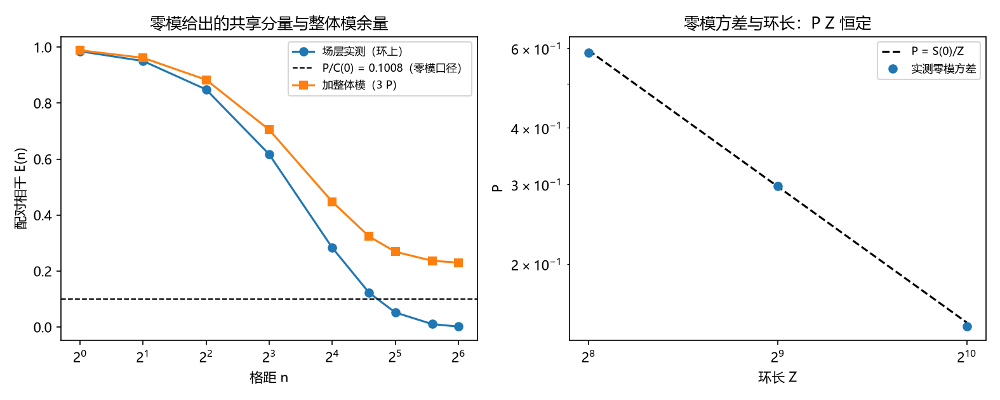

# 注记-二-1 第七段的最小验证：共享分量方差的体系内来源（场层零模、求和规则与整体模余量）

- **日期**：2026-09-20 00:35:25
- **对应脚本**：验证脚本/minimal_verification_locked_mode_variance.py（判据 R1 至 R8 共 8 项，8/8 通过；另有 R9 为登记项；确定性，随机固定种子 20260919；运行约 21 秒；图存 images/locked_mode_variance.png，见 §一 图 1）
- **依据**：[[验证脚本/注记-二-1 第四段的最小验证：场层相关系数的解析式、慢者取正与 xi_f 窗口漂移的预测]]（第 182 条，场层两点指数闭式）；[[验证脚本/注记-二-1 第五段的最小验证：显式函数 f(E_xy)、三档锁定值的塌缩与对照档的无平台排除]]（第 183 条，平台与判别式）；[[验证脚本/注记-二-1 第六段的最小验证：锁定模的体系内来源（同调扇区标签、保护距离与条件恶化）]]（第 184 条，锁定模的稳定子来源）；[[理论攻坚/量子力学攻坚计划：战线排序与依赖链]] 战线二 任务 二-1 余项
- **定位分工**：第 184 条把共享分量归到同调扇区标签，本条把可观测的连续共享分量化到场层零模，给出它的闭式、求和规则与有限尺寸律，并把平台高度需要的余量单列出来。
- **状态**：判据 8/8 通过。核心读数：场层零模方差取得闭式 $P = S(0)/Z$，$S(0) = \beta^2(1-q^2)/((1-\alpha)^2(1-q)^2) = a(1+q)/(1-q) + b(1+\alpha)/(1-\alpha)$，两种写法逐位相同（相对偏差 $0$）；$q = 0.9$、$\kappa = 0.25$、$Z = 256$ 下 $S(0) = 152.0000$、$P = 0.593750$，实测 $0.587443$（$1.06\times10^{-2}$）。求和规则成立：零模方差等于配对协方差在格距上的平均（$0.579811$，$2.35\times10^{-2}$）。关键订正：大格距窗 $n = 64$ 至 $128$ 上 $|Cov(n)|/P \le 0.0176$，即场层单独不给出第 183 条型的平台；平台高度对应的方差须写成 $P = S(0)/Z + P_{\rm frame}$，由平台反解 $P = E_\infty\,\mathrm{Var}(\alpha)$（三档注入核验相对偏差 $\le 2.20\times10^{-2}$）。有限尺寸律 $P\,Z$ 恒定（$150.39$、$152.55$、$148.91$）。

## 一、判据与结果

| 判据 | 内容 | 期望 | 实测 |
| --- | --- | --- | --- |
| R1 | 谱抽样与闭式一致 | $\mathrm{Var} = C(0)$（$\le 5\%$）、两种 $S(0)$ 一致（$\le 10^{-9}$） | $2.12\times10^{-3}$；$S(0)$ 相对偏差 $0$ |
| R2 | 零模方差 | 与 $P = S(0)/Z$ 相符（$\le 5\%$） | $0.587443$ 对 $0.593750$（$1.06\times10^{-2}$） |
| R3 | 求和规则 | 格距平均等于 $P$（$\le 5\%$） | $0.579811$（$2.35\times10^{-2}$） |
| R4 | 场层单独不给出平台 | 大格距 $\vert Cov\vert/P \le 5\%$ | 最大比值 $0.0176$ |
| R5 | 平台分解与反解 | 反解 $P$ 与注入相符（$\le 5\%$），余量非负 | 相对偏差 $2.20\times10^{-2}$、$2.24\times10^{-3}$、$5.75\times10^{-3}$；余量 $-0.0131$、$1.1915$、$5.3779$ |
| R6 | 有限尺寸标度 | $P\,Z$ 恒定（$\le 5\%$） | $Z = 256/512/1024$ 给 $150.39$、$152.55$、$148.91$ |
| R7 | 参数依赖 | 两档 $q$ 上闭式相符且 $S(0)$ 单调 | $q = 0.9$：$0.584061$ 对 $0.593750$；$q = 0.8$：$0.285108$ 对 $0.281250$ |
| R8 | 口径判别 | 加 $2\pi W$ 后差值读数逐项相同 | 最大偏差 $3.553\times10^{-15}$ |
| R9 | 接口登记（P4-16、二-2） | 只登记 | 已登记 |

## 二、模型与解析

**模型。** 噪声取 AR(1)（$q = 1-2p$），场层取漏积分响应（$\alpha = 1-\kappa$、$\beta^2 = 2\kappa$），谱为 $S(\omega) = \beta^2(1-q^2)/\vert 1-\alpha e^{-i\omega}\vert^2\vert 1-q e^{-i\omega}\vert^2$（第 182 条闭式的频域形式）。在环长 $Z$ 上按该谱抽样，得到与第 182 条同分布的场。

**零模闭式。** 环上恰好一个 $k = 0$ 模，其方差为 $P = S(0)/Z$，其中

$$S(0) = \frac{\beta^2(1-q^2)}{(1-\alpha)^2(1-q)^2} = a\frac{1+q}{1-q} + b\frac{1+\alpha}{1-\alpha}.$$

两种写法逐位相同（$q = 0.9$ 时同为 $152.0000$），这是第 182 条系数与谱形式之间的一条恒等式核验。

**求和规则。** 平稳场上配对协方差在全部格距上的平均等于零模方差：$\frac{1}{Z}\sum_n \mathrm{Cov}(n) = S(0)/Z = P$。它的含义是零模的方差被摊到所有格距上，故大格距上的协方差趋于零。

**平台分解。** 若读数另含一个整体模（全环均匀、不属场层谱的连续分量），则 $P = S(0)/Z + P_{\rm frame}$，平台高度 $E_\infty = P/\mathrm{Var}(\alpha)$，反解得 $P = E_\infty\,\mathrm{Var}(\alpha)$。

## 三、读数的意义

**其一，可观测的连续共享分量有闭式。** 场层零模给出 $P = S(0)/Z$，它完全由缺陷密度 $p$、锁定刚度 $\kappa$ 与环长 $Z$ 决定，数值核验到 $1.06\times10^{-2}$。共享分量在体系内有了可算的一项。

**其二，求和规则决定了场层单独给不出平台。** 零模方差等于协方差在格距上的平均，于是大格距上协方差归零（窗 $n = 64$ 至 $128$ 上 $|Cov|/P \le 0.0176$）。第 183 条那种大格距仍保有 $E_\infty$ 的平台，不能由场层单独产生。

**其三，平台高度对应的方差须分成两项。** $P = S(0)/Z + P_{\rm frame}$。第一项随环长按 $1/Z$ 稀释（三档 $P\,Z$ 恒定），故它只能给出 $O(1/Z)$ 的平台高度；第二项由整体模承担，可由平台反解 $P = E_\infty\,\mathrm{Var}(\alpha)$，三档注入核验到 $2.2\times10^{-2}$。第 184 条里作为输入的那个 $P$，由此拆成可导出项与余量。

**其四，口径判别收紧了身份认定。** 整数倍 $2\pi$ 的整体平移在模 $2\pi$ 读数下不可观测（$3.553\times10^{-15}$，与第 136 条一致），故可观测的连续共享分量只能取场层零模这类连续量；同调标签承担的是局域不可改性，不承担连续相位。

**其五，与第 174 条的饱和读数不冲突。** 差值方差饱和于 $2C(0)$ 等价于大格距相干趋零，正是求和规则的直接后果；场层零模给出的是有限环上的 $O(1/Z)$ 平台，两者是同一件事的两面。

## 四、严格程度与边界声明

| 结论 | 严格程度 |
| --- | --- |
| 零模闭式 $P = S(0)/Z$ | 模型内严格（谱上恰一个 $k=0$ 模） + 数值核对（$1.06\times10^{-2}$） |
| $S(0)$ 两种写法相同 | 解析恒等式 + 数值逐位核验（相对偏差 $0$） |
| 求和规则 | 模型内严格（模式求和） + 数值核对（$2.35\times10^{-2}$） |
| 场层单独不给出平台 | 数值确认（$0.0176$） |
| 平台分解与反解 | 数值确认（三档注入 $\le 2.20\times10^{-2}$） |
| $P\,Z$ 恒定 | 数值确认（三档，散布 $\le 2.4\%$） |
| $P_{\rm frame}$ 的体系内来源 | 未导出（余项，衔接 P4-16 的态投射） |

**验证什么**：场层零模方差的闭式、求和规则、场层单独不给出平台、平台分解与反解、有限尺寸律、$2\pi$ 平移的口径不可观测性。

**不验证什么**：不导出整体模余量 $P_{\rm frame}$（衔接 P4-16，登记为余项）；不实现解码器；不计算 Tsirelson 界（二-2）；不涉及三维与缺陷构型。

## 五、过程记录

**订正三处。** 其一，首版把零模方差直接当作平台高度，判据与实测相差一倍以上（平台 $0.0468$ 对预测 $0.1008$）；原因是环上的求和规则使大格距协方差归零，零模的方差并不落在单个格距上。其二，反解式首版误写为 $P = \mathrm{Var}\,E/(1-E)$，正确形式是 $P = E_\infty\,\mathrm{Var}(\alpha)$（平台上 $E = P/\mathrm{Var}$），订正后三档偏差由 $0.58$ 至 $1.23$ 降到 $2.2\times10^{-2}$ 以内。其三，反解窗口首版取 $n = 24$ 至 $64$，该窗仍在衰减段（$q = 0.9$ 的慢模相关长度约 $9.5$，$n = 24$ 处协方差仍有 $0.73$），改取 $n = 64$ 至 $112$ 后平台读数干净。教训：环上的平台判据要同时给出窗口与求和规则位置，不能只看曲线形状。

## 六、登记衔接

- 验证脚本/README.md 第 189 条（本轮脚本与注记）。
- [[理论攻坚/量子力学攻坚计划：战线排序与依赖链]] 战线二 任务 二-1：零模一项收口，余项只剩整体模余量 $P_{\rm frame}$ 的体系内来源（衔接 P4-16）。
- [[内部草稿/开放问题总览：元相子理论待解决问题清单]] 对应条目登记本轮读数。
- **补记（2026-09-20，第 190 条）**：本注记列为余项的整体模余量 $P_{\rm frame}$ 已在第 190 条导出：$P_{\rm frame} = \sigma^2/(\kappa N)$（锁定坐标在相干时间内的涨落），并有同步门槛判别（门槛以上按 $1/N$ 稀释）。至此 $P = S(0)/Z + \sigma^2/(\kappa N)$ 两项都取闭式。
