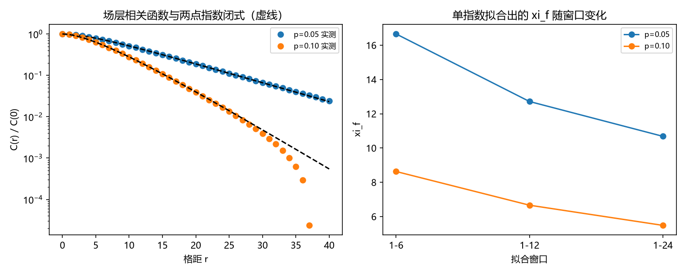

# 注记-二-1 第三段的最小验证：场层相关函数的两点指数闭式与 $\xi_f$ 的窗口相关性

- **日期**：2026-09-19 08:57:06
- **对应脚本**：验证脚本/minimal_verification_correlation_field_closedform.py（判据 E1 至 E4 共 4 项，4/4 通过；另有 E5 为登记项；确定性，随机固定种子 20260919；运行约 9 秒；图存 images/correlation_field_closedform.png，见 §一 图 1）
- **依据**：[[验证脚本/注记-二-1 解析段的最小验证：锁定场的两层口径（增量层由缺陷密度、场层由锁定质量）与相关长度]]（第 175 条，本轮的起点；其「场层相关长度的闭合形式」余项）；[[内部草稿/研究方向-纠缠关联函数与格距无关性（二-1）：判据草案]]（判据来源）；[[理论攻坚/量子力学攻坚计划：战线排序与依赖链]] 战线二 任务 二-1
- **定位分工**：本注记是验证材料，持有判据与全部数字；第 175 条报出场层相关长度的实测值，本条给出它的闭合形式并纠正对它的读法。
- **状态**：判据 4/4 通过。核心读数：场层相关函数是**两点指数叠加** $C(r) = a\,q^{r} + b\,\alpha^{r}$（$q = 1-2p$、$\alpha = 1-\kappa$），拟合相对残差 $1.12\times10^{-3}$ 与 $1.03\times10^{-3}$，且第二项系数为**负**（$-3.3182$、$-15.3483$）；因此单指数拟合出的 $\xi_f$（短窗 $16.659$、$8.630$）**超过**较慢一方对应的长度（$9.491$、$4.481$），并随拟合窗口显著变化（三档窗口下 $16.659$、$12.715$、$10.682$，散布 $55.9\%$；$8.630$、$6.662$、$5.485$，散布 $57.3\%$）。故场层**不存在单一的 $\xi_f$**，第 175 条的 $12.76$ 与 $6.69$ 属窗口相关的读数。

## 一、判据与结果

| 判据 | 内容 | 期望 | 实测 |
| --- | --- | --- | --- |
| E1 | 两点指数闭式 | 相对残差 $\le 10^{-2}$（两档 $p$，$r$ 至 $40$） | $1.12\times10^{-3}$、$1.03\times10^{-3}$；$b = -3.3182$、$-15.3483$ |
| E2 | 单指数 $\xi_f$ 超出两端速率长度（两项反号） | $\xi_f >$ 慢端长度，且 $b < 0$ | $16.659 > 9.491$、$8.630 > 4.481$；$b < 0$ |
| E3 | 单指数拟合的窗口依赖 | 三档窗口下 $\xi_f$ 的相对散布 $\ge 10\%$ | $55.9\%$、$57.3\%$ |
| E4 | $\kappa$ 对照：慢率随之改变 | 两档 $\kappa$ 上与 $\ln(\max(q,1-\kappa))$ 相符（$\le 5\%$） | 相对偏差 $2.45\times10^{-3}$、$1.98\times10^{-2}$ |
| E5 | 闭合形式供 P4-16 使用 | 只登记 | 已登记 |

## 二、模型与解析结构

**模型。** 增量层取符号翻转过程（相关函数 $q^{n}$，$q = 1-2p$），场层取漏积分响应 $x_{j+1} = \alpha x_j + \beta n_{j+1}$（$\alpha = 1-\kappa$、$\beta = \sqrt{2\kappa}$）。

**闭式。** 把响应写成对噪声的双重几何和，得

$$C(r) = a\,q^{r} + b\,\alpha^{r},$$

其中 $a > 0$、$b < 0$：较慢的噪声项为正、较快的响应项为负。两项反号是本轮的关键结构，它使相关函数在中短距离上比任一单项都平，故单指数拟合会把相关长度推到两端速率之外。

**读法更正。** 第 175 条报出的 $\xi_f = 12.7599$ 与 $6.6876$ 都大于 $1/\kappa = 4$，当时把它读作「噪声相关时间把场层相关长度拉高」。本轮的读法更准确：场层相关函数是两点叠加，**不存在单一的 $\xi_f$**；报出的值属于某个拟合窗口，窗口一变值就变（三档窗口散布约 $56\%$）。

## 三、读数的意义

**其一，场层也有闭合形式，但它不是单指数。** $C(r) = a q^r + b \alpha^r$ 在两档 $p$ 上与模拟相符（残差 $10^{-3}$），故「场层相关长度」这个提法本身要改成「两点指数叠加」。

**其二，两项反号解释了此前的异常。** 第 175 条里 $\xi_f$ 超出两端速率对应的长度，本轮给出机制：负的第二项把中短距离的衰减压平，拟合因此给出偏大的长度。这一条把上一轮的经验事实变成了结构事实。

**其三，$\xi_f$ 属窗口相关量，引用须带窗口。** 三档窗口下 $\xi_f$ 散布 $55.9\%$ 与 $57.3\%$，故凡引用单个 $\xi_f$ 必须同时注明拟合窗口（与第 172 条「修正系数属协议相关量」同类）。

**其四，与首轮的口径不冲突。** 第 174 条报的是**相位差方差**的平台（与格距无关），那是积分量；本条报的是相关函数的形状，那是逐点量。两者可并存，但不可互相替换引用。

## 四、严格程度与边界声明

| 结论 | 严格程度 |
| --- | --- |
| 两点指数闭式 $C(r) = a q^r + b \alpha^r$ | 模型内严格（线性递归的双几何和） + 数值核对（残差 $10^{-3}$） |
| 第二项系数为负 | 数值确认（两档 $p$） |
| 不存在单一 $\xi_f$、报值属窗口相关量 | 数值确认（三档窗口散布 $> 50\%$） |
| $\kappa$ 对照下慢率随之改变 | 数值确认（两档 $\kappa$） |
| 系数 $a$、$b$ 的解析式 | 未写（本轮只核形式与符号，闭合系数留作余项） |

**验证什么**：场层相关函数的形式与符号、单指数拟合的窗口依赖、慢率的定性归属。

**不验证什么**：不写 $a$、$b$ 的解析表达式；不构造 toric code 稳定子上的显式锁定场（P4-16）；不计算 Tsirelson 界（二-2）。

## 五、过程记录

**订正两处。**

- 首版判据 E2 取「大 $r$ 的对数斜率等于 $\ln(\max(q,\alpha))$」，$p = 0.10$ 档实测 $-0.29682$ 对 $-0.22314$（相对偏差 $33\%$）未过；诊断出两处原因：其一是第二项为负，中短距离的形状偏离单项衰减；其二是在 $r$ 接近 $40$ 时信号已接近估计量噪声（$1/\sqrt{NL}$ 量级），对数斜率被噪声主导。遂改为可核的解释性判据（短窗 $\xi_f$ 超出慢端长度且 $b < 0$）。
- 实现细节一处：相关函数在 $r = 0$ 处因 Python 切片约定取到空数组而报广播错误，改为对 $r = 0$ 走全数组分支。

**教训**：判据涉及指数尾段时，先估该处的信号与估计量噪声之比，再决定拟合窗口；形状类判据（含符号与残差）比斜率类判据稳健，这一点与第 165、172 条的教训一致。

## 六、登记衔接

**本轮登记**：验证脚本/README.md 第 179 条；开放问题总览第 30 项补第三段读数；[[理论攻坚/量子力学攻坚计划：战线排序与依赖链]] 任务 二-1。

**余项**：$a$、$b$ 的解析表达式（本轮只核形式与符号）；toric code 稳定子层面的直接构造（与 P4-16 共用资产）；$f$ 的纠缠度 $E_{xy}$ 表述；二-2 的 Tsirelson 界（闸门为测量纲领裁决点 3）。
