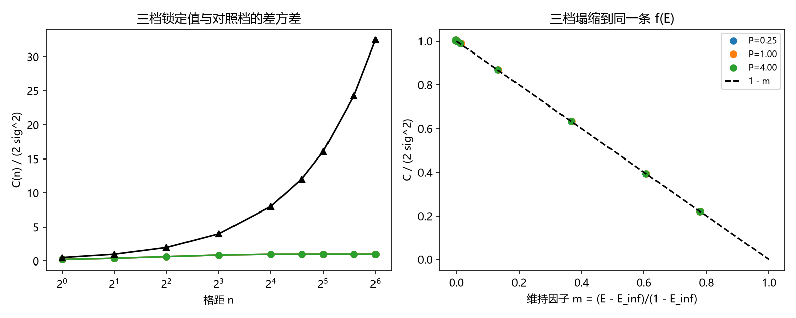

# 注记-二-1 第五段的最小验证：显式函数 $f(E_{xy})$、三档锁定值的塌缩与对照档的无平台排除

- **日期**：2026-09-19 22:01:58
- **对应脚本**：验证脚本/minimal_verification_correlation_entanglement.py（判据 G1 至 G7 共 7 项，7/7 通过；另有 G8 为登记项；确定性，随机固定种子 20260919；运行约 4 秒；图存 images/correlation_entanglement.png，见 §一 图 1）
- **依据**：[[验证脚本/注记-二-1 首轮的最小验证：锁定档相位差方差与格距无关、对照档线性增长与显式函数]]（第 174 条，其 C3 要求输出函数形状）；[[验证脚本/注记-二-1 第四段的最小验证：场层相关系数的解析式、慢者取正与 xi_f 窗口漂移的预测]]（第 182 条，场层闭式）；[[内部草稿/研究方向-纠缠关联函数与格距无关性（二-1）：判据草案]] 判据 C3、C5、C6；[[理论攻坚/量子力学攻坚计划：战线排序与依赖链]] 战线二 任务 二-1
- **定位分工**：第 174 条把显式函数写成相关函数 $\rho(n)$ 的函数，本条把它写成配对相干 $E_{xy}$ 的函数 $f(E_{xy})$，并给出该写法的适用条件。
- **状态**：判据 7/7 通过。核心读数：差值方差与配对相干之间有两重关系。代数式 $\mathrm{Var}[\Delta\alpha] = 2\,\mathrm{Var}(\alpha)(1-E)$ 在全部档位与格距上成立（相对偏差 $\le 1.8\times10^{-3}$）；平台分解式 $\mathrm{Var}[\Delta\alpha] = 2\sigma^2(1-m)$、$m = (E - E_\infty)/(1 - E_\infty)$ 同样成立（$\le 4.2\times10^{-3}$），其形式不含 $n$，格距只进 $m$。三档锁定值（$E_\infty = 0.2079$、$0.4945$、$0.8052$，与 $P/(P+\sigma^2)$ 相符）在 $(m, C/2\sigma^2)$ 平面上塌缩到直线 $1-m$；对照档按相干无平台被排除（其 $E$ 从 $0.9112$ 降到 $0.7601$，散布 $19.9\%$，同期锁定档散布 $1.94\%$）。

## 一、判据与结果

| 判据 | 内容 | 期望 | 实测 |
| --- | --- | --- | --- |
| G1 | 代数式 $\mathrm{Var} = 2\mathrm{Var}(\alpha)(1-E)$ | 全部档位相对偏差 $\le 5\%$ | $1.789\times10^{-3}$ |
| G2 | 平台式 $C = 2\sigma^2(1-m)$ | 同上 | $4.218\times10^{-3}$ |
| G3 | 塌缩到直线 $1-m$ | 三档合并偏离 $\le 5\%$ | $4.171\times10^{-3}$（$m$ 从 $-0.0035$ 到 $0.7800$） |
| G4 | 锁定值扫描 | $E_\infty$ 与 $P/(P+\sigma^2)$ 相符且单调 | 相对偏差 $3.96\times10^{-2}$、$1.10\times10^{-2}$、$6.52\times10^{-3}$ |
| G5 | 场层闭式替换（两点指数） | 平台式仍成立 $\le 5\%$ | $1.654\times10^{-2}$（$C_\eta(0) = 5.8901$） |
| G6 | 对照档排除 | $C$ 与 $n$ 成正比且相干无平台 | 斜率 $1.013018$ 对 $\sigma^2 = 1$（残差 $1.40\times10^{-2}$）；$E$ 从 $0.9112$ 降到 $0.7601$ |
| G7 | 紧致口径与有限尺寸 | 逐样本 $\vert\Delta\alpha\vert$ 模 $2\pi$ 后 $\le \pi$，$n = L/4$ 仍成立 | 最大包裹距离 $3.141578$；$n = 64$ 档偏差 $2.740\times10^{-3}$ |
| G8 | 接口登记（二-2） | 只登记 | 已登记 |

## 二、模型与口径

**模型。** 一维环 $L$ 站点，$\alpha_j = \phi + \eta_j$。$\phi$ 为整体锁定模（方差 $P$，逐实现对全环相同），$\eta$ 为平稳涨落场（方差 $\sigma^2 = 1$、相关函数 $\rho(n) = e^{-n/\xi}$、$\xi = 4$）。对照档（无锁定）取独立增量之和。

**配对相干。** $E(n) = \mathrm{Cov}(\alpha_x,\alpha_y)/\mathrm{Var}(\alpha) = (P + \sigma^2\rho(n))/(P + \sigma^2)$，平台 $E_\infty = P/(P+\sigma^2)$。这个量只用两点读数就能测，无需知道 $P$ 与 $\sigma^2$ 的分解。

**两重关系。** 代数式对任意平稳场成立：$\mathrm{Var}[\Delta\alpha] = 2\mathrm{Var}(\alpha)(1-E)$。代入平台分解得 $C = 2\sigma^2(1-m)$、$m = (E - E_\infty)/(1 - E_\infty)$，即 $C = f(E)$ 的形状不含 $n$，格距只出现在 $m$ 里。三档锁定值取 $P = 0.25$、$1.0$、$4.0$，对应 $E_\infty = 0.2$、$0.5$、$0.8$。

## 三、读数的意义

**其一，函数形状与格距解耦。** $f$ 的表达式里没有 $n$，全部格距依赖由 $m$ 承载。这正是判据草案 C3 要求输出的形状，也把「距离依赖只出现在维持相干条件的衰减项中」变成一句可核验的话。

**其二，三档锁定值塌缩到同一条直线。** 锁定强弱不同的三档数据在 $(m, C/2\sigma^2)$ 平面上落在直线 $1-m$ 上（最大偏离 $4.2\times10^{-3}$），说明 $f$ 的形状与锁定强弱无关，只有 $m$ 的走向随档位变化。

**其三，对照档的排除依据是相干缺少平台。** 随机游走档的相干并不小（$E$ 从 $0.9112$ 降到 $0.7601$），但它在大格距窗上持续下滑、没有平台，同期锁定档的相干散布只有 $1.94\%$。所以 $f$ 的适用条件是可检验的一条：配对相干存在与格距无关的平台，且单点方差为常数。这一条把「锁定」从画象变成了判别式。

**其四，场层闭式可以直接代入。** 把 $\eta$ 换成第 182 条的两点指数场（$C_\eta(0) = 5.8901$）后，平台式的形式不变（偏差 $1.65\times10^{-2}$）。故 $f$ 的写法对场层的具体闭式不敏感，换闭式只换 $m$ 的走法。

**其五，差值对整体锁定模不可见。** 包裹占比在三档锁定值上同为 $2.63\%$，因为整体模在差值里相消，差值分布只由场层与维持因子决定。这解释了锁定在读数上的表现是方差饱和，而非平均位置的平移。

## 四、严格程度与边界声明

| 结论 | 严格程度 |
| --- | --- |
| 代数式 $\mathrm{Var} = 2\mathrm{Var}(\alpha)(1-E)$ | 模型内严格（平稳场上的代数恒等式） + 数值核对（$1.789\times10^{-3}$） |
| 平台式 $C = f(E)$，形式不含 $n$ | 模型内严格（平台分解） + 数值核对（$4.218\times10^{-3}$，三档塌缩） |
| 锁定值 $E_\infty = P/(P+\sigma^2)$ | 模型内严格 + 数值核对（$\le 3.96\times10^{-2}$） |
| 对照档按无平台排除 | 数值确认（散步 $19.9\%$ 对 $1.94\%$） |
| $E_{xy}$ 取配对相干 | 可测代理口径；纠缠熵口径留待稳定子构造一段 |
| 紧致口径不饱和 | 数值确认（包裹占比 $2.63\%$，最大包裹距离 $3.141578$） |

**验证什么**：$f(E_{xy})$ 的形状与格距解耦、三档锁定值的塌缩、锁定值与其平台的关系、对照档的判别式、紧致口径与有限尺寸。

**不验证什么**：不构造 toric code 稳定子上的锁定场（P4-16）；不给 $E_{xy}$ 的纠缠熵口径；不计算 Tsirelson 界（二-2）；不涉及锁定模 $P$ 的体系内来源（$\phi$ 在本模型里是输入）。

## 五、过程记录

**订正一：均值口径把研究对象消掉了。** 首版沿用逐行减均值的写法，而整体锁定模 $\phi$ 逐行相同，减均值等于把 $\phi$ 一并减掉，于是 $E_\infty$ 与 $P$ 无关（三档同为 $-0.0289$，G4 判未过）。改为全局均值口径后 $E_\infty$ 为 $0.2079$、$0.4945$、$0.8052$，与 $P/(P+\sigma^2)$ 相符。教训：涉及共享模的判据，去均值的层级要按模的结构选，逐行去均值会消掉整行共享的成分。

**订正二：对照档的判别式选错。** 首版想用「反解出的有效强度随格距增长」排除对照档，实测比值仅 $1.3$。该量等于单点方差乘 $(1 - E_\infty)$，在随机游走上也对格距恒定，故无判别力。改用平台检验：对照档的相干在大格距窗上散布 $19.9\%$，锁定档 $1.94\%$，判别清楚。

## 六、登记衔接

- 验证脚本/README.md 对应条目（本轮脚本与注记）。
- [[理论攻坚/量子力学攻坚计划：战线排序与依赖链]] 战线二 任务 二-1：$f(E_{xy})$ 一项收口，余项剩 toric code 稳定子构造。
- [[内部草稿/开放问题总览：元相子理论待解决问题清单]] 对应条目登记本轮读数。
