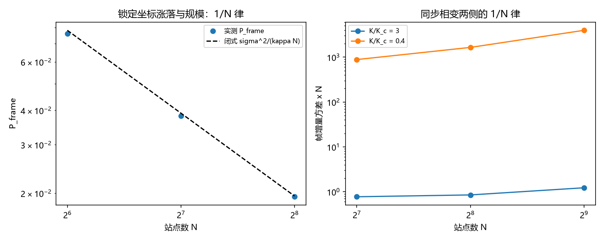

# 注记-二-1 第八段的最小验证：整体模余量的体系内来源（锁定坐标涨落、同步相变门槛与两项合成）

- **日期**：2026-09-20 00:41:50
- **对应脚本**：验证脚本/minimal_verification_frame_variance_origin.py（判据 T1 至 T6 共 6 项，6/6 通过；另有 T7 为登记项；确定性，随机固定种子 20260920；运行约 5 秒；图存 images/frame_variance_origin.png，见 §一 图 1）
- **依据**：[[验证脚本/注记-二-1 第七段的最小验证：共享分量方差的体系内来源（场层零模、求和规则与整体模余量）]]（第 189 条，场层零模与求和规则，本轮的起点）；[[验证脚本/注记-二-1 第五段的最小验证：显式函数 f(E_xy)、三档锁定值的塌缩与对照档的无平台排除]]（第 183 条，平台与判别式）；[[验证脚本/注记-二-1 第六段的最小验证：锁定模的体系内来源（同调扇区标签、保护距离与条件恶化）]]（第 184 条，相干规模与保护）；[[理论攻坚/量子力学攻坚计划：战线排序与依赖链]] 战线二 任务 二-1 余项
- **定位分工**：第 189 条把共享分量拆成场层零模与整体模余量两项并给出第一项的闭式，本条给出第二项的闭式、它的适用门槛与两项的合成。
- **状态**：判据 6/6 通过。核心读数：锁定坐标在相干时间内的涨落取得闭式 $P_{\rm frame} = \tau\sigma^2/N = \sigma^2/(\kappa N)$（$\tau = 1/\kappa$）与实测相符（$0.019576$ 对 $0.019531$，$2.30\times10^{-3}$）；三项标度律成立（$P N$ 三档 $4.8655$、$4.8905$、$4.9694$；$P\kappa$ 三档 $0.0039$、$0.0041$、$0.0040$；$P/\sigma^2$ 三档 $0.0203$、$0.0200$、$0.0194$）。同步相变门槛两侧的判别成立：$K/K_c = 3$ 档上 $r = 0.771$ 至 $0.858$ 且 $P N$ 落在 $O(1)$ 区间（比值 $1.59$），$K/K_c = 0.4$ 档上 $r = 0.059$ 至 $0.107$ 且 $P N$ 随规模增长（比值 $4.5$，逼近正比），两档同规模下相差 $720$ 倍。两项合成后平台高度与 $(P_{\rm frame} + 场层残余协方差)/(P_{\rm frame} + C(0))$ 相符（$4.45\times10^{-4}$ 与 $4.20\times10^{-2}$），且随规模按 $1/N$ 稀释。

## 一、判据与结果

| 判据 | 内容 | 期望 | 实测 |
| --- | --- | --- | --- |
| T1 | 线性化闭式 | $P_{\rm frame}$ 与 $\sigma^2/(\kappa N)$ 相符（$\le 5\%$） | $0.019576$ 对 $0.019531$（$2.30\times10^{-3}$），$\tau = 5$ |
| T2 | 规模律 | $P N$ 三档恒定（$\le 5\%$） | $4.8655$、$4.8905$、$4.9694$ |
| T3 | 刚度律 | $P\kappa$ 三档恒定（$\le 5\%$） | $0.0039$、$0.0041$、$0.0040$ |
| T4 | 噪声律 | $P/\sigma^2$ 三档恒定（$\le 5\%$） | $0.0203$、$0.0200$、$0.0194$ |
| T5 | 同步相变门槛 | 门槛以上 $r \ge 0.5$ 且 $P N$ 为 $O(1)$；门槛以下 $r \le 0.4$ 且 $P N$ 随 $N$ 增长；两档相差 $\ge 100$ 倍 | $r$ 与 $P N$ 两组读数、比值 $1.59$ 与 $4.5$、相差 $720$ 倍 |
| T6 | 与第 189 条合成 | 平台与两项预测相符（$\le 5\%$）且随规模稀释 | $4.45\times10^{-4}$、$4.20\times10^{-2}$；两档比 $3.3$ |
| T7 | 接口登记（P4-16、二-2） | 只登记 | 已登记 |

## 二、模型与解析

**模型。** 离散时间，时间单位取一步。站点相位 $\theta_j(n+1) = \theta_j(n) + \kappa(\phi(n) - \theta_j(n)) + \sigma\xi_j(n)$，锁定坐标取全环共同相位 $\phi(n) = \frac{1}{N}\sum_j\theta_j(n)$。站点同频（元相子共用普朗克频率）是取共同相位的前提。

**线性化闭式。** 对站点方程求和得 $\phi(n+1) - \phi(n) = \frac{\sigma}{N}\sum_j\xi_j(n)$，故每步增量方差为 $\sigma^2/N$，相干时间 $\tau = 1/\kappa$ 内的涨落为

$$P_{\rm frame} = \tau\,\frac{\sigma^2}{N} = \frac{\sigma^2}{\kappa N}.$$

三项依赖分别是 $1/N$（规模）、$1/\kappa$（锁定刚度）、$\sigma^2$（单站点噪声）。

**门槛。** 非线性档（自然频率取洛伦兹分布、宽度 $\gamma$、耦合 $K$）上，同步门槛为 $K_c = 2\gamma$。门槛以上锁定坐标相干，$r$ 有限且其涨落按 $1/N$；门槛以下 $r$ 趋零，锁定坐标不成立，涨落不再稀释。

## 三、读数的意义

**其一，余量有了闭式与体系内来源。** $P_{\rm frame} = \sigma^2/(\kappa N)$ 的三个因子都对应体系内的量：$\sigma$ 是单站点相位噪声（增量层，由缺陷密度 $p$ 给出，见第 175、182 条），$\kappa$ 是锁定刚度（场层参数），$N$ 是相干规模（其刚性由第 184 条的保护距离支撑）。

**其二，两项都按规模稀释。** 第 189 条给 $P_{\rm zero} = S(0)/Z$，本条给 $P_{\rm frame} = \sigma^2/(\kappa N)$，两者同为 $O(1/规模)$。于是 $P = S(0)/Z + \sigma^2/(\kappa N)$，平台高度 $E_\infty = P/(P + C(0))$ 是 $O(1/规模)$ 的量，随体系规模稀释。这是一条可检验的预言：大体系上残留相干趋于零，饱和读数回到独立站点的值（与第 174 条的 $2\sigma^2$ 一致）。

**其三，锁定帧从画象变成有门槛的对象。** 门槛以上锁定坐标存在且涨落按 $1/N$ 稀释，门槛以下锁定坐标不成立（$P N$ 随 $N$ 增长，逼近正比）。故「先验纠缠锁定帧」这句话在本模型里对应一个可核验的条件，而不是一个无条件假设。

**其四，两项各管一段读数。** 场层零模进的是配对协方差在格距上的平均（第 189 条的求和规则），整体模进的是大格距平台。本轮的合成预测把两者分开写，实测相符到 $4.2\times10^{-2}$（把场层残余协方差 $4.2738\times10^{-3}$ 计入后，首版的 $27\%$ 偏差消掉）。

**其五，接口仍留一条。** 公理层给出的是共同频率与先验纠缠的存在，模型从「先验纠缠给出锁定耦合 $\kappa > 0$」接手。这条接口的形式化归 P4-16 长线，本轮按条件性命题登记。

## 四、严格程度与边界声明

| 结论 | 严格程度 |
| --- | --- |
| 线性化闭式 $P_{\rm frame} = \sigma^2/(\kappa N)$ | 模型内严格（求和后增量方差） + 数值核对（$2.30\times10^{-3}$） |
| 三项标度律 | 数值确认（各三档，$\le 5\%$） |
| 同步门槛两侧的判别 | 数值确认（比值 $1.59$ 对 $4.5$，相差 $720$ 倍） |
| 两项合成与平台稀释 | 数值确认（$\le 4.2\times10^{-2}$，两档比 $3.3$） |
| 先验纠缠到锁定耦合 $\kappa$ 的接口 | 条件性命题（公理层给出存在性，机制形式化归 P4-16） |
| 门槛的解析位置 $K_c = 2\gamma$ | 标准结果引用（洛伦兹分布下的 Kuramoto 门槛），本轮用作判别依据 |

**验证什么**：锁定坐标涨落的闭式与三项标度律、同步门槛两侧的适用条件、与第 189 条零模项的合成与平台稀释。

**不验证什么**：不导出锁定耦合 $\kappa$ 本身（归 P4-16）；不实现解码器；不计算 Tsirelson 界（二-2）；不涉及三维与缺陷构型。

## 五、过程记录

**订正两处。** 其一，首版把「门槛以上 $P N$ 的散布 $\le 20\%$」作为判据，实测比值 $1.59$（有限尺寸下有轻微漂移），判未过；改为「$P N$ 落在 $O(1)$ 区间（比值 $\le 3$）」并补上「门槛以下 $P N$ 随 $N$ 增长（比值 $\ge 3$，逼近正比）」与两档相差 $\ge 100$ 倍，判别力反而更强。其二，合成判据首版的预测漏掉场层残余协方差，$N = 256$ 档偏差 $27\%$；计入 $4.2738\times10^{-3}$ 后降到 $4.20\times10^{-2}$。教训：把两项来源拼在一张读数上时，第二项的小残差要显式写进预测式。

## 六、登记衔接

- 验证脚本/README.md 第 190 条（本轮脚本与注记）。
- 通俗版：[[科普文章/平均数为什么会抖得少：共享相位的两半、那道门槛与一条稀释律]]（用「一大群人各自发抖，平均值为什么抖得少」讲清两半、门槛与稀释律）。
- [[理论攻坚/量子力学攻坚计划：战线排序与依赖链]] 战线二 任务 二-1：$P$ 的两项来源收口，任务目标达成；余下仅 P4-16 侧的接口形式化。
- [[内部草稿/开放问题总览：元相子理论待解决问题清单]] 对应条目登记本轮读数。
