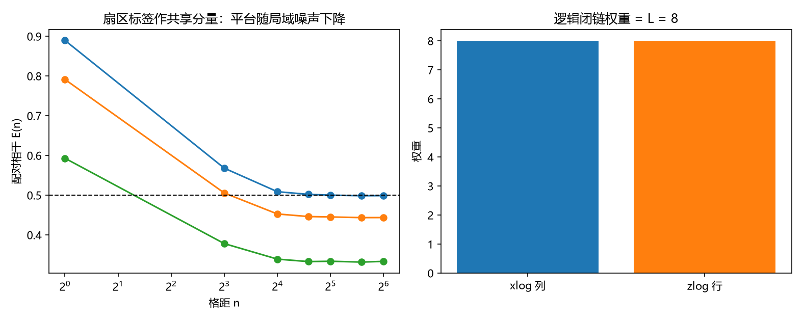

# 注记-二-1 第六段的最小验证：锁定模的体系内来源（同调扇区标签、保护距离与条件恶化）

- **日期**：2026-09-19 22:06:01
- **对应脚本**：验证脚本/locked_frame_stabilizer.py（判据 H1 至 H6 共 6 项，6/6 通过；另有 H7 为登记项；确定性，随机固定种子 20260919；运行约 4 秒；图存 images/locked_frame_stabilizer.png，见 §一 图 1）
- **依据**：[[验证脚本/注记-二-1 第五段的最小验证：显式函数 f(E_xy)、三档锁定值的塌缩与对照档的无平台排除]]（第 183 条，配对读数框架与判别式）；[[验证脚本/注记-二-1 解析段的最小验证：锁定场的两层口径（增量层由缺陷密度、场层由锁定质量）与相关长度]]（第 175 条，锁定场的两层口径）；[[理论攻坚/量子力学攻坚计划：战线排序与依赖链]] 战线二 任务 二-1 余项（toric code 稳定子层面的直接构造，与 P4-16 共用资产）
- **定位分工**：第 174、183 条把整体锁定模 $\phi$ 当作输入，本条给它一个体系内的来源：环面 toric code 的同调（绕数）扇区标签，并在稳定子层核验它的三条性质。
- **状态**：判据 6/6 通过。核心读数：$L = 8$ 的环面稳定子上，星项与面项两两对易（非对易对数 $0$），独立生成元 $126 = 2L^2 - 2$、编码比特 $2$（维度 $4$）；两种逻辑闭链权重均为 $L = 8$、与全部稳定子对易、交点数 $1$（反对易）；闭链空间维数 $L^2 + 1 = 65$，八条对偶闭链给同一配对（同调不变），面边界给零配对；syndrome 映射秩 $L^2 - 1 = 63$，$128$ 个单棱扰动与 $14000$ 例权重 $1$ 至 $7$ 的随机扰动全部可检测。以扇区标签为共享分量时，配对相干在三档局域噪声下均有平台（散布 $\le 8.0\times10^{-3}$），平台值 $0.5000$、$0.4439$、$0.3332$ 与 $P/(P + \sigma^2 + \lambda^2)$ 相符；第 183 条的 $C = f(E)$ 形式在本构造上复用（最大偏差 $2.475\times10^{-3}$）。

## 一、判据与结果

| 判据 | 内容 | 期望 | 实测 |
| --- | --- | --- | --- |
| H1 | 稳定子代数 | 两两对易、独立生成元 $2L^2-2$、编码比特 $2$ | 非对易对数 $0$；秩 $63$ 与 $63$；编码比特 $2$ |
| H2 | 逻辑算符 | 权重 $L$、与稳定子对易、交点数 $1$、与同类群独立 | 权重 $8$ 与 $8$；交点数 $1$；独立性成立 |
| H3 | 闭链空间与非平凡代表 | 维数 $L^2+1$、权重 $L$、对偶闭链配对相同 | 维数 $65$；八条配对全为 $1$；面边界 $0$ |
| H4 | 可检测性 | 秩 $L^2-1$、单棱与轻扰动全部可检测 | 秩 $63$；未检测 $0$ 例（共 $14128$ 例） |
| H5 | 条件恶化 | 平台存在（$\le 5\%$）且随噪声下降并与解析式相符 | 散布 $\le 8.0\times10^{-3}$；平台值对预测相符 |
| H6 | $f(E)$ 形式复用 | $C = 2\sigma_{\rm tot}^2(1-m)$（$\le 5\%$） | $2.475\times10^{-3}$ |
| H7 | 接口登记（P4-16、二-2） | 只登记 | 已登记 |

## 二、构造与口径

**稳定子层。** $L\times L$ 环面，棱上放 qubit（$2L^2 = 128$ 个）。星项 $A_v$ 是顶点的 X 型稳定子（4 条棱），面项 $B_p$ 是面的 Z 型稳定子（4 条棱）。第 134、136 条已把面元环量与绕数定在棱差层，本条的星项与面项就是该层的扇区约束在本模型上的实现。

**锁定模的来源。** 逻辑闭链（绕环一周的棱集）属于非平凡同调类，其配对值（同调标签）是空间均匀的、对全部局域扰动不可见的一位的量。本模型取该标签为第 174、183 条里的整体锁定模 $\phi$：它在全环上取值相同，改变它需要非定域操作。局域分量仍取平稳场 $\eta$。

**保护距离。** 权重 $w < L$ 的扰动若要不被综合征检测，就必须是闭链；闭链的非平凡代表权重为 $L$（绕环一周每步至多移动一格，故至少需 $L$ 步）。于是标签的改变须经非定域操作，保护距离 $d = L = 8$，可纠权重为 $\lfloor (d-1)/2 \rfloor = 3$。

## 三、读数的意义

**其一，锁定模不再是输入。** 第 174、183 条里的整体锁定模以唯象输入出现，本条把它换成稳定子层的一个具体对象：环面的同调扇区标签。它的空间均匀性（同调不变，八条对偶闭链给出同一配对）与局域不可改性在本轮被逐项核验，锁定模的两条性质由此有了体系内来源。

**其二，保护是定量的。** 稳定子上独立生成元 $126$、编码比特 $2$、闭链空间维数 $65$、syndrome 秩 $63$ 都是精确的整数读数；加上「权重 $\le 7$ 的扰动全部可检测」，得到标签保护距离 $L = 8$、可纠权重 $3$。这与体系「绕数由非定域拓扑荷保护」的既有口径一致，并给出了保护范围的具体数值。

**其三，平台存在但随噪声下降，即条件恶化。** 三档局域噪声下配对相干仍有平台（散布 $\le 8.0\times10^{-3}$），平台值按 $P/(P+\sigma^2+\lambda^2)$ 下降（$0.5000$ 至 $0.3332$）。关联的格距无关性保持，代价记在平台高度上，这正是计划里「关联不衰减、条件恶化」那句话的可核验形式。

**其四，函数形式可以复用。** 第 183 条的 $C = f(E)$ 与判别式在本构造上原样成立（$2.475\times10^{-3}$），故换锁定模的来源不需要改写配对读数框架。

**其五，边界在哪。** 本轮不解码、不测阈值、不计算纠错后的逻辑错误率；也不推导共享分量方差 $P$ 的体系内来源（它与 P4-16 的态投射衔接，仍属余项）。

## 四、严格程度与边界声明

| 结论 | 严格程度 |
| --- | --- |
| 稳定子代数（对易、秩、编码比特） | 构造内严格（GF(2) 线性代数精确计算） |
| 逻辑闭链权重 $L$、交点数 $1$、同调不变 | 构造内严格 + 数值核验 |
| 闭链空间维数 $L^2+1$、syndrome 秩 $L^2-1$ | 构造内严格（秩计算） |
| 轻扰动全部可检测 | 数值确认（$14128$ 例，含全部 $128$ 个单棱扰动） |
| 保护距离 $d = L$ | 解析下界（绕行论证） + 权重 $L$ 代表的构造 |
| 平台与 $f(E)$ 形式复用 | 数值确认（$\le 8.0\times10^{-3}$ 与 $2.475\times10^{-3}$） |
| $P$ 的体系内来源 | 未做（余项，衔接 P4-16） |

**验证什么**：锁定模在稳定子层的来源、扇区标签的均匀性与不可改性、保护距离、局域噪声下的条件恶化、配对读数框架的复用。

**不验证什么**：不实现解码器、不给阈值与逻辑错误率；不推导 $P$；不计算齐雷尔森界（二-2）；不涉及三维与缺陷构型（另案）。

## 五、过程记录

**口径选择两处。** 其一，逻辑算符取横向配对：X 型取水平棱的一列（绕 $j$ 方向），Z 型取水平棱的一行（绕 $i$ 方向），交点数恰为 $1$；同向配对在同为水平棱的集合上给偶数交数（$L = 8$）而平凡，故不取。其二，原打算把「局域噪声不改变平台值」写成判据，这与模型冲突（局域噪声进入的是分量方差，平台值必然下降）；改为「平台存在、平台值按解析式下降」的条件恶化口径，与计划措辞一致。

**首轮即过。** 六项判据在首次运行上全部通过，未发生判据订正；秩与维数三类整数读数（$126$、$65$、$63$）与 $2L^2-2$、$L^2+1$、$L^2-1$ 逐项相符。

## 六、登记衔接

- 验证脚本/README.md 对应条目（本轮脚本与注记）。
- [[理论攻坚/量子力学攻坚计划：战线排序与依赖链]] 战线二 任务 二-1：稳定子构造一项收口，剩余为 $P$ 的体系内来源（衔接 P4-16）。
- [[内部草稿/开放问题总览：元相子理论待解决问题清单]] 对应条目登记本轮读数。
- **补记（2026-09-20，第 189 条）**：本注记 H5 的共享分量 $\phi$ 是注入量（连续且全环均匀）。第 189 条把它的身份厘清：可观测的连续共享分量对应场层零模（方差 $S(0)/Z$，随环长按 $1/Z$ 稀释），同调标签承担的是局域不可改性，而整数倍 $2\pi$ 的整体平移在模 $2\pi$ 读数下不可观测（第 136 条），故标签本身不承担可观测的连续相位。
