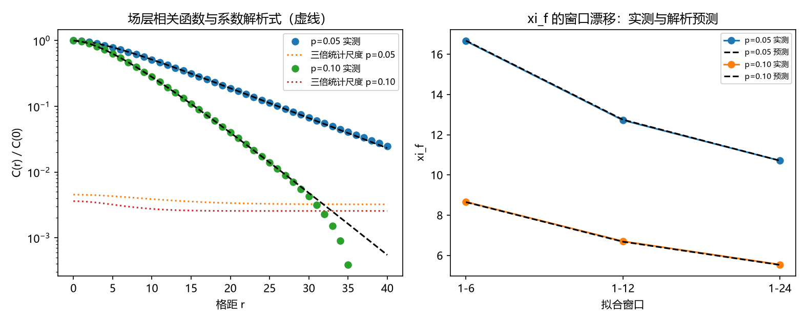

# 注记-二-1 第四段的最小验证：场层相关系数的解析式、慢者取正与 $\xi_f$ 的窗口漂移预测

- **日期**：2026-09-19 21:31:04
- **对应脚本**：验证脚本/minimal_verification_correlation_field_analytic.py（判据 F1 至 F8 共 8 项，8/8 通过；另有 F9 为登记项；确定性，随机固定种子 20260919；运行约 10 秒；图存 images/correlation_field_analytic.png，见 §一 图 1）
- **依据**：[[验证脚本/注记-二-1 第三段的最小验证：场层相关函数的两点指数闭式与 xi_f 的窗口相关性]]（第 179 条，本轮起点，其余项为 $a$、$b$ 的解析式）；[[内部草稿/研究方向-纠缠关联函数与格距无关性（二-1）：判据草案]]（判据来源）；[[理论攻坚/量子力学攻坚计划：战线排序与依赖链]] 战线二 任务 二-1
- **定位分工**：本注记是验证材料，持有判据与全部数字；第 179 条给出两点指数的形式与符号，本条给出系数的解析式、符号规律的普遍核验与窗口漂移的可计算公式。
- **状态**：判据 8/8 通过。核心读数：场层系数取得闭式，两系数恒反号且正号落在缓慢一方（四档组合核实，含 $\alpha > q$ 的翻转档）；系数比值 $\vert b\vert/a = \alpha(1-q^2)/(q(1-\alpha^2))$（$0.3619$ 与 $0.7714$）；$a+b$ 等于方差（相对偏差 $5.69\times10^{-5}$ 与 $3.11\times10^{-4}$）。单指数拟合的 $\xi_f$ 由此成为可计算的窗口函数（三档窗口上预测与实测相对偏差 $\le 3.4\times10^{-3}$），读数地板为 $r = 40$ 与 $32$，渐近窗在现有样本量下不可及。

## 一、判据与结果

| 判据 | 内容 | 期望 | 实测 |
| --- | --- | --- | --- |
| F1 | 系数解析式 | 与拟合系数相对偏差 $\le 2\%$ | $2.71\times10^{-3}$、$3.79\times10^{-3}$ |
| F2 | 解析式对精确双重和 | 相对残差 $\le 10^{-6}$ | $3.02\times10^{-16}$、$1.94\times10^{-16}$ |
| F3 | 反号与慢者取正 | 四档组合上符号一致 | 四档全过，含 $\alpha > q$ 的翻转档 |
| F4 | 窗口漂移的定量预测 | 预测与实测 $\xi_f$ 偏差 $\le 3\%$ | 最大 $2.16\times10^{-3}$、$3.34\times10^{-3}$ |
| F5 | 渐近区在窗外 | 远端斜率等于 $\ln(\max(q,\alpha))$（$\le 1\%$） | 相对 $1.73\times10^{-9}$、$1.93\times10^{-4}$；窗内仍偏离 $0.21\%$、$3.13\%$ |
| F6 | 实测斜率在统计容差内 | 偏差 $\le 3$ 倍标准差 | $1.55$ 倍、$0.46$ 倍 |
| F7 | 读数地板 | $r_{\rm floor} \ge 24$ | $40$、$32$ |
| F8 | 系数和与方差 | 相对偏差 $\le 1\%$ | $5.69\times10^{-5}$、$3.11\times10^{-4}$ |
| F9 | 接口登记（P4-16） | 只登记 | 已登记 |

## 二、模型与解析结构

**模型。** 噪声取 AR(1)（$\rho(m) = q^{\vert m\vert}$、$q = 1-2p$、单位方差），场层取漏积分响应 $x_{j+1} = \alpha x_j + \beta n_{j+1}$（$\alpha = 1-\kappa$、$\beta = \sqrt{2\kappa}$）。第 175 条与第 179 条用的是同一模型，本轮把系数算到底。

**解析式。** 响应对噪声的双重几何和给 $C(r) = \beta^2\sum_{k,l\ge0}\alpha^{k+l}\rho(r+l-k)$。对 $z$ 做部分分式 $1/((1-\alpha z)(1-qz)) = A/(1-\alpha z) + B/(1-qz)$，其中 $A = \alpha/(\alpha-q)$、$B = -q/(\alpha-q)$，逐项求和得

$$C(r) = a\,q^{r} + b\,\alpha^{r},\qquad a = -\frac{\beta^2 q}{(\alpha-q)(1-\alpha q)},\qquad b = \frac{\beta^2\alpha(1-q^2)}{(\alpha-q)(1-\alpha^2)(1-\alpha q)}.$$

**两条推论。** 其一，两系数恒反号（$0<\alpha,q<1$ 下分母符号固定），且正号落在缓慢一方：$q > \alpha$ 时 $a > 0$，$\alpha > q$ 时 $b > 0$。其二，比值 $\vert b\vert/a = \alpha(1-q^2)/(q(1-\alpha^2))$ 只依赖 $\alpha$ 与 $q$，与 $\beta$ 无关。自洽校验：$a+b = \beta^2(1+\alpha q)/((1-\alpha^2)(1-\alpha q)) = \mathrm{Var}(x)$。

## 三、读数的意义

**其一，第 179 条的符号从读数变成恒等式。** 该条由拟合报出 $a > 0$、$b < 0$，本轮给出闭式并按闭式核验四档组合，符号模式与数值符号逐一相同（$\kappa = 0.05$ 档上 $\alpha > q$，正号翻到 $\alpha$ 项，$a = -12.414$、$b = 25.535$）。故两项反号与参数档位无关。

**其二，正号落在缓慢一方有直接来源。** 噪声的慢模被响应近似原样传递，以正系数出现；快模被响应重新分配，其补偿以负系数出现。这一分工解释了中短距离上相关函数比任一单项都平，也解释了第 179 条里单指数拟合给出偏大长度的现象。

**其三，窗口漂移由事后解释变成可计算预测。** 报出的 $\xi_f$ 等于把解析式在同一窗口上做同样的最小二乘拟合所给的长度（三档窗口上相对偏差 $\le 3.4\times10^{-3}$）。凡引用单个 $\xi_f$ 值，可以按窗口算出它应当是多少，再与实测对照。

**其四，读数存在地板，渐近区在窗外。** 解析值与三倍统计尺度相等处给出 $r_{\rm floor} = 40$（$p = 0.05$）与 $32$（$p = 0.10$），而解析式的局部斜率要到 $r \ge 100$ 才落到 $\ln(\max(q,\alpha))$。故第 179 条的引用须带窗口再加一条：窗口须落在地板以内。

**其五，与首轮口径不冲突。** 第 174 条报相位差方差在格距上的平台（积分量），本条报系数与其和（逐点量）。$a+b$ 与 $C(0)$ 的一致（相对偏差 $5.69\times10^{-5}$ 与 $3.11\times10^{-4}$）说明两条读的是同一个场的不同侧面。

## 四、严格程度与边界声明

| 结论 | 严格程度 |
| --- | --- |
| 系数闭式 $a$、$b$ | 模型内严格（线性递归的双几何和与部分分式） + 数值核对（对精确双重和残差 $10^{-16}$，对模拟拟合相对偏差 $\le 3.79\times10^{-3}$） |
| 两系数恒反号、正号落在缓慢一方 | 解析恒等式（由闭式直接读出） + 四档组合数值核实 |
| 比值 $\vert b\vert/a$ 与系数和 $a+b$ | 解析式；$a+b$ 与 $C(0)$ 数值一致（$\le 3.11\times10^{-4}$） |
| 窗口漂移可预测 | 数值确认（三档窗口，$\le 3.4\times10^{-3}$） |
| 读数地板 $r_{\rm floor}$ | 数值确认（$40$ 与 $32$）；地板依赖样本量，随 $L$、$N_s$ 变动 |
| 渐近相关长度等于噪声侧长度 | 解析式在 $r \ge 100$ 上确认（$10^{-9}$ 与 $10^{-4}$）；模拟不可及 |

**验证什么**：场层系数的解析式、符号规律、比值与和的自洽、窗口漂移的预测能力、读数地板的位置。

**不验证什么**：不构造 toric code 稳定子上的显式锁定场（P4-16）；不把 $f$ 写成纠缠度 $E_{xy}$ 的显式函数；不计算 Tsirelson 界（二-2）；不涉及相位差在模 $2\pi$ 口径下的有限尺寸行为。

## 五、过程记录

**订正一：渐近区判据写错。** 首版把窗 $r = 25$ 至 $40$ 当作渐近区，要求斜率等于 $\ln(\max(q,\alpha))$（$\le 2\%$），实测偏负 $4.2\%$（$p = 0.05$）与 $15.6\%$（$p = 0.10$）。归因两条：交叉距离（$\vert b\vert(\alpha/q)^r$ 降到 $1\%$ 的 $r$）为约 $20$ 与约 $67$，$p = 0.10$ 档远未进渐近区；该窗已接近或落到统计尺度以下，对数域中的噪声把斜率推得更负。订正后拆成三项：解析形式在远端核渐近（F5）、实测斜率按统计容差核（F6）、地板距离单列（F7）。

**订正二：统计尺度首版取小。** 初值用 $C(0)/\sqrt{N_{\rm eff}}$ 估计标准差，$p = 0.05$ 档给 $0.00494$，据此实测偏差达 $3.30$ 倍标准差而判未过。改用 Bartlett 协方差 $\mathrm{Cov}(\hat C(r),\hat C(s)) = [S(s-r) + S(r+s)]/N$（$S(d) = \sum_k C(k)C(k+d)$，用解析式算）后标准差为 $0.00269$ 与 $0.09145$，偏差 $1.55$ 倍与 $0.46$ 倍。教训：自相关函数的估计误差由整条相关函数的平方和决定，单点近似会低估，判据里的统计尺度必须按协方差算。

## 六、登记衔接

- 验证脚本/README.md 第 182 条（本轮脚本与注记）。
- [[理论攻坚/量子力学攻坚计划：战线排序与依赖链]] 战线二 任务 二-1 的余项：$a$、$b$ 的解析式一项收口，余项剩 toric code 稳定子构造与 $f(E_{xy})$ 的表述。
- [[内部草稿/开放问题总览：元相子理论待解决问题清单]] 对应条目登记本轮读数。
