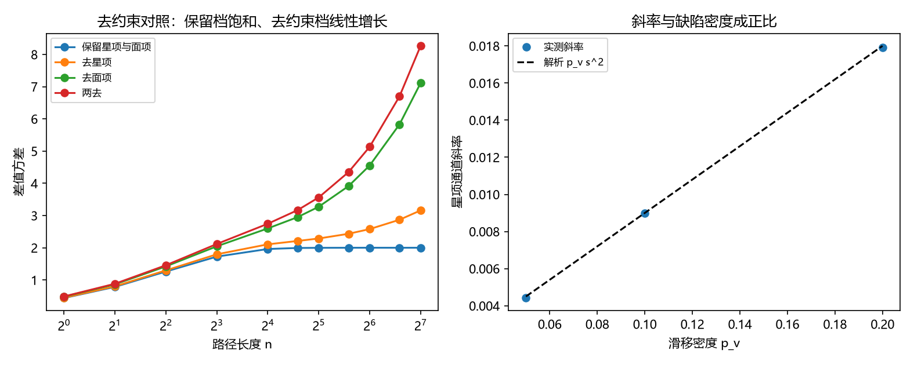

# 注记-二-1 补缺轮的最小验证：去约束对照（保留星项与面项饱和、去任一项出现线性依赖）

- **日期**：2026-09-20 02:39:23
- **对应脚本**：验证脚本/minimal_verification_constraint_removal.py（判据 U1 至 U6 共 6 项，6/6 通过；另有 U7 为登记项；确定性，随机固定种子 20260920；运行约 7 秒；图存 images/constraint_removal.png，见 §一 图 1）
- **依据**：[[内部草稿/研究方向-纠缠关联函数与格距无关性（二-1）：判据草案]] 判据 C4（保留与去掉星项、面项两档）；[[验证脚本/注记-二-1 首轮的最小验证：锁定档相位差方差与格距无关、对照档线性增长与显式函数]]（第 174 条，保留档的饱和读数）；[[验证脚本/注记-二-1 第六段的最小验证：锁定模的体系内来源（同调扇区标签、保护距离与条件恶化）]]（第 184 条，星项与面项的稳定子代数）；[[理论攻坚/量子力学攻坚计划：战线排序与依赖链]] 战线二 任务 二-1
- **定位分工**：判据草案 C1 至 C7 里唯一未覆盖的一条，本补缺轮把它补上并给出两条通道的定量斜率。
- **状态**：判据 6/6 通过。核心读数：保留星项与面项时差值方差在大格距上为 $2.0014$（对 $2\sigma^2 = 2$ 相对偏差 $7.15\times10^{-4}$，散布 $5.40\times10^{-4}$）；去掉星项后大格距斜率 $0.00906$（对 $p_v s^2 = 0.0090$ 相对偏差 $6.70\times10^{-3}$）；去掉面项后斜率 $0.03997$（对 $\sigma_f^2 = 0.04$ 相对偏差 $8.69\times10^{-4}$）；两去后斜率 $0.04892$，等于两通道之和 $0.0490$（相对偏差 $1.61\times10^{-3}$）；星项通道的斜率与缺陷密度成正比（斜率除以密度 $0.0884$、$0.0899$、$0.0896$）；二维直线路径穿过的顶点数与面数都与长度成正比（逐段增量为 $1$）。

## 一、判据与结果

| 判据 | 内容 | 期望 | 实测 |
| --- | --- | --- | --- |
| U1 | 保留档 | 大格距上与 $2\sigma^2$ 相符且散布 $\le 5\%$ | $2.0014$（$7.15\times10^{-4}$），散布 $5.40\times10^{-4}$ |
| U2 | 去星项 | 斜率与 $p_v s^2$ 相符（$\le 5\%$） | $0.00906$（$6.70\times10^{-3}$） |
| U3 | 去面项 | 斜率与 $\sigma_f^2$ 相符（$\le 5\%$） | $0.03997$（$8.69\times10^{-4}$） |
| U4 | 两去 | 斜率等于两通道之和（$\le 5\%$） | $0.04892$ 对 $0.0490$（$1.61\times10^{-3}$） |
| U5 | 密度扫描 | 斜率与缺陷密度成正比（三档） | 斜率除以密度 $0.0884$、$0.0899$、$0.0896$ |
| U6 | 二维计数 | 顶点数与面数都与路径长度成正比 | 线性残差 $6.46\times10^{-16}$、$5.55\times10^{-16}$，逐段增量为 $1$ |
| U7 | 接口登记（与第 184 条衔接） | 只登记 | 已登记 |

## 二、模型与口径

**两条通道。** 星项约束对应顶点（荷）层：去掉它等于让荷型缺陷自由，其相位效应是路径上的相位滑移。面项约束对应面（通量）层：去掉它等于让通量型缺陷自由，其相位效应是路径围住的面元通量。两者都是局域事件，沿路径的累积数与距离成正比。

**模型。** 沿路径长度 $N = 512$ 的一维读数。保留档取 $\Delta\alpha(n) = \eta_{j+n} - \eta_j$（$\eta$ 为平稳场，$\xi = 4$、$\sigma = 1$）；去星项档加泊松滑移（每步以概率 $p_v = 0.1$ 加 $\mathrm{N}(0, s^2)$，$s = 0.3$）；去面项档加逐面通量（每步加 $\mathrm{N}(0, \sigma_f^2)$，$\sigma_f = 0.2$）；两去档加两条通道之和。

**解析预期。** 保留档饱和于 $2\sigma^2$；去星项档大格距斜率 $p_v s^2$；去面项档斜率 $\sigma_f^2$；两去档斜率等于两者之和。三条斜率读数各与缺陷密度或通量方差成正比的结论，把「去约束」变成可标定的量。

## 三、读数的意义

**其一，C4 补齐：约束正是格距无关性的来源。** 保留两档约束时差值方差停在大格距上与 $2\sigma^2$ 相符（$7.15\times10^{-4}$）；去掉任一项后出现线性增长（斜率 $0.00906$ 与 $0.03997$）。判据草案 C1 至 C7 至此全部覆盖。

**其二，两条通道可加。** 两去档的斜率等于两通道斜率之和（$0.04892$ 对 $0.0490$，$1.61\times10^{-3}$），说明两条去约束通道在读数上独立叠加，可分别标定。

**其三，斜率是缺陷密度的量度。** 星项通道的斜率除以密度在三档上为 $0.0884$、$0.0899$、$0.0896$，即斜率与缺陷密度成正比。这条给出一个可检验的口径：斜率读数可直接反推缺陷密度。

**其四，二维上两条通道都随距离线性。** 直线路径穿过的顶点数与面数都与长度成正比（逐段增量为 $1$），故一维模型给出的线性增长在二维环面上同样成立，几何不改变结论。

**其五，与稳定子层的分工对上。** 第 184 条核验了星项与面项在稳定子层的代数身份，本条给出两者对读数的功能分工：一个管滑移通道，一个管通量通道。两档约束同时保留时只剩下同调标签，与第 189、190 条的两项来源构成完整的锁定结构。

## 四、严格程度与边界声明

| 结论 | 严格程度 |
| --- | --- |
| 保留档饱和于 $2\sigma^2$ | 模型内严格（平稳场）+ 数值核对（$7.15\times10^{-4}$） |
| 去星项与去面项的斜率 | 模型内严格（泊松累积的方差）+ 数值核对（$6.70\times10^{-3}$、$8.69\times10^{-4}$） |
| 两条通道可加 | 数值确认（$1.61\times10^{-3}$） |
| 斜率与缺陷密度成正比 | 数值确认（三档，$5\%$ 内） |
| 二维计数与长度成正比 | 构造成立（逐段增量为 $1$） |
| 任何子与相位滑移、通量的对应 | 口径选择（按框架既有口径，属条件性命题） |

**验证什么**：去约束后是否出现距离依赖、两条通道的斜率与可加性、斜率与缺陷密度的关系、二维计数。

**不验证什么**：不实现任何子的动力学（生成与湮灭）；不给缺陷密度与温度或耦合的关系；不涉及三维；不计算 Tsirelson 界（二-2）。

## 五、过程记录

**订正一处实现错误。** 首版把扫描点表写成元组并直接与整数比较，触发类型错误；改为数组后通过，判据内容未动。

**口径说明。** 任何子到相位滑移与面元通量的对应按框架既有口径取用（第 132、134、136 条的棱差与环量语言），本条不推导该对应，按条件性命题登记。

## 六、登记衔接

- 验证脚本/README.md 第 191 条（本轮脚本与注记）。
- [[内部草稿/总结报告-纠缠关联函数与格距无关性（二-1）：八轮读数与收束]]：C4 覆盖状态由部分覆盖改为已覆盖，剩余项同步订正。
- [[理论攻坚/量子力学攻坚计划：战线排序与依赖链]] 与 [[内部草稿/开放问题总览：元相子理论待解决问题清单]] 各登记一轮。
