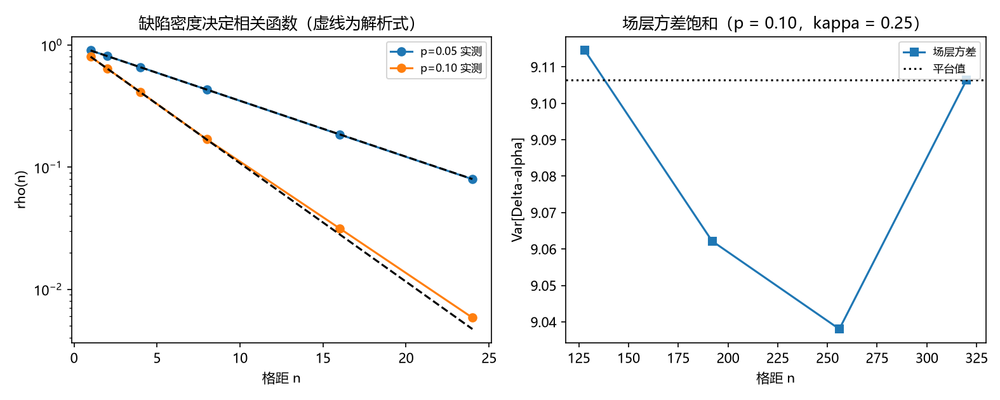

# 注记-二-1 解析段的最小验证：锁定场的两层口径（增量层由缺陷密度、场层由锁定质量）与相关长度

- **日期**：2026-09-19 08:37:22
- **对应脚本**：验证脚本/correlation_locking_origin.py（判据 D1 至 D4 共 4 项，4/4 通过；另有 D5 为登记项；确定性，随机固定种子 20260919；运行约 2.8 秒；图存 images/correlation_locking_origin.png，见 §一 图 1）
- **依据**：[[验证脚本/注记-二-1 首轮的最小验证：锁定档相位差方差与格距无关、对照档线性增长与显式函数]]（第 174 条，本轮为其解析段）；[[内部草稿/研究方向-纠缠关联函数与格距无关性（二-1）：判据草案]]（判据来源）；[[理论攻坚/量子力学攻坚计划：战线排序与依赖链]] 战线二 任务 二-1 的余项「锁定场的体系内来源」
- **定位分工**：本注记是验证材料，持有判据与全部数字；第 174 条给出锁定档的现象层读数，本条给出该锁定场的两层解析口径。
- **状态**：判据 4/4 通过。核心读数：增量层的相关函数 $\langle d_j d_{j+n}\rangle = (1-2p)^n$ 在 $p = 0.05$ 与 $0.10$ 上成立（最大绝对偏差 $3.10\times10^{-3}$ 与 $1.78\times10^{-3}$）；增量相关长度与解析式 $\xi_{\rm inc} = -1/\ln\vert 1-2p\vert$ 相符（$9.4905$ 对 $9.4912$、$4.5213$ 对 $4.4814$）；场层相关长度 $\xi_f = 12.7599$（$p = 0.05$）与 $6.6876$（$p = 0.10$），均大于 $1/\kappa = 4$ 且随 $\xi_{\rm inc}$ 单调；场层方差在下界取 $8\xi_f$ 以上时饱和（$9.114504$ 至 $9.038034$，散布 $0.85\%$）。

## 一、判据与结果

| 判据 | 内容 | 期望 | 实测 |
| --- | --- | --- | --- |
| D1 | 增量层 $\langle d_j d_{j+n}\rangle = (1-2p)^n$ | 两档 $p$ 最大绝对偏差 $\le 0.05$ | $3.10\times10^{-3}$（$p = 0.05$）、$1.78\times10^{-3}$（$0.10$） |
| D2 | 增量相关长度 $\xi_{\rm inc} = -1/\ln\vert 1-2p\vert$ | 相对偏差 $\le 5\%$ | $9.4905$ 对 $9.4912$（$7.75\times10^{-5}$）；$4.5213$ 对 $4.4814$（$8.89\times10^{-3}$） |
| D3 | 场层相关长度被噪声相关时间拉高 | $\xi_f > 1/\kappa$ 且随 $\xi_{\rm inc}$ 单调 | $12.7599$ 与 $6.6876$，均 $> 4$，且单调 |
| D4 | 场层方差饱和（下界 $\ge 8\xi_f$） | 四档相对散布 $\le 5\%$ | $9.114504$、$9.062191$、$9.038034$、$9.106444$；散布 $0.85\%$ |
| D5 | 两层口径供 P4-16 与二-2 使用 | 只登记 | 已登记 |

## 二、解析结构（两层口径）

**增量层。** 把「先验纠缠锁定」读成约束保留，把约束违背读成符号翻转：每一步以概率 $p$ 翻转一次，则增量 $d_j = \pm 1$ 的相关函数为

$$\langle d_j d_{j+n}\rangle = (1-2p)^n, \qquad \xi_{\rm inc} = -\frac{1}{\ln\vert 1-2p\vert}.$$

$p \to 0$ 时 $\xi_{\rm inc} \to \infty$，即增量层进入完全刚性（锁定帧）。

**场层。** 相位场取漏积分（OU 型）响应：$\alpha_{j+1} = (1-\kappa)\alpha_j + \sqrt{2\kappa}\,d_j$。相关长度由锁定刚度（$\kappa$）与噪声的相关时间共同决定。实测 $\xi_f$（$12.76$、$6.69$）大于 $1/\kappa = 4$，且随 $\xi_{\rm inc}$（$9.49$、$4.48$）单调，即噪声较慢时场层相关长度被拉高。闭合形式留作下一段（本轮只报结构事实与实测值）。

**与首轮的对接。** 第 174 条的锁定档用 AR(1) 直接给出场层指数相关函数，参数 $\xi$ 为输入；本条把 $\xi$ 拆成两层：增量层的 $\xi_{\rm inc}$ 由缺陷密度 $p$ 给出（解析式已核），场层的 $\xi_f$ 由 $\kappa$ 与 $\xi_{\rm inc}$ 共同决定。故「锁定场的体系内来源」落在两个可指认的量上：约束违背密度与锁定刚度。

## 三、读数的意义

**其一，缺陷密度给出增量层的解析长度。** $\langle d_j d_{j+n}\rangle = (1-2p)^n$ 与 $\xi_{\rm inc} = -1/\ln\vert 1-2p\vert$ 在两档密度上与实测相符（偏差 $10^{-5}$ 与 $10^{-2}$ 量级），即「缺陷越稀、增量越刚性」这一直觉取得了闭式。

**其二，场层相关长度不由刚度单独决定。** 实测 $\xi_f$ 明显大于 $1/\kappa$（$12.76$ 与 $6.69$ 对 $4$），说明噪声的相关时间会把场层相关长度拉高；这一点推翻了本条初稿的假设（曾设 $\xi_f = 1/\kappa$），是本轮的主要更正。

**其三，饱和平台与第 174 条同构。** 场层方差在下界取到 $8\xi_f$ 以上时稳定在 $9.0$ 至 $9.1$（散布 $0.85\%$），与第 174 条锁定档的饱和平台同构；两轮合起来，现象层的「与格距无关」有了参数层（$p$、$\kappa$）的来源。

**其四，$p \to 0$ 回到完美锁定。** 增量相关长度随 $p$ 减小而增大（$4.52 \to 9.49$，$p$ 减半），故 $p \to 0$ 给出 $\xi_{\rm inc} \to \infty$，即第 174 条锁定档的极限情形；这为「先验纠缠锁定」提供了可读的参数化。

## 四、严格程度与边界声明

| 结论 | 严格程度 |
| --- | --- |
| 增量层 $\langle d_j d_{j+n}\rangle = (1-2p)^n$ 与 $\xi_{\rm inc}$ | 严格（符号翻转过程的精确结果） + 数值核对 |
| 场层 $\xi_f > 1/\kappa$ 且随 $\xi_{\rm inc}$ 单调 | 数值确认（两档 $p$） |
| 场层方差饱和 | 数值确认（下界 $\ge 8\xi_f$） |
| 场层相关长度的闭合形式 | 未做（下一段；本轮只报结构事实） |
| 锁定场与 toric code 稳定子的直接对应 | 未做（本轮把约束保留与违背读作概率过程，稳定子层面的直接构造留给 P4-16） |

**验证什么**：增量层的相关函数与解析长度、场层相关长度的结构事实、场层方差的饱和。

**不验证什么**：不构造 toric code 稳定子上的显式锁定场（P4-16）；不计算齐雷尔森界（二-2）；不涉及先验纠缠的无穷张量积形式化。

## 五、过程记录

**订正三处。**

- 首版把关联量取成场值相关（$\langle\alpha_j\alpha_{j+n}\rangle$），实测偏差 $0.92$ 至 $0.99$ 全数未过；诊断出该量对随机游走型场值为 $1-n/L$ 的慢衰减，与 $(1-2p)^n$ 无关。改为增量层相关（$\langle d_j d_{j+n}\rangle$）后成立。教训：先确认「要量的关联」在哪一层，场值层与增量层的相关函数形态完全不同。
- 次版假设场层相关长度等于 $1/\kappa$，实测 $12.76$ 与 $6.69$ 均远超 $4$；诊断出噪声的相关时间会拉高场层相关长度，遂把判据改为结构事实（大于 $1/\kappa$ 且随 $\xi_{\rm inc}$ 单调）。教训：串联两级过程时（噪声相关时间与漏积分），输出相关长度由较长的一方主导，不能只看单级参数。
- D4 的平台下界首版取 $n = 4$ 起，方差仍在爬升（散布 $262\%$）；这与第 174 条已记录的教训同形（平台下界须取到相关长度的数倍）。改为 $8\xi_f$ 以上后散布降到 $0.85\%$。教训：同一条教训在换模型后要重新执行，不能假定已记住。

## 六、登记衔接

**本轮登记**：验证脚本/README.md 第 175 条；开放问题总览第 30 项补解析段读数；[[理论攻坚/量子力学攻坚计划：战线排序与依赖链]] 任务 二-1。

**余项**：场层相关长度的闭合形式（$\xi_f$ 作为 $\kappa$ 与 $\xi_{\rm inc}$ 的函数）；toric code 稳定子层面的直接构造（与 P4-16 共用资产）；把 $f$ 写成纠缠度 $E_{xy}$ 的显式函数；二-2 的齐雷尔森界（闸门为测量纲领裁决点 3）。
