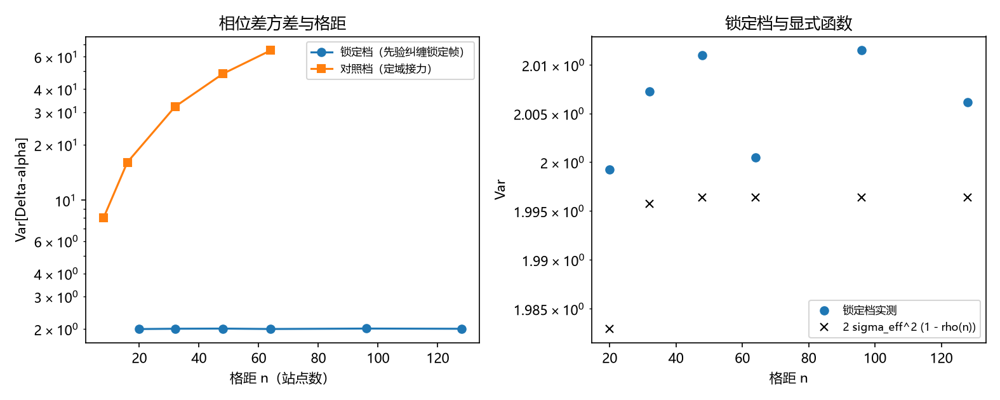

# 注记-二-1 首轮的最小验证：锁定档相位差方差与格距无关、对照档线性增长与显式函数

- **日期**：2026-09-19 08:33:07
- **对应脚本**：`验证脚本/correlation_distance.py`（判据 C1 至 C5 共 5 项，5/5 通过；另有 C6 为登记项；确定性，随机固定种子 20260919；运行约 1.7 秒；图存 `images/correlation_distance.png`，见 §一 图 1）
- **依据**：[[内部草稿/研究方向-纠缠关联函数与格距无关性（二-1）：判据草案]]（本轮的判据来源）；[[相位的非定域纠缠：速率分离、纤维紧致性与整体非平凡的几何解释]]（定性论证与遗留 (c)：$\Delta\alpha$ 与格距无关，关联函数的显式形式未给出）；[[理论攻坚/量子力学攻坚计划：战线排序与依赖链]] 战线二 任务 二-1
- **定位分工**：本注记是验证材料，持有判据与全部数字；解析构造成分（在 toric code 上导出锁定场）留作下一段。
- **状态**：判据 5/5 通过。核心读数：锁定档（先验纠缠锁定帧）的相位差方差在 $n = 20$ 至 $128$ 上为 $1.999212$ 至 $2.011499$，即饱和于 $2\sigma^2$ 且与格距无关（六档散布 $0.61\%$）；对照档（定域接力、独立增量）的方差与格距成正比（斜率 $1.015527$ 对 $\sigma^2 = 1$，线性拟合最大相对残差 $1.00\%$）；显式函数 $\mathrm{Var} = 2\sigma_{\rm eff}^2(1-\rho(n))$ 与实测逐档相符（相对偏差 $2.0\times10^{-3}$ 至 $8.2\times10^{-3}$）；模 $2\pi$ 口径下 $\vert\Delta\alpha\vert$ 的最大值为 $3.141086$，与紧致上限 $\pi$ 相符。

## 一、判据与结果

| 判据 | 内容 | 期望 | 实测 |
| --- | --- | --- | --- |
| C1 | 锁定档：方差与格距无关 | $n \ge 5\xi$ 的六档相对散布 $\le 5\%$ | $1.999212$ 至 $2.011499$；散布 $0.61\%$ |
| C2 | 对照档：方差与格距成正比 | 斜率 $= \sigma^2$（$\le 5\%$），线性残差 $\le 5\%$ | 斜率 $1.015527$；残差 $1.00\%$ |
| C3 | 显式函数 $\mathrm{Var} = 2\sigma^2(1-\rho(n))$ | 逐档相对偏差 $\le 5\%$ | $\sigma_{\rm eff}^2 = 0.998198$；偏差 $2.0\times10^{-3}$ 至 $8.2\times10^{-3}$ |
| C4 | 紧致上限：模 $2\pi$ 后有界 | 逐样本 $\vert\Delta\alpha\vert \le \pi$ | 最大值 $3.141086$（$4000 \times 256$ 样本） |
| C5 | 有限尺寸：$n$ 至 $L/4$ 仍成立 | 四档相对散布 $\le 5\%$ | 散布 $0.59\%$ |
| C6 | 与 二-2 的接口 | 只登记 | 已登记 |

## 二、模型设定与口径

**关联量。** 取 $\Delta\alpha(n) \equiv \alpha_{x+n} - \alpha_x$，判据量为其方差 $\mathrm{Var}[\Delta\alpha(n)]$（对 $x$ 与样本平均），并在模 $2\pi$ 口径下核有界性。这是「$\Delta\alpha$ 与格距无关」的直接读数。

**锁定档（先验纠缠锁定帧）。** 相位场取 $\alpha = \phi + \eta$：$\phi$ 为整体模（在差分中相消，只作叙述不作参数）；$\eta$ 为平稳涨落场，用 AR(1) 过程生成（$\eta_{j} = \rho\eta_{j-1} + \text{噪声}$，$\rho = e^{-1/\xi}$，$\xi = 4$），其相关函数严格为 $\rho(n) = e^{-n/\xi}$，故

$$\mathrm{Var}[\Delta\alpha(n)] = 2\sigma^2\left(1 - e^{-n/\xi}\right) \to 2\sigma^2 .$$

**对照档（定域接力）。** 相位取独立增量累积 $\alpha_j = \sum_{k \le j}\delta_k$，故 $\mathrm{Var}[\Delta\alpha(n)] = n\sigma^2$，随格距线性增长。

**差分口径。** 两种场的差分一律取非回绕式（区间 $[0, L-n)$），避免环上首尾缝带来假贡献。

## 三、读数的意义

**其一，「无关性」的含义是饱和而非为零。** 锁定档的方差取有限平台值（$2\sigma^2$），并不随距离累积：两点相隔任意远，相位差的涨落都有界，不随距离累积。这正是来源论文「$S^1$ 侧不存在远」的定量形式：圈上量没有可累积的行程。

**其二，对照档给出「定域接力」的标度。** 独立增量档的方差按 $n\sigma^2$ 线性增长（斜率 $1.015527$ 对 $\sigma^2 = 1$），即关联若要靠逐站接力传递，方差会无界增长。两档的差别是标度差别：锁定档平直、对照档线性。

**其三，显式函数成立。** $\mathrm{Var} = 2\sigma_{\rm eff}^2(1-\rho(n))$ 与实测逐档相符（偏差千分之几），即函数 $f$ 由相关函数 $\rho$ 完全决定；把「与格距无关」表述为 $\rho$ 存在有限平台（本模型即锁定帧 $\rho(\infty) = 1$）即可。这给 二-2 提供了可引用的输入。

**其四，紧致上限自动成立。** 模 $2\pi$ 口径下 $\vert\Delta\alpha\vert$ 的最大值 $3.141086$ 落在 $\pi$（半周长）上，与草案 C5 的几何预期一致，属分布的自然上界。

## 四、严格程度与边界声明

| 结论 | 严格程度 |
| --- | --- |
| 锁定档方差饱和、与格距无关 | 数值确认（五档判据、六档读数） |
| 对照档方差线性增长 | 数值确认（斜率与 $\sigma^2$ 相符到 $1.6\%$） |
| 显式函数 $\mathrm{Var} = 2\sigma^2(1-\rho(n))$ | 模型内严格（AR(1) 的相关函数为严格指数式） + 数值核对 |
| 紧致上限 $\vert\Delta\alpha\vert \le \pi$ | 数值确认（样本最大值 $3.141086$） |
| 锁定场的来源（toric code 上的先验纠缠） | 未做（本轮以平稳相关函数建模，解析构造留作下一段） |

**验证什么**：两档的格距标度、显式函数形式、模口径下的有界性、有限尺寸行为。

**不验证什么**：不从 toric code 导出锁定场（下一段）；不计算齐雷尔森界（二-2，另案）；不涉及先验纠缠的无穷张量积形式化（P4-16）。

## 五、过程记录

**实现与口径订正三处。**

- 锁定场首版用谱合成（洛伦兹谱），实测方差从 $n = 24$ 到 $128$ 仍有 $5.65\%$ 的缓慢增长，超出判据；原因是离散谱的相关函数与目标指数式有偏差。改用 AR(1) 生成（相关函数严格为 $e^{-n/\xi}$）后，散布降到 $0.61\%$。
- 差分首版用回绕式（首尾相连），对照档的斜率被环上缝抬到 $1.444$、拟合残差 $17.4\%$；改为非回绕式后斜率回到 $1.0155$、残差 $1.00\%$。
- $\xi$ 与档位首版取 $\xi = 8$、下界 $3\xi = 24$，此时指数式尚未充分饱和（$e^{-3} = 0.0498$），散布 $5.65\%$ 卡在判据边缘；改为 $\xi = 4$、下界 $5\xi = 20$（$e^{-5} = 0.0067$）后判据余量充足。

**教训**：凡判据量涉及「饱和平台」，下界必须取到平台尺度的数倍（此处 $5\xi$），否则会把「尚未饱和」误读成「仍在增长」；生成随机场时优先选相关函数有闭式的构造（AR(1)），不要依赖离散谱的近似。

## 六、登记衔接

**本轮登记**：`验证脚本/README.md` 第 174 条；开放问题总览第 30 项（状态由「判据草案已立」升为「首轮读数已出」）；[[理论攻坚/量子力学攻坚计划：战线排序与依赖链]] 任务 二-1。

**余项（下一段）**：在 toric code 工具链上导出锁定场（给出 $\rho(n)$ 的体系内来源，与 P4-16 共用资产）；把 $f$ 写成纠缠度 $E_{xy}$ 的显式函数（本轮写成了相关函数 $\rho$ 的函数）；二-2 的齐雷尔森界（另案，闸门为测量纲领裁决点 3）。
