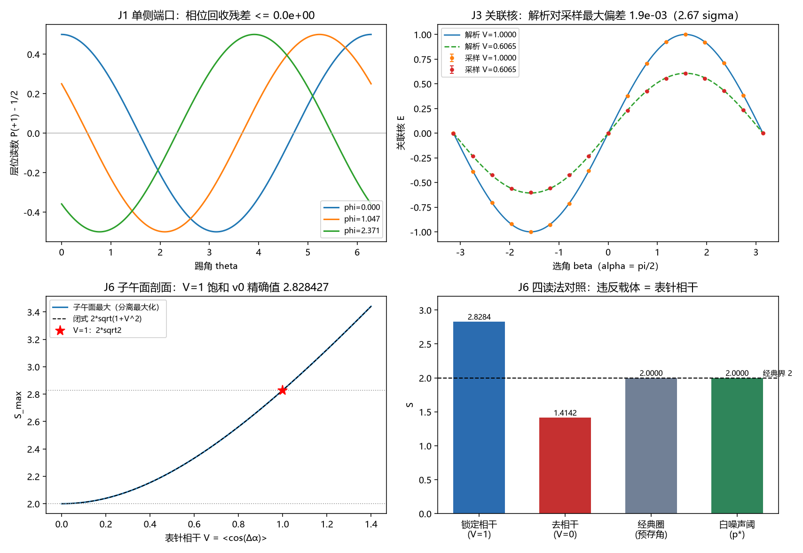

# 注记-二-2 路径甲迁移轮的最小验证：由快照相位分布到 CHSH 的体系内计算

- **日期**：2026-09-23 13:38:48
- **脚本**：`验证脚本/minimal_verification_tsirelson_pathA.py`（种子 20260914，采样每设置对 $N = 2\times10^6$，全确定性）
- **图**：见 §五 图 1（`images/minimal_verification_tsirelson_pathA.png`）
- **定位**：战线二（P1-29）任务 二-2 路径甲迁移轮。判据草案见 [[研究方向-二-2 路径甲：由快照相位分布到 CHSH 的体系内计算（判据草案）]]；本轮把 v0 的构造输入（纠缠锁定态 $|\Phi_\gamma\rangle$）替换为体系自己的读数链：快照相位分布（M4）、相对表针 $\Delta\alpha$ 关联（二-1）、锁定对通道相关、关联核、CHSH 组合。迁移口径为换语言不换数字：与 v0 同参数点的精确量逐位对齐，采样量在联合误差内对齐。
- **关联**：[[贝尔违反的场侧闸门：纠缠锁定对、经典圈对照与可见度阈]]（v0 命题 1 至 7）、[[注记-Tsirelson生死闸门v0的最小验证：纠缠锁定对、经典圈对照与可见度阈]]（v0 判据 J1 至 J10 与 J6b，12/12）、[[注记-单系统Born采样的最小验证：相位均匀性与份额角向采样]]（M4 快照相位均匀性）、[[锁定帧与格距无关性：先验纠缠的定量形式化]]（命题 19 至 25：锁定刚度、联合条件、剖面接口）、[[开放问题总览：元相子理论待解决问题清单]]（P1-29）

---

## 一、判据（运行前写死）

| 序 | 判据 | 验收数值 |
|---|---|---|
| J1 | 单侧端口：零模踢加层位读出给余弦条纹；可见度 $=1$；解析相位回收；采样回收 | 1e-12；3 个快照相位；$5\sigma$（$2\times10^5$ 发/点） |
| J2 | 快照测度：单侧边际 $=\tfrac12$ 对一切踢角；联合律边际恒等式；对侧选角三档采样 $\vert\langle a\rangle\vert$ | 1e-15；1e-15；$5\sigma$（$3\times10^5$ 发/档） |
| J3 | 关联核：解析对采样逐点一致（两档 $\Delta\alpha$：锐值与 wrapped 族 $v=1$；13 个 $\beta$ 乘两组 $\alpha$）；闭式 $\langle\cos\Delta\alpha\rangle = e^{-v/2}$ 对采样 | 每点 $3\sigma$（$\sigma = 1/\sqrt{N} = 7.1\times10^{-4}$）；$5\times10^{-3}$ |
| J6 | 数字对齐：$V=1$ 最优角 $S$；采样 $\hat S$ 对 v0 记录值；越经典界 $z$；子午面 $\max S$（$V=1$ 与 $V=0$）；退相干同角组；LHV 穷举；$p^*$ 处混合读数 | 1e-12；$3\sigma$；$\ge 800$；1e-6；1e-12；恰 2；恰 2 |

## 二、模型设定

相位语言把 v0 的态矢量换成三件体系内读数。其一，快照相位：每粒子的表针相位 $\phi$ 取均匀测度（M4 的条件性命题：随机触发、与系统无共同零点、噪声抹匀），单侧边际由此恒为 $\tfrac12$。

其二，锁定对的两条通道相关：层位对层位相关 $=1$（联合分支锁定），表针对表针相关 $=\langle\cos\Delta\alpha\rangle = V$（二-1 的相对表针读数；$\Delta\alpha$ 取同心 wrapped 族，闭式 $V = e^{-v/2}$ 与第 236 条的 $m=1$ 矩一致），交叉通道相关 $=0$（象限正交）。

其三，Ramsey 链读数：踢角 $\alpha$ 后读层位，给出 $\cos\alpha\,Z + \sin\alpha\,X$ 的相干混合（v0 命题 7 的相位语言形态）。由边际 $\tfrac12$ 与三条通道相关唯一确定联合读数律 $P(a,b) = \tfrac14[1 + a b\,E]$，其关联核为

$$E(\alpha,\beta) = \cos\alpha\cos\beta + V\sin\alpha\sin\beta.$$

$V=1$ 时该核化为 v0 的 $E = \cos(\alpha-\beta)$，$V=0$ 时化为退相干控制态的 $E = \cos\alpha\cos\beta$。同一式在两个锚点上复现 v0 的读数，这是本轮的关键一致性检验：平移不变形式 $V\cos(\alpha-\beta)$ 在 $V \to 0$ 时给 $S \to 0$，与 v0 命题 5 的 $S = \sqrt2$ 不相容。

## 三、结果（实测 vs 期望）

| 判据 | 实测 | 期望 | 判定 |
|---|---|---|---|
| J1 可见度（解析） | $1.00000000000000$ | $1$ | 过 |
| J1 相位回收（解析 / 采样） | $\le 0$ / $7.5\times10^{-4}$ | $10^{-12}$ / $5\sigma = 1.1\times10^{-2}$ | 过 |
| J2 单侧边际（踢角扫描） | $0.0$ | $10^{-15}$ | 过 |
| J2 边际恒等式 | $0.0$ | $10^{-15}$ | 过 |
| J2 采样 $\vert\langle a\rangle\vert$ | $3.0\times10^{-3}$ | $5\sigma = 9.1\times10^{-3}$ | 过 |
| J3 解析对采样最大偏差 | $1.9\times10^{-3} = 2.67\sigma$ | $3\sigma$ | 过 |
| J3 $\langle\cos\Delta\alpha\rangle$ | $0.606934$ | $e^{-1/2} = 0.606531$（差 $4.0\times10^{-4}$） | 过 |
| J6 $S$（解析，$V=1$） | $2.82842712474619$ | v0 的 $2.82842712474619$（差 $4.4\times10^{-16}$） | 过 |
| J6 $\hat S$（采样） | $2.82837\pm0.00100$ | v0 的 $2.82692\pm0.00100$（差 $1.02\sigma$） | 过 |
| J6 越经典界 | $z = 828$ | $\ge 800$ | 过 |
| J6 子午面 $\max S$ | $2.828427125$（$V=1$）、$2.000000$（$V=0$） | $2\sqrt2$、$2$ | 过 |
| J6 退相干同角组 | $1.414213562373$ | $\sqrt2$ | 过 |
| J6 LHV 穷举封顶 | $2.0$ | $2$ | 过 |
| J6 $p^*$ 处混合读数 | $2.000000$ | 恰经典界 $2$ | 过 |

汇总 $4/4$ 通过。$V=1$ 的采样值与 v0 记录差 $1.02\sigma$：两者共用种子 20260914 与 $N = 2\times10^6$，抽样算法不同（v0 抽四维 Born 分布，本轮抽联合读数律），故采样半按统计口径对齐、精确半逐位对齐；越界 $z$ 为 828 对 v0 的 827。

## 四、口径修正（相对判据草案）

其一，关联核改写为通道形式 $E = \cos\alpha\cos\beta + V\sin\alpha\sin\beta$。草案 §二 第三步与 J3 行原写 $E = V\langle\cos(\Delta\alpha+\theta_A-\theta_B)\rangle$，该形式平移不变，与两个锚点不相容：$V \to 0$ 时给 $S \to 0$，而 v0 命题 5 的退相干控制为 $S = \sqrt2$；且它无法复现子午面剖面 $2\sqrt{1+\cos^2\Delta\alpha}$（命题 3 与命题 24 的接口）。通道形式同时复现两个锚点，故采纳。

其二，子午面口径与白噪声口径分列。$S_{\max} = 2\sqrt{1+V^2}$ 属子午面读数族的全角最大；$S = 2\sqrt2\,p$（$p$ 为白噪声混合权重，阈 $p^* = 1/\sqrt2$）属另一机制，v0 判据 J7 已证。草案 J5 行原写的 $S_{\max} = 2\sqrt2\,V(v)$ 把两者混同，本轮分列登记。

其三，J3 的采样阈值口径。草案写 $\le 10^{-3}$，该档对应解析量；解析对采样时单点统计误差为 $\sigma = 1/\sqrt N = 7.1\times10^{-4}$，故判据口径改为每点 $3\sigma$，实测最大偏差 $2.67\sigma$。

## 五、图

图 1 四联。左上为 J1 单侧条纹：三个快照相位的 $P(+1)-\tfrac12$ 曲线，解析相位回收残差为零。右上为 J3 关联核：$\alpha = \pi/2$ 下两档 $V$ 的解析曲线与采样点（带误差棒）。左下为 J6 子午面剖面：分离最大化（数值）对闭式 $2\sqrt{1+V^2}$，$V=1$ 处标出 $2\sqrt2$。右下为四读法对照：锁定相干 $2.8284$、去相干 $1.4142$、经典圈 $2.0000$、白噪声阈 $2.0000$，经典界线在 $2$。

## 六、边界声明

**验证什么**：路径甲读数链能把 v0 的全部关键数字在同一模型口径内复现，态矢量输入由此替换为体系内读数（快照相位分布、相对表针关联、通道相关、联合读数律）。

**不验证什么**：不重开 v0 的存在性与上界两颚；不给 Y 象限全空间口径（相位语言侧的重组合第二组合方式未合成，该口径仍以 v0 判据 J10 为凭据）；$V$ 表与联合条件窗的对照归增强轮 J5；空间分离的全场实现归方向二（P4-5 同族）；$2\sqrt2$ 的原理级来源归方向三。

## 七、结论

迁移轮 $4/4$ 通过，路径甲的读数链在模型内闭合到与 v0 同数：$S = 2\sqrt2$ 精确、采样越经典界 $z = 828$、子午面剖面在 $V=1$ 饱和。判据草案按本轮结果修正三处口径（关联核形式、两个 $S_{\max}$ 口径分列、J3 采样阈值）。下行路线：增强轮 J5（$V$ 表与联合条件窗、门槛闭式对照）、J4 的 Y 象限口径与 J7、J8 收口。
